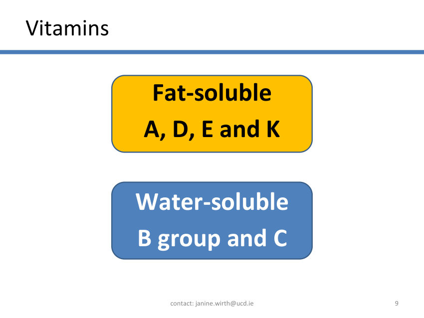
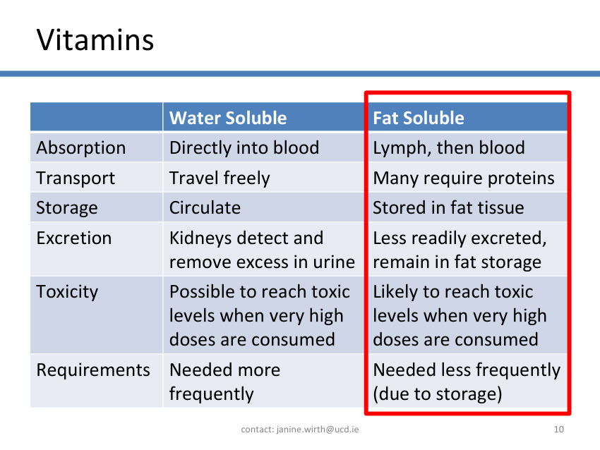
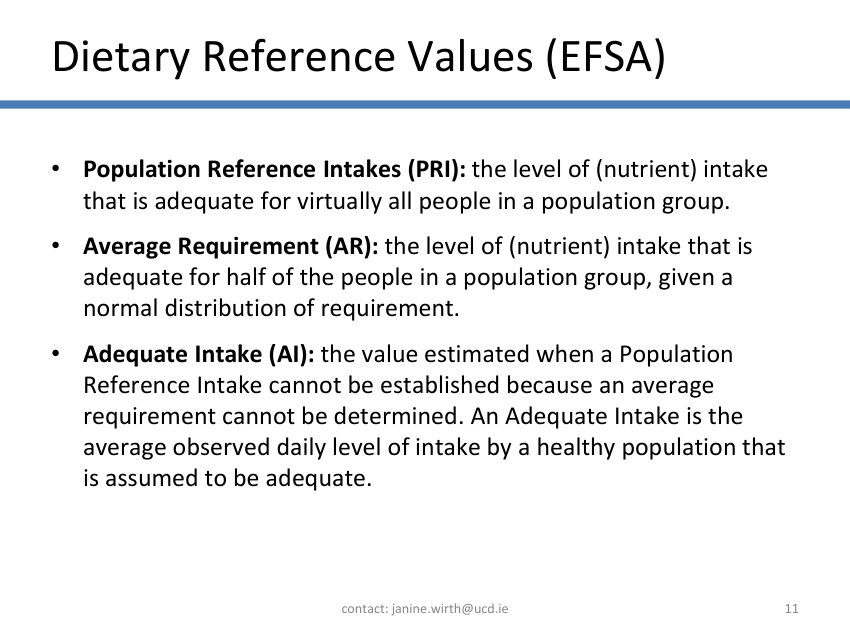
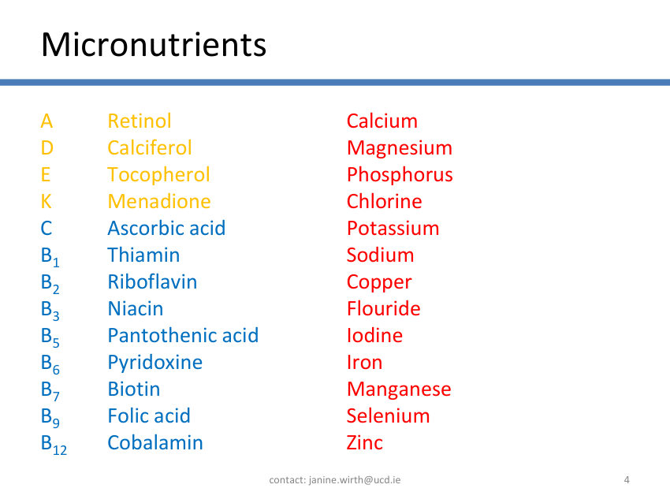
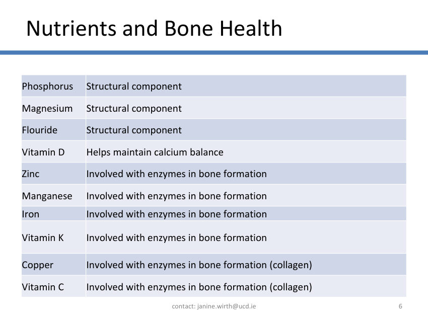

# Topic 1 — Vitamins: the basics

Slides: Lecture 12 (Vitamins A & K), pages 4 to 11

---

## The big idea

A vitamin is something the body **cannot make**, so it must come from food.

Too little gives a **deficiency disease**. Give it back and the disease is cured.

Vitamins come in two families: **fat-soluble** (A, D, E, K) and **water-soluble** (B group and C).

The family decides how a vitamin is **absorbed, carried, stored and excreted**, and how easy it is to overdose.

Intake targets come from **dietary reference values**: PRI, AR and AI.

---

**How to use these notes:**
When you see 🧠, stop.
Say the answer out loud or write it down.
Then click to check.

---

## ⭐ Learn by heart from this topic

**1. Fat-soluble vs water-soluble.** Cover one column and say it from memory.

| | Water-soluble | Fat-soluble |
|---|---|---|
| Which vitamins | B group and C | A, D, E, K |
| Absorption | Directly into blood | Lymph, then blood |
| Transport | Travel freely | Many require carrier proteins |
| Storage | Circulate | Stored in fat tissue |
| Excretion | Kidneys detect and remove excess in urine | Less readily excreted, remain in fat storage |
| Toxicity | Possible at very high doses | Likely at very high doses |
| Requirements | Needed more frequently | Needed less frequently, because of storage |

 

**2. The three EFSA dietary reference values.**

| Value | Meaning |
|---|---|
| **PRI** Population Reference Intake | Intake that is adequate for virtually all people in a population group |
| **AR** Average Requirement | Intake that is adequate for half the people in a population group |
| **AI** Adequate Intake | Used when a PRI cannot be set because no AR can be found. It is the average intake of a healthy population, assumed to be adequate |

**Memory hook:** AR is for half. PRI is for nearly all. AI is the fallback.

---

## 1. What a vitamin is

Five things make a vitamin a vitamin (slide 8):

| Rule | What it means |
|---|---|
| Most are **not made in the body** | So they are needed from the diet |
| **Deficiency causes disease, repletion cures it** | This is where the name comes from: "vital amine" |
| **No chemical structure in common** | Vitamins are a mixed bag of molecules |
| **Do not yield energy** | They are not fuel. They help the reactions that make energy |
| Needed in **small amounts** | Micrograms (µg) or milligrams (mg) |

 

**Why "vital amine"?**
The first vitamins found were amines. The name stuck even though most vitamins are not amines.

 

**Link to the course:** the learning outcomes for this block are
to **describe the function and dietary sources** of vitamins, minerals and trace elements,
and to **know the deficiencies** linked to each nutrient.
Every vitamin topic follows that pattern: forms, sources, function, deficiency, toxicity.

 

### 🧠 Check
Do vitamins give the body energy?

Answer

No. Vitamins do not yield energy.

Many of them help the enzymes that release energy from carbohydrate, fat and protein. But the energy comes from the food, not the vitamin.

---

## 2. Fat-soluble vs water-soluble

**How to read this slide:** two boxes, two families.
Yellow = fat-soluble: **A, D, E and K**.
Blue = water-soluble: **B group and C**.

**Memory hook:** fat-soluble spells **DEKA**.

 

**How to read this table:** each row is one stage in the life of a vitamin inside the body.
Read down the fat-soluble column first. Then compare with water-soluble.

 

**Fat-soluble pathway, step by step:**

1. Eaten with dietary fat.
2. Packed into **micelles** in the small intestine.
3. Absorbed into the gut wall and loaded into **chylomicrons**.
4. Chylomicrons go into the **lymph**, then the **blood**.
5. Delivered to the **liver**. Stored in the liver and in fat tissue.
6. Many need a **carrier protein** to travel in the blood.

 

**Water-soluble pathway, step by step:**

1. Absorbed **directly into the blood**.
2. **Travel freely**, no carrier needed.
3. Not stored. They **circulate**.
4. The **kidneys** detect any excess and remove it in the **urine**.

 

**Why this matters:**

| Because fat-soluble vitamins are stored... | Because water-soluble vitamins are not... |
|---|---|
| You need them **less often** | You need them **more often** |
| Excess builds up, so toxicity is **likely** at very high doses | Excess leaves in the urine, so toxicity is only **possible** at very high doses |

 

### 🧠 Check
Which four vitamins are fat-soluble? Which family is more likely to reach toxic levels, and why?

Answer

A, D, E and K.

Fat-soluble vitamins are more likely to reach toxic levels. They are stored in fat and the liver and are not easily excreted, so excess builds up.

 

### 🧠 Check
A vitamin is absorbed into the lymph, then the blood. Is it fat-soluble or water-soluble?

Answer

Fat-soluble.

Lymph first means it travelled in chylomicrons. Water-soluble vitamins go straight into the blood.

---

## 3. Dietary reference values, EFSA

**How to read this slide:** three definitions. Each one is a level of intake for a population group.

 

**Population Reference Intake, PRI.**
The level of intake that is adequate for **virtually all** people in a population group.
This is the target most people aim for.

 

**Average Requirement, AR.**
The level of intake that is adequate for **half** the people in a population group.
It assumes requirements follow a normal distribution.
Half the people need more than the AR. Half need less.

 

**Adequate Intake, AI.**
Used **when a PRI cannot be set**, because no AR can be found.
It is the **average observed daily intake of a healthy population**, assumed to be adequate.
It is a best guess from what healthy people eat, not from experiments.

 

**Other names you will see in these lectures:**

| Term | Used for |
|---|---|
| **RDA** Recommended Dietary Allowance | Older or US term. Used like a PRI. The vitamin A and D slides use it |
| **UL** Upper Limit | The safe upper level of intake. Above it, toxicity becomes a risk |

 

**How the three fit together:**

AR is in the middle of the population.
PRI sits above the AR so that nearly everyone is covered.
AI is only used when there is not enough data to work out an AR.

 

### 🧠 Check
A vitamin has an AI but no PRI. What does that tell you?

Answer

Nobody could work out an average requirement for it.

So instead the value is the average intake of a healthy population, assumed to be adequate.

Examples later in the course: vitamin K and biotin both have an AI.

---

## 4. The micronutrient map and their jobs

**How to read this slide:** left column = vitamins, with their chemical names. Right column = minerals.

 

**Vitamins and their chemical names.** Learn the pairs.

| Vitamin | Chemical name |
|---|---|
| A | Retinol |
| D | Calciferol |
| E | Tocopherol |
| K | Menadione |
| C | Ascorbic acid |
| B1 | Thiamin |
| B2 | Riboflavin |
| B3 | Niacin |
| B5 | Pantothenic acid |
| B6 | Pyridoxine |
| B7 | Biotin |
| B9 | Folic acid |
| B12 | Cobalamin |

 

**Minerals and trace elements:** calcium, magnesium, phosphorus, chlorine, potassium, sodium, copper, fluoride, iodine, iron, manganese, selenium, zinc.

 

**Critical micronutrient functions (slide 5):**

- Bone health
- Antioxidants
- Oxygen transport
- Enzyme function
- Immune function
- Electrolytes in body fluids
- Other tissue functions

 

**How to read this table:** every row is a nutrient. The right column says what it does in bone. There are three kinds of job.

| Job in bone | Nutrients |
|---|---|
| **Structural component** | Phosphorus, magnesium, fluoride |
| **Helps maintain calcium balance** | Vitamin D |
| **Involved with enzymes in bone formation** | Zinc, manganese, iron, vitamin K |
| **Enzymes in bone formation, collagen** | Copper, vitamin C |

 

**Why this matters:** bone is a team effort. Vitamins D and K come up again in their own topics. Vitamin D keeps calcium available. Vitamin K helps the proteins that bind calcium into bone.

 

### 🧠 Check
Which vitamin helps maintain calcium balance for bone? Which two nutrients work on collagen?

Answer

Vitamin D maintains calcium balance.

Copper and vitamin C are involved with enzymes in collagen formation.

---

## Summary

- A vitamin is not made in the body, is needed in µg or mg, gives no energy, and its deficiency disease is cured by repletion.
- Fat-soluble = A, D, E, K. Absorbed with fat into lymph then blood, stored in liver and fat, toxicity likely at high doses, needed less often.
- Water-soluble = B group and C. Absorbed straight into blood, not stored, excess out in urine, needed more often.
- PRI covers nearly everyone. AR covers half. AI is the fallback when no AR exists.
- Many micronutrients share jobs, for example bone health needs phosphorus, magnesium, fluoride, vitamin D, vitamin K, zinc, copper and vitamin C.
