# Topic 2 — Vitamin A

Slides: Lecture 12 (Vitamins A & K), pages 12 to 28

---

## The big idea

Vitamin A is a **fat-soluble** vitamin.

It comes in two ways:
**preformed** vitamin A from animal foods, and
**pro-vitamin A** (carotenes) from plants.

It does four jobs: **vision, growth, reproduction, immune function.**

Too little → **night blindness**, then **xerophthalmia**, then blindness.

Too much → **liver and bone damage**, and **birth defects** in pregnancy.

---

**How to use these notes:**
When you see 🧠, stop.
Say the answer out loud or write it down.
Then click to check.

---

## ⭐ Learn by heart from this topic

**The vitamin A card.** Cover the right column and say it from memory.

| Ask | Answer |
|---|---|
| Soluble in | Fat |
| Preformed forms | Retinol (alcohol), retinal (aldehyde), retinoic acid (acid) |
| Pro-vitamin | β-carotene and other carotenoids (cleaved to retinal) |
| Unit | Retinol activity equivalent (RAE). 1 µg RAE = 1 µg retinol |
| Best food | Liver (6,582 µg RAE in 3 oz). Then sweet potato, spinach, carrots |
| RDA | Men 700 µg, women 600 µg, lactation 950 µg |
| Transport | Chylomicrons → liver. Released bound to retinol binding protein (RBP) + transthyretin |
| Stored in | Liver (mainly) and adipose |
| Functions | Vision, growth, reproduction, immune function, gene expression |
| Deficiency | Night blindness → xerophthalmia → irreversible blindness. Bitot's spots. Hyperkeratosis |
| Toxicity | Liver and bone damage. Teratogenic. UL in pregnancy 3000–3300 µg |
| Status test | Liver biopsy (direct), dark adaptation time, Bitot's spots, relative dose response |

 

**The RAE conversions (slide 14):**

- 1 µg retinol = 1 µg RAE
- 12 µg β-carotene = 1 µg RAE
- 24 µg other carotenes = 1 µg RAE

**Memory hook:** retinol 1, β-carotene 12, the rest 24. Each step doubles.

---

## 1. The forms of vitamin A

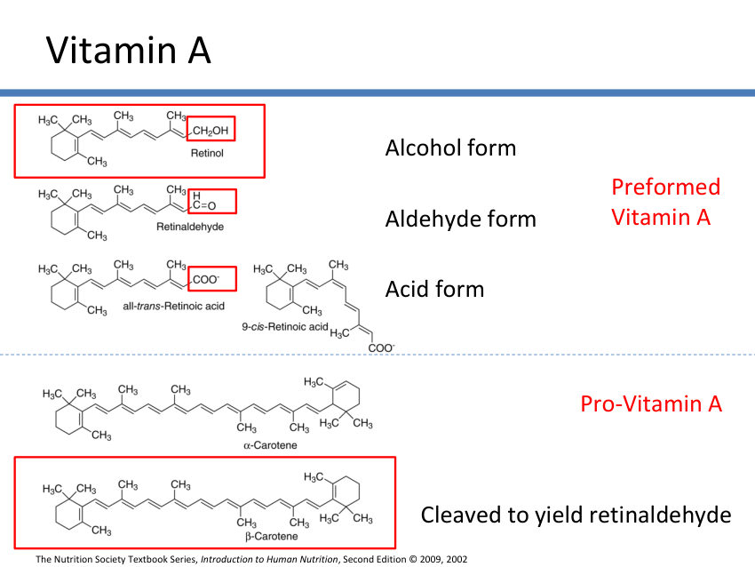

**How to read this slide:**

- Top three structures are **preformed vitamin A**. Same ring and chain, different end group (boxed in red).
- Bottom two are **pro-vitamin A** carotenes. They are much longer.
- β-carotene is two retinal molecules joined end to end. It is **cleaved** in the gut to give retinaldehyde (retinal).

 

| Form | Chemical type | Name |
|---|---|---|
| Alcohol | –CH₂OH | **Retinol** |
| Aldehyde | –CHO | **Retinal** (retinaldehyde) |
| Acid | –COOH | **Retinoic acid** |
| Pro-vitamin | long carotene | **β-carotene** (plus α, γ-carotene, cryptoxanthin) |

 

**Preformed** = already vitamin A. Found in animal foods (liver, egg, milk).

**Pro-vitamin** = can be turned into vitamin A. Found in orange and green plants.

 

### 🧠 Check
Which form is the alcohol? Which is the aldehyde? Which is the acid?

Answer

Alcohol = retinol. Aldehyde = retinal. Acid = retinoic acid.

Hook: retin-**ol** (alcohol), retin-**al** (aldehyde), retinoic **acid**.

---

## 2. Carotenes and the RAE

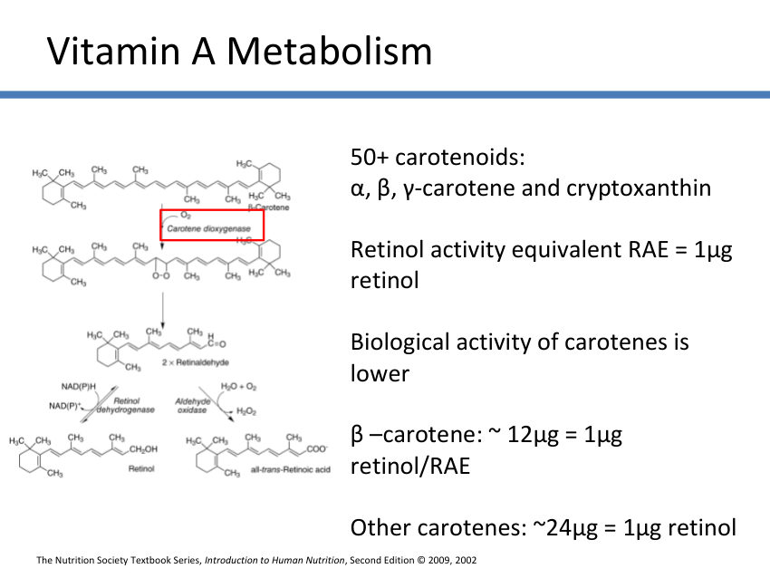

There are **50+ carotenoids**. The main ones are α, β, γ-carotene and cryptoxanthin.

The body makes less vitamin A from a carotene than from retinol.
So we count food vitamin A in **retinol activity equivalents (RAE)**.

 

### 📐 Equation 1: Retinol activity equivalents

$$\text{µg RAE} = \text{µg retinol} + \frac{\text{µg β-carotene}}{12} + \frac{\text{µg other carotenes}}{24}$$

| Symbol | Meaning | Units |
|---|---|---|
| µg RAE | vitamin A activity of the food | µg |
| µg retinol | preformed vitamin A in the food | µg |
| µg β-carotene | β-carotene in the food | µg |
| µg other carotenes | α-carotene, γ-carotene, cryptoxanthin | µg |

**Why it holds:** about 12 µg β-carotene gives 1 µg retinol in the body. Other carotenes give half as much again, so 24 µg.

**Use it when:** a question gives you carotene amounts and asks for vitamin A, or asks you to compare a plant food with an animal food.

**Does not apply:** to foods that already contain retinol. Those count 1 for 1.

 

**Why carotenes count for less** (slide 15):

- Poor absorption.
- Poor activity of the gut enzyme **carotene dioxygenase** (the enzyme that cleaves carotene).
- Other carotenoids can **inhibit** carotene dioxygenase.
- Sometimes the molecule is cut in the wrong place. That gives 8, 10 or 12 apo-carotenes, which become **retinoic acid, not retinol**.

 

### 🧠 Check
A carrot gives you 6000 µg β-carotene. How many µg RAE is that?

Answer

6000 ÷ 12 = **500 µg RAE**.

---

## 3. Foods and requirements

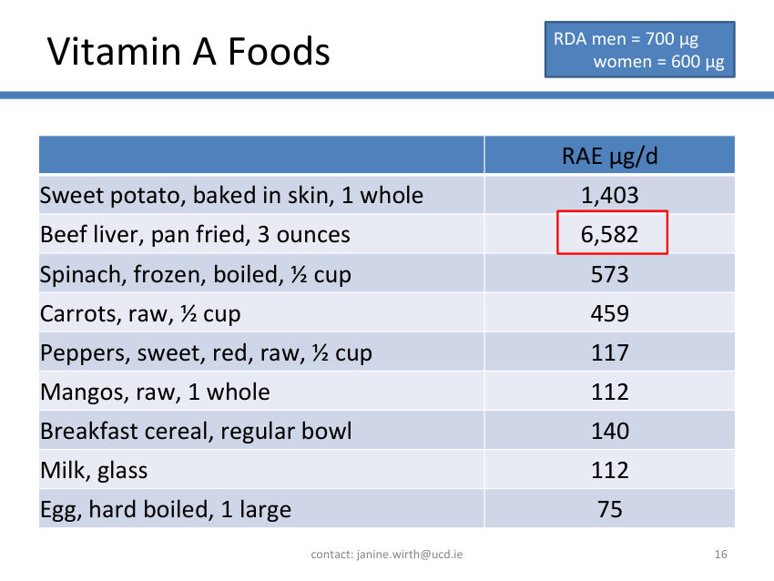

**How to read this table:** the numbers are µg RAE per serving. Liver is in a league of its own.

| Food | µg RAE |
|---|---|
| Beef liver, 3 oz | **6,582** |
| Sweet potato, 1 whole | 1,403 |
| Spinach, ½ cup | 573 |
| Carrots, ½ cup | 459 |
| Breakfast cereal, bowl | 140 |
| Red pepper, ½ cup | 117 |
| Mango, 1 | 112 |
| Milk, glass | 112 |
| Egg, 1 large | 75 |

 

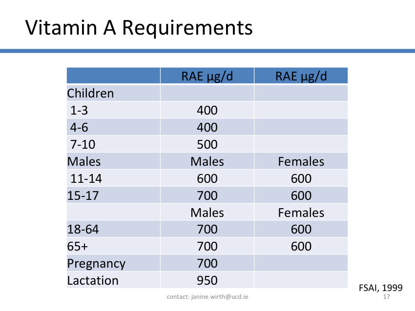

**Requirements (FSAI 1999), µg RAE per day:**

| Group | Males | Females |
|---|---|---|
| Children 1–6 | 400 | 400 |
| Children 7–10 | 500 | 500 |
| 11–14 | 600 | 600 |
| 15 and over | **700** | **600** |
| Pregnancy | | 700 |
| Lactation | | **950** |

**Learn:** men 700, women 600, lactation 950.

Lactation is the highest because vitamin A goes into breast milk.

 

**Why it matters (slide 12):** vitamin A deficiency is a major public health problem.
More than **600,000 deaths a year** in children under five.
The Harvest Plus project breeds orange sweet potato to raise vitamin A intake.

 

### 🧠 Check
What is the RDA for an adult man? For a breastfeeding woman?

Answer

Man: 700 µg RAE per day.
Lactation: 950 µg RAE per day.

---

## 4. Absorption, transport and storage

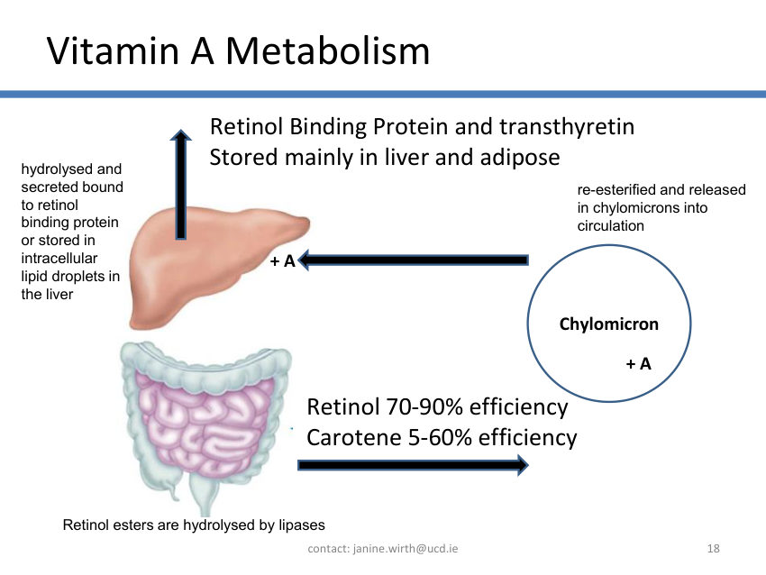

**How to read this slide:** follow the arrows from the gut (bottom) up to the liver (top).

1. In the gut, **retinol esters are hydrolysed by lipases** (the ester is split off).
2. In the gut wall, retinol is **re-esterified** and packed into **chylomicrons**.
3. Chylomicrons carry it in the lymph, then blood, to the **liver**.
4. In the liver it is either **stored** in lipid droplets, or hydrolysed and sent out bound to **retinol binding protein (RBP)** and **transthyretin**.

 

**Efficiency of absorption:**

| Form | Absorbed |
|---|---|
| Retinol | 70–90% |
| Carotene | 5–60% |

 

**Stored mainly in the liver** and in adipose tissue.
This is why liver is such a rich food source, and why toxicity builds up in the liver.

 

**Link to Topic 1:** this is the fat-soluble pattern. Micelles → chylomicrons → lymph → blood → liver. Water-soluble vitamins go straight into the blood.

 

### 🧠 Check
Which protein carries retinol out of the liver in the blood?

Answer

Retinol binding protein (RBP), together with transthyretin.

---

## 5. Function 1: vision

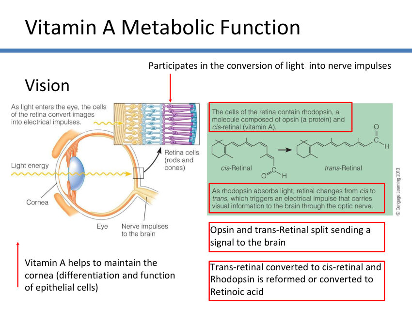

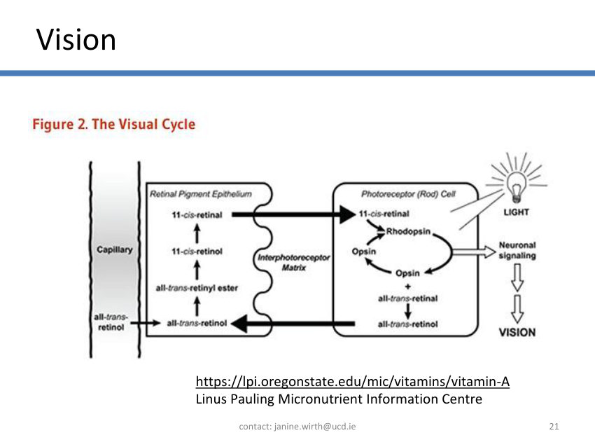

**How to read these diagrams:**

- Retina cells (rods) contain **rhodopsin** = **opsin** (a protein) + **11-cis-retinal** (vitamin A).
- Light hits rhodopsin. cis-retinal flips to **trans-retinal**.
- **Opsin and trans-retinal split.** That split sends the signal to the brain.
- trans-retinal is converted back to cis-retinal and rhodopsin is rebuilt.
- Some retinal is lost each cycle (oxidised to retinoic acid). New retinol tops it up.

 

**Two vision jobs:**

1. Converts light into nerve impulses (the rhodopsin cycle above).
2. Maintains the **cornea**: differentiation of epithelial cells.

 

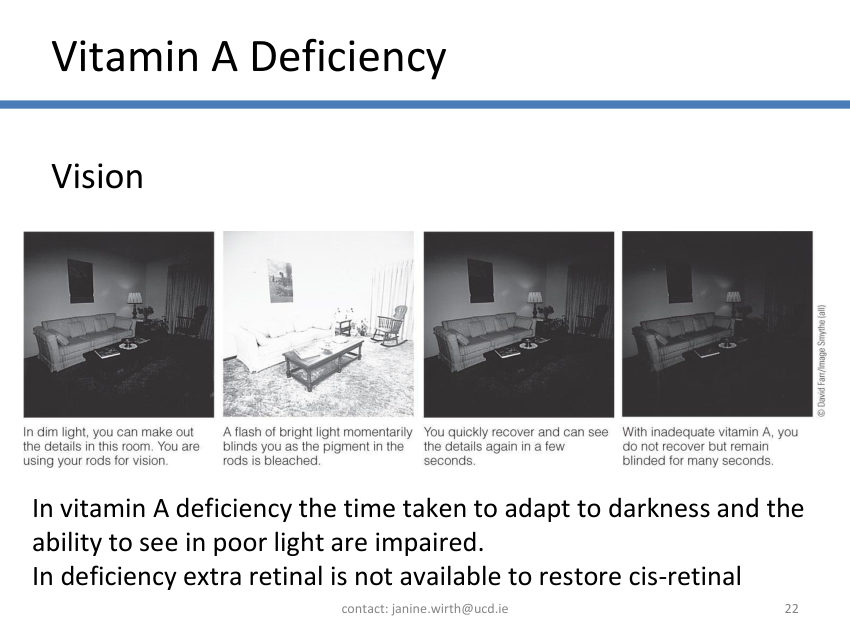

**In deficiency:** there is no spare retinal to rebuild cis-retinal.
So the time to adapt to the dark gets longer, and you cannot see in poor light.
That is **night blindness**.

 

### 🧠 Check
What are the two parts of rhodopsin? What happens when light hits it?

Answer

Opsin (protein) + 11-cis-retinal.

Light turns cis-retinal into trans-retinal. Opsin and trans-retinal split apart. That sends the signal.

---

## 6. Function 2: gene expression

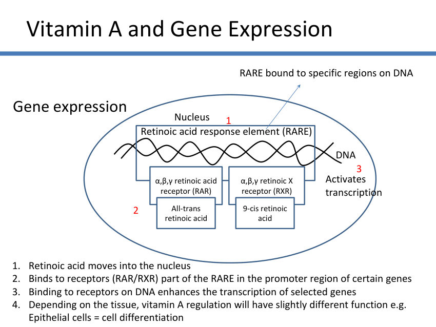

**How to read this diagram:** follow the numbers 1, 2, 3.

1. **Retinoic acid** moves into the nucleus.
2. It binds to receptors, **RAR** (retinoic acid receptor) and **RXR** (retinoid X receptor). These sit on the **RARE** (retinoic acid response element) in the promoter region of certain genes.
3. Binding **enhances transcription** of those genes.
4. Which genes depends on the tissue. In epithelial cells the result is **cell differentiation**.

 

| Receptor | Binds |
|---|---|
| RAR (α, β, γ) | all-trans retinoic acid |
| RXR (α, β, γ) | 9-cis retinoic acid |

 

**Genes controlled by retinoic acid encode:**

- structural proteins (skin keratins)
- enzymes (alcohol dehydrogenase)
- cell differentiation (epithelial cells)
- immune cells

 

**Other functions (slide 24):** embryonic development, immune function.
**Carotenoids** also act as **antioxidants**.

 

### 🧠 Check
Which form of vitamin A controls gene expression: retinol, retinal or retinoic acid?

Answer

Retinoic acid.

Retinal is for vision. Retinoic acid is for genes.

---

## 7. Deficiency

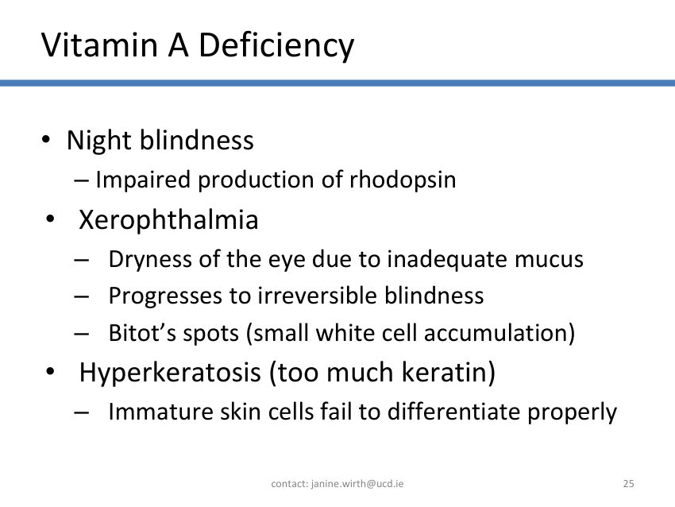

**The sequence:**

1. **Night blindness.** Not enough rhodopsin.
2. **Xerophthalmia.** Dry eye, because the cornea makes too little mucus.
3. **Bitot's spots.** Small white patches of dead cells on the surface of the eye.
4. **Irreversible blindness.**

Also **hyperkeratosis**: too much keratin, because immature skin cells fail to differentiate.

 

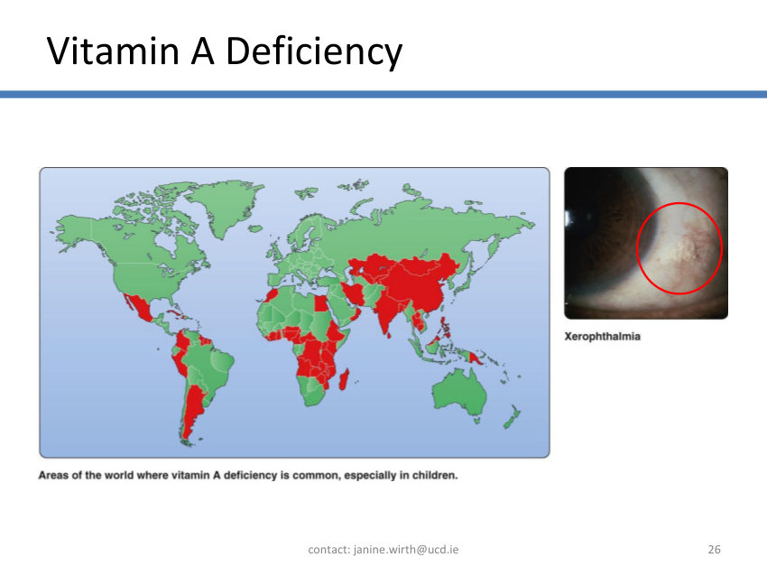

**How to read this map:** red = countries where vitamin A deficiency is common, especially in children. Mostly Africa and South Asia.

 

**Link the symptom to the function:**

| Function lost | Symptom |
|---|---|
| Rhodopsin cycle | night blindness |
| Epithelial differentiation (cornea) | xerophthalmia, Bitot's spots |
| Epithelial differentiation (skin) | hyperkeratosis |
| Immune function | impaired immunity |

 

### 🧠 Check
Put these in order: xerophthalmia, blindness, night blindness.

Answer

Night blindness → xerophthalmia → irreversible blindness.

---

## 8. Measuring status

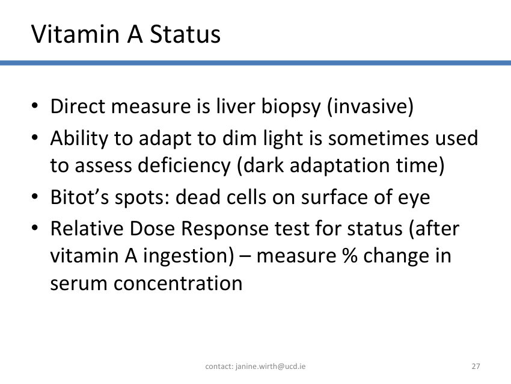

| Test | What it is | Note |
|---|---|---|
| Liver biopsy | direct measure of stores | invasive |
| Dark adaptation time | how fast the eye adjusts to dim light | functional test |
| Bitot's spots | dead cells on the eye surface | clinical sign |
| Relative dose response | give vitamin A, measure % change in serum level | big rise = low stores |

 

**Why the relative dose response works:**
If the liver is empty, the new vitamin A goes straight into the blood, so serum jumps.
If the liver is full, serum barely moves.

---

## 9. Toxicity

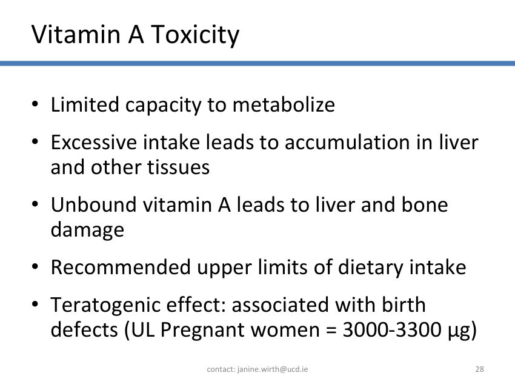

- The body has a **limited capacity to metabolise** vitamin A.
- Excess builds up in the **liver** and other tissues.
- **Unbound** vitamin A (more than RBP can carry) damages the **liver and bone**.
- There are **recommended upper limits**.
- **Teratogenic:** linked to birth defects. **UL in pregnancy = 3000–3300 µg.**

 

**Why fat-soluble vitamins reach toxic levels:** they are stored in fat and the liver and are not easily excreted. Water-soluble extras go out in the urine.

 

### 🧠 Check
Why is vitamin A dangerous in pregnancy?

Answer

It is teratogenic. High doses are linked to birth defects. The UL for pregnant women is 3000–3300 µg per day.

---

## Summary (slide 39)

- Fat-soluble. Absorbed with dietary fat, transported in chylomicrons, stored in the liver.
- Retinol, retinal, retinoic acid = active, preformed forms. β-carotene = pro-vitamin A.
- Functions: vision, gene expression, immune function, reproduction.
- Deficiency: night blindness → xerophthalmia → irreversible blindness. Impaired immunity.
- Toxicity: unbound vitamin A damages liver and bone. Teratogenic.
