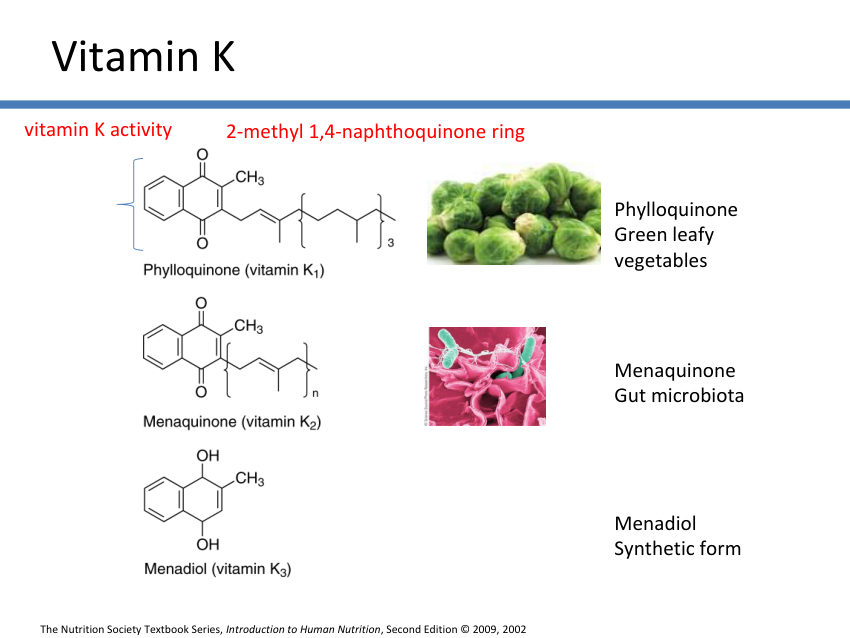
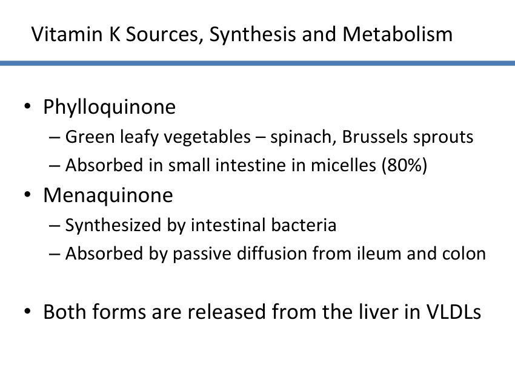
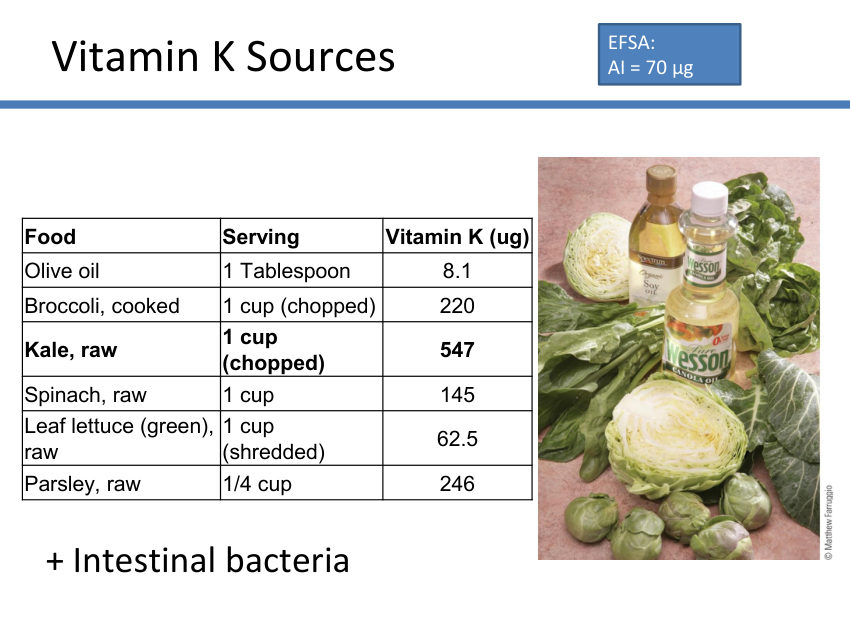
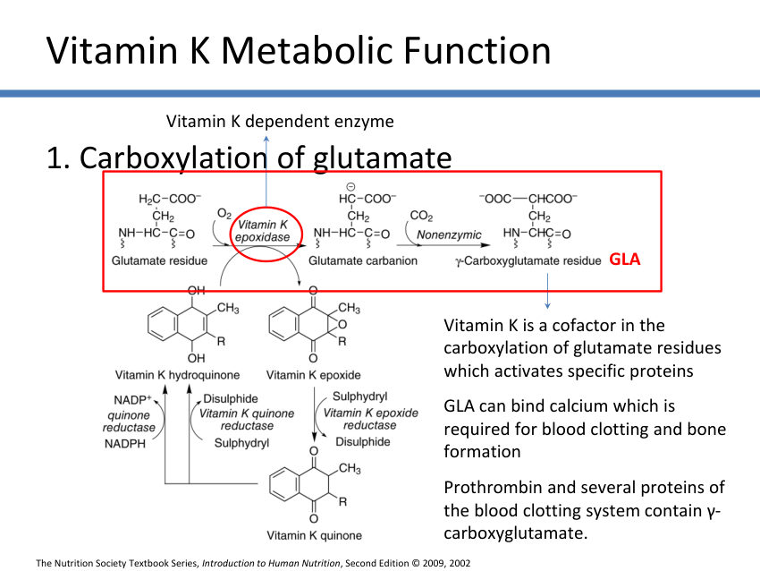
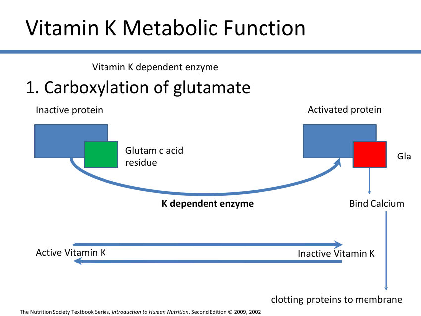
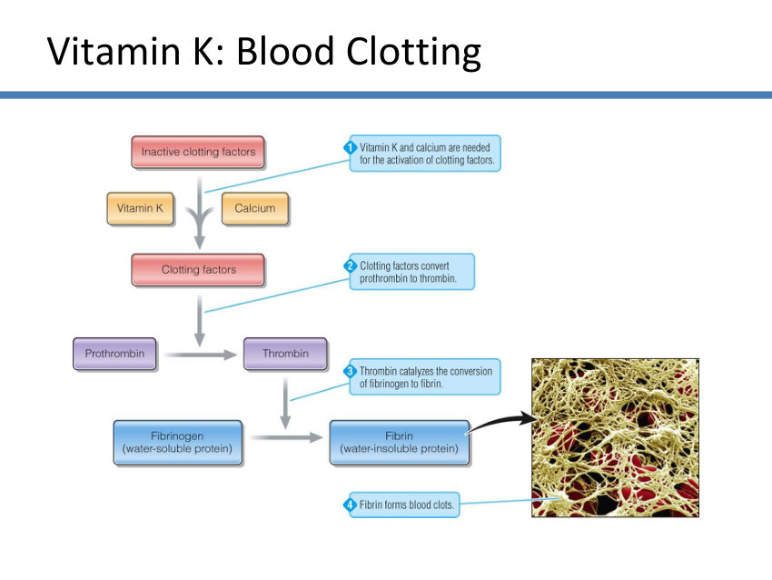
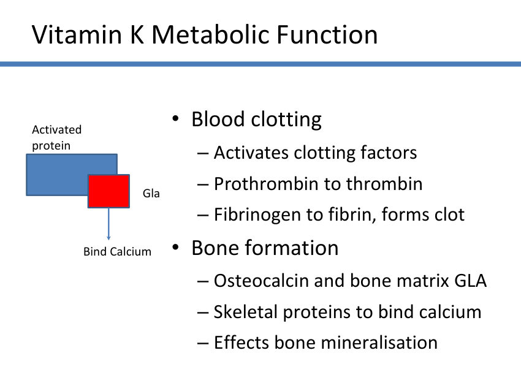
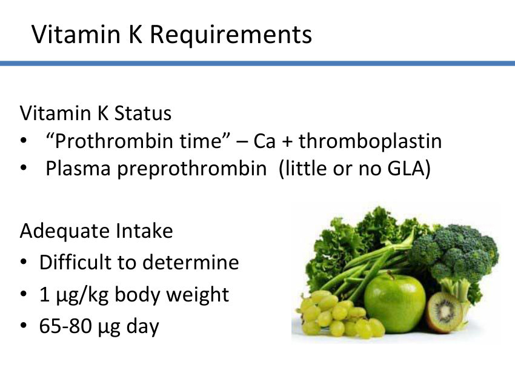
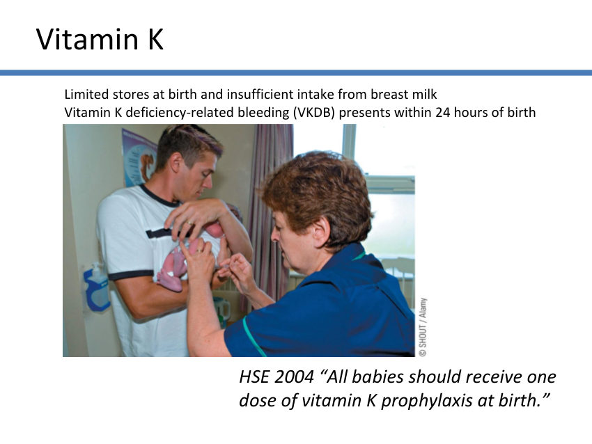
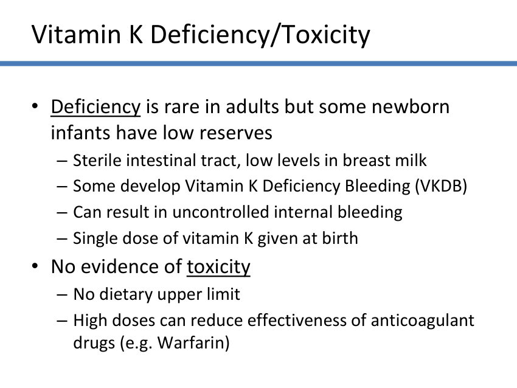

# Topic 3 — Vitamin K

Slides: Lecture 12 (Vitamins A & K), pages 29 to 38

---

## The big idea

Vitamin K is a **fat-soluble** vitamin with one main job.

It helps an enzyme add a **carboxyl group to glutamate** in certain proteins.

The new group, **Gla**, lets those proteins **bind calcium**.

Calcium-binding proteins are needed for **blood clotting** and for **bone**.

Too little → **bleeding**. This mostly happens in **newborns**, so every baby gets a dose at birth.

Toxicity is only known for the **synthetic form**.

---

**How to use these notes:**
When you see 🧠, stop.
Say the answer out loud or write it down.
Then click to check.

---

## ⭐ Learn by heart from this topic

**The vitamin K card.** Cover the right column and say it from memory.

| Ask | Answer |
|---|---|
| Soluble in | Fat |
| Chemical core | 2-methyl 1,4-naphthoquinone ring |
| Three forms | K1 phylloquinone (green leafy veg), K2 menaquinone (gut bacteria), K3 menadiol (synthetic) |
| Best foods | Kale (547 µg per cup), parsley, broccoli, spinach |
| Absorption | K1 in micelles in the small intestine (80%). K2 by passive diffusion from ileum and colon |
| Transport | Both released from the liver in VLDL |
| Intake | EFSA AI 70 µg. About 1 µg/kg body weight, 65–80 µg per day |
| Function | Cofactor for carboxylation of glutamate → Gla. Gla binds calcium |
| Used for | Blood clotting (prothrombin → thrombin, fibrinogen → fibrin). Bone (osteocalcin) |
| Status test | Prothrombin time. Plasma preprothrombin (little or no Gla) |
| Deficiency | Rare in adults. Newborns: vitamin K deficiency bleeding, VKDB |
| Toxicity | None known for natural forms. No UL. Synthetic form only. High doses reduce warfarin |

 

**Memory hook for the forms:**
K**1** = **plants** (phylloquinone, "phyllo" = leaf).
K**2** = **microbes** (menaquinone, made in the gut).
K**3** = **made in a lab** (menadiol).

---

## 1. The three forms

**How to read this slide:** three structures, one shared core.
The red ring at the top is the **2-methyl 1,4-naphthoquinone ring**. This ring is what gives vitamin K activity.
The side chain is what changes between the forms.

 

| Form | Name | Where it comes from |
|---|---|---|
| **K1** | Phylloquinone | Green leafy vegetables |
| **K2** | Menaquinone | Gut microbiota (bacteria in the gut) |
| **K3** | Menadiol | Synthetic form |

 

K1 has a long side chain with one double bond.
K2 has a side chain made of repeating units, so there is a family of menaquinones.
K3 has no side chain at all. It is just the ring.

 

### 🧠 Check
Which form of vitamin K is made by gut bacteria? What is its chemical name?

Answer

K2, menaquinone.

K1 phylloquinone comes from green leafy vegetables. K3 menadiol is synthetic.

---

## 2. Sources, absorption and transport

**Phylloquinone, K1:**

- From green leafy vegetables: spinach, Brussels sprouts, kale.
- Absorbed in the **small intestine in micelles**, about **80%**.

**Menaquinone, K2:**

- **Synthesised by intestinal bacteria.**
- Absorbed by **passive diffusion** from the **ileum and colon**.

**Both forms** are released from the **liver in VLDL**.

 

**Link to Topic 1:** micelles → gut wall → liver is the fat-soluble pattern. Vitamin K follows it.

 

**How to read this table:** µg of vitamin K per serving. Green leaves win. Oil has very little.

| Food | Serving | Vitamin K (µg) |
|---|---|---|
| Kale, raw | 1 cup chopped | **547** |
| Parsley, raw | ¼ cup | 246 |
| Broccoli, cooked | 1 cup chopped | 220 |
| Spinach, raw | 1 cup | 145 |
| Leaf lettuce, raw | 1 cup shredded | 62.5 |
| Olive oil | 1 tablespoon | 8.1 |

Plus what the **intestinal bacteria** make.

**EFSA Adequate Intake: 70 µg per day.**

 

### 🧠 Check
Name two food sources of vitamin K and one non-food source.

Answer

Foods: any green leafy vegetable, for example kale, spinach, broccoli, parsley, Brussels sprouts.

Non-food: intestinal bacteria make menaquinone, K2.

---

## 3. Function: carboxylation of glutamate

**How to read this slide:** the red box is the key reaction.
Left = a glutamate residue in a protein.
Right = the same residue with an extra carboxyl group. That is **γ-carboxyglutamate, Gla**.
Below the box is the vitamin K cycle. Vitamin K is used up and then recycled.

 

**The reaction in words:**

1. A **vitamin K dependent enzyme** takes a **glutamate residue** on a protein.
2. It adds a **carboxyl group**. This needs **active vitamin K** as a cofactor.
3. The glutamate becomes **Gla**.
4. **Gla can bind calcium.** That is the whole point.

 

**How to read this slide:** left = inactive protein with a plain glutamate (green).
Right = activated protein with Gla (red), which can bind calcium.
The bottom arrows show vitamin K being used (active → inactive) and recycled back (inactive → active).

 

**Why it matters:**

- Prothrombin and several other clotting proteins contain Gla.
- Without vitamin K, they are made but they have no Gla. They cannot bind calcium, so they do not work.
- The calcium link is what attaches clotting proteins to the membrane where the clot forms.

 

### 🧠 Check
What does Gla stand for, and what can it do that plain glutamate cannot?

Answer

γ-carboxyglutamate.

It can bind calcium. Plain glutamate cannot.

---

## 4. Blood clotting

**How to read this diagram:** start at the top with inactive clotting factors. Vitamin K and calcium are needed to activate them. Then follow the chain down.

 

**The chain:**

1. Vitamin K and calcium activate **clotting factors**.
2. Clotting factors convert **prothrombin → thrombin**.
3. Thrombin converts **fibrinogen → fibrin**.
4. Fibrin forms the **clot**.

 

| Before | After | Done by |
|---|---|---|
| Inactive clotting factors | Active clotting factors | Vitamin K + calcium |
| Prothrombin | Thrombin | Clotting factors |
| Fibrinogen (soluble) | Fibrin (insoluble) | Thrombin |

 

**Link to §3:** prothrombin only works because it has Gla residues that bind calcium. No vitamin K, no Gla, no clot.

 

### 🧠 Check
Put these in order: fibrin, prothrombin, thrombin, fibrinogen, clot.

Answer

Prothrombin → thrombin → fibrinogen → fibrin → clot.

Thrombin is the enzyme that turns fibrinogen into fibrin.

---

## 5. Bone

Vitamin K has a second job in **bone formation**.

- **Osteocalcin** and other **bone matrix Gla proteins** are carboxylated by vitamin K.
- These skeletal proteins can then **bind calcium**.
- This affects **bone mineralisation**.

 

**Same mechanism as clotting:** glutamate → Gla → binds calcium.
Only the protein is different. In blood it is prothrombin. In bone it is osteocalcin.

 

**Link to Topic 1:** on the bone health table, vitamin K is "involved with enzymes in bone formation". This is that enzyme.

---

## 6. Requirements and status

**Adequate Intake:**

- **Difficult to determine**, so it is an AI, not a PRI.
- About **1 µg per kg body weight**.
- About **65–80 µg per day**.

 

### 📐 Equation 1: Adequate intake from body weight

$$\text{AI (µg/day)} = 1\ \text{µg/kg} \times \text{body weight (kg)}$$

| Symbol | Meaning | Units |
|---|---|---|
| AI | adequate intake of vitamin K per day | µg/day |
| 1 µg/kg | the rule of thumb from the slide | µg per kg |
| body weight | the person's mass | kg |

**Why it holds:** the requirement scales with body size. The slide gives 1 µg/kg, which lands at 65–80 µg for a typical adult.

**Use it when:** a question gives a body weight and asks for the vitamin K requirement.

**Does not apply:** to newborns, who get a single prophylactic dose instead. And EFSA simply sets a flat AI of 70 µg for adults.

 

**Measuring status:**

| Test | How it works |
|---|---|
| **Prothrombin time** | Add calcium and thromboplastin to plasma, time the clot. Slow clotting = low vitamin K |
| **Plasma preprothrombin** | Prothrombin with little or no Gla. More of it = less vitamin K |

 

### 🧠 Check
A person weighs 60 kg. Roughly how much vitamin K do they need per day?

Answer

1 µg/kg × 60 kg = 60 µg per day.

That is close to the 65–80 µg range on the slide.

---

## 7. Deficiency and toxicity

**How to read this slide:** a newborn getting a vitamin K injection. The text explains why.

 

**Deficiency is rare in adults.** But **newborn infants** have low reserves because:

- Limited stores at birth.
- The gut is **sterile**, so no bacteria to make K2.
- **Breast milk** is low in vitamin K.

Some develop **vitamin K deficiency bleeding, VKDB**.
It presents within **24 hours of birth** and can cause **uncontrolled internal bleeding**.

**HSE 2004: all babies should receive one dose of vitamin K prophylaxis at birth.**

 

**Toxicity:**

- **No evidence of toxicity** from natural forms.
- **No dietary upper limit.**
- Toxicity is **known only for the synthetic form**, K3.
- High doses can **reduce the effectiveness of anticoagulant drugs** such as **warfarin**.

 

**Why warfarin matters:** warfarin works by blocking vitamin K. Extra vitamin K cancels it out, so the blood clots again.

 

### 🧠 Check
Give three reasons a newborn is at risk of vitamin K deficiency.

Answer

1. Limited stores at birth.
2. Sterile gut, so no bacterial K2.
3. Low vitamin K in breast milk.

That is why every baby gets one dose at birth.

---

## Summary (slide 40)

- K1 phylloquinone from green leafy vegetables. K2 menaquinone from gut bacteria. K3 menadiol is synthetic.
- Cofactor for carboxylation of glutamate to Gla. Gla binds calcium.
- Essential for blood clotting. Involved in bone metabolism.
- Deficiency: vitamin K deficiency-related bleeding, VKDB, in newborns.
- Toxicity: known only for the synthetic form. No UL.
