# Topic 4 — Vitamin D

Slides: Lecture 13 (Vitamins D & E), pages 4 to 25

---

## The big idea

Vitamin D is the **sunshine vitamin**.

Your skin makes it from **7-dehydrocholesterol** when **UVB** light hits it.

It is not active until the **liver** and then the **kidney** add OH groups.

The active form, **1,25-dihydroxyvitamin D**, acts like a hormone.

Its main job is to keep **blood calcium** up: more absorbed from the gut, less lost in urine, some pulled from bone.

Too little → **rickets** in children, **osteomalacia** in adults.

Too much → **high blood calcium**, soft tissue calcification.

---

**How to use these notes:**
When you see 🧠, stop.
Say the answer out loud or write it down.
Then click to check.

---

## ⭐ Learn by heart from this topic

**The vitamin D card.** Cover the right column and say it from memory.

| Ask | Answer |
|---|---|
| Soluble in | Fat |
| Two forms | D2 ergocalciferol (plants, mushrooms), D3 cholecalciferol (skin, animal foods) |
| Made in skin from | 7-dehydrocholesterol + UVB |
| Carried in blood by | Vitamin D binding protein (DBP) |
| Liver makes | 25-hydroxyvitamin D (calcidiol). This is the **status biomarker** |
| Kidney makes | 1,25-dihydroxyvitamin D (calcitriol). The **active** form |
| Turned up by | PTH, released when blood calcium is low |
| Main job | Calcium homeostasis: ↑ gut absorption, ↑ kidney reabsorption, mobilise bone |
| Other jobs | Cell differentiation, immune function, β-cell function |
| Best foods | Oily fish: mackerel 200 g 18 µg, salmon 200 g 16 µg. Fortified milk |
| Unit | 1 µg = 40 IU |
| RDA | Infants 10 µg (400 IU), adolescents 15 µg (600 IU), adults 10 µg (400 IU) |
| Older adults (FSAI 2020) | 15 µg healthy, 20 µg housebound |
| Deficiency | Rickets (children), osteomalacia (adults) |
| Toxicity | Raised blood calcium, high blood pressure, soft tissue calcification. Sun never causes it |

 

**The pathway, in one line:**

7-dehydrocholesterol → (UVB, skin) → vitamin D3 → (liver) → 25-hydroxyvitamin D → (kidney) → 1,25-dihydroxyvitamin D

**Memory hook:** skin, liver, kidney. 7, 25, 1-25.

---

## 1. Structure and the two forms

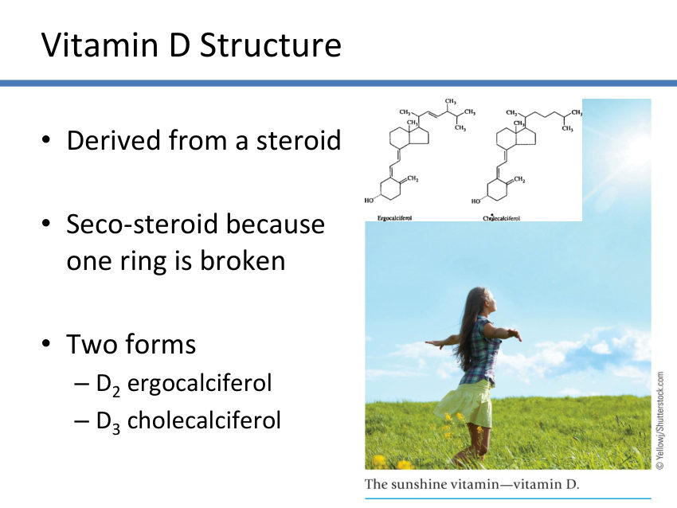

**How to read this slide:** both structures are steroids with one ring opened up. That broken ring is what makes them "seco".

- Vitamin D is **derived from a steroid**.
- It is a **seco-steroid**, because **one ring is broken**.
- There are two forms:

| Form | Name | Where from |
|---|---|---|
| D2 | **Ergocalciferol** | plants, UV-treated mushrooms |
| D3 | **Cholecalciferol** | skin, animal foods |

 

Both forms go through the **same metabolism** in the liver and kidney.

 

### 🧠 Check
Which is D2 and which is D3? Why is vitamin D called a seco-steroid?

Answer

D2 = ergocalciferol. D3 = cholecalciferol.

Seco-steroid because one of the steroid rings is broken open.

---

## 2. Food sources

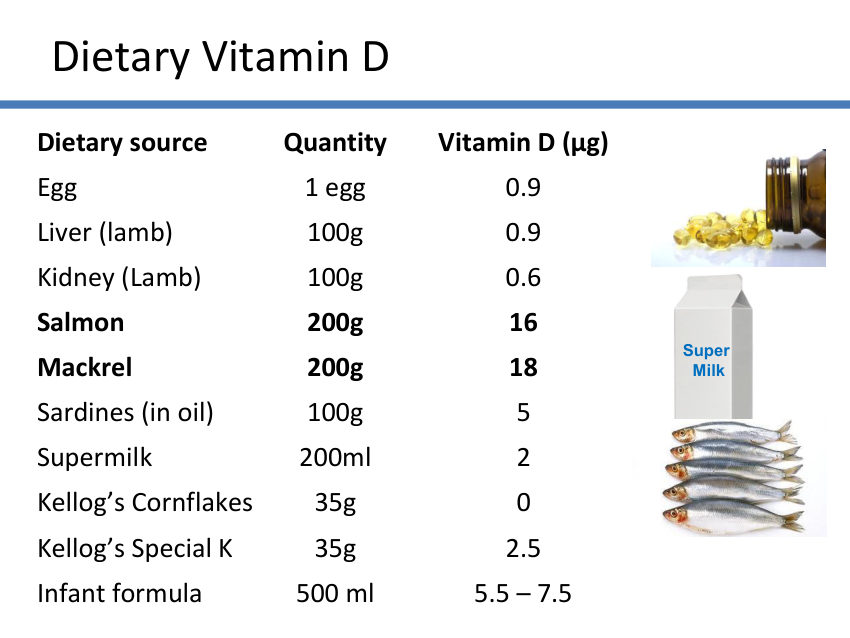

**How to read this table:** oily fish is far ahead. Eggs and liver are small. Cornflakes have none, so fortification depends on the product.

| Food | Serving | Vitamin D (µg) |
|---|---|---|
| Mackerel | 200 g | **18** |
| Salmon | 200 g | **16** |
| Sardines in oil | 100 g | 5 |
| Infant formula | 500 ml | 5.5–7.5 |
| Special K | 35 g | 2.5 |
| Supermilk (fortified) | 200 ml | 2 |
| Egg | 1 | 0.9 |
| Lamb liver | 100 g | 0.9 |
| Lamb kidney | 100 g | 0.6 |
| Cornflakes | 35 g | 0 |

 

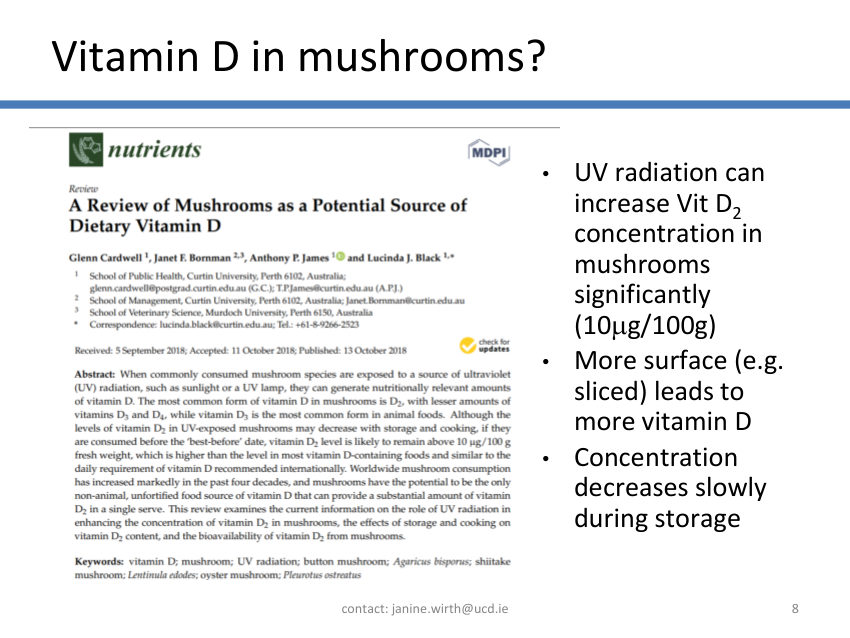

**Mushrooms:**

- **UV radiation** raises the **D2** in mushrooms a lot (about 10 µg per 100 g).
- More surface area, for example sliced, means more vitamin D.
- The level falls slowly during storage.

 

**EFSA health claim (2014):** "Vitamin D contributes to normal development of bones and teeth."

 

### 🧠 Check
Name the two richest food sources of vitamin D on the slide.

Answer

Mackerel (18 µg per 200 g) and salmon (16 µg per 200 g). Oily fish.

---

## 3. Synthesis in skin and activation

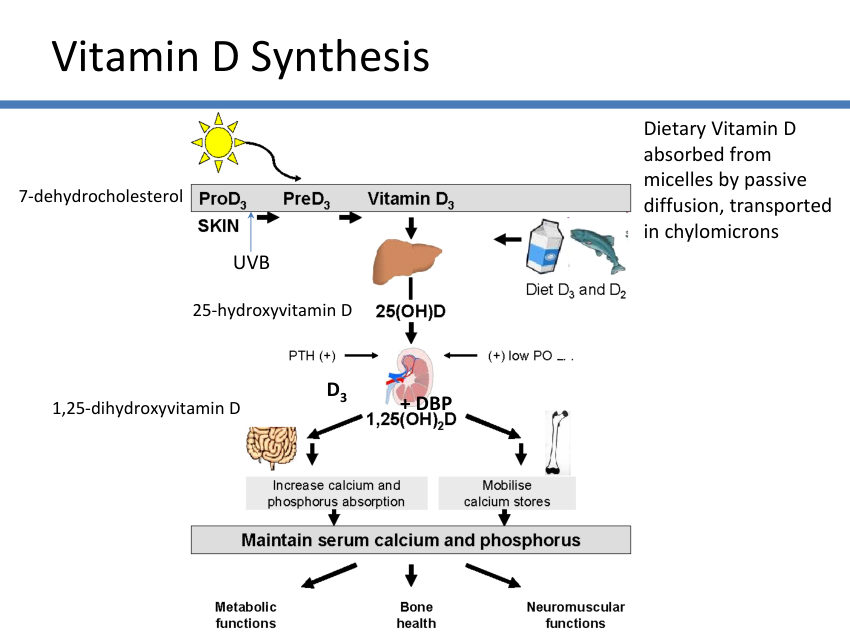

**How to read this slide:** start at the sun on the top left. Follow the arrows down through the liver and then the kidney.

**Step 1: skin**
**7-dehydrocholesterol** in the skin is hit by **UVB**.
It becomes **vitamin D3**.

**Step 2: diet**
Dietary vitamin D is absorbed from **micelles** by **passive diffusion**.
It travels in **chylomicrons**.

**Step 3: blood**
Vitamin D is carried on **DBP**, the vitamin D binding protein.

**Step 4: liver**
The liver adds an OH at carbon 25.
Enzyme: **25-hydroxylase**.
Product: **25-hydroxyvitamin D** (calcidiol).

**Step 5: kidney**
The kidney adds an OH at carbon 1.
Enzyme: **1-hydroxylase**.
Product: **1,25-dihydroxyvitamin D** (calcitriol). This is the **active** form.

 

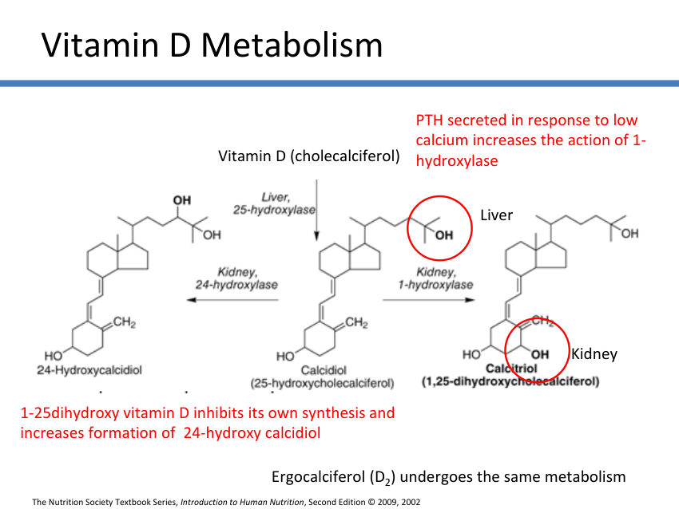

**How to read this slide:** the middle structure is cholecalciferol. Left arrow goes to the liver (25-hydroxylase). Right arrow goes to the kidney, which can make either calcitriol (1-hydroxylase) or 24-hydroxy calcidiol (24-hydroxylase).

 

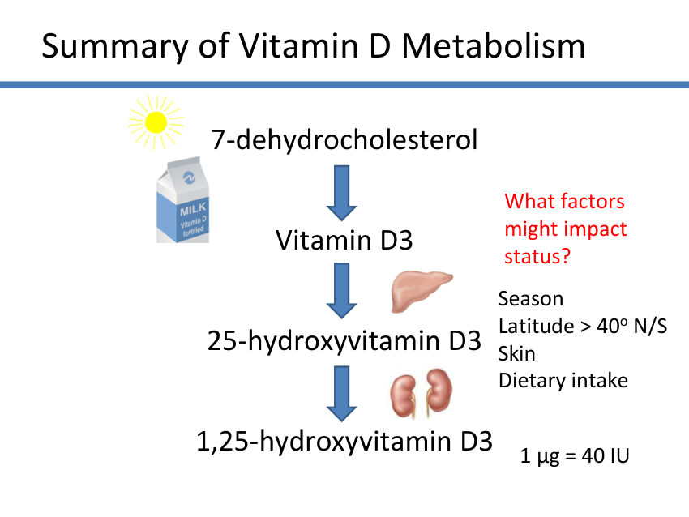

| Step | Where | Enzyme | Product |
|---|---|---|---|
| 1 | Skin | UVB | Vitamin D3 |
| 2 | Liver | 25-hydroxylase | 25-hydroxyvitamin D |
| 3 | Kidney | 1-hydroxylase | 1,25-dihydroxyvitamin D |

The kidney can also use **24-hydroxylase** to make **24-hydroxy calcidiol**. That is the way to switch it off.

 

### 🧠 Check
Which organ makes 25-hydroxyvitamin D? Which makes 1,25-dihydroxyvitamin D?

Answer

Liver makes 25-hydroxyvitamin D.
Kidney makes 1,25-dihydroxyvitamin D (the active form).

---

## 4. Regulation and what affects status

**How the body controls the active form (slide 11):**

- Low blood calcium → **PTH** (parathyroid hormone) is released.
- PTH **increases 1-hydroxylase** in the kidney. More calcitriol is made.
- 1,25-dihydroxyvitamin D **inhibits its own synthesis**.
- It also **increases 24-hydroxylase**, which makes 24-hydroxy calcidiol instead.

So the system turns up when calcium is low, and turns itself down when enough is made.

 

**What affects vitamin D status (slide 12):**

| Factor | Why |
|---|---|
| Season | less UVB in winter |
| Latitude above 40° N or S | sun too low for much of the year |
| Skin | skin type and how much is exposed |
| Dietary intake | oily fish, fortified foods, supplements |

Ireland is above 40° N. That is why winter status is poor here.

 

### 🧠 Check
Blood calcium falls. What hormone is released, and what does it do to vitamin D?

Answer

PTH is released. It increases 1-hydroxylase in the kidney, so more active 1,25-dihydroxyvitamin D is made.

---

## 5. Calcium homeostasis

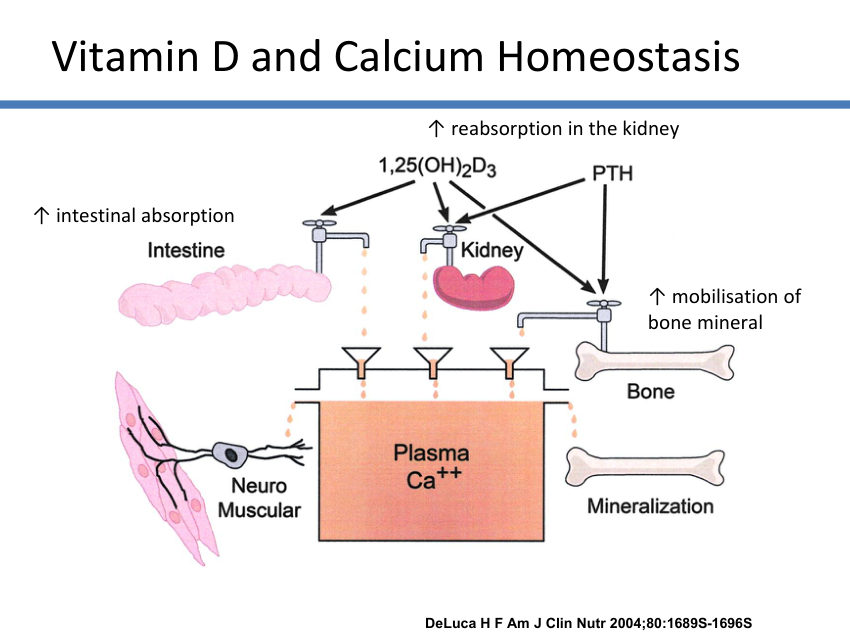

**How to read this diagram:** 1,25(OH)₂D₃ and PTH act on three taps that feed the plasma calcium pool: the intestine, the kidney and bone.

**Three ways vitamin D keeps blood calcium up:**

1. **↑ intestinal absorption** of calcium.
2. **↑ reabsorption in the kidney** (less calcium lost in urine).
3. **Mobilisation of bone mineral** (calcium pulled out of bone).

 

Plasma calcium is then used for **bone mineralisation**, **neuromuscular** function and **metabolic** functions.

**Important for bone health.**

 

### 🧠 Check
Name the three organs vitamin D acts on to raise blood calcium.

Answer

Intestine (more absorption), kidney (less excretion), bone (mobilise mineral).

---

## 6. Other functions

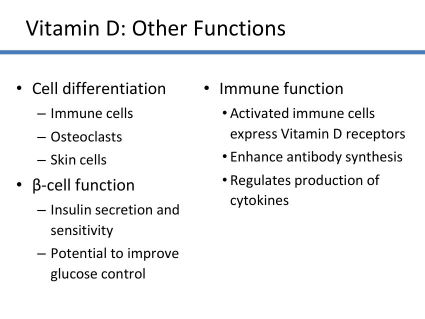

| Area | What vitamin D does |
|---|---|
| **Cell differentiation** | immune cells, osteoclasts, skin cells |
| **β-cell function** | insulin secretion and sensitivity, may improve glucose control |
| **Immune function** | activated immune cells express vitamin D receptors, enhances antibody synthesis, regulates cytokines |

 

**Link to the NANS data in §7:** people with higher plasma vitamin D had lower glucose and fewer metabolic syndrome factors. That fits the β-cell role.

 

### 🧠 Check
Which cells of the pancreas does vitamin D help, and what do they make?

Answer

β-cells. They make insulin. Vitamin D supports insulin secretion and sensitivity.

---

## 7. Deficiency and status

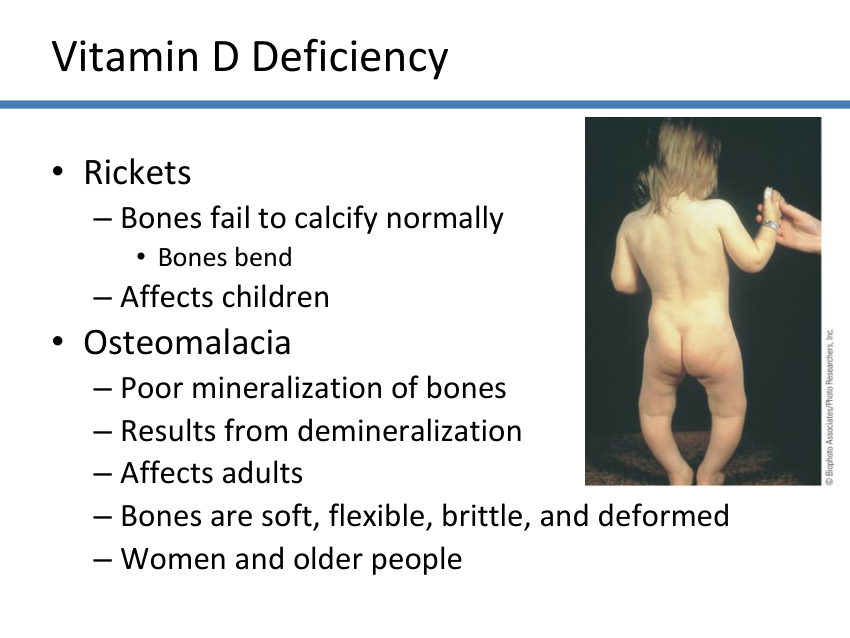

| Disease | Who | What happens |
|---|---|---|
| **Rickets** | children | bones fail to calcify normally, so bones bend |
| **Osteomalacia** | adults, especially women and older people | poor mineralisation, demineralisation. Bones are soft, flexible, brittle and deformed |

 

**Measuring status:**

The biomarker is **25-hydroxyvitamin D** in blood (nmol/L).
Not the active form. The liver product.

 

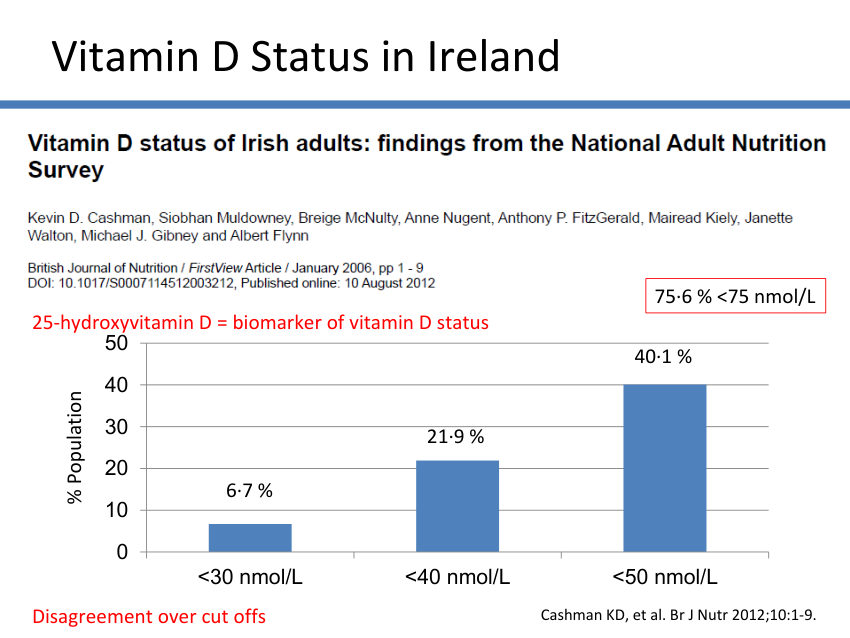

**How to read this chart:** each bar is the % of Irish adults below a cut-off. The lower the cut-off, the fewer people fall below it.

**Irish adults (Cashman 2012):**

| Below | % of adults |
|---|---|
| 30 nmol/L | 6.7% |
| 40 nmol/L | 21.9% |
| 50 nmol/L | 40.1% |
| 75 nmol/L | 75.6% |

There is **disagreement over cut-offs**. That is why the slide shows four.

 

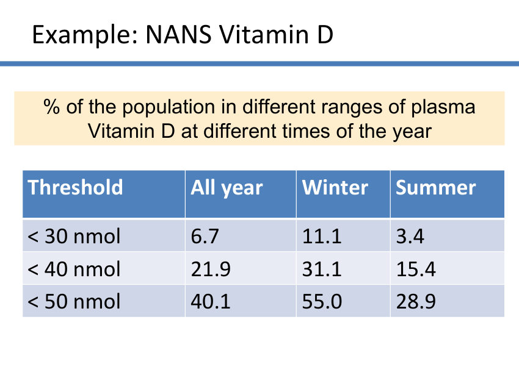

**Winter vs summer:**

| Below | All year | Winter | Summer |
|---|---|---|---|
| 30 nmol/L | 6.7% | 11.1% | 3.4% |
| 40 nmol/L | 21.9% | 31.1% | 15.4% |
| 50 nmol/L | 40.1% | 55.0% | 28.9% |

In winter, more than half of Irish adults are below 50 nmol/L.

 

**Low status and death (slide 16):** 25(OH)D below 30 nmol/L = **1.7 times** the risk of death.

 

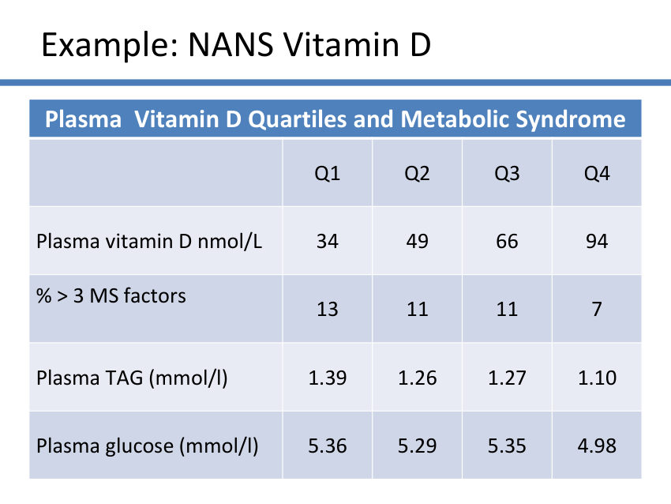

**How to read this table:** Q1 has the lowest plasma vitamin D, Q4 the highest. As vitamin D rises, metabolic syndrome factors, TAG and glucose all fall.

| | Q1 | Q2 | Q3 | Q4 |
|---|---|---|---|---|
| Plasma vitamin D (nmol/L) | 34 | 49 | 66 | 94 |
| % with more than 3 MS factors | 13 | 11 | 11 | 7 |
| Plasma TAG (mmol/L) | 1.39 | 1.26 | 1.27 | 1.10 |
| Plasma glucose (mmol/L) | 5.36 | 5.29 | 5.35 | 4.98 |

 

### 🧠 Check
What is the blood test for vitamin D status? Which disease does deficiency cause in children, and which in adults?

Answer

25-hydroxyvitamin D.

Children: rickets. Adults: osteomalacia.

---

## 8. Requirements

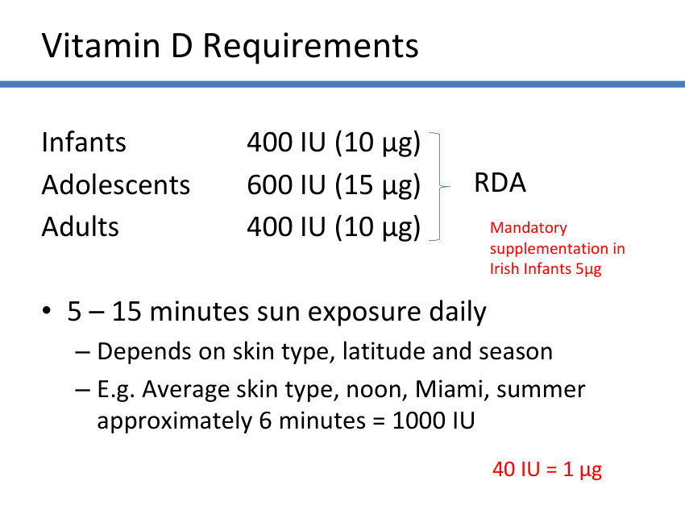

| Group | RDA |
|---|---|
| Infants | 400 IU = 10 µg |
| Adolescents | 600 IU = 15 µg |
| Adults | 400 IU = 10 µg |

**Mandatory supplementation in Irish infants: 5 µg.**

 

**Sun:** 5 to 15 minutes of sun exposure daily.
It depends on skin type, latitude and season.
Example: average skin, noon, Miami, summer: about 6 minutes = 1000 IU.

 

### 📐 Equation 1: IU and µg

$$1\ \text{µg} = 40\ \text{IU} \qquad \text{µg} = \frac{\text{IU}}{40} \qquad \text{IU} = 40 \times \text{µg}$$

| Symbol | Meaning | Units |
|---|---|---|
| IU | international units, the old way to label vitamin D | IU |
| µg | micrograms of vitamin D | µg |
| 40 | the fixed conversion factor | IU per µg |

**Why it holds:** by definition, 1 µg of vitamin D is 40 IU. It is a fixed label, not a biological measurement.

**Use it when:** a supplement label or a recommendation gives IU and you need µg, or the other way round.

**Does not apply:** to any other vitamin. The IU factor is different for each vitamin.

 

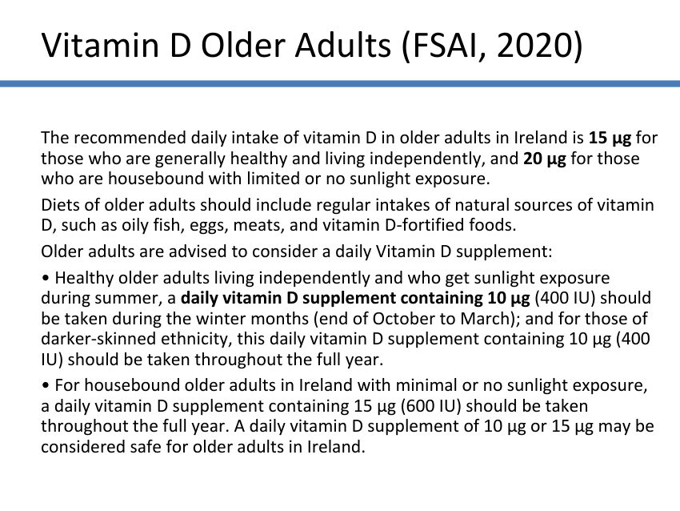

**Older adults in Ireland (FSAI 2020):**

| Who | Recommended intake |
|---|---|
| Healthy, living independently | 15 µg per day |
| Housebound, little or no sun | 20 µg per day |

**Supplement advice:**

- Healthy, independent, gets summer sun: **10 µg (400 IU)** daily from end of October to March.
- Darker-skinned ethnicity: **10 µg (400 IU)** daily all year.
- Housebound: **15 µg (600 IU)** daily all year.

Diets should include oily fish, eggs, meats and fortified foods.

 

### 🧠 Check
A supplement says 400 IU. How many µg is that?

Answer

400 ÷ 40 = 10 µg.

---

## 9. Toxicity

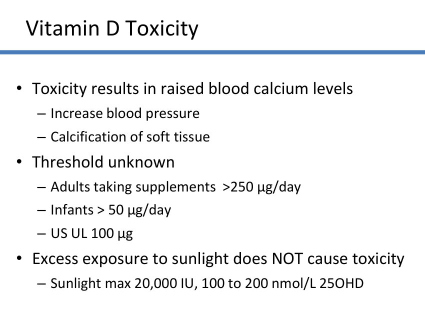

**What happens:** toxicity means **raised blood calcium**.

- Increased blood pressure.
- Calcification of soft tissue.

 

**Threshold is unknown, but:**

| Group | Level linked to toxicity |
|---|---|
| Adults taking supplements | more than 250 µg per day |
| Infants | more than 50 µg per day |
| US upper limit | 100 µg |

 

**Sunlight does NOT cause toxicity.**
Sun exposure tops out at about 20,000 IU, giving 100 to 200 nmol/L 25(OH)D.
The skin stops making more.

 

### 🧠 Check
Can you get vitamin D toxicity from too much sun? What is the sign of toxicity in the blood?

Answer

No. Sun exposure cannot cause toxicity.

Toxicity shows as raised blood calcium.

---

## Summary (slide 42)

- Fat-soluble. Works as a prohormone.
- Made in the skin from 7-dehydrocholesterol with UVB.
- Activated in the liver (25-OH) and kidney (1,25-OH) to calcitriol.
- Regulates calcium and phosphate. Essential for bone and immune function.
- Deficiency: rickets in children, osteomalacia in adults.
- Toxicity: hypercalcaemia. Nausea, vomiting, weakness, kidney damage.
- Sources: sunlight, fortified milk, oily fish.
