# Topic 5 — Vitamin E and antioxidants

Slides: Lecture 13 (Vitamins D & E), pages 26 to 41, and summary page 43

---

## The big idea

Vitamin E is a **fat-soluble antioxidant**.

It sits in cell membranes and protects the **PUFA** in them from free radicals.

A free radical has an **unpaired electron**. It steals electrons and starts a chain reaction.

Vitamin E gives up a hydrogen, stops the chain, and stays stable.

**Vitamin C** then recycles it.

The most active form is **α-tocopherol**. Nuts, seeds and vegetable oils are the sources.

Deficiency and toxicity are both rare.

---

**How to use these notes:**
When you see 🧠, stop.
Say the answer out loud or write it down.
Then click to check.

---

## ⭐ Learn by heart from this topic

**The vitamin E card.** Cover the right column and say it from memory.

| Ask | Answer |
|---|---|
| Soluble in | Fat |
| Vitamers | Tocopherols and tocotrienols. α, β, γ, δ of each. 8 in all |
| Most active | α-tocopherol |
| Unit | α-tocopherol equivalents (α-TE) |
| AI | 0.4 mg α-TE per g of dietary PUFA |
| Best foods | Sunflower oil, safflower oil, almonds, hazelnuts. Nuts, seeds, vegetable oils |
| Transport | Chylomicrons → liver → VLDL to other tissues |
| Function | Antioxidant. Protects membrane PUFA from free radicals |
| How | Donates H from its phenolic –OH. Radical stabilised by the aromatic ring. Regenerated by vitamin C |
| Deficiency | Rare. Neurological issues, haemolytic anaemia |
| Toxicity | Rare. High doses may increase bleeding risk (inhibit vitamin K) |
| Trials | High-dose supplements: small effect, no effect, or more risk |

 

**The α-TE formula (slide 30):**

mg α-TE = mg α-tocopherol + 0.5 × mg β-tocopherol + 0.1 × mg γ-tocopherol + 0.3 × mg α-tocotrienol

**Memory hook:** α counts 1, β half, γ a tenth, α-tocotrienol 0.3.

---

## 1. The vitamers

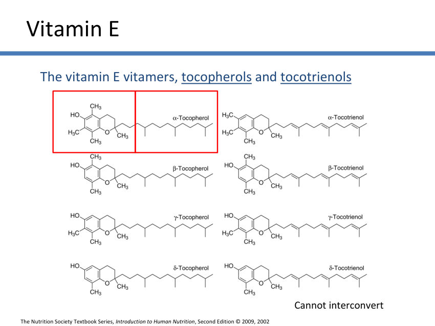

**How to read this slide:** left column is the four tocopherols, right column the four tocotrienols. The tocotrienols have double bonds in the tail. The red box on α-tocopherol shows the ring and the tail.

- Vitamin E is a family of **8 vitamers**.
- **Tocopherols**: α, β, γ, δ. Saturated tail.
- **Tocotrienols**: α, β, γ, δ. Tail with three double bonds.
- They **cannot interconvert**. The body cannot turn γ into α.
- **α-tocopherol is the most active.**

 

### 🧠 Check
How many vitamers of vitamin E are there? Which one is the most active?

Answer

Eight: four tocopherols and four tocotrienols.

α-tocopherol is the most active.

---

## 2. α-tocopherol equivalents

Different vitamers have different biological potency.
So we count vitamin E in **α-tocopherol equivalents**.

 

### 📐 Equation 1: α-tocopherol equivalents

$$\text{mg α-TE} = \text{mg α-toc} + 0.5 \times \text{mg β-toc} + 0.1 \times \text{mg γ-toc} + 0.3 \times \text{mg α-tocotrienol}$$

| Symbol | Meaning | Units |
|---|---|---|
| mg α-TE | vitamin E activity of the food | mg |
| mg α-toc | α-tocopherol in the food | mg |
| mg β-toc | β-tocopherol, counts half | mg |
| mg γ-toc | γ-tocopherol, counts one tenth | mg |
| mg α-tocotrienol | α-tocotrienol, counts 0.3 | mg |

**Why it holds:** each vitamer is weighted by how active it is compared with α-tocopherol. α counts fully.

**Use it when:** a question gives the tocopherol breakdown of an oil or food and asks for its vitamin E content.

**Does not apply:** to δ-tocopherol or the other tocotrienols. They are not in the formula.

 

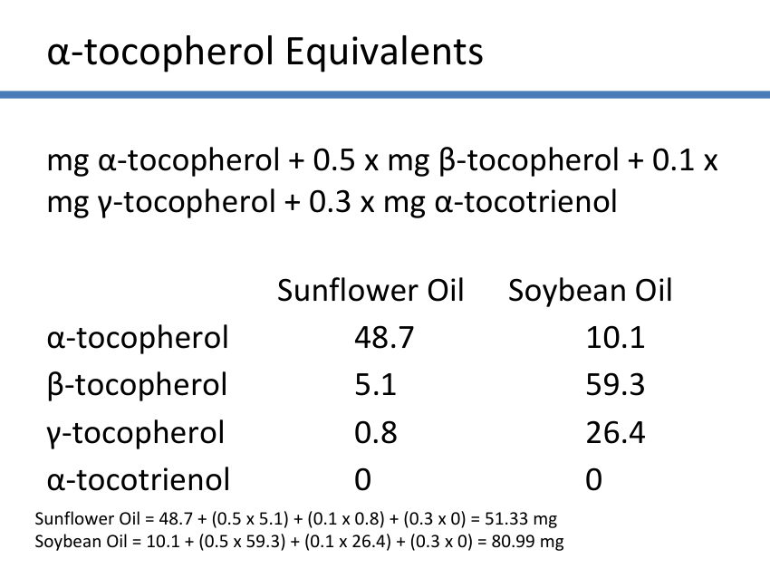

**Worked example from the slide:**

| | Sunflower oil | Soybean oil |
|---|---|---|
| α-tocopherol | 48.7 | 10.1 |
| β-tocopherol | 5.1 | 59.3 |
| γ-tocopherol | 0.8 | 26.4 |
| α-tocotrienol | 0 | 0 |

Sunflower oil = 48.7 + (0.5 × 5.1) + (0.1 × 0.8) + (0.3 × 0) = **51.33 mg**

Soybean oil = 10.1 + (0.5 × 59.3) + (0.1 × 26.4) + (0.3 × 0) = **80.99 mg**

 

### 🧠 Check
An oil has 20 mg α-tocopherol and 10 mg γ-tocopherol. How many mg α-TE?

Answer

20 + 0.1 × 10 = 21 mg α-TE.

---

## 3. Foods and AI

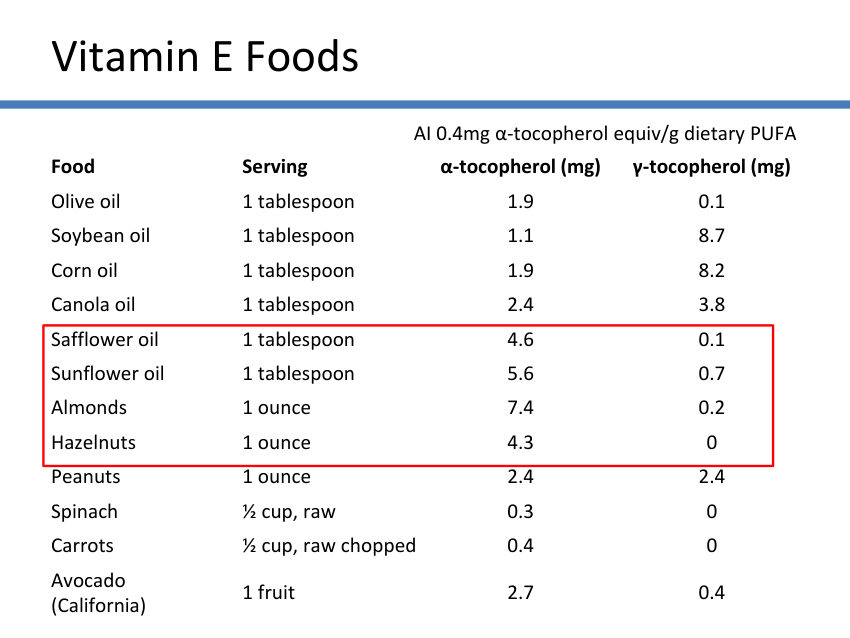

**How to read this table:** two columns of numbers. The first is α-tocopherol, the one that counts most. The second is γ-tocopherol. Soybean and corn oil are high in γ but low in α.

| Food | Serving | α-tocopherol (mg) | γ-tocopherol (mg) |
|---|---|---|---|
| Almonds | 1 oz | **7.4** | 0.2 |
| Sunflower oil | 1 tbsp | **5.6** | 0.7 |
| Safflower oil | 1 tbsp | 4.6 | 0.1 |
| Hazelnuts | 1 oz | 4.3 | 0 |
| Avocado | 1 fruit | 2.7 | 0.4 |
| Canola oil | 1 tbsp | 2.4 | 3.8 |
| Peanuts | 1 oz | 2.4 | 2.4 |
| Olive oil | 1 tbsp | 1.9 | 0.1 |
| Corn oil | 1 tbsp | 1.9 | 8.2 |
| Soybean oil | 1 tbsp | 1.1 | 8.7 |
| Carrots | ½ cup | 0.4 | 0 |
| Spinach | ½ cup | 0.3 | 0 |

 

**Adequate intake:** **0.4 mg α-TE per gram of dietary PUFA.**

The more PUFA you eat, the more vitamin E you need to protect it.

 

### 🧠 Check
Why is the vitamin E requirement set per gram of PUFA?

Answer

Vitamin E protects PUFA from oxidation. More PUFA in the diet means more to protect, so more vitamin E is needed.

---

## 4. Absorption and transport

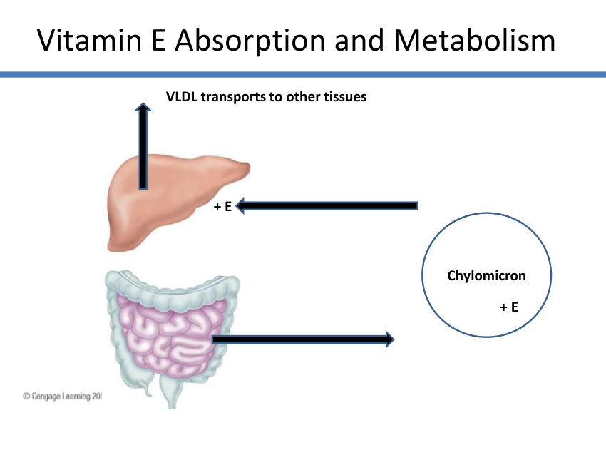

**How to read this slide:** same picture as vitamin A. Gut → chylomicron → liver. Then VLDL out to tissues.

1. Absorbed with fat in the gut.
2. Packed into **chylomicrons**.
3. Delivered to the **liver**.
4. The liver sends it out in **VLDL** to other tissues.

 

**Link to Topic 1:** this is the fat-soluble pattern. Lymph first, then blood.

---

## 5. Free radicals

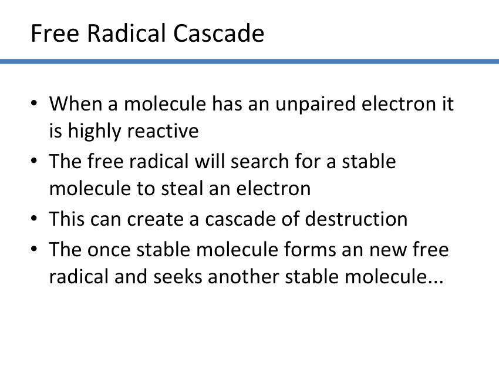

**What a free radical is:**

- A molecule with an **unpaired electron**.
- That makes it **highly reactive**.
- It searches for a stable molecule and **steals an electron**.
- The once-stable molecule is now a new free radical.
- It attacks the next molecule. That is the **cascade of destruction**.

 

**What free radicals damage:**

| Damage | Effect |
|---|---|
| Cell membranes | transport in and out of cells |
| DNA | impaired cell function |
| RNA | |
| Proteins | inflammatory response |

 

**Not always bad:** white blood cells make oxygen radicals on purpose to kill invading pathogens.

 

### 🧠 Check
What makes a free radical reactive, and why does one radical lead to many?

Answer

An unpaired electron. The radical steals an electron from a stable molecule, which becomes a radical itself, so the chain goes on.

---

## 6. How antioxidants and vitamin E work

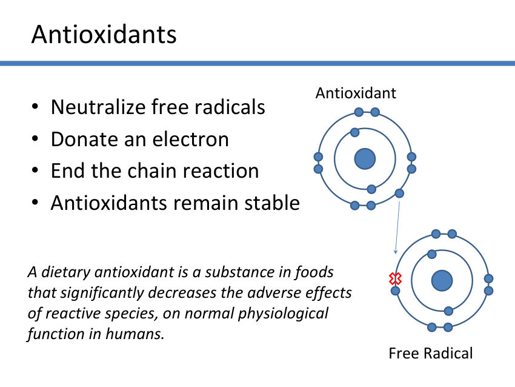

**How to read this slide:** the antioxidant on top has a spare electron to give. It hands it to the free radical below, and the radical is calmed.

**An antioxidant:**

1. **Neutralises** free radicals.
2. **Donates an electron.**
3. **Ends the chain reaction.**
4. **Remains stable** itself.

 

**Definition:** a dietary antioxidant is a substance in foods that significantly decreases the adverse effects of reactive species on normal physiological function in humans.

 

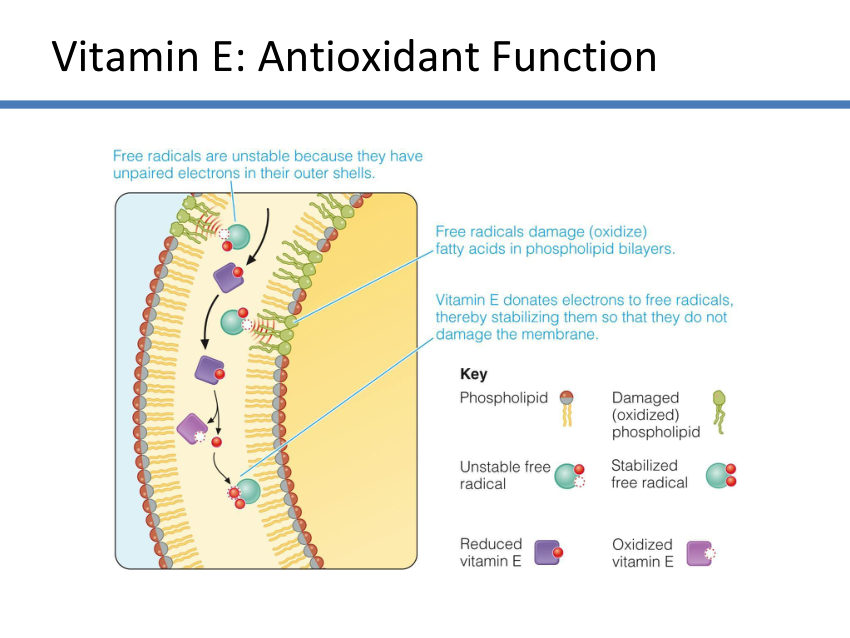

**How to read this slide:** the membrane is made of phospholipids with PUFA tails. Free radicals oxidise the tails. Vitamin E in the membrane donates electrons to the radicals and stops the damage.

 

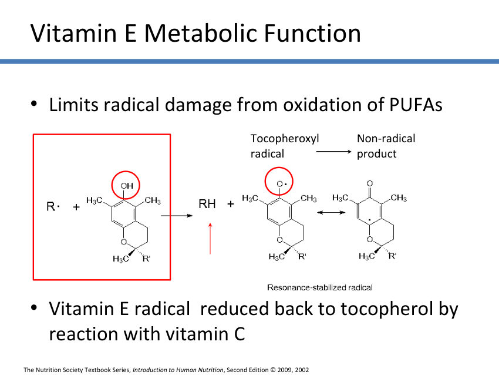

**How to read this slide:** R· is a radical. Vitamin E gives it a hydrogen, so R· becomes RH. Vitamin E becomes the tocopheroxyl radical, which is stable because of resonance in the ring.

**The vitamin E mechanism:**

- Vitamin E limits radical damage from the **oxidation of PUFAs**.
- It donates **hydrogen from its phenolic –OH group** to the radical.
- Vitamin E becomes the **tocopheroxyl radical**.
- That radical is **stabilised by the aromatic ring** (resonance), so it does not attack anything.
- The vitamin E radical is **reduced back to tocopherol by vitamin C**.

 

### 🧠 Check
Which part of vitamin E gives up the hydrogen? What turns vitamin E back into its active form?

Answer

The phenolic –OH group on the ring.

Vitamin C reduces the tocopheroxyl radical back to tocopherol.

---

## 7. The antioxidant network and disease

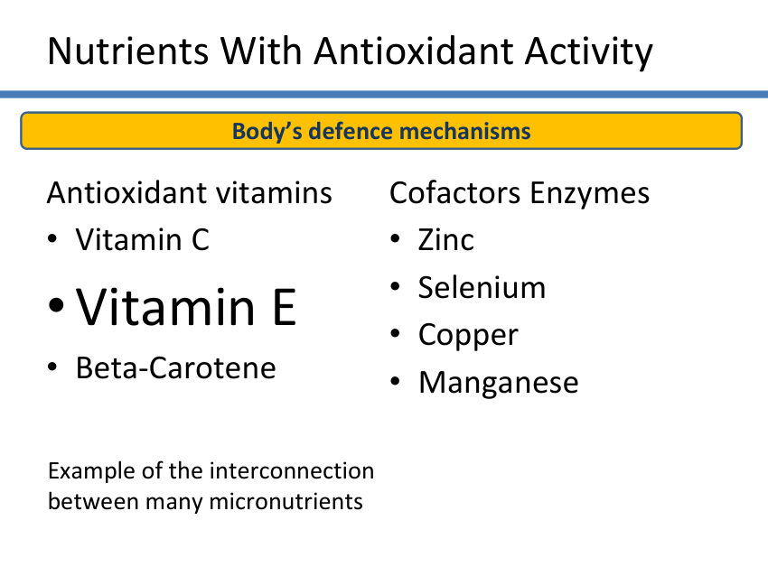

**The body's defence:**

| Antioxidant vitamins | Cofactors for antioxidant enzymes |
|---|---|
| Vitamin C | Zinc |
| **Vitamin E** | Selenium |
| β-carotene | Copper |
| | Manganese |

This is an example of how many micronutrients work together.

 

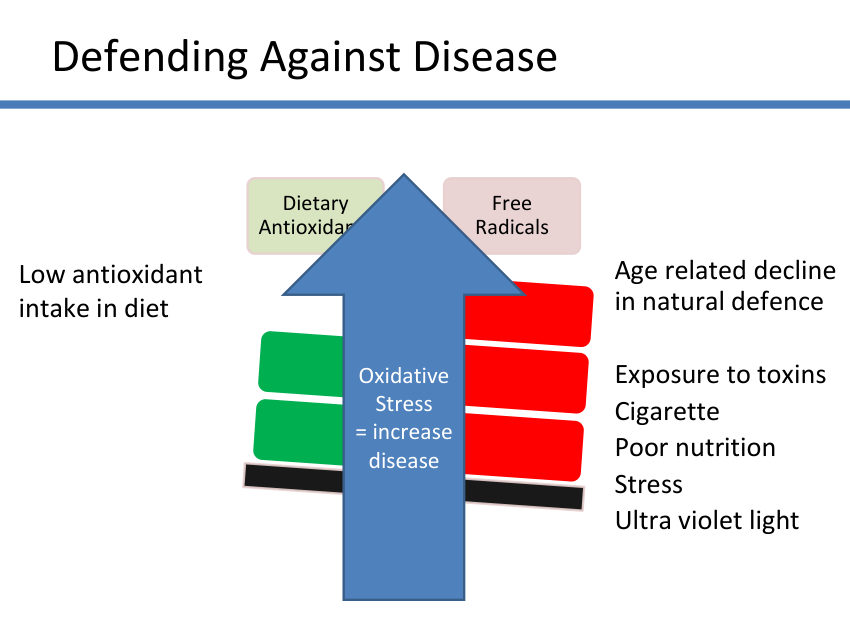

**How to read this slide:** green blocks are dietary antioxidants, red blocks are free radicals. When the red side wins, you get oxidative stress and more disease.

**What tips the balance towards oxidative stress:**

- Low antioxidant intake in the diet.
- Age-related decline in natural defence.
- Exposure to toxins: cigarettes, poor nutrition, stress, UV light.

 

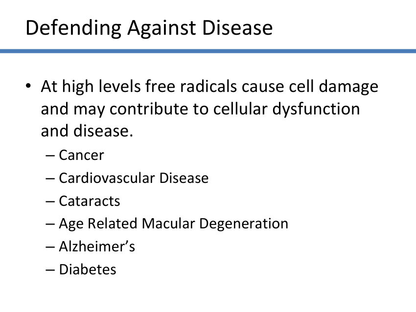

**Diseases linked to free radical damage:**

- Cancer
- Cardiovascular disease
- Cataracts
- Age-related macular degeneration
- Alzheimer's
- Diabetes

 

### 🧠 Check
Name three antioxidant vitamins and two minerals that act as cofactors for antioxidant enzymes.

Answer

Vitamins: C, E, β-carotene.

Minerals: any two of zinc, selenium, copper, manganese.

---

## 8. Trials, deficiency and toxicity

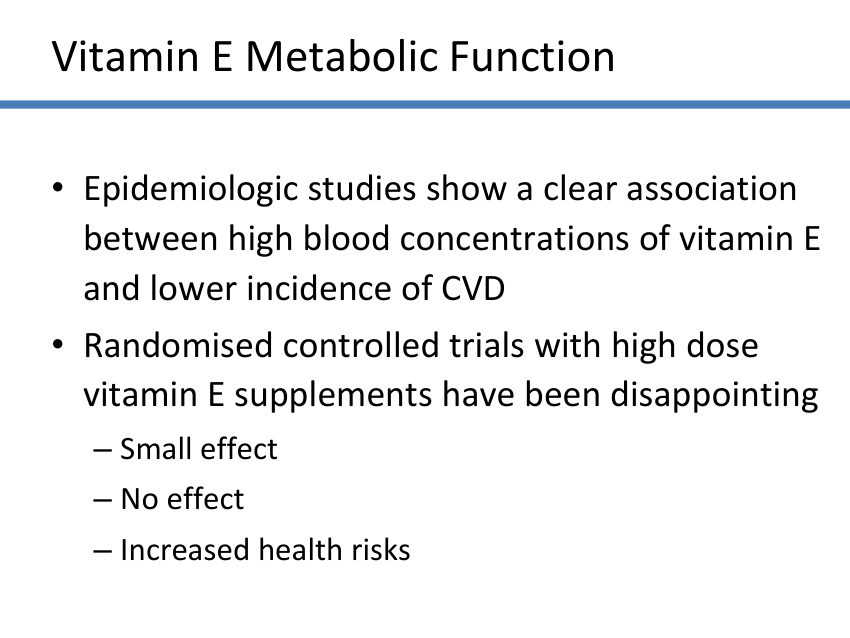

**What the evidence says:**

- **Epidemiology:** people with high blood vitamin E have **less cardiovascular disease**.
- **Randomised controlled trials** of high-dose vitamin E supplements have been **disappointing**: small effect, no effect, or **increased health risks**.

Association is not the same as cause.

 

**Deficiency (rare):** neurological issues, haemolytic anaemia.

**Toxicity (rare):** high doses may **increase bleeding risk** because vitamin E can **inhibit vitamin K**.

 

### 🧠 Check
Why might very high vitamin E doses cause bleeding?

Answer

Vitamin E can inhibit vitamin K, and vitamin K is needed for blood clotting.

---

## Summary (slide 43)

- Fat-soluble antioxidant. Main form α-tocopherol.
- Protects cell membranes from oxidative damage.
- Donates hydrogen from the phenolic –OH to neutralise free radicals. Radical stabilised by the aromatic ring.
- Regenerated by vitamin C.
- Supports immune function and skin health.
- Deficiency rare: neurological issues, haemolytic anaemia.
- Toxicity rare: high doses may raise bleeding risk by inhibiting vitamin K.
- Sources: nuts, seeds, vegetable oils, green leafy vegetables.
