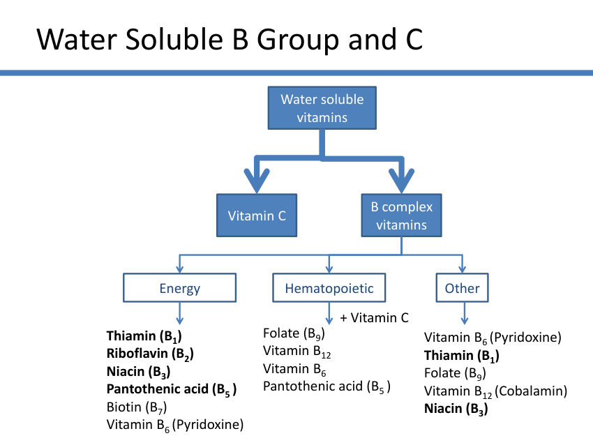
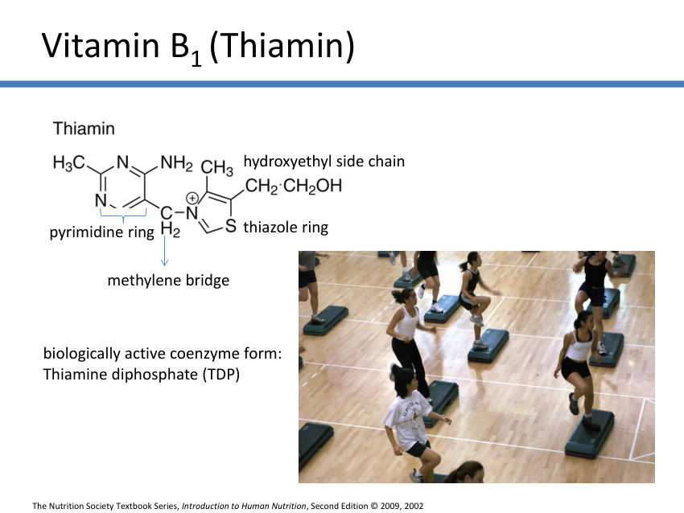
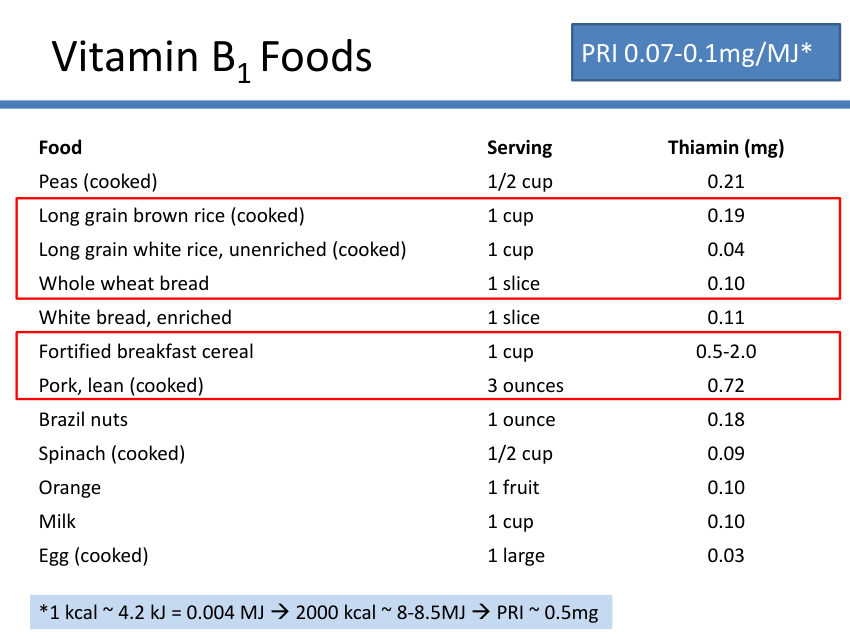
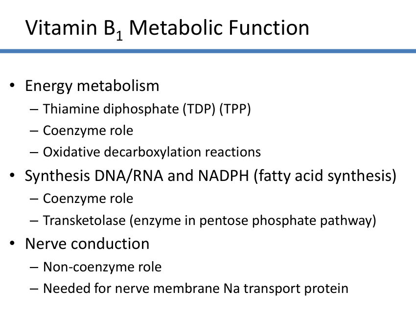
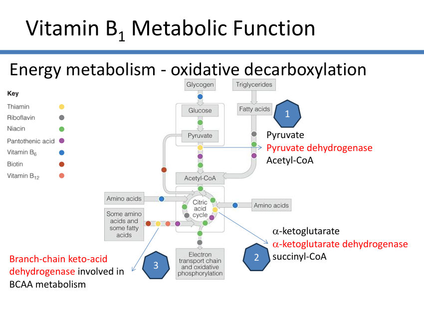
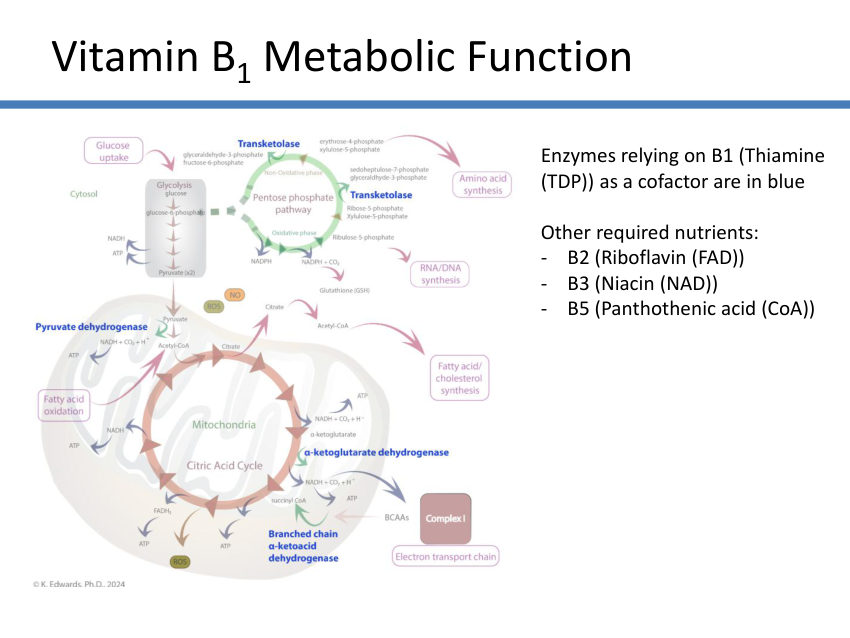
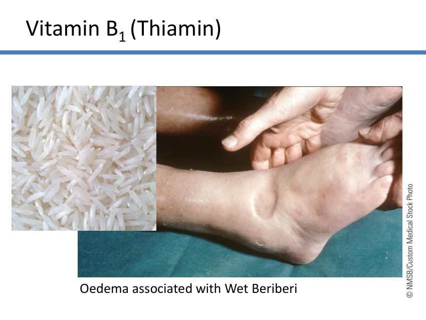
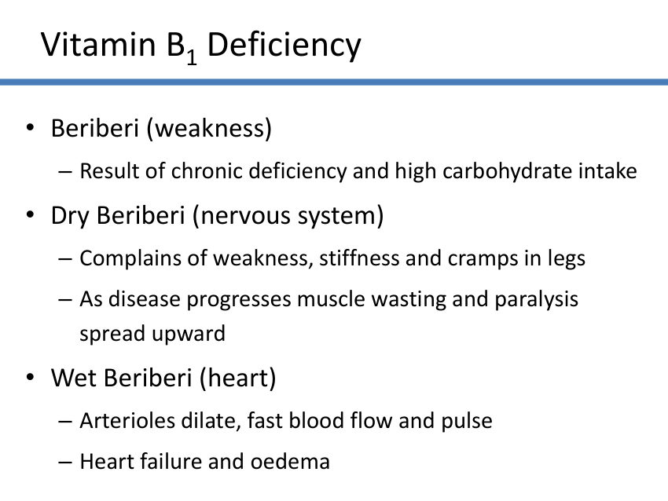
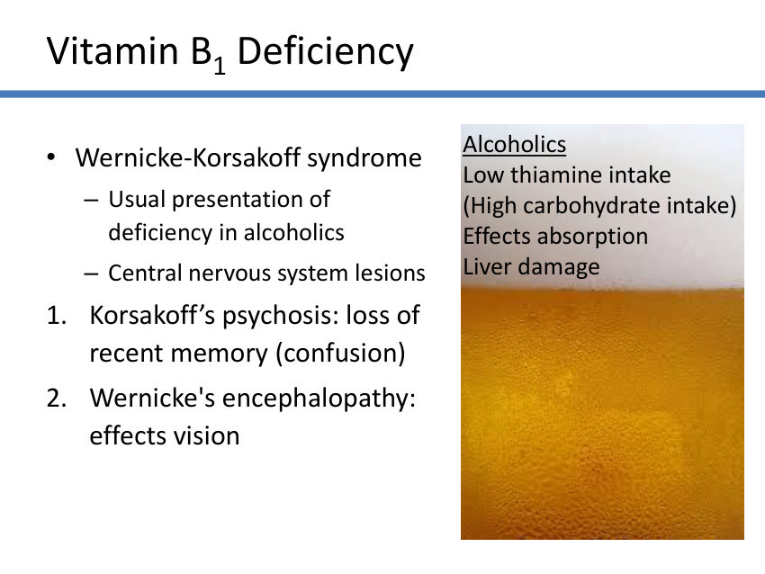

# Topic 6 — The B group and thiamin (B1)

Slides: Lecture 14 (Vitamins B1–5), pages 5 to 13

---

## The big idea

The B vitamins are **water-soluble**.

Most of them are **coenzymes**: helpers that enzymes need to work.

Thiamin (B1) is the coenzyme **TDP**.

TDP sits in the enzymes that burn carbohydrate for energy.

Too little thiamin, with a high carbohydrate diet → **beriberi**.

In alcoholics → **Wernicke-Korsakoff syndrome**.

---

**How to use these notes:**
When you see 🧠, stop.
Say the answer out loud or write it down.
Then click to check.

---

## ⭐ Learn by heart from this topic

**The thiamin card.** Cover the right column and say it from memory.

| Ask | Answer |
|---|---|
| Soluble in | Water |
| Other name | Vitamin B1 |
| Coenzyme form | Thiamine diphosphate (TDP), also called thiamine pyrophosphate (TPP) |
| Structure | Pyrimidine ring + thiazole ring, joined by a methylene bridge |
| Best foods | Pork, fortified breakfast cereal, peas, brown rice, whole wheat bread, Brazil nuts |
| Requirement | PRI 0.07–0.1 mg per MJ of energy. About 0.5 mg a day at 2000 kcal |
| Functions | Energy metabolism (oxidative decarboxylation). DNA/RNA and NADPH synthesis (transketolase). Nerve conduction |
| Key enzymes | Pyruvate dehydrogenase. α-ketoglutarate dehydrogenase. Branched-chain keto-acid dehydrogenase |
| Deficiency | Beriberi (dry = nerves, wet = heart). Wernicke-Korsakoff syndrome in alcoholics |

 

**The B-group map.** Three jobs, and which B vitamins do each.

| Job | B vitamins |
|---|---|
| Energy | B1, B2, B3, B5, B7, B6 |
| Hematopoietic (blood making) | B9, B12, B6, B5, plus vitamin C |
| Other | B6, B1, B9, B12, B3 |

---

## 1. The B-group map

**How to read this slide:**

- Top box: **water-soluble vitamins**.
- They split into two: **vitamin C** on the left, the **B complex** on the right.
- The B complex splits into three jobs: **Energy**, **Hematopoietic**, **Other**.
- Some vitamins appear under more than one job. B6 appears under all three.

 

**The whole B complex:**

| Number | Name |
|---|---|
| B1 | Thiamin |
| B2 | Riboflavin |
| B3 | Niacin |
| B5 | Pantothenic acid |
| B6 | Pyridoxine |
| B7 | Biotin |
| B9 | Folate |
| B12 | Cobalamin |

 

**Energy group:** B1, B2, B3, B5, B7, B6.
These are coenzymes in burning food for ATP.

**Hematopoietic group:** B9, B12, B6, B5, with vitamin C.
These help make red blood cells.

**Other:** B6, B1, B9, B12, B3.

 

**Link to Topic 1:** water-soluble vitamins are absorbed straight into the blood, travel freely, are not stored, and the kidneys remove the excess in urine. So they are needed more often than the fat-soluble ones.

 

### 🧠 Check
Which B vitamins are in the energy group?

Answer

B1, B2, B3, B5, B7 and B6.

Hook: the low numbers burn fuel. 1, 2, 3, 5, 7, plus 6.

---

## 2. Structure and coenzyme form

**How to read this slide:**

- Left ring = **pyrimidine ring**.
- Right ring = **thiazole ring** (it has the S in it).
- They are joined by a **methylene bridge** (one CH₂).
- Hanging off the thiazole ring is the **hydroxyethyl side chain** (CH₂CH₂OH).

 

The active coenzyme is made by adding two phosphates to that side chain.

**Thiamine diphosphate (TDP) = thiamine pyrophosphate (TPP).**
Two names, one molecule.

 

### 🧠 Check
What are the two rings in thiamin, and what joins them?

Answer

A pyrimidine ring and a thiazole ring, joined by a methylene bridge.

---

## 3. Foods and requirement per MJ

**How to read this table:** the numbers are mg thiamin per serving. Look at the red boxes. Brown rice beats unenriched white rice by five times. Fortified cereal and pork are the big ones.

| Food | Serving | Thiamin (mg) |
|---|---|---|
| Fortified breakfast cereal | 1 cup | **0.5–2.0** |
| Pork, lean, cooked | 3 oz | **0.72** |
| Peas, cooked | ½ cup | 0.21 |
| Long grain brown rice, cooked | 1 cup | 0.19 |
| Brazil nuts | 1 oz | 0.18 |
| White bread, enriched | 1 slice | 0.11 |
| Whole wheat bread | 1 slice | 0.10 |
| Milk | 1 cup | 0.10 |
| Orange | 1 fruit | 0.10 |
| Spinach, cooked | ½ cup | 0.09 |
| Long grain white rice, unenriched | 1 cup | 0.04 |
| Egg, cooked | 1 large | 0.03 |

 

**Refining removes thiamin.** Brown rice 0.19 mg, unenriched white rice 0.04 mg.
Enriched white bread gets it back: 0.11 mg, about the same as whole wheat.

 

**The requirement is per unit of energy, not per day.**

PRI = **0.07 to 0.1 mg per MJ**.

Because thiamin is needed to burn carbohydrate, the more energy you eat, the more thiamin you need.

 

### 📐 Equation 1: thiamin requirement from energy intake

$$\text{MJ} = \text{kcal} \times 0.0042$$

$$\text{PRI (mg)} = 0.07 \text{ to } 0.1 \times \text{MJ}$$

| Symbol | Meaning | Units |
|---|---|---|
| kcal | daily energy intake | kcal |
| MJ | the same energy in megajoules | MJ |
| 0.0042 | 1 kcal = 4.2 kJ = 0.0042 MJ | MJ per kcal |
| PRI | population reference intake of thiamin | mg per day |
| 0.07 to 0.1 | thiamin needed per MJ | mg per MJ |

**Why it holds:** thiamin is the coenzyme that burns carbohydrate. The need scales with the energy burned, so it is set per MJ.

**Use it when:** a question gives an energy intake in kcal or MJ and asks for the thiamin requirement.

**Does not apply:** to vitamins with a fixed daily amount, such as pantothenic acid (AI 5 mg) or folate.

 

**Worked example from the slide:**

2000 kcal × 0.0042 = 8.4 MJ, so about 8 to 8.5 MJ.

8.4 × 0.07 = 0.59 mg. 8.4 × 0.1 = 0.84 mg.

So the PRI is roughly **0.5 mg** and up.

 

### 🧠 Check
Someone eats 3000 kcal a day. Roughly how many MJ is that?

Answer

3000 × 0.0042 = 12.6 MJ.

Their thiamin PRI would be 0.07 × 12.6 = 0.88 mg up to 0.1 × 12.6 = 1.26 mg.

---

## 4. Functions

Thiamin has three jobs. Two are coenzyme jobs. One is not.

| Job | Coenzyme? | What happens |
|---|---|---|
| **Energy metabolism** | Yes, as TDP | Oxidative decarboxylation reactions |
| **DNA/RNA and NADPH synthesis** | Yes, as TDP | Coenzyme for transketolase in the pentose phosphate pathway. NADPH is needed for fatty acid synthesis |
| **Nerve conduction** | No | Needed for the nerve membrane Na transport protein |

 

**Oxidative decarboxylation** means: take a carboxyl group off as CO₂ and oxidise what is left.

 

### 🧠 Check
Which thiamin job is not a coenzyme job?

Answer

Nerve conduction. Thiamin is needed for the Na transport protein in nerve membranes.

---

## 5. The three TDP enzymes

**How to read this slide:** the pathway is the big grey map of energy metabolism. The coloured dots mark where each B vitamin is needed. Yellow = thiamin. The three numbered blue hexagons are the three TDP enzymes.

 

| # | Enzyme | Reaction |
|---|---|---|
| 1 | **Pyruvate dehydrogenase** | Pyruvate → acetyl-CoA |
| 2 | **α-ketoglutarate dehydrogenase** | α-ketoglutarate → succinyl-CoA |
| 3 | **Branched-chain keto-acid dehydrogenase** | Breaks down branched-chain amino acids (BCAA) |

 

Enzyme 1 is the gate between glycolysis and the TCA cycle.
Enzyme 2 is inside the TCA cycle.
Enzyme 3 is on the amino acid side.

 

**How to read this slide:** the enzymes that need thiamin (TDP) are in blue. Transketolase is at the top in the pentose phosphate pathway. Pyruvate dehydrogenase and α-ketoglutarate dehydrogenase are near the citric acid cycle.

 

**These enzymes need other B vitamins too:**

| Vitamin | Coenzyme |
|---|---|
| B2 riboflavin | FAD |
| B3 niacin | NAD |
| B5 pantothenic acid | CoA |

So one reaction, pyruvate → acetyl-CoA, needs B1, B2, B3 and B5 at once.

 

### 🧠 Check
Name the three TDP-dependent enzymes.

Answer

Pyruvate dehydrogenase. α-ketoglutarate dehydrogenase. Branched-chain keto-acid dehydrogenase.

---

## 6. Deficiency: beriberi

**How to read this slide:** polished white rice on the left. A swollen foot on the right. That is the oedema of wet beriberi. The pressed finger leaves a dent.

 

**Beriberi** means weakness.

It comes from **chronic deficiency plus a high carbohydrate intake**.
Lots of carbohydrate to burn, but no thiamin to burn it with.

 

| Type | System | Signs |
|---|---|---|
| **Dry beriberi** | Nervous system | Weakness, stiffness and cramps in the legs. Then muscle wasting and paralysis that spread upward |
| **Wet beriberi** | Heart | Arterioles dilate, fast blood flow and pulse. Heart failure and oedema |

 

**Hook:** dry = nerves and muscles waste away. Wet = the heart fails and fluid collects.

 

### 🧠 Check
Which beriberi affects the heart, and what are its two signs?

Answer

Wet beriberi. Heart failure and oedema. Arterioles dilate, with fast blood flow and pulse.

---

## 7. Wernicke-Korsakoff and alcohol

**Wernicke-Korsakoff syndrome** is the usual way thiamin deficiency shows up in **alcoholics**.

It is caused by lesions in the central nervous system.

 

| Part | What goes wrong |
|---|---|
| **Korsakoff's psychosis** | Loss of recent memory. Confusion |
| **Wernicke's encephalopathy** | Affects vision |

 

**Why alcoholics get it:**

- Low thiamin intake.
- High carbohydrate intake (alcohol).
- Alcohol affects absorption of thiamin.
- Liver damage.

 

### 🧠 Check
Which part of Wernicke-Korsakoff affects memory, and which affects vision?

Answer

Korsakoff's psychosis = memory loss and confusion.
Wernicke's encephalopathy = vision.

---

## Summary (slide 34)

- Thiamin (B1) has a key role in energy metabolism as TDP.
- TDP enzymes: pyruvate dehydrogenase, α-ketoglutarate dehydrogenase, branched-chain keto-acid dehydrogenase. Also transketolase.
- Non-coenzyme role in nerve conduction.
- Requirement is set per MJ: 0.07–0.1 mg/MJ.
- Deficiency = beriberi, in alcoholism and high carbohydrate with low thiamin intake. Dry = nerves. Wet = heart.
- Wernicke-Korsakoff syndrome in alcoholics.
