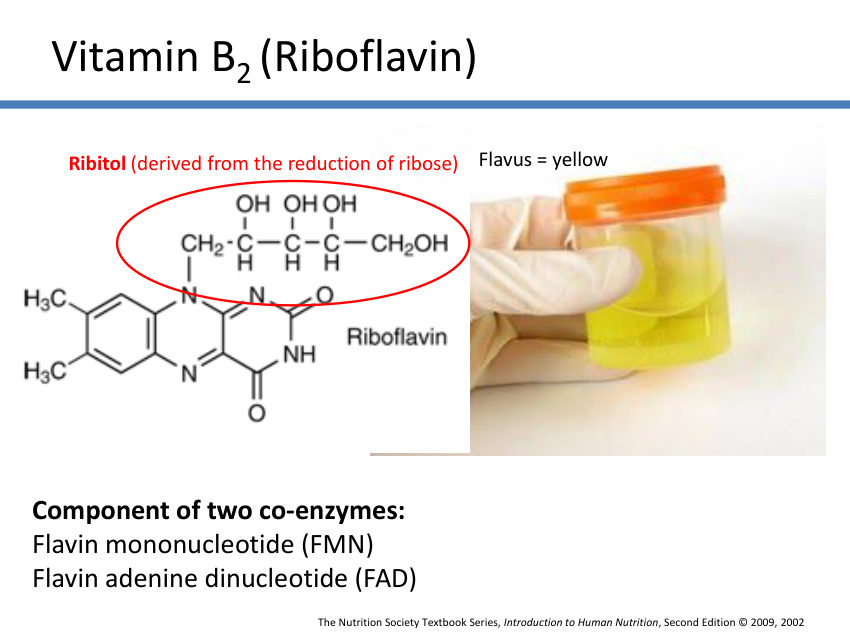
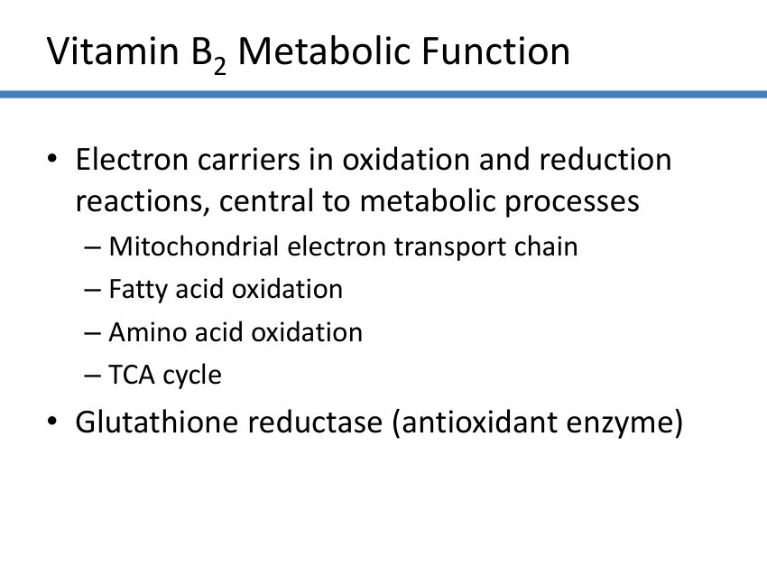
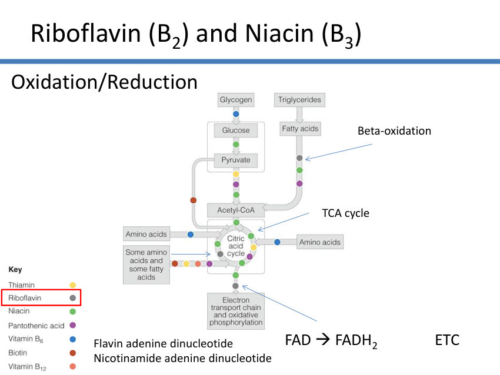
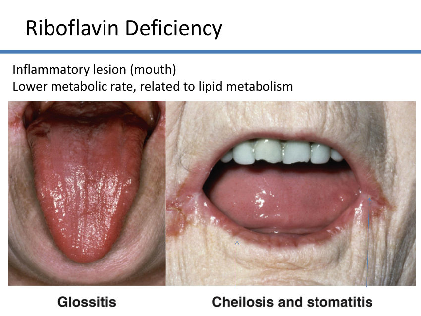
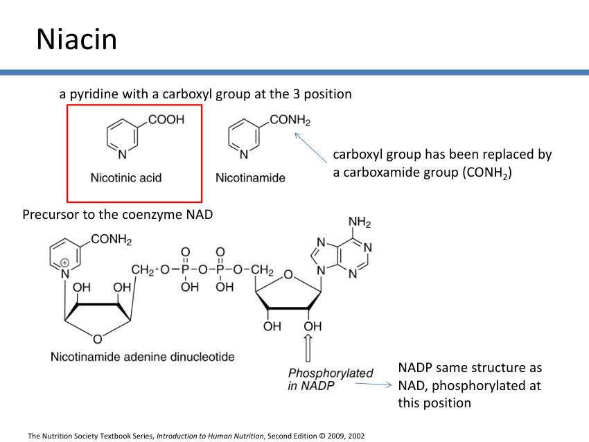
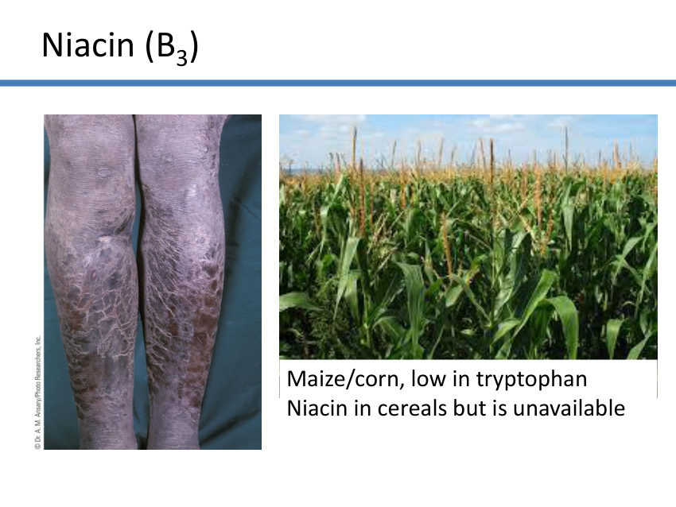
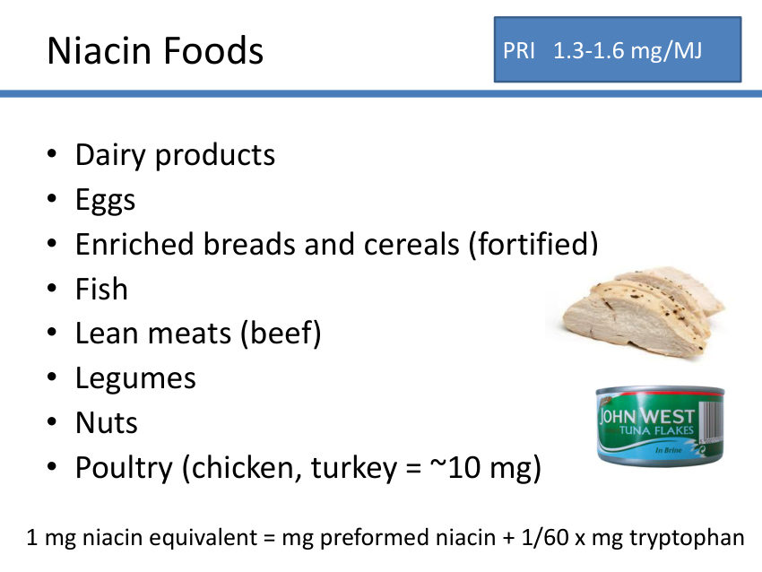
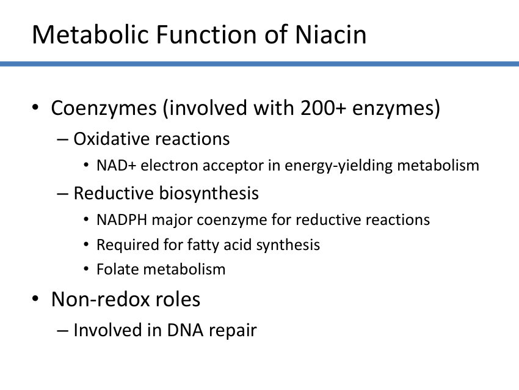
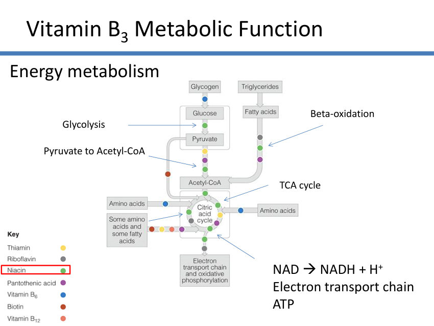
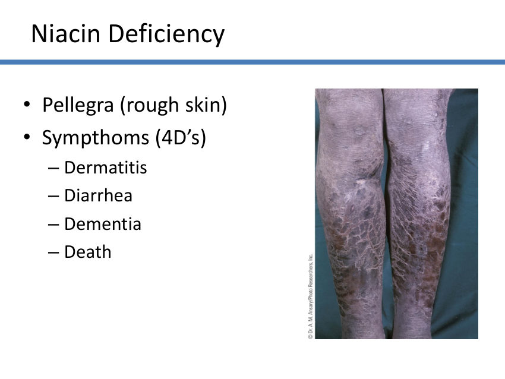

# Topic 7 — Riboflavin (B2) and niacin (B3)

Slides: Lecture 14 (Vitamins B1–5), pages 14 to 24

---

## The big idea

Riboflavin and niacin are both **electron carriers**.

Riboflavin makes **FAD** and **FMN**.
Niacin makes **NAD** and **NADP**.

They carry electrons in the reactions that make ATP.

Riboflavin deficiency → **sore, inflamed mouth**.
Niacin deficiency → **pellagra, the 4 Ds**.

Niacin is special: the body can make it from the amino acid **tryptophan**.

---

**How to use these notes:**
When you see 🧠, stop.
Say the answer out loud or write it down.
Then click to check.

---

## ⭐ Learn by heart from this topic

**The riboflavin card.** Cover the right column and say it from memory.

| Ask | Answer |
|---|---|
| Soluble in | Water |
| Other name | Vitamin B2. Flavus = yellow |
| Coenzyme forms | FMN (flavin mononucleotide) and FAD (flavin adenine dinucleotide) |
| Structure | Ring system with a ribitol side chain |
| Best foods | Milk, cheese and dairy. Eggs. Almonds. Fortified cereals. Liver, meat, fish. Broccoli, spinach |
| Requirement | PRI 1.3–1.6 mg/MJ |
| Function | Electron carrier in redox reactions: ETC, fatty acid oxidation, amino acid oxidation, TCA. Glutathione reductase |
| Deficiency | Inflamed mouth: glossitis, cheilosis, stomatitis. Cracked lips, sore throat, skin disorders |

 

**The niacin card.**

| Ask | Answer |
|---|---|
| Soluble in | Water |
| Other name | Vitamin B3. Nicotinic acid and nicotinamide |
| Coenzyme forms | NAD and NADP |
| Structure | Pyridine ring with a carboxyl group at position 3 |
| Made from | Tryptophan. 60 mg tryptophan = 1 mg niacin |
| Best foods | Poultry (about 10 mg). Lean meat, fish, dairy, eggs, legumes, nuts, enriched cereals |
| Requirement | PRI 1.3–1.6 mg/MJ |
| Function | NAD+ accepts electrons in energy metabolism. NADPH for synthesis. DNA repair |
| Deficiency | Pellagra: dermatitis, diarrhoea, dementia, death |

 

**The niacin equivalent:**

- 1 mg NE = 1 mg niacin, or 60 mg tryptophan.

---

## 1. Riboflavin structure and coenzymes

**How to read this slide:**

- The three-ring system on the left is the flavin part.
- The chain circled in red is **ribitol**. It comes from reducing the sugar ribose.
- The yellow fluid in the photo is urine. Riboflavin is yellow. Flavus means yellow in Latin.

 

Riboflavin is part of two coenzymes:

| Coenzyme | Full name |
|---|---|
| **FMN** | Flavin mononucleotide |
| **FAD** | Flavin adenine dinucleotide |

 

### 🧠 Check
What are the two coenzymes made from riboflavin?

Answer

FMN (flavin mononucleotide) and FAD (flavin adenine dinucleotide).

---

## 2. Riboflavin foods and PRI

Riboflavin is in a wide range of foods.

| Group | Foods |
|---|---|
| Grains | Whole grain, enriched grain foods, fortified cereals |
| Dairy | **Milk, cheese and other dairy products** |
| Eggs | Eggs |
| Nuts | Almonds |
| Meat and fish | Salmon, halibut, chicken, beef, liver |
| Vegetables | Broccoli, asparagus, spinach |

 

**PRI: 1.3–1.6 mg/MJ** as given on the slide.

Like thiamin, the requirement is tied to energy intake.

 

### 🧠 Check
Name the food group written in bold on the riboflavin foods slide.

Answer

Milk, cheese and other dairy products.

---

## 3. Riboflavin functions

Riboflavin coenzymes are **electron carriers** in oxidation and reduction reactions.

FAD picks up two hydrogens: **FAD → FADH₂**.

 

**How to read this slide:** the grey map is energy metabolism. Riboflavin is the grey dot in the key, boxed in red. It sits in β-oxidation, the TCA cycle and the electron transport chain.

 

| Where | What |
|---|---|
| Mitochondrial electron transport chain | FADH₂ hands electrons on to make ATP |
| Fatty acid oxidation (β-oxidation) | FAD accepts electrons |
| Amino acid oxidation | FAD accepts electrons |
| TCA cycle | FAD → FADH₂ |
| Glutathione reductase | An antioxidant enzyme that needs FAD |

 

### 🧠 Check
Name the antioxidant enzyme that needs riboflavin.

Answer

Glutathione reductase.

---

## 4. Riboflavin deficiency

**How to read this slide:** two photos of the mouth. Left: a swollen, smooth, red tongue, called **glossitis**. Right: cracks at the corners of the mouth and inflamed lips, called **cheilosis** and **stomatitis**.

 

Riboflavin deficiency shows up as **inflammatory lesions of the mouth**.

| Sign | Meaning |
|---|---|
| Glossitis | Inflamed tongue |
| Cheilosis | Cracked lips |
| Stomatitis | Inflamed mouth |

Also: sore throat, skin disorders.

And a **lower metabolic rate**, linked to lipid metabolism, because fatty acid oxidation needs FAD.

 

### 🧠 Check
What is glossitis?

Answer

An inflamed tongue. A sign of riboflavin deficiency.

---

## 5. Niacin structure and coenzymes

**How to read this slide:**

- Top left, boxed: **nicotinic acid**. A pyridine ring with a carboxyl group (COOH) at position 3.
- Top right: **nicotinamide**. The carboxyl has been replaced by a carboxamide group (CONH₂).
- Bottom: the big molecule is **NAD**, nicotinamide adenine dinucleotide. Niacin is the precursor.
- **NADP** has the same structure as NAD, plus one phosphate at the position marked.

 

| Form | Group at position 3 |
|---|---|
| Nicotinic acid | –COOH |
| Nicotinamide | –CONH₂ |

 

### 🧠 Check
What is the difference between NAD and NADP?

Answer

NADP is NAD with an extra phosphate. Same structure otherwise.

---

## 6. Niacin foods, tryptophan and niacin equivalents

**How to read this slide:** the legs show the skin of pellagra. The field is maize. Maize is low in tryptophan, and the niacin in cereals is in a form the body cannot use. So people living on maize get pellagra.

 

| Foods |
|---|
| Dairy products |
| Eggs |
| Enriched breads and cereals (fortified) |
| Fish |
| Lean meats (beef) |
| Legumes |
| Nuts |
| Poultry: chicken and turkey, about **10 mg** |

 

**PRI: 1.3–1.6 mg/MJ.**

 

**Niacin is made from tryptophan.**
Tryptophan is an amino acid in protein.
60 mg of tryptophan gives 1 mg of niacin.
So the niacin in a food is counted in **niacin equivalents (NE)**.

 

### 📐 Equation 1: niacin equivalents

$$\text{mg NE} = \text{mg preformed niacin} + \frac{\text{mg tryptophan}}{60}$$

| Symbol | Meaning | Units |
|---|---|---|
| mg NE | niacin equivalents in the food | mg |
| mg preformed niacin | niacin already present in the food | mg |
| mg tryptophan | tryptophan in the food's protein | mg |
| 60 | mg tryptophan that makes 1 mg niacin | mg per mg |

**Why it holds:** the body converts tryptophan to niacin, but it takes about 60 mg tryptophan to make 1 mg.

**Use it when:** a question gives both niacin and tryptophan amounts and asks for total niacin activity.

**Does not apply:** to the niacin in cereals such as maize. That niacin is bound and unavailable, and maize is low in tryptophan too.

 

### 🧠 Check
A meal has 5 mg niacin and 300 mg tryptophan. How many mg NE?

Answer

5 + 300 ÷ 60 = 5 + 5 = 10 mg NE.

---

## 7. Niacin functions

Niacin coenzymes work with **200+ enzymes**.

| Role | Coenzyme | What |
|---|---|---|
| **Oxidative reactions** | NAD+ | Electron acceptor in energy-yielding metabolism |
| **Reductive biosynthesis** | NADPH | Major coenzyme for reductive reactions. Needed for fatty acid synthesis. Folate metabolism |
| **Non-redox** | | DNA repair |

 

**How to read this slide:** niacin is the green dot, boxed in the key. It appears all over the map: glycolysis, pyruvate to acetyl-CoA, the TCA cycle, β-oxidation and the electron transport chain.

 

**NAD → NADH + H⁺**

NAD picks up electrons in glycolysis, pyruvate → acetyl-CoA, the TCA cycle and β-oxidation.
NADH hands them to the electron transport chain to make **ATP**.

 

**Hook:** NAD for breaking down (catabolism). NADPH for building up (synthesis).

 

### 🧠 Check
Which niacin coenzyme is used for fatty acid synthesis?

Answer

NADPH. It is the coenzyme for reductive biosynthesis.

---

## 8. Pellagra

**How to read this slide:** rough, scaly, darkened skin on the legs. Pellagra means rough skin.

 

**Pellagra** = niacin deficiency.

**The 4 Ds:**

1. **Dermatitis**
2. **Diarrhoea**
3. **Dementia**
4. **Death**

 

### 🧠 Check
What are the 4 Ds of pellagra?

Answer

Dermatitis, diarrhoea, dementia, death.

---

## Summary (slide 34)

- Riboflavin (B2): FMN and FAD, electron carriers in energy metabolism. Also glutathione reductase. Deficiency: cracked lips, sore throat, skin disorders, inflamed mouth.
- Niacin (B3): precursor to NAD and NADP. Synthesised from tryptophan, 60 mg = 1 mg NE. Deficiency: pellagra, the 4 Ds.
- Both have a PRI of 1.3–1.6 mg/MJ.
