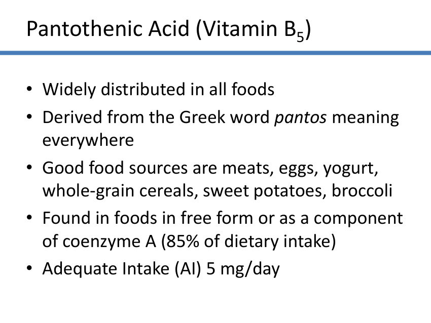
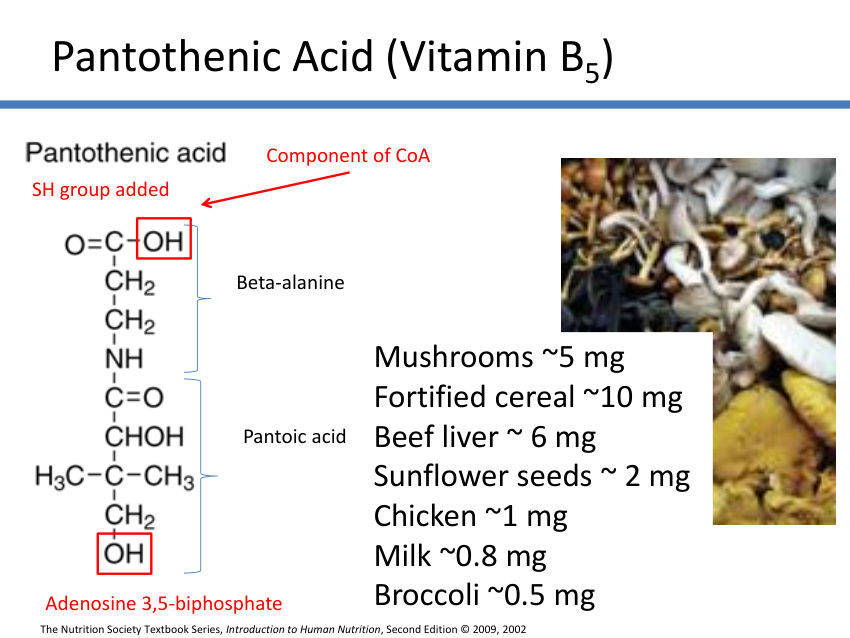
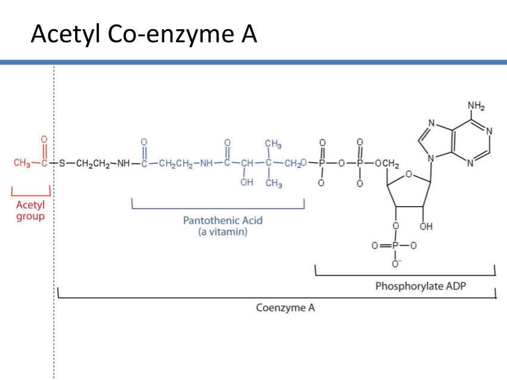
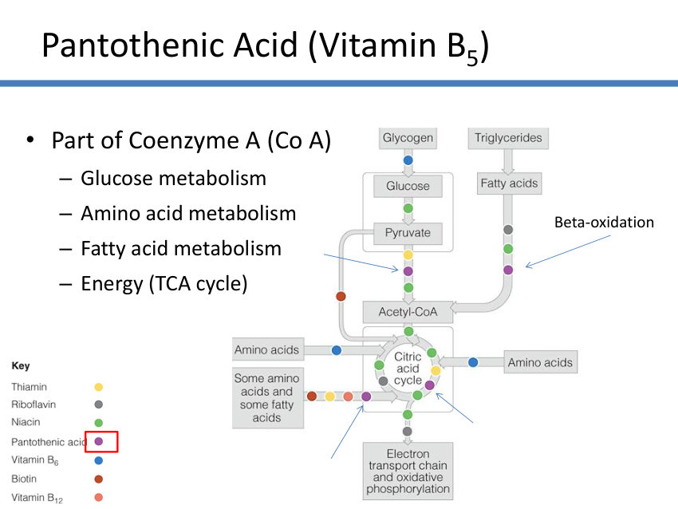
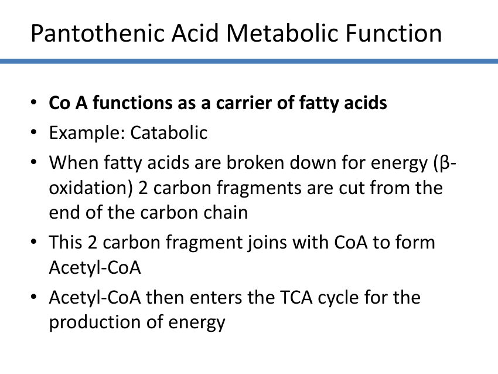
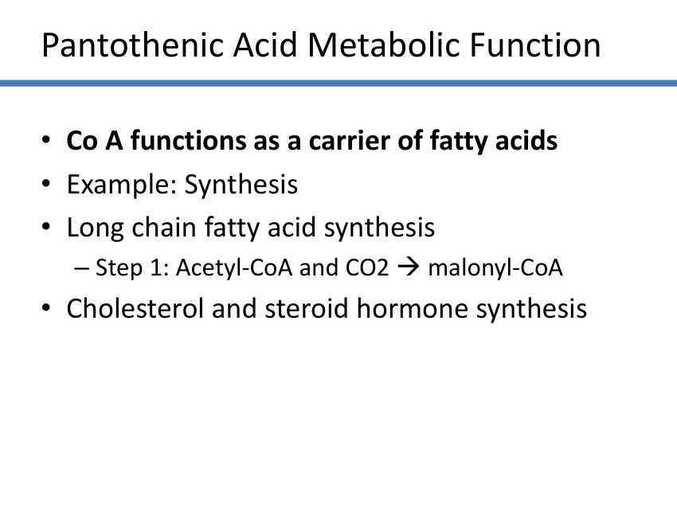
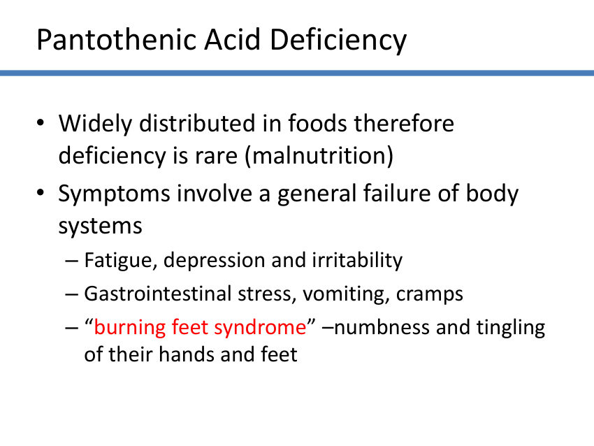

# Topic 8 — Pantothenic acid (B5)

Slides: Lecture 14 (Vitamins B1–5), pages 25 to 33

---

## The big idea

Pantothenic acid is part of **coenzyme A (CoA)**.

CoA carries **2-carbon acetyl groups**.

That makes it central to burning fat, glucose and amino acids for ATP, and to building fatty acids and cholesterol.

It is in nearly every food. Its name means **everywhere**.

So deficiency is rare. When it happens: **burning feet syndrome**.

---

**How to use these notes:**
When you see 🧠, stop.
Say the answer out loud or write it down.
Then click to check.

---

## ⭐ Learn by heart from this topic

**The pantothenic acid card.** Cover the right column and say it from memory.

| Ask | Answer |
|---|---|
| Soluble in | Water |
| Other name | Vitamin B5. Pantos = everywhere |
| Coenzyme form | Coenzyme A (CoA) |
| Structure | Pantoic acid + β-alanine |
| Foods | Everywhere. Meats, eggs, yogurt, whole-grain cereals, sweet potatoes, broccoli. Fortified cereal ≈ 10 mg, liver ≈ 6 mg, mushrooms ≈ 5 mg |
| In food as | Free form, or part of CoA (85% of intake) |
| Requirement | AI 5 mg/day |
| Function | CoA carries fatty acids and acetyl groups. ATP production. Fatty acid, cholesterol and steroid synthesis |
| Deficiency | Rare. Fatigue, depression, irritability. GI upset. Burning feet syndrome |

---

## 1. What it is and where it is found

The name comes from the Greek **pantos**, meaning **everywhere**.
It is widely distributed in all foods.

 

**Good sources:** meats, eggs, yogurt, whole-grain cereals, sweet potatoes, broccoli.

| Food | Pantothenic acid |
|---|---|
| Fortified cereal | about 10 mg |
| Beef liver | about 6 mg |
| Mushrooms | about 5 mg |
| Sunflower seeds | about 2 mg |
| Chicken | about 1 mg |
| Milk | about 0.8 mg |
| Broccoli | about 0.5 mg |

 

In food it is found in the **free form** or as part of **coenzyme A**.
About **85%** of dietary intake is as CoA.

**Adequate Intake (AI): 5 mg/day.**

 

**Link to Topic 1:** it is an AI, not a PRI. An AI is used when there is not enough evidence to set an average requirement.

 

### 🧠 Check
What does pantos mean, and why is that a good name?

Answer

Everywhere. Pantothenic acid is in nearly all foods.

---

## 2. Structure and coenzyme A

**How to read this slide:**

- The molecule on the left is pantothenic acid. The top half is **β-alanine**. The bottom half is **pantoic acid**.
- Red labels show how it becomes CoA. An **SH group is added** at the top. **Adenosine 3,5-bisphosphate** is added at the bottom.
- The photo is mushrooms, a good source.

 

| Part of CoA | Comes from |
|---|---|
| SH group | Added at the top |
| Pantothenic acid | Pantoic acid + β-alanine |
| Adenosine 3,5-bisphosphate | Added at the bottom |

 

**How to read this slide:** the whole long molecule is coenzyme A. Pantothenic acid is the middle part in blue. The **acetyl group** in red is joined to the S of the SH group. That is **acetyl-CoA**.

 

The SH group is the business end. Acetyl groups and fatty acids attach there.

 

### 🧠 Check
Which two pieces make up pantothenic acid?

Answer

Pantoic acid and β-alanine.

---

## 3. Metabolism

1. CoA in food is **broken down to pantothenic acid**.
2. Pantothenic acid is **absorbed in the small intestine**.
3. It circulates in the blood to the **liver**, where it is metabolised and sent round the body.
4. Most of it is used to **make CoA**.

 

CoA is found in high concentrations in the **liver, heart, kidneys and brain**.

 

### 🧠 Check
Where is pantothenic acid absorbed?

Answer

In the small intestine.

---

## 4. Function: CoA in catabolism

**How to read this slide:** pantothenic acid is the purple dot in the key. It appears at acetyl-CoA, in the TCA cycle and in β-oxidation.

 

Pantothenic acid is **critical for ATP production** because it is needed for CoA.

CoA is used in:

- Glucose metabolism
- Amino acid metabolism
- Fatty acid metabolism
- Energy (TCA cycle)

 

**CoA is a carrier of fatty acids.**

**Example: catabolism (β-oxidation).**

1. Fatty acids are broken down for energy. **2-carbon fragments** are cut from the end of the chain.
2. Each 2-carbon fragment joins CoA to make **acetyl-CoA**.
3. Acetyl-CoA enters the **TCA cycle** to make energy.

 

### 🧠 Check
In β-oxidation, how many carbons are cut off at a time, and what do they join?

Answer

Two carbons. They join CoA to make acetyl-CoA, which enters the TCA cycle.

---

## 5. Function: synthesis

CoA also carries fatty acids when the body is **building**.

**Example: long chain fatty acid synthesis.**

Step 1: **acetyl-CoA + CO₂ → malonyl-CoA**.

 

CoA is also needed for **cholesterol and steroid hormone synthesis**.

 

**Hook:** CoA cuts fat down (β-oxidation) and builds fat up (fatty acid synthesis). Both start with acetyl-CoA.

---

## 6. Deficiency

Deficiency is **rare**, because the vitamin is everywhere. It is seen in **malnutrition**.

Symptoms are a **general failure of body systems**:

| Area | Symptoms |
|---|---|
| Mood | Fatigue, depression, irritability |
| Gut | Gastrointestinal stress, vomiting, cramps |
| Nerves | **Burning feet syndrome**: numbness and tingling of the hands and feet |

 

### 🧠 Check
What is burning feet syndrome?

Answer

Numbness and tingling of the hands and feet. The classic sign of pantothenic acid deficiency.

---

## Summary (slide 34)

- Pantothenic acid (B5) is part of coenzyme A.
- CoA carries acetyl groups and fatty acids. Critical for ATP production.
- Catabolism: β-oxidation → acetyl-CoA → TCA cycle. Synthesis: acetyl-CoA + CO₂ → malonyl-CoA, cholesterol, steroids.
- Found everywhere. AI 5 mg/day.
- Deficiency rare: burning feet syndrome.
