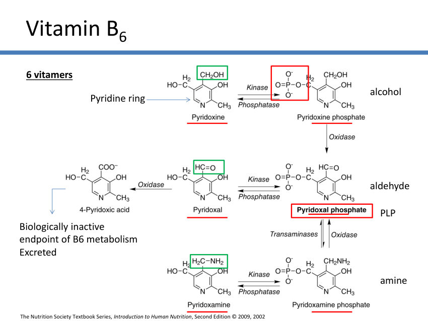
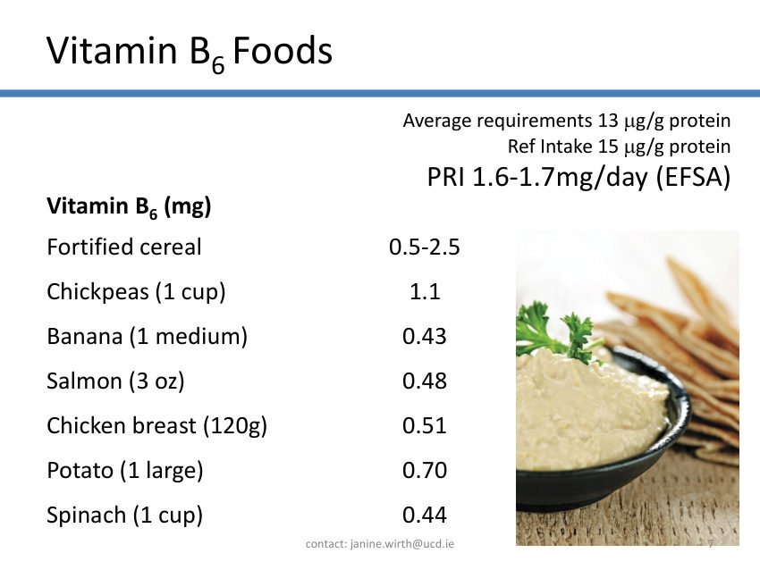
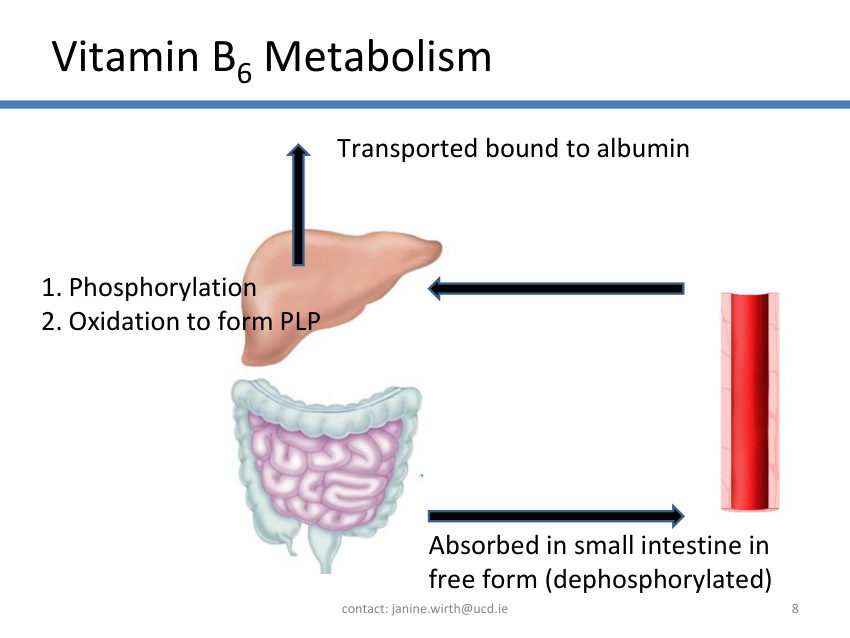
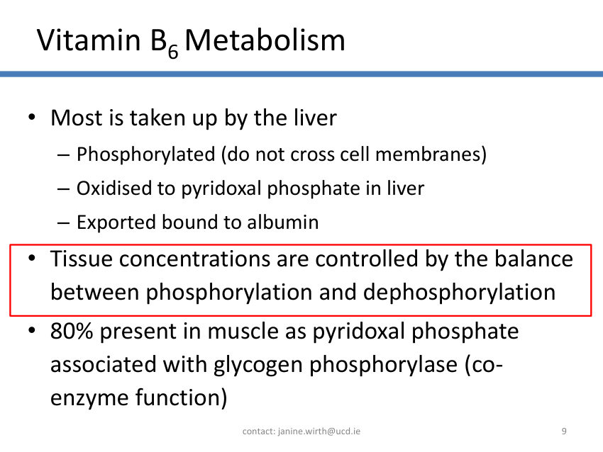
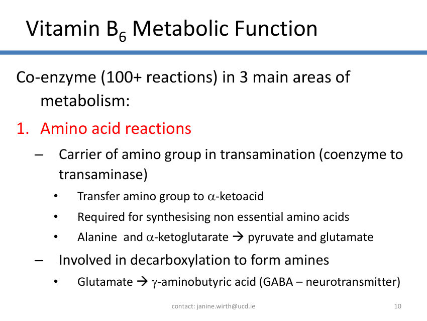
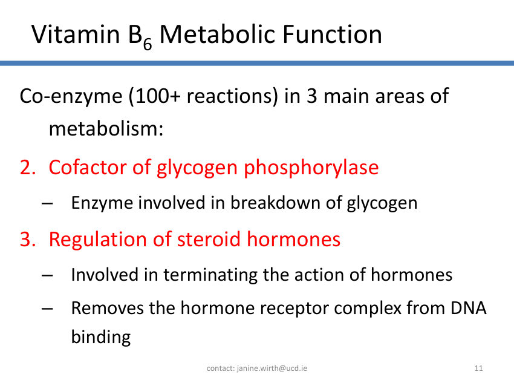
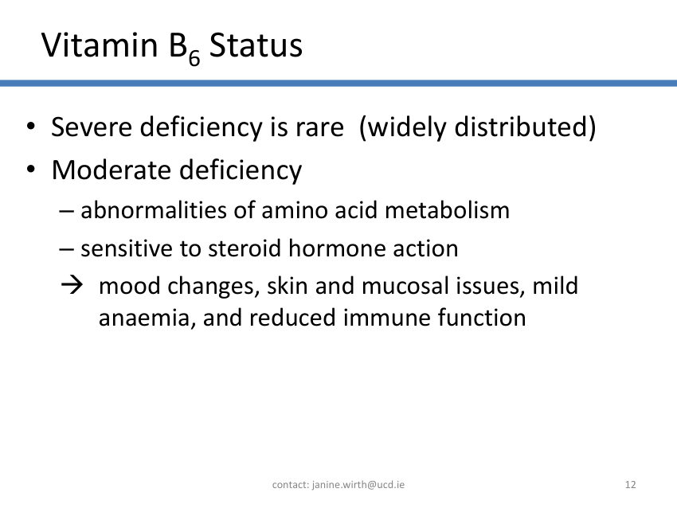

# Topic 9 — Vitamin B6

Slides: Lecture 15 (Vitamins B6–9), pages 5 to 12

---

## The big idea

Vitamin B6 is a **water-soluble** B vitamin.

It comes as **six vitamers**. They all share a pyridine ring.

The active coenzyme is **pyridoxal phosphate (PLP)**.

PLP is the coenzyme for **100+ reactions**, in three areas:
**amino acid reactions, glycogen breakdown, and steroid hormone control.**

Deficiency is rare, but moderate deficiency gives
**mood changes, skin problems, mild anaemia and weak immunity.**

---

**How to use these notes:**
When you see 🧠, stop.
Say the answer out loud or write it down.
Then click to check.

---

## ⭐ Learn by heart from this topic

**The vitamin B6 card.** Cover the right column and say it from memory.

| Ask | Answer |
|---|---|
| Soluble in | Water |
| Vitamers | Six: pyridoxine (alcohol), pyridoxal (aldehyde), pyridoxamine (amine), each plus its phosphate form |
| Active form | Pyridoxal phosphate (PLP) |
| End product | 4-pyridoxic acid. Inactive, excreted |
| Best foods | Fortified cereal, chickpeas, potato, chicken, salmon, spinach, banana |
| PRI | 1.6–1.7 mg/day (EFSA). Scales with protein: 15 µg per g protein |
| Absorbed | Small intestine, free (dephosphorylated) form |
| Transport | Bound to albumin |
| Stored | 80% in muscle, as PLP on glycogen phosphorylase |
| Functions | 1. Amino acid reactions (transamination, decarboxylation). 2. Cofactor of glycogen phosphorylase. 3. Regulation of steroid hormones |
| Deficiency | Rare. Moderate: mood changes, skin and mucosal issues, mild anaemia, reduced immunity. Dermatitis, irritability, anaemia |

 

**The three jobs of PLP. Memory hook: A-G-S.**

- **A**mino acids
- **G**lycogen phosphorylase
- **S**teroid hormones

---

## 1. The six vitamers and PLP

**How to read this slide:**

- All six molecules have the same **pyridine ring**.
- Down the left column: the three free forms. Down the right column: their **phosphate** forms.
- Top row = **alcohol**. Middle row = **aldehyde**. Bottom row = **amine**.
- The red box is **pyridoxal phosphate (PLP)**. That is the active coenzyme.
- Arrows marked **kinase** add a phosphate. Arrows marked **phosphatase** take it off.
- Arrows marked **oxidase** turn the other forms into PLP.
- Bottom left, 4-pyridoxic acid. That is the **inactive end point**. It is excreted.

 

| Chemical type | Free form | Phosphate form |
|---|---|---|
| Alcohol | **Pyridoxine** | Pyridoxine phosphate |
| Aldehyde | **Pyridoxal** | **Pyridoxal phosphate (PLP)** |
| Amine | **Pyridoxamine** | Pyridoxamine phosphate |

 

Three free forms. Three phosphate forms. Six vitamers.

Only one matters for the exam name: **PLP** is the active form.

 

**Hook:** pyridox-**ine** = alcohol (like retin-ol). Pyridox-**al** = aldehyde. Pyridox-**amine** = amine.

 

### 🧠 Check
How many vitamers of vitamin B6 are there? Which one is the active coenzyme?

Answer

Six.

Pyridoxal phosphate (PLP) is the active coenzyme.

---

## 2. Foods and requirements

**How to read this table:** amounts are mg of vitamin B6 per serving. Fortified cereal can give the most. The rest are all under 1.5 mg.

| Food | Vitamin B6 (mg) |
|---|---|
| Fortified cereal | 0.5–2.5 |
| Chickpeas, 1 cup | 1.1 |
| Potato, 1 large | 0.70 |
| Chicken breast, 120 g | 0.51 |
| Salmon, 3 oz | 0.48 |
| Spinach, 1 cup | 0.44 |
| Banana, 1 medium | 0.43 |

 

**Requirements:**

| Measure | Value |
|---|---|
| Average requirement | 13 µg per g protein |
| Reference intake | 15 µg per g protein |
| PRI (EFSA) | **1.6–1.7 mg/day** |

 

**Why it is set per gram of protein:**
PLP is the coenzyme for amino acid metabolism.
More protein in the diet means more amino acids to handle, so more B6 is needed.

 

### 🧠 Check
Why is the vitamin B6 requirement written per gram of protein?

Answer

Because PLP is needed for amino acid metabolism. Eat more protein, and you need more B6 to process the amino acids.

---

## 3. Absorption, transport and metabolism

**How to read this slide:** start at the gut (bottom), go to the liver (top), then out to the blood.

1. Absorbed in the **small intestine** in the **free, dephosphorylated** form.
2. Carried in the blood **bound to albumin**.
3. In the liver: **phosphorylation**, then **oxidation** to form **PLP**.
4. Exported from the liver **bound to albumin**.

 

**The details (slide 9):**

- Most B6 is taken up by the **liver**.
- The liver **phosphorylates** it. Phosphorylated forms **cannot cross cell membranes**. That traps it inside the cell.
- The liver **oxidises** it to pyridoxal phosphate.
- It is exported bound to **albumin**.
- Tissue levels are controlled by the **balance of phosphorylation and dephosphorylation**.
- **80%** of body B6 is in **muscle**, as PLP bound to **glycogen phosphorylase**.

 

**Why phosphate matters:**
No phosphate = can move across membranes (absorption, transport).
With phosphate = trapped inside the cell (storage, coenzyme work).

 

### 🧠 Check
Where is most of the body's vitamin B6, and what is it attached to?

Answer

In muscle (80%), as PLP bound to glycogen phosphorylase.

 

### 🧠 Check
Why does phosphorylation trap vitamin B6 inside a cell?

Answer

Phosphorylated forms do not cross cell membranes.

---

## 4. Function 1: amino acid reactions

PLP is a coenzyme in **100+ reactions**. The biggest group is amino acid reactions.

 

**Transamination.** PLP is the coenzyme to **transaminases**.

- PLP carries the **amino group**.
- It transfers the amino group onto an **α-ketoacid**.
- This is how the body makes **non-essential amino acids**.

Example:

$$\text{alanine} + \alpha\text{-ketoglutarate} \rightarrow \text{pyruvate} + \text{glutamate}$$

The amino group moves from alanine to α-ketoglutarate. Alanine becomes pyruvate. α-ketoglutarate becomes glutamate.

 

**Decarboxylation.** PLP also helps remove a carboxyl group from an amino acid, making an **amine**.

Example:

$$\text{glutamate} \rightarrow \text{GABA}$$

GABA (γ-aminobutyric acid) is a **neurotransmitter**.

 

| Reaction | What moves | Example |
|---|---|---|
| Transamination | amino group | alanine + α-ketoglutarate → pyruvate + glutamate |
| Decarboxylation | carboxyl group removed | glutamate → GABA |

 

### 🧠 Check
In a transamination, what does PLP carry, and what does it give it to?

Answer

PLP carries the amino group. It gives it to an α-ketoacid.

---

## 5. Function 2: glycogen phosphorylase

**Glycogen phosphorylase** is the enzyme that **breaks down glycogen**.

PLP is its **cofactor**.

This is why 80% of body B6 sits in muscle. Muscle holds a lot of glycogen, and a lot of glycogen phosphorylase.

 

### 🧠 Check
Which enzyme in muscle uses PLP as a cofactor, and what does the enzyme do?

Answer

Glycogen phosphorylase. It breaks down glycogen.

---

## 6. Function 3: regulation of steroid hormones

PLP helps **terminate** the action of steroid hormones.

It **removes the hormone-receptor complex from its DNA binding site**.

So B6 switches steroid hormone signalling **off**.

 

**Link to Topic 2:** retinoic acid binds receptors on DNA to switch genes on. B6 does the opposite job for steroid hormones: it takes the hormone-receptor complex off the DNA.

 

**What goes wrong without B6:** the hormone-receptor complex stays on the DNA for longer. Cells become more **sensitive to steroid hormones**.

---

## 7. Deficiency

**Severe deficiency is rare.** B6 is widely distributed in food.

 

**Moderate deficiency** shows up in two ways:

- abnormalities of **amino acid metabolism**
- increased **sensitivity to steroid hormone action**

These lead to:

- mood changes
- skin and mucosal issues
- mild anaemia
- reduced immune function

 

**Summary list (slide 39):** dermatitis, irritability, anaemia.

 

**Link the symptom to the function:**

| Function lost | Symptom |
|---|---|
| Amino acid metabolism | mild anaemia, reduced immunity |
| Decarboxylation to GABA | mood changes, irritability |
| Steroid hormone control | over-sensitivity to steroid hormones |

 

### 🧠 Check
Name three signs of moderate vitamin B6 deficiency.

Answer

Any three of: mood changes, skin and mucosal issues, mild anaemia, reduced immune function. Or from the summary: dermatitis, irritability, anaemia.

---

## Summary (slide 39)

- Active form: pyridoxal phosphate (PLP).
- Six vitamers: pyridoxine, pyridoxal, pyridoxamine, and their phosphates. 4-pyridoxic acid is the inactive end product.
- Absorbed free in the small intestine. Carried on albumin. Liver makes PLP. 80% stored in muscle on glycogen phosphorylase.
- Functions: amino acid metabolism (transamination, decarboxylation), cofactor of glycogen phosphorylase, regulation of steroid hormones.
- Deficiency: dermatitis, irritability, anaemia. Rare, because B6 is widely distributed.
