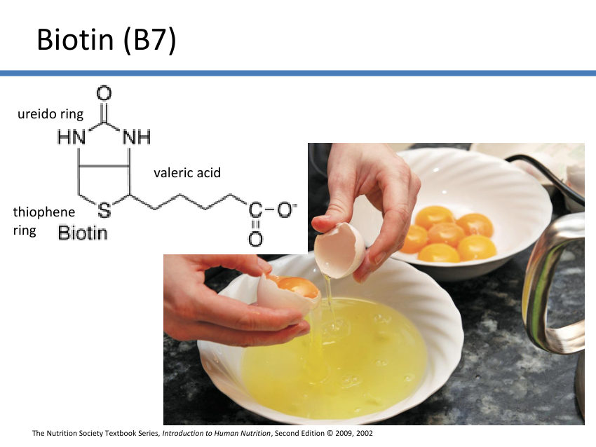
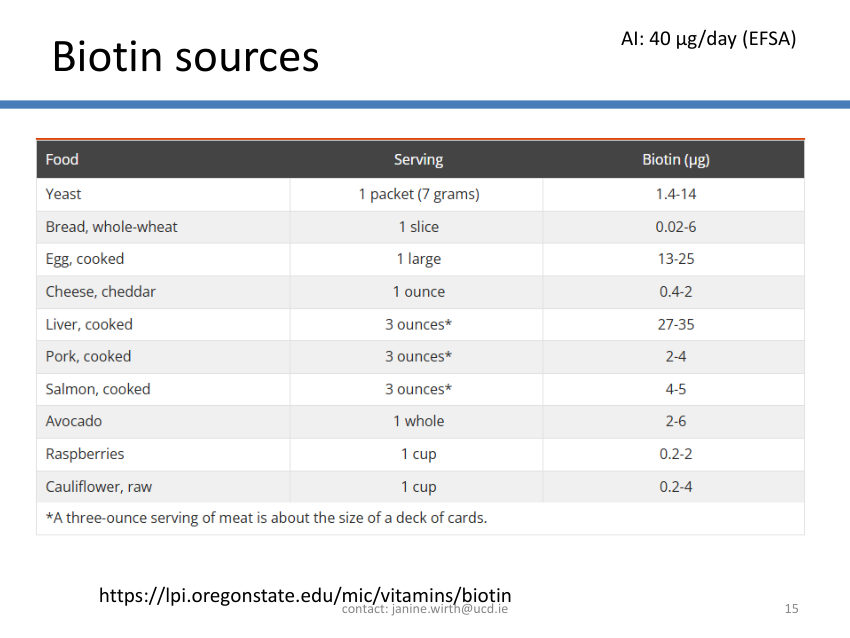
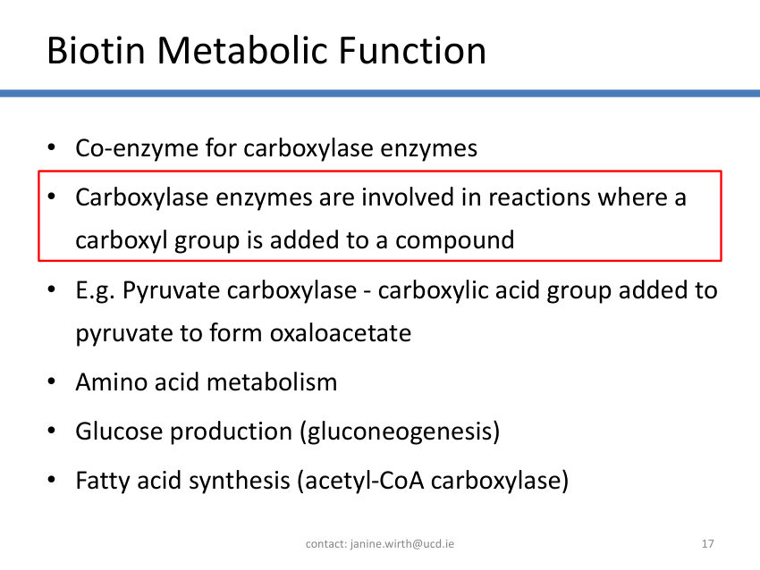
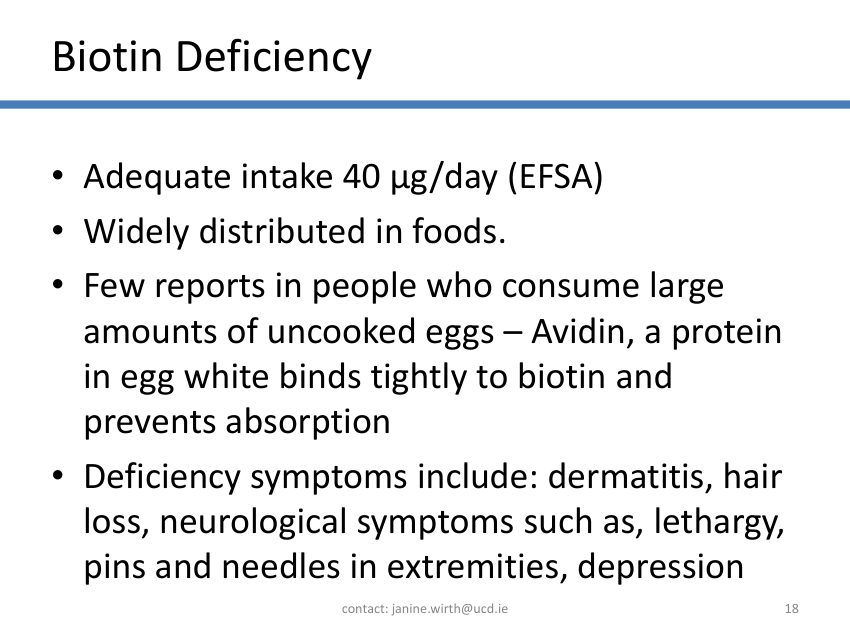

# Topic 10 — Biotin (B7)

Slides: Lecture 15 (Vitamins B6–9), pages 13 to 18

---

## The big idea

Biotin is a **water-soluble** B vitamin.

It is the coenzyme for **carboxylase** enzymes.
A carboxylase **adds a carboxyl group** to a molecule.

It is in almost every food, and gut bacteria make it too.
So deficiency is rare.

The one famous cause of deficiency: **raw egg white**.
It contains **avidin**, which binds biotin and stops absorption.

---

**How to use these notes:**
When you see 🧠, stop.
Say the answer out loud or write it down.
Then click to check.

---

## ⭐ Learn by heart from this topic

**The biotin card.** Cover the right column and say it from memory.

| Ask | Answer |
|---|---|
| Soluble in | Water |
| Structure | Ureido ring + thiophene ring + valeric acid side chain |
| Best foods | Liver, eggs, fish, wholegrains. Also made by gut microflora |
| AI | 40 µg/day (EFSA) |
| In food | Often bound to protein |
| Function | Coenzyme for carboxylases (add a carboxyl group) |
| Examples | Pyruvate carboxylase (pyruvate → oxaloacetate), acetyl-CoA carboxylase (fatty acid synthesis) |
| Pathways | Gluconeogenesis, fatty acid synthesis, amino acid metabolism |
| Deficiency | Rare. Raw egg white (avidin) blocks absorption. Dermatitis, hair loss, lethargy, pins and needles, depression |

 

**Memory hook:** biotin = **carboxylases**. Carboxylase = **add CO₂**.

---

## 1. Structure

**How to read this slide:** three parts, labelled on the diagram.

| Part | What it is |
|---|---|
| **Ureido ring** | the top ring, with two N–H groups |
| **Thiophene ring** | the lower ring, containing sulfur (S) |
| **Valeric acid** | the side chain, ending in a carboxyl group |

 

You do not need to draw it. You need to name the three parts.

 

### 🧠 Check
Name the three parts of the biotin molecule.

Answer

Ureido ring, thiophene ring, valeric acid side chain.

---

## 2. Sources and requirement

**How to read this table:** amounts are µg biotin per serving. Liver and egg are the standouts. Most foods give a few µg.

| Food | Biotin (µg) |
|---|---|
| Liver, cooked, 3 oz | **27–35** |
| Egg, cooked, 1 large | **13–25** |
| Yeast, 1 packet | 1.4–14 |
| Salmon, cooked, 3 oz | 4–5 |
| Avocado, 1 whole | 2–6 |
| Pork, cooked, 3 oz | 2–4 |

 

**Key points (slide 16):**

- Widely distributed in foods.
- Best sources: **liver, eggs, fish and wholegrains**.
- Present in many foods **bound to protein**.
- **Synthesised by intestinal microflora** (gut bacteria).

 

**Adequate Intake (AI) = 40 µg/day** (EFSA).

 

**Link to Topic 1:** it is an AI, not a PRI. An AI is used when the average requirement cannot be worked out.

 

### 🧠 Check
What is the AI for biotin? Why is it an AI and not a PRI?

Answer

40 µg/day.

An AI is set when an average requirement cannot be determined, so a PRI cannot be calculated.

---

## 3. Function: coenzyme for carboxylases

Biotin is the **coenzyme for carboxylase enzymes**.

A carboxylase **adds a carboxyl group** (–COOH, from CO₂) to a compound.

 

**Example: pyruvate carboxylase.**

$$\text{pyruvate} + \text{CO}_2 \rightarrow \text{oxaloacetate}$$

A carboxyl group is added to pyruvate (3 carbons) to make oxaloacetate (4 carbons).

This is the first step of **gluconeogenesis** (making glucose).

 

**Pathways that need biotin:**

| Pathway | Enzyme |
|---|---|
| Gluconeogenesis (glucose production) | pyruvate carboxylase |
| Fatty acid synthesis | acetyl-CoA carboxylase |
| Amino acid metabolism | carboxylases |

 

**Link to Topic 8:** fatty acid synthesis starts with acetyl-CoA + CO₂ → malonyl-CoA.
That step is done by **acetyl-CoA carboxylase**.
It needs **biotin** (the carboxylase coenzyme) and **CoA** (from pantothenic acid). Two B vitamins in one reaction.

 

### 🧠 Check
What does a carboxylase do? Give one example of a biotin-dependent carboxylase.

Answer

It adds a carboxyl group to a compound.

Pyruvate carboxylase (pyruvate → oxaloacetate) or acetyl-CoA carboxylase (acetyl-CoA → malonyl-CoA).

---

## 4. Deficiency and avidin

Deficiency is **rare**. Biotin is in almost every food and gut bacteria make it.

 

**The one classic cause:** eating **large amounts of uncooked eggs**.

- Egg white contains a protein called **avidin**.
- Avidin **binds tightly to biotin**.
- Bound biotin **cannot be absorbed**.

Cooking the egg denatures avidin, so cooked eggs are fine. Cooked egg is actually a good biotin source.

 

**Symptoms of deficiency:**

- **Dermatitis**
- **Hair loss**
- Neurological: **lethargy**, **pins and needles** in the extremities, **depression**

 

### 🧠 Check
Why can eating lots of raw egg cause biotin deficiency?

Answer

Raw egg white contains avidin. Avidin binds tightly to biotin and prevents it being absorbed.

---

## Summary (slide 39)

- Function: coenzyme for carboxylases → gluconeogenesis, fatty acid and amino acid metabolism.
- Sources: egg yolk, liver, nuts, gut microbiota. AI 40 µg/day.
- Deficiency: rare. Caused by raw egg white (avidin). Dermatitis, hair loss, neurological symptoms.
