# Topic 11 — Folate (B9)

Slides: Lecture 15 (Vitamins B6–9), pages 19 to 38

---

## The big idea

Folate is a **water-soluble** B vitamin.

**Folate** is the natural form in food. **Folic acid** is the synthetic form.

The active form is **tetrahydrofolate (THF)**.

THF carries **single carbon units**. That is needed to make **DNA** and to handle **amino acids**.

Too little → cells that divide fast suffer first: **megaloblastic anaemia**.

Too little in early pregnancy → **neural tube defects** (spina bifida, anencephaly).
So every woman who could get pregnant should take **400 µg folic acid a day**.

---

**How to use these notes:**
When you see 🧠, stop.
Say the answer out loud or write it down.
Then click to check.

---

## ⭐ Learn by heart from this topic

**The folate card.** Cover the right column and say it from memory.

| Ask | Answer |
|---|---|
| Soluble in | Water |
| Natural form | Folate (80% of food folate is polyglutamate) |
| Synthetic form | Folic acid |
| Structure | Pteridine + PABA + glutamic acid |
| Active form | Tetrahydrofolate (THF). Circulates as 5-methyl-THF |
| Best foods | Chickpeas (280 µg), liver, spinach, breakfast cereal, asparagus |
| PRI (EFSA) | 330 µg/day. 600 µg/day in pregnancy |
| Bioavailability | Food folate about 50%. Folic acid about 100% |
| Unit | Dietary folate equivalent (DFE) = µg food folate + 1.7 × µg folic acid |
| Absorbed | Conjugase (zinc-dependent) splits off glutamates. Active transport |
| Function | Single-carbon transfers: DNA and RNA synthesis, amino acid metabolism, neurotransmitters |
| Deficiency | Megaloblastic anaemia. Neural tube defects |
| Supplement | 400 µg/day before conception and first 12 weeks. 4 mg/day to prevent recurrence |

 

**The DFE conversion (slide 22):**

- 1 µg food folate = 1 µg DFE
- 0.6 µg folic acid = 1 µg DFE, so 1 µg folic acid = 1.7 µg DFE

**The pregnancy numbers:** 400 µg every day. 4 mg (4000 µg) if a previous pregnancy had an NTD.

---

## 1. Structure: folate and folic acid

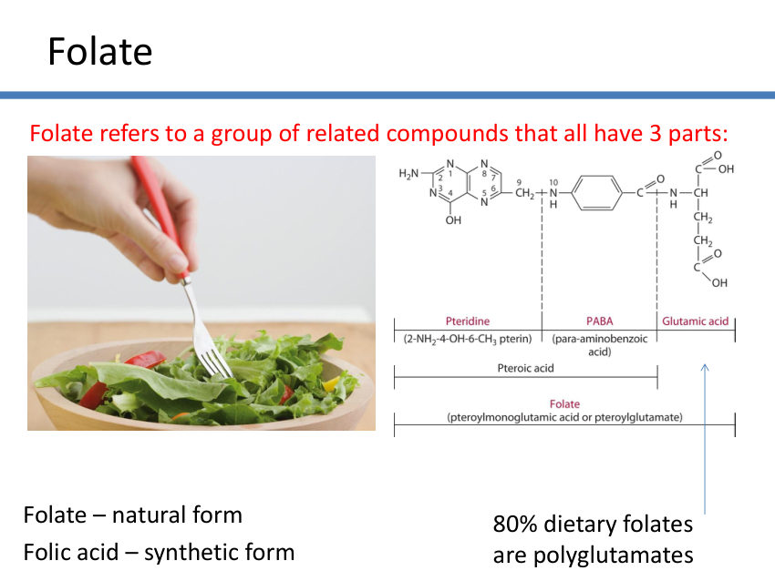

**How to read this slide:** the molecule is split into three coloured parts, labelled underneath.

| Part | Name |
|---|---|
| Left ring pair | **Pteridine** |
| Middle ring | **PABA** (para-aminobenzoic acid) |
| Right chain | **Glutamic acid** |

Pteridine + PABA = **pteroic acid**.
Pteroic acid + glutamic acid = **folate** (pteroylglutamic acid).

 

**Two names, two forms:**

| Name | What it is |
|---|---|
| **Folate** | the natural form in food |
| **Folic acid** | the synthetic form, in supplements and fortified foods |

 

**80% of dietary folates are polyglutamates.** That means several glutamic acids in a chain, not one. They have to be trimmed before absorption (see §4).

 

### 🧠 Check
What are the three parts of a folate molecule? Which name is the synthetic form?

Answer

Pteridine, PABA, glutamic acid.

Folic acid is the synthetic form. Folate is the natural form.

---

## 2. Foods and requirements

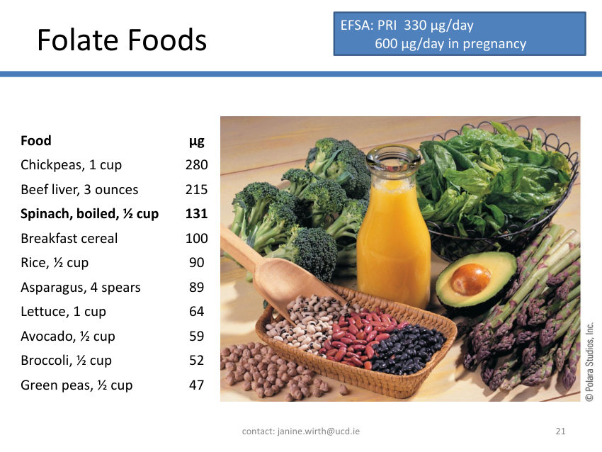

**How to read this table:** µg folate per serving. Legumes, liver and green vegetables lead. The word **foliage** is in the name.

| Food | µg |
|---|---|
| Chickpeas, 1 cup | **280** |
| Beef liver, 3 oz | 215 |
| Spinach, boiled, ½ cup | 131 |
| Breakfast cereal | 100 |
| Rice, ½ cup | 90 |
| Asparagus, 4 spears | 89 |
| Lettuce, 1 cup | 64 |
| Avocado, ½ cup | 59 |
| Broccoli, ½ cup | 52 |
| Green peas, ½ cup | 47 |

 

**EFSA PRI:**

| Group | µg/day |
|---|---|
| Adults | **330** |
| Pregnancy | **600** |

 

### 🧠 Check
What is the EFSA PRI for folate in adults, and in pregnancy?

Answer

Adults 330 µg/day. Pregnancy 600 µg/day.

---

## 3. Bioavailability and the DFE

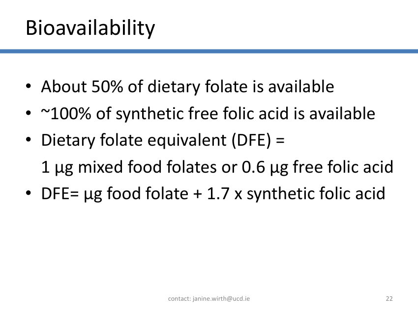

Not all folate in food gets into the body.

| Form | Available |
|---|---|
| Dietary folate (food) | about **50%** |
| Synthetic free folic acid | about **100%** |

 

So we count folate in **dietary folate equivalents (DFE)**.

1 µg DFE = 1 µg mixed food folate = 0.6 µg free folic acid.

 

### 📐 Equation 1: dietary folate equivalents

$$\text{µg DFE} = \text{µg food folate} + 1.7 \times \text{µg synthetic folic acid}$$

| Symbol | Meaning | Units |
|---|---|---|
| µg DFE | folate activity of the diet | µg |
| µg food folate | natural folate in foods | µg |
| µg synthetic folic acid | folic acid from supplements or fortified foods | µg |

**Why it holds:** 0.6 µg folic acid does the work of 1 µg food folate. So 1 µg folic acid is worth 1 ÷ 0.6 ≈ 1.7 µg DFE.

**Use it when:** a question mixes food folate with fortified food or a supplement and asks for total folate, or asks whether a diet meets the PRI.

**Does not apply:** to food folate on its own. That counts 1 for 1.

 

### 🧠 Check
A bowl of fortified cereal has 100 µg of synthetic folic acid. How many µg DFE is that?

Answer

100 × 1.7 = **170 µg DFE**.

---

## 4. Absorption and activation

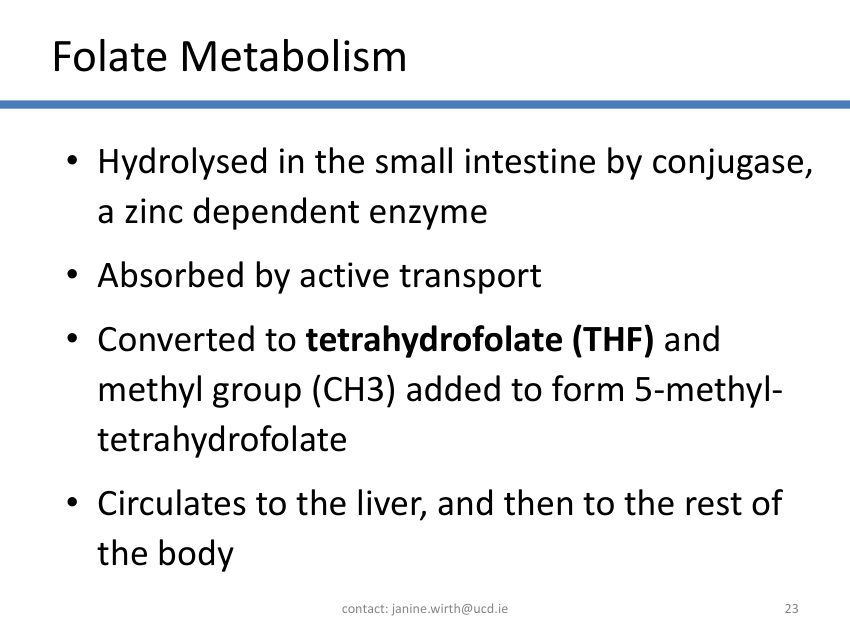

**Step by step:**

1. In the small intestine, **conjugase** cuts the extra glutamates off polyglutamates. Conjugase is a **zinc-dependent** enzyme.
2. Folate is absorbed by **active transport**.
3. Inside the gut cell it is converted to **tetrahydrofolate (THF)**.
4. A methyl group (CH₃) is added to form **5-methyl-tetrahydrofolate**.
5. 5-methyl-THF circulates to the **liver**, then to the rest of the body.

 

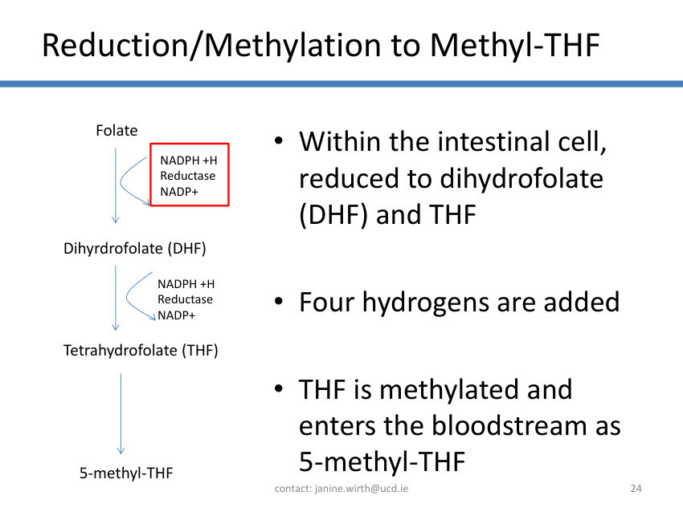

**How to read this diagram:** read top to bottom. Each arrow is a reductase step using NADPH.

$$\text{folate} \xrightarrow{\text{reductase}} \text{DHF} \xrightarrow{\text{reductase}} \text{THF} \rightarrow \text{5-methyl-THF}$$

- Folate → **dihydrofolate (DHF)**: two hydrogens added.
- DHF → **tetrahydrofolate (THF)**: two more. **Four hydrogens in total.**
- Both steps use a **reductase** and **NADPH**.
- THF is methylated and enters the blood as **5-methyl-THF**.

 

**Link to Topic 7:** NADPH comes from niacin. Folate activation needs niacin.
**Link to minerals:** conjugase needs zinc. Low zinc can lower folate absorption.

 

### 🧠 Check
Which enzyme hydrolyses polyglutamate folates in the gut, and which mineral does it need?

Answer

Conjugase. It is zinc-dependent.

 

### 🧠 Check
How many hydrogens are added to turn folate into THF?

Answer

Four. Two to make DHF, two more to make THF.

---

## 5. Function: single-carbon transfers

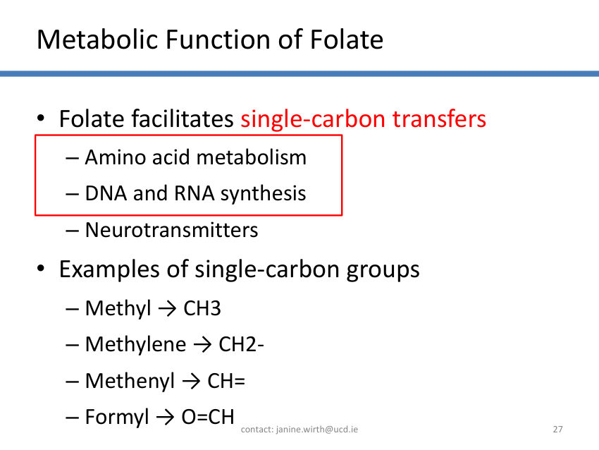

THF is a **carrier of single-carbon units**.

It picks up one carbon in one reaction and drops it in another.

 

**Where single carbons are needed:**

- Amino acid metabolism
- DNA and RNA synthesis
- Neurotransmitters

 

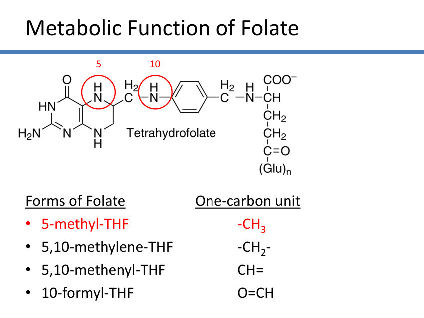

**How to read this slide:** the red circles at N5 and N10 are where the carbon unit attaches.

| Form of folate | One-carbon unit |
|---|---|
| 5-methyl-THF | methyl, –CH₃ |
| 5,10-methylene-THF | methylene, –CH₂– |
| 5,10-methenyl-THF | methenyl, CH= |
| 10-formyl-THF | formyl, O=CH |

 

The number tells you which nitrogen holds the carbon: **N5**, **N10**, or both.

 

### 🧠 Check
What does THF carry? Name the four one-carbon units.

Answer

Single-carbon units.

Methyl (CH₃), methylene (CH₂), methenyl (CH=), formyl (O=CH).

---

## 6. DNA synthesis and methionine

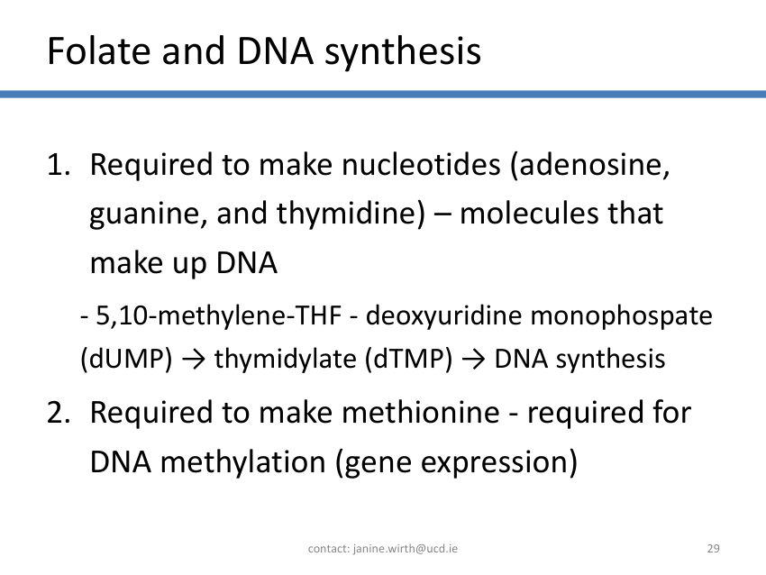

**Job 1: making nucleotides.**

Folate is needed to make the bases of DNA: **adenine, guanine and thymidine**.

The key step:

$$\text{dUMP} \xrightarrow{\text{5,10-methylene-THF}} \text{dTMP} \rightarrow \text{DNA}$$

5,10-methylene-THF gives a carbon to deoxyuridine monophosphate (dUMP) to make thymidylate (dTMP). No folate, no thymidine, no new DNA.

 

**Job 2: making methionine.**

Methionine is needed for **DNA methylation**, which controls gene expression.

 

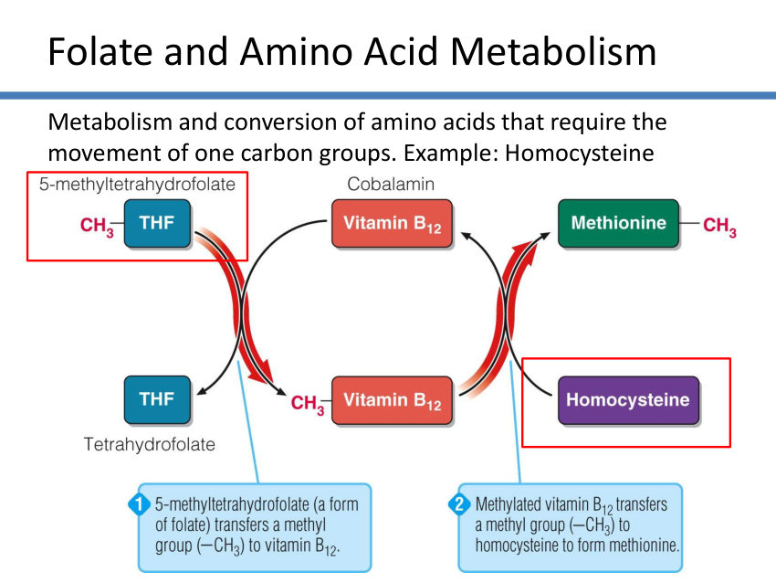

**How to read this diagram:** follow the CH₃ (in red) around the loop.

1. **5-methyl-THF** hands its methyl group to **vitamin B12** (cobalamin). It becomes THF.
2. Methylated B12 hands the methyl group to **homocysteine**. Homocysteine becomes **methionine**.

So turning homocysteine into methionine needs **both folate and vitamin B12**.

 

**Link to Topic 7 and Topic 9:** folate is the carbon carrier, B12 is the hand-over, B6 handles the amino acid reactions around it. The B vitamins work as a team.

 

### 🧠 Check
Which form of folate is used to make thymidylate (dTMP)? Which vitamin works with folate to make methionine?

Answer

5,10-methylene-THF makes dTMP from dUMP.

Vitamin B12 (cobalamin) works with 5-methyl-THF to turn homocysteine into methionine.

---

## 7. Deficiency: megaloblastic anaemia

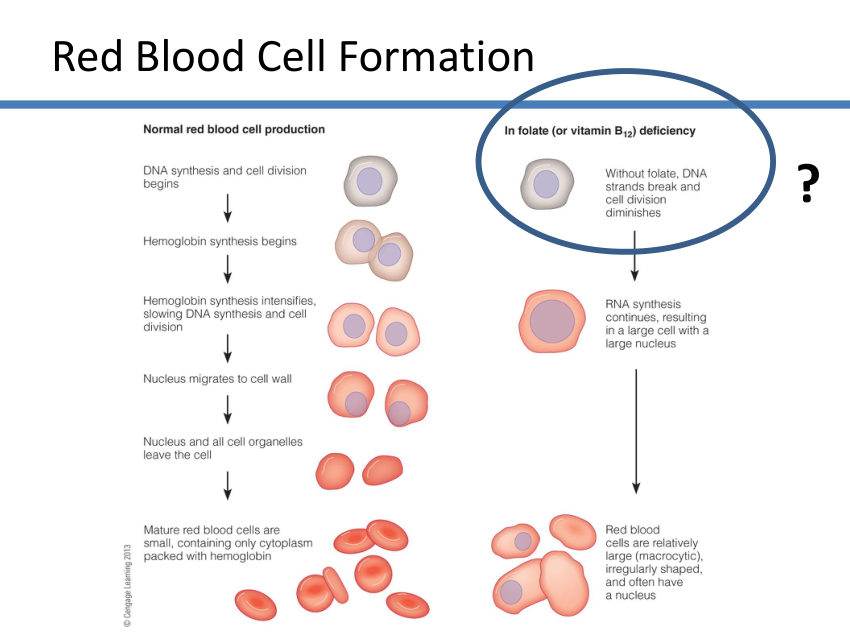

**How to read this diagram:** left column is normal red cell production. Right column (circled) is what happens without folate or B12.

- Normally the cell makes DNA, divides, builds haemoglobin, shrinks, loses its nucleus and becomes a small red cell.
- Without folate, **DNA strands break and cell division slows**.
- RNA synthesis carries on, so the cell keeps growing. It ends up **large, with a nucleus**.

 

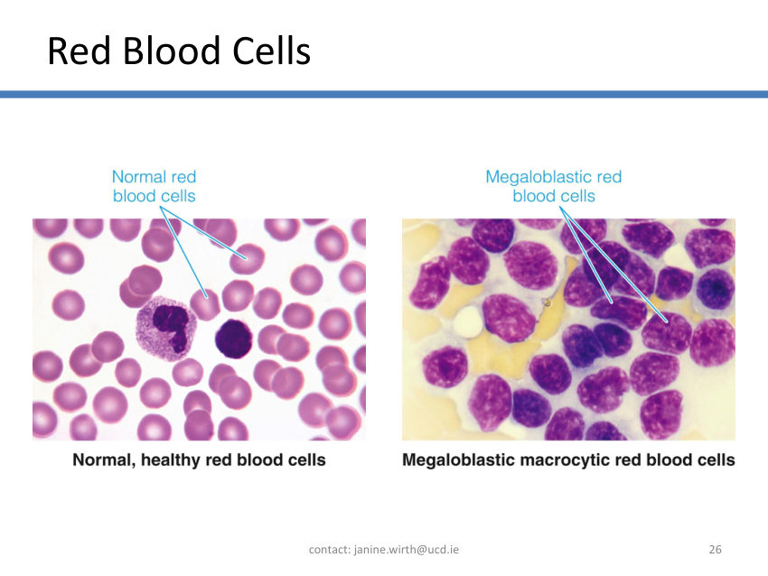

**How to read this slide:** left, normal small round red cells. Right, **megaloblastic, macrocytic** red cells. Large, irregular, often with a nucleus.

 

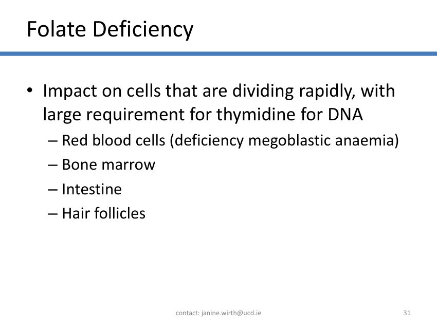

**Who suffers first:** cells that **divide rapidly**, because they need lots of **thymidine** for DNA.

| Tissue | Result |
|---|---|
| Red blood cells | **megaloblastic anaemia** |
| Bone marrow | fewer cells made |
| Intestine | lining not replaced |
| Hair follicles | hair problems |

 

### 🧠 Check
Why does folate deficiency hit red blood cells so hard?

Answer

Red cells are made fast and need lots of thymidine for DNA. Without folate, DNA synthesis fails, division slows, and the cells become large (megaloblastic).

---

## 8. Pregnancy and neural tube defects

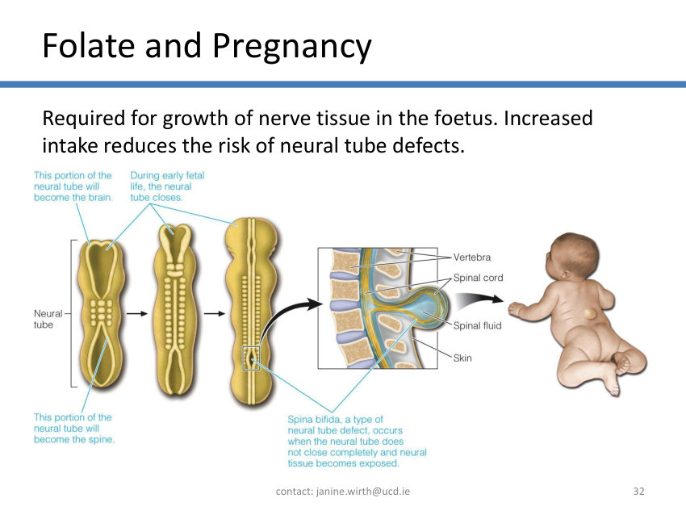

**How to read this diagram:** the neural tube is the strip of tissue that closes up to form the brain and spinal cord in early pregnancy. If it does not close, the baby has a neural tube defect (NTD).

Folate is needed for **growth of nerve tissue in the foetus**.
Higher intake **reduces the risk of NTDs**.

 

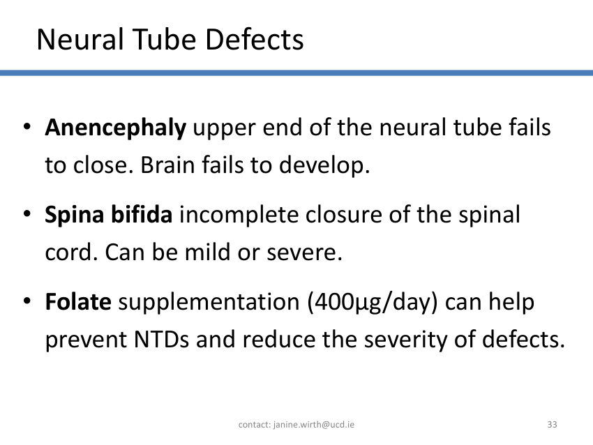

| Defect | What happens |
|---|---|
| **Anencephaly** | upper end of the neural tube fails to close. The brain fails to develop |
| **Spina bifida** | incomplete closure of the spinal cord. Can be mild or severe |

 

**Folate supplementation of 400 µg/day** helps prevent NTDs and reduces how severe they are.

 

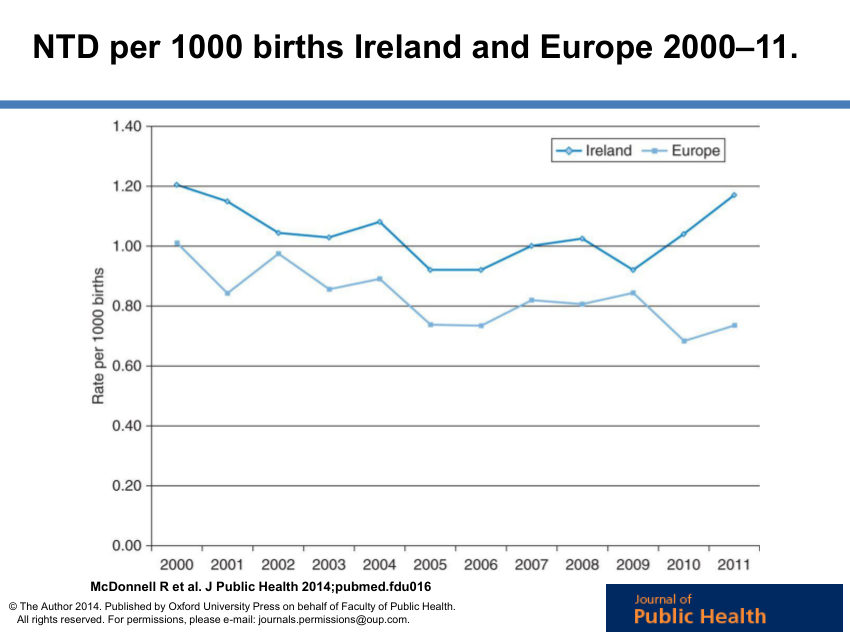

**How to read this graph:** NTDs per 1000 births, 2000 to 2011. Dark line is Ireland, light line is Europe. Ireland sits **above** Europe for most of the period.

 

### 🧠 Check
Name the two neural tube defects on the slides and say what fails to close in each.

Answer

Anencephaly: the upper end of the neural tube. The brain does not develop.

Spina bifida: the spinal cord does not close completely.

---

## 9. Irish recommendations and fortification

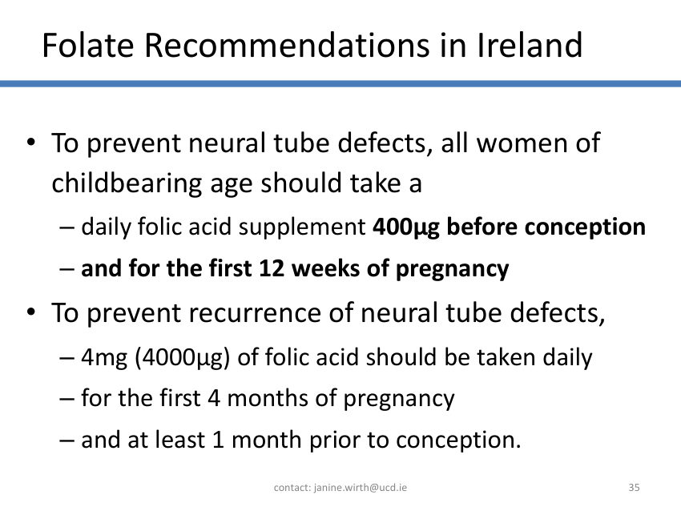

**To prevent NTDs**, all women of childbearing age should take:

- a daily folic acid supplement of **400 µg**
- **before conception**
- and for the **first 12 weeks** of pregnancy

 

**To prevent recurrence** (a previous NTD pregnancy):

- **4 mg (4000 µg)** of folic acid daily
- for the **first 4 months** of pregnancy
- and at least **1 month before** conception

 

**Why before conception:** the neural tube closes very early, before many women know they are pregnant.

 

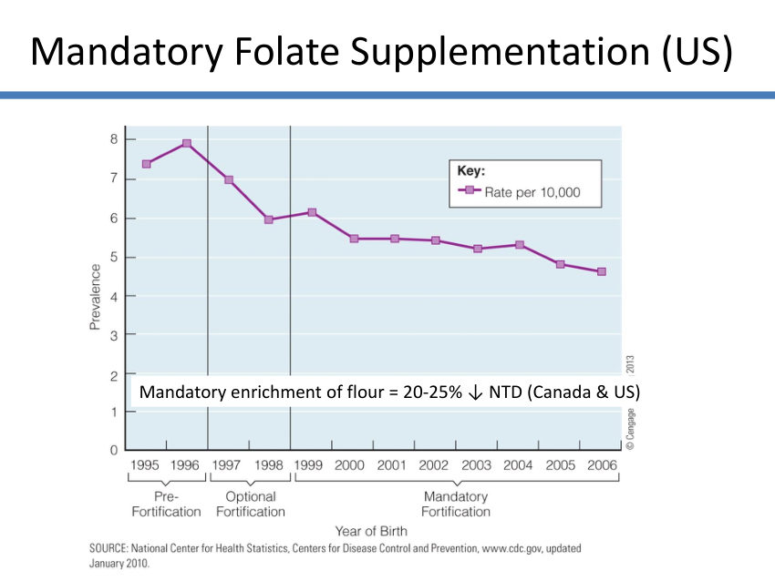

**How to read this graph:** NTD rate per 10,000 births, USA 1995 to 2006. The rate falls after mandatory flour fortification begins.

**Mandatory enrichment of flour** in the US and Canada cut NTDs by **20–25%**.

 

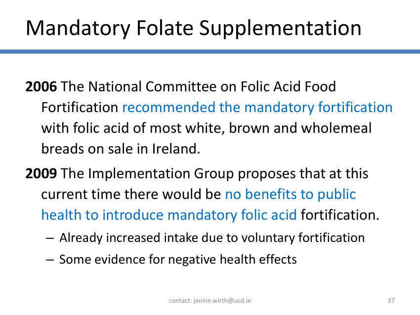

**Ireland's story:**

| Year | What happened |
|---|---|
| 2006 | National Committee on Folic Acid Food Fortification **recommended mandatory fortification** of most white, brown and wholemeal bread |
| 2009 | Implementation Group said there would be **no public health benefit** at that time |

Reasons given in 2009:

- intake had already risen through **voluntary** fortification
- some evidence of **negative health effects**

 

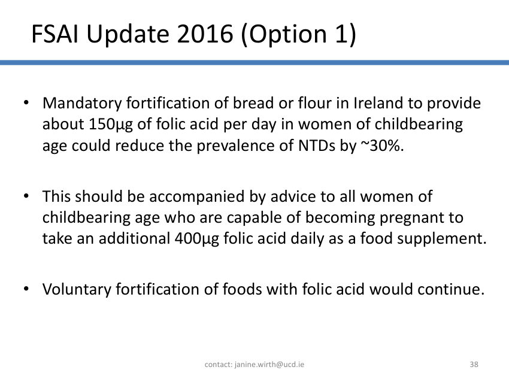

**FSAI 2016, Option 1:**

- Mandatory fortification of bread or flour, giving about **150 µg folic acid per day** to women of childbearing age, could cut NTDs by about **30%**.
- Plus advice to all women who could become pregnant to take an extra **400 µg** daily as a supplement.
- Voluntary fortification would continue.

 

### 🧠 Check
A woman had a previous pregnancy with spina bifida. What folic acid dose should she take, and when?

Answer

4 mg (4000 µg) daily, from at least 1 month before conception and for the first 4 months of pregnancy.

---

## Summary (slide 39)

- Active form: tetrahydrofolate (THF).
- Functions: DNA and RNA synthesis, amino acid and neurotransmitter metabolism, all through single-carbon transfers.
- Food folate about 50% available, folic acid about 100%. DFE = food folate + 1.7 × folic acid.
- Deficiency: megaloblastic anaemia, neural tube defects.
- All women of childbearing age: 400 µg folic acid daily before conception and for the first 12 weeks. 4 mg to prevent recurrence.
