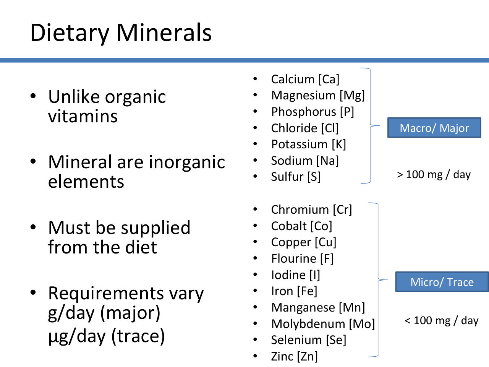
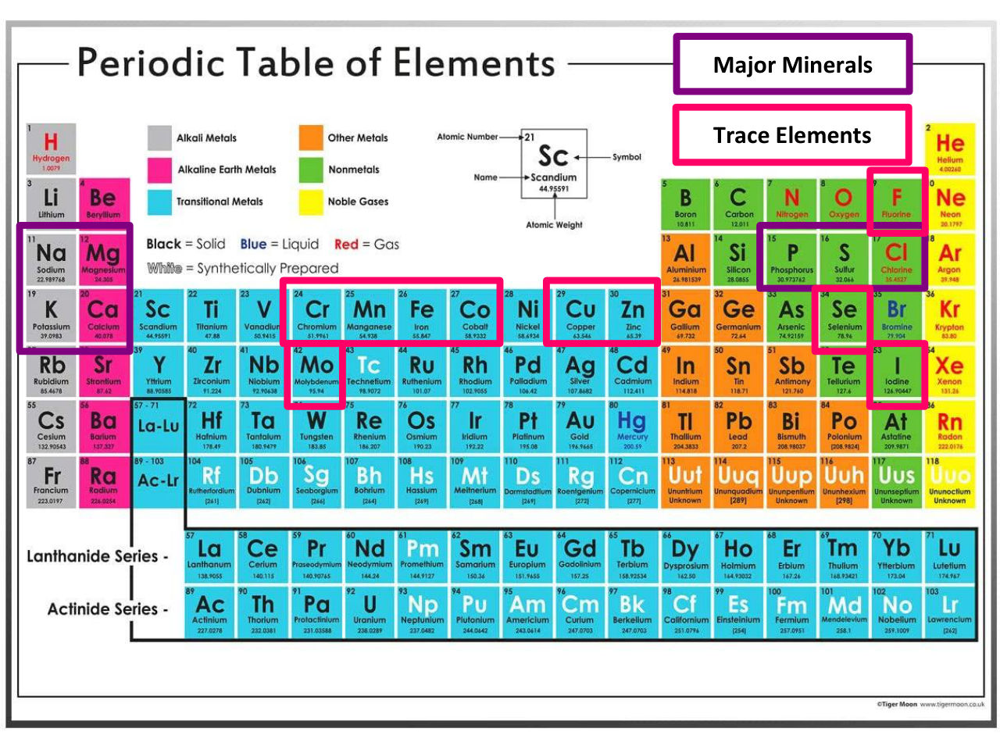
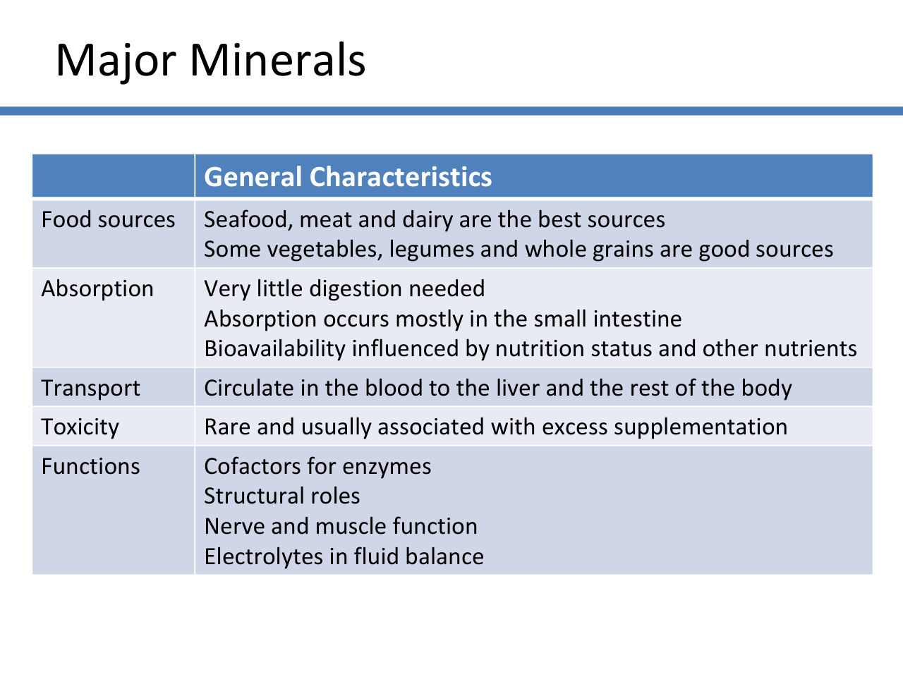
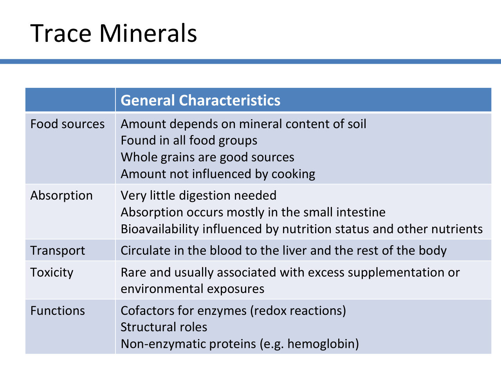
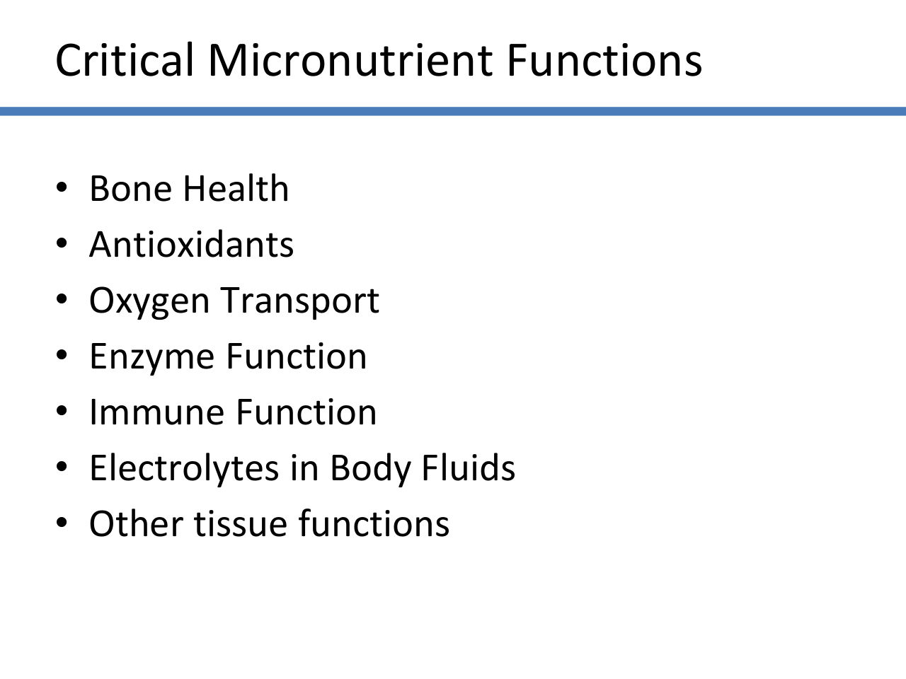

# Topic 12 — Minerals: the basics

Slides: Lecture 17 (Minerals Ca, P, Mg), pages 4 to 9

---

## The big idea

Vitamins are **organic** molecules.
Minerals are **inorganic elements**. Single atoms, like Ca, Fe, Zn.

The body cannot make them. They must come from the **diet**.

There are two groups, split by how much you need:

- **Major (macro) minerals:** more than **100 mg a day**.
- **Trace (micro) elements:** less than **100 mg a day**.

---

**How to use these notes:**
When you see 🧠, stop.
Say the answer out loud or write it down.
Then click to check.

---

## ⭐ Learn by heart from this topic

**The minerals card.** Cover the right column and say it from memory.

| Ask | Answer |
|---|---|
| Vitamins are | Organic |
| Minerals are | Inorganic elements, from the diet |
| Major mineral cut-off | More than 100 mg per day |
| Trace element cut-off | Less than 100 mg per day |
| The 7 major minerals | Calcium, magnesium, phosphorus, chloride, potassium, sodium, sulfur |
| The 10 trace elements | Chromium, cobalt, copper, fluorine, iodine, iron, manganese, molybdenum, selenium, zinc |
| Best food sources (major) | Seafood, meat, dairy. Some vegetables, legumes, whole grains |
| Food sources (trace) | All food groups. Amount depends on the **soil**. Whole grains good. Not changed by cooking |
| Digestion needed | Very little |
| Where absorbed | Mostly the small intestine |
| Toxicity | Rare. Usually from supplements (trace: or environmental exposure) |
| Functions | Enzyme cofactors, structure, nerve and muscle, electrolytes |

 

**Memory hook:** the seven major minerals are **Ca, Mg, P, Cl, K, Na, S**. Everything else on the list is trace.

---

## 1. Minerals are not vitamins

**How to read this slide:** left column is the general idea. Right column lists every mineral the course covers, split into two brackets.

| | Vitamins | Minerals |
|---|---|---|
| Chemistry | Organic molecules | Inorganic elements |
| Made in the body? | Mostly not | Never |
| Source | Diet | Diet |
| Amounts | µg to mg | g per day (major) to µg per day (trace) |

 

**Link to Topic 1:** a vitamin is an organic compound needed in tiny amounts. Minerals share the "tiny amounts" rule but are single elements, not compounds.

 

### 🧠 Check
What is the chemical difference between a vitamin and a mineral?

Answer

Vitamins are organic compounds. Minerals are inorganic elements.

---

## 2. Major versus trace: the 100 mg rule

**How to read this slide:** a periodic table. The purple boxes are the major minerals. The pink boxes are the trace elements.

The cut-off is **100 mg per day**.

| Group | Need per day | Members |
|---|---|---|
| **Major** (macro) | **> 100 mg** | Calcium, magnesium, phosphorus, chloride, potassium, sodium, sulfur |
| **Trace** (micro) | **< 100 mg** | Chromium, cobalt, copper, fluorine, iodine, iron, manganese, molybdenum, selenium, zinc |

 

The slide says major minerals are needed in **g/day** and trace elements in **µg/day**. That is the scale. Calcium needs about 1 g. Iodine needs about 150 µg.

 

### 🧠 Check
Is iron a major mineral or a trace element? What is the cut-off?

Answer

Trace element. The cut-off is 100 mg per day. Iron needs are around 10 to 16 mg.

---

## 3. Major minerals: general characteristics

| | Major minerals |
|---|---|
| Food sources | **Seafood, meat and dairy** are the best. Some vegetables, legumes and whole grains are good |
| Absorption | Very little digestion needed. Mostly in the **small intestine**. Bioavailability depends on nutrition status and other nutrients |
| Transport | Circulate in the blood to the liver and the rest of the body |
| Toxicity | Rare. Usually from **excess supplementation** |
| Functions | Cofactors for enzymes. Structural roles. Nerve and muscle function. **Electrolytes** in fluid balance |

 

**Bioavailability** means how much of what you eat is actually absorbed and used. For minerals it changes with your status (low stores, more absorbed) and with what else is in the meal.

 

### 🧠 Check
Where are most minerals absorbed? How much digestion do they need?

Answer

Mostly in the small intestine. Very little digestion, because they are already single elements.

---

## 4. Trace elements: general characteristics

| | Trace elements |
|---|---|
| Food sources | Found in **all food groups**. Amount depends on the **mineral content of the soil**. Whole grains are good. **Not affected by cooking** |
| Absorption | Same as major: little digestion, small intestine, bioavailability varies |
| Transport | Blood to the liver and the body |
| Toxicity | Rare. From excess supplementation **or environmental exposure** |
| Functions | Enzyme cofactors, especially in **redox reactions**. Structural roles. Non-enzyme proteins such as **haemoglobin** |

 

**Two things that are different from the major minerals:**

1. The amount in a food depends on the soil it grew in. That is why iodine and selenium vary by region.
2. Toxicity can come from the environment, not just pills.

 

**Link to Topic 15:** haemoglobin is the classic non-enzyme protein that holds a trace element, iron.

 

### 🧠 Check
Why does the iodine content of a vegetable vary from place to place?

Answer

Trace element content depends on the mineral content of the soil it grew in.

---

## 5. What minerals do

Seven jobs. Each later topic hangs off one or more of them.

| Job | Minerals that do it |
|---|---|
| **Bone health** | Calcium, phosphorus, magnesium |
| **Antioxidants** | Selenium, zinc (superoxide dismutase) |
| **Oxygen transport** | Iron (haemoglobin) |
| **Enzyme function** | Magnesium, zinc, iron, selenium |
| **Immune function** | Zinc, iron, selenium |
| **Electrolytes in body fluids** | Sodium, potassium, chloride |
| Other tissue functions | Iodine (thyroid) |

 

### 🧠 Check
Name one mineral for each of: oxygen transport, electrolyte, antioxidant.

Answer

Oxygen transport: iron. Electrolyte: sodium, potassium or chloride. Antioxidant: selenium.

---

## Summary

- Minerals are inorganic elements. They come from the diet.
- Major = more than 100 mg a day: Ca, Mg, P, Cl, K, Na, S.
- Trace = less than 100 mg a day: Cr, Co, Cu, F, I, Fe, Mn, Mo, Se, Zn.
- Little digestion, absorbed in the small intestine, bioavailability varies.
- Toxicity is rare and mostly from supplements.
- Trace element content depends on soil and is not changed by cooking.
