# Topic 13 — Calcium

Slides: Lecture 17 (Minerals Ca, P, Mg), pages 10 to 23. Recap in Lecture 21, page 29.

---

## The big idea

Calcium is the **most abundant mineral** in the body: about **1200 g**.

**99%** of it is in **bones and teeth**. That is the structure, and it is also a **calcium bank**.

The other **1%** is in body fluids, and that 1% is what keeps you alive minute to minute: muscle contraction, nerve signals, blood clotting.

Blood calcium is held in a tight band, **9 to 10.4 mg per 100 ml**, by three hormones acting on three organs:

- Hormones: **PTH**, **vitamin D** (calcitriol), **calcitonin**.
- Organs: **intestine**, **kidney**, **bone**.

Too little calcium over a lifetime → low bone mass → **osteoporosis**.

---

**How to use these notes:**
When you see 🧠, stop.
Say the answer out loud or write it down.
Then click to check.

---

## ⭐ Learn by heart from this topic

**The calcium card.** Cover the right column and say it from memory.

| Ask | Answer |
|---|---|
| Amount in body | 1200 g, most abundant mineral |
| Where | 99% bones and teeth, 1% body fluids |
| Best foods | Milk, yoghurt, cheese (dairy), green leafy vegetables, canned sardines, bread, fortified foods, mineral water |
| Irish RDA | Adults 800 mg; 11–17 years 1200 mg; pregnancy and lactation 1200 mg |
| EFSA PRI | 1000 mg |
| 200 mg of calcium = | 125 ml milk, 28 g cheddar, 1 small yoghurt, 56 g sardines, 6 slices bread, 550 g green leafy veg |
| Absorption | About 30%. Active (vitamin D dependent, calbindin) + passive (concentration dependent) |
| Blocks absorption | Oxalates and phytates in food |
| Plasma calcium | 9–10.4 mg per 100 ml, tightly controlled |
| Raises blood Ca | PTH + vitamin D: more absorption, more kidney reabsorption, more bone resorption |
| Lowers blood Ca | Calcitonin: less absorption, less reabsorption, less resorption |
| Functions | Bone and teeth, muscle contraction, nerve transmission, blood clotting, vascular contraction and dilation |
| Status test | DEXA scan: bone mineral content and bone mineral density |
| Osteoporosis | BMD more than 2.5 SD below the young adult mean |
| Deficiency | Reduced bone mass, osteoporosis |
| Toxicity | US UL 2500 mg/day. Kidney stones, soft tissue calcification, blocks Fe and Zn absorption. Linked to supplements |

 

**Memory hook:** **PTH Pulls calcium uP**. **Calcitonin Calms it down**.

---

## 1. Where calcium is

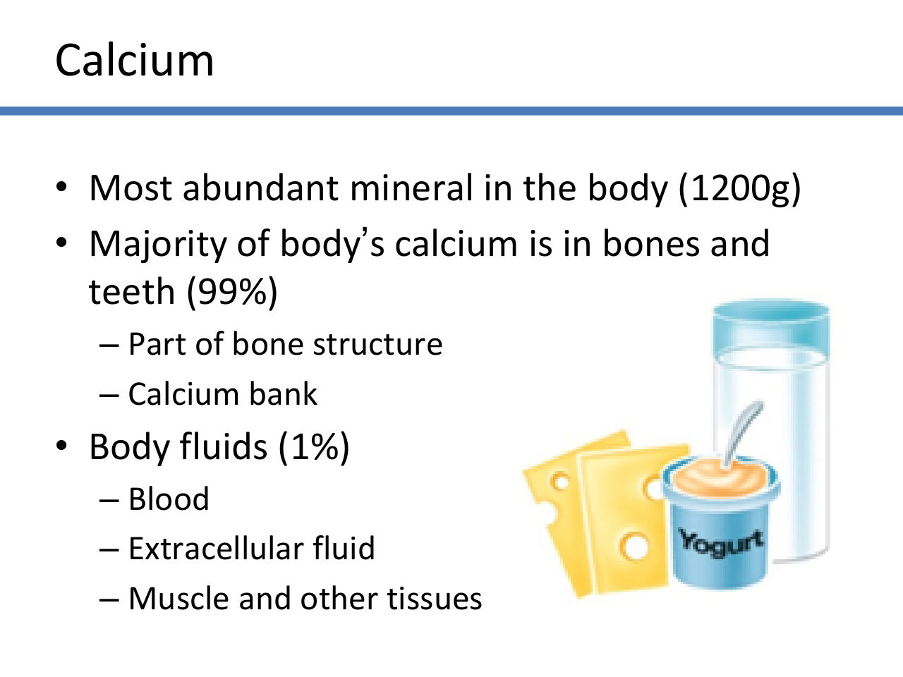

| Pool | Share | What it does |
|---|---|---|
| Bones and teeth | **99%** | Structure. Also a **calcium bank** the body can draw on |
| Body fluids | **1%** | Blood, extracellular fluid, muscle and other tissues |

 

The bank idea matters. When blood calcium drops, the body takes calcium out of bone to top it up. Bone pays so that blood stays normal.

 

### 🧠 Check
How much calcium is in the body, and where is almost all of it?

Answer

About 1200 g. 99% is in bones and teeth.

---

## 2. Sources and requirements

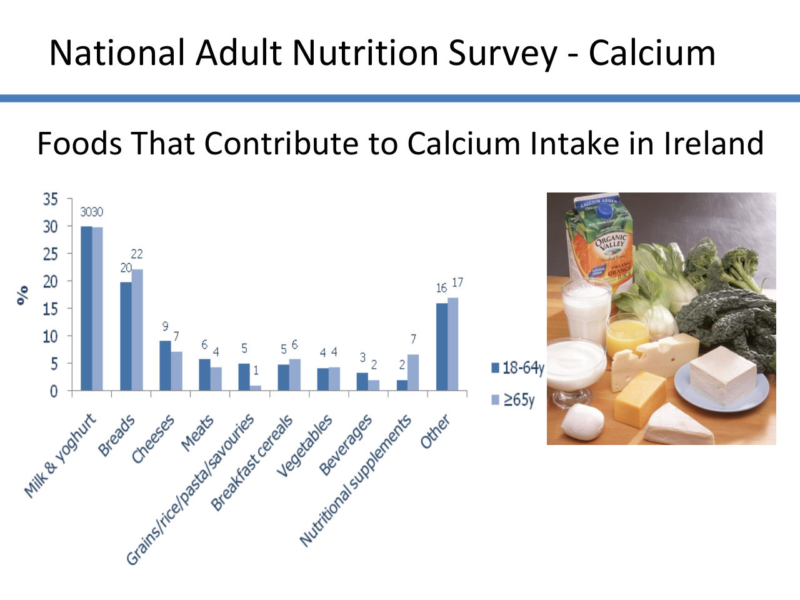

**How to read this graph:** each bar is the share of Irish calcium intake coming from a food group. Dark bars are adults 18–64, light bars are over 65.

| Food group | Share of Irish calcium intake |
|---|---|
| **Milk and yoghurt** | **30%** |
| Breads | 20–22% |
| Cheeses | 7–9% |
| Meats | 4–6% |
| Grains, rice, pasta | 1–5% |
| Breakfast cereals | 5–6% |
| Vegetables | 4% |

Dairy and bread together give about half of Irish calcium.

 

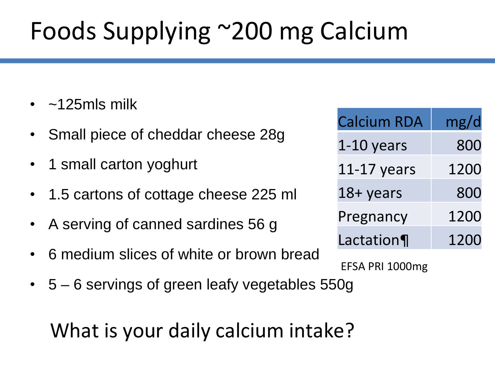

**Foods that each give about 200 mg calcium:**

| Food | Amount for 200 mg |
|---|---|
| Milk | about 125 ml |
| Cheddar cheese | small piece, 28 g |
| Yoghurt | 1 small carton |
| Cottage cheese | 1.5 cartons, 225 ml |
| Canned sardines | one serving, 56 g |
| White or brown bread | 6 medium slices |
| Green leafy vegetables | 5–6 servings, 550 g |

Notice the last two rows. Bread and greens contain calcium, but you need a lot of them.

 

**Requirements:**

| Group | Calcium RDA (mg/day) |
|---|---|
| 1–10 years | 800 |
| **11–17 years** | **1200** |
| 18+ years | **800** |
| Pregnancy | 1200 |
| Lactation | 1200 |

**EFSA PRI = 1000 mg.**

Teenagers need the most because they are laying down bone fast.

 

### 📐 Equation 1: Portions needed to reach the RDA

$$\text{portions} = \frac{\text{RDA (mg)}}{\text{mg calcium per portion}}$$

| Symbol | Meaning | Units |
|---|---|---|
| portions | how many servings of that food you would need in a day | count |
| RDA | the requirement for that person's age group | mg/day |
| mg per portion | calcium in one serving of the food | mg |

**Why it holds:** each portion gives a fixed amount. Divide the target by the amount per portion. Round up, because half a portion does not reach the target.

**Use it when:** the exam gives a food's calcium per portion and asks how many portions reach the RDA. The lecturer listed this as an example exam question.

**Does not apply:** if the question already gives total intake. Then just compare it with the RDA.

 

**Example:** an adult (RDA 800 mg) and 125 ml milk gives 200 mg. 800 ÷ 200 = **4** glasses.

 

### 🧠 Check
Which food group gives Irish adults the most calcium? What is the RDA for a 15-year-old?

Answer

Milk and yoghurt, about 30%.

1200 mg per day.

---

## 3. Absorption: active and passive

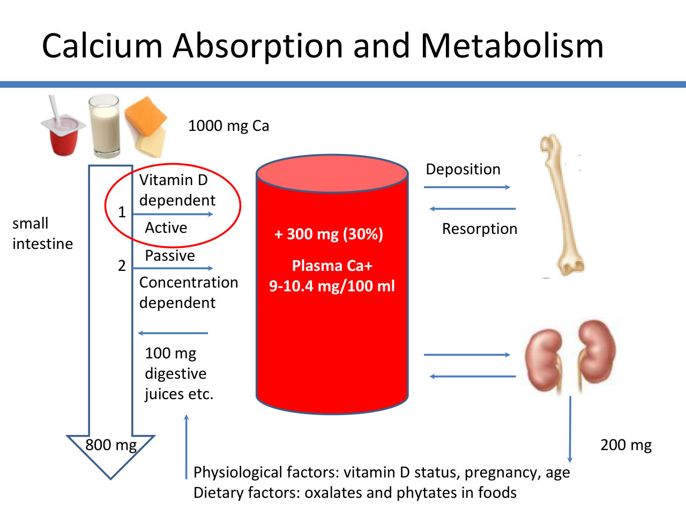

**How to read this slide:** 1000 mg of calcium comes in at the top. Follow the arrows. The red cylinder is blood plasma.

| Step | What happens | Amount |
|---|---|---|
| Intake | Food | 1000 mg |
| Absorbed in the small intestine | Into blood | **+300 mg (30%)** |
| Secreted back into the gut | Digestive juices | 100 mg |
| Lost in faeces | Not absorbed | 800 mg |
| Lost in urine | Kidney | 200 mg |
| Bone | Deposition in and resorption out | continuous exchange |

Net: 300 in, 100 back out through the gut, 200 out in urine. Balanced.

 

**Two absorption routes:**

| Route | Type | Depends on |
|---|---|---|
| **1. Active** | Transcellular, saturable | **Vitamin D** (calbindin). About 20–30% |
| **2. Passive** | Paracellular, between cells | **Concentration** of calcium in the gut. About 50–70% |

Active transport does most of the work when intake is low. Passive transport takes over when intake is high.

 

**What changes absorption:**

| Type | Factor |
|---|---|
| Physiological | Vitamin D status, pregnancy (more absorbed), age (less absorbed) |
| Dietary | **Oxalates** and **phytates** in foods bind calcium and reduce absorption |

Oxalates are in spinach and rhubarb. Phytates are in whole grains and legumes. This is why 550 g of green leafy veg only supplies 200 mg.

 

### 🧠 Check
Of 1000 mg calcium eaten, about how much is absorbed? Which route depends on vitamin D?

Answer

About 300 mg, 30%.

The active route. Passive absorption depends on concentration.

---

## 4. Vitamin D activation and calbindin

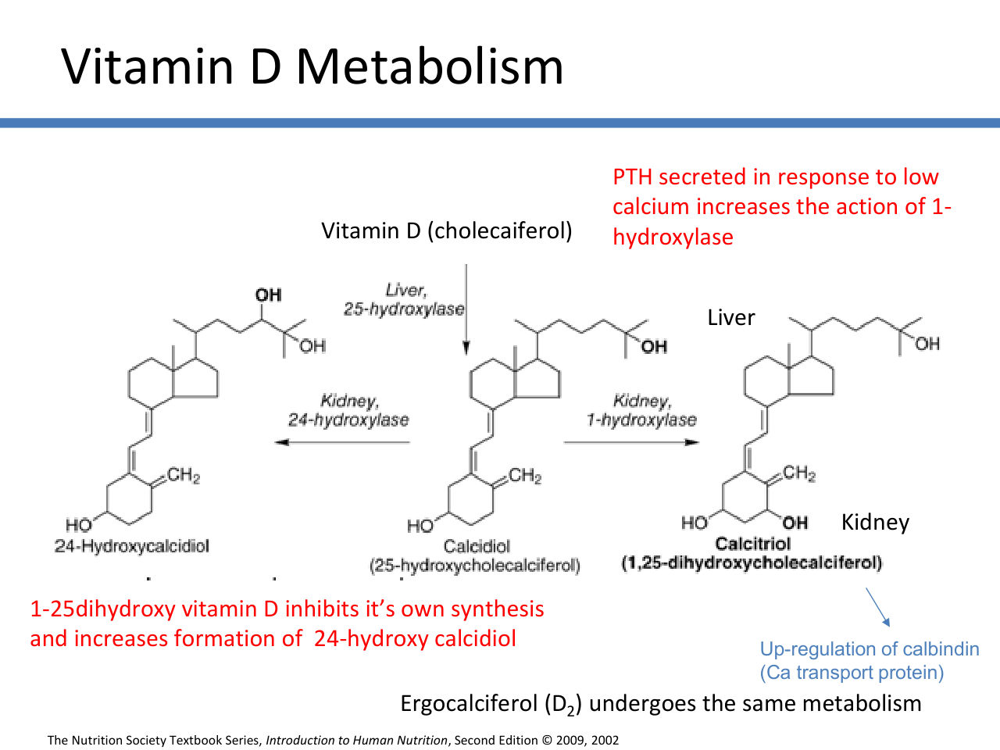

**How to read this slide:** the vitamin D pathway from Topic 4, redrawn to show the calcium links in red and blue.

| Step | Organ | Enzyme | Product |
|---|---|---|---|
| 1 | Liver | 25-hydroxylase | 25-hydroxyvitamin D (calcidiol) |
| 2 | Kidney | **1-hydroxylase** | **1,25-dihydroxyvitamin D (calcitriol)**, the active form |
| Off-switch | Kidney | 24-hydroxylase | 24-hydroxycalcidiol, inactive |

 

**Three control points (the red and blue text):**

1. **PTH is secreted when calcium is low.** It **increases 1-hydroxylase**, so more calcitriol is made.
2. **Calcitriol inhibits its own synthesis** and pushes the pathway towards 24-hydroxylase. Negative feedback.
3. **Calcitriol up-regulates calbindin.** Calbindin is the **calcium transport protein** in the gut wall. More calbindin, more active absorption.

D2 (ergocalciferol) goes through the same steps.

 

**Link to Topic 4:** this is the same liver → kidney pathway. The new word is **calbindin**.

 

### 🧠 Check
What is calbindin and what increases it?

Answer

The calcium transport protein in the intestine. Calcitriol (active vitamin D) up-regulates it.

---

## 5. Keeping blood calcium steady: three organs, three hormones

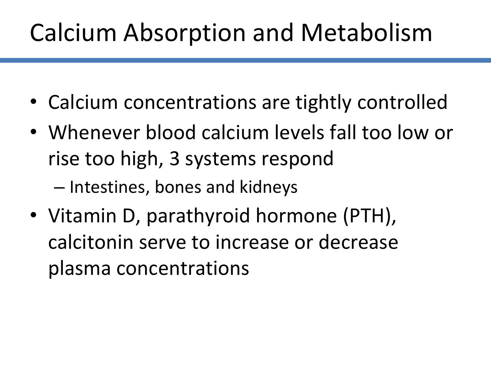

Blood calcium is **tightly controlled** at **9 to 10.4 mg per 100 ml**.

When it falls too low or rises too high, **three systems** respond: **intestine, bone, kidney**.

**Three hormones** drive them: **vitamin D**, **parathyroid hormone (PTH)**, **calcitonin**.

 

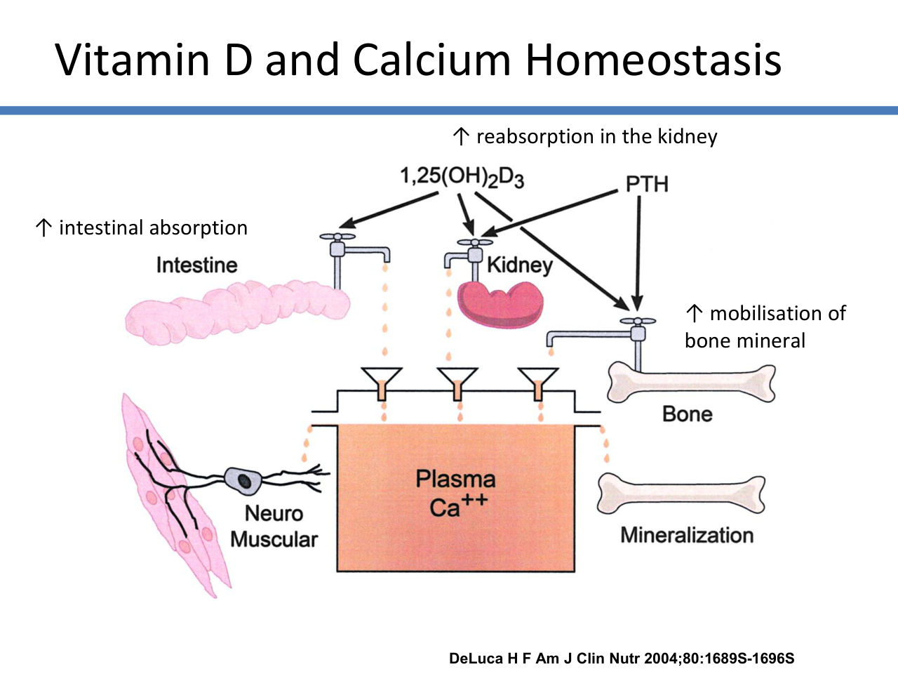

**How to read this slide:** calcitriol and PTH act on three taps that fill the plasma calcium tank.

| Tap | Effect of calcitriol (with PTH) |
|---|---|
| Intestine | ↑ absorption |
| Kidney | ↑ reabsorption |
| Bone | ↑ mobilisation of bone mineral |

 

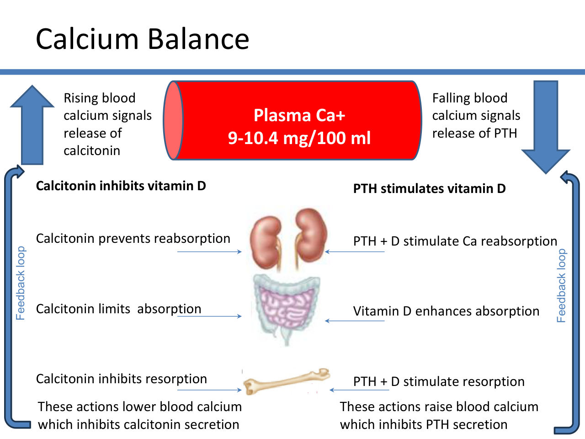

**How to read this slide:** two loops. Right side is the "calcium too low" loop. Left side is the "calcium too high" loop.

**Calcium falls → PTH is released:**

| Action | Result |
|---|---|
| PTH stimulates vitamin D activation | more calcitriol |
| PTH + D stimulate **reabsorption** in the kidney | less lost in urine |
| Vitamin D enhances **absorption** in the gut | more comes in |
| PTH + D stimulate **resorption** of bone | calcium released from the bank |
| Blood calcium rises | **PTH secretion stops** |

**Calcium rises → calcitonin is released:**

| Action | Result |
|---|---|
| Calcitonin inhibits vitamin D | less calcitriol |
| Calcitonin prevents reabsorption | more lost in urine |
| Calcitonin limits absorption | less comes in |
| Calcitonin inhibits resorption | bone keeps its calcium |
| Blood calcium falls | **calcitonin secretion stops** |

 

**The four words (recap slide, lecture 21):**

| Word | Meaning |
|---|---|
| **Calcitriol** | 1,25-dihydroxyvitamin D, the active form of vitamin D |
| **Calbindin** | calcium transport protein, up-regulated by calcitriol |
| **Calcitonin** | hormone released when calcium is **high**: resorption ↓, reabsorption ↓, absorption ↓ |
| **Parathyroid hormone (PTH)** | hormone released when calcium is **low**: resorption ↑, reabsorption ↑, absorption ↑ |

 

**Three "re" words, do not mix them up:**

- **Absorption** = gut → blood.
- **Reabsorption** = kidney filtrate → blood (saved from urine).
- **Resorption** = bone → blood (bone broken down).

 

### 🧠 Check
Blood calcium drops. Which hormone responds, and what three things does it do?

Answer

PTH. It raises gut absorption (through vitamin D), raises kidney reabsorption, and raises bone resorption. Blood calcium goes back up and PTH switches off.

---

## 6. More than bones: what the 1% does

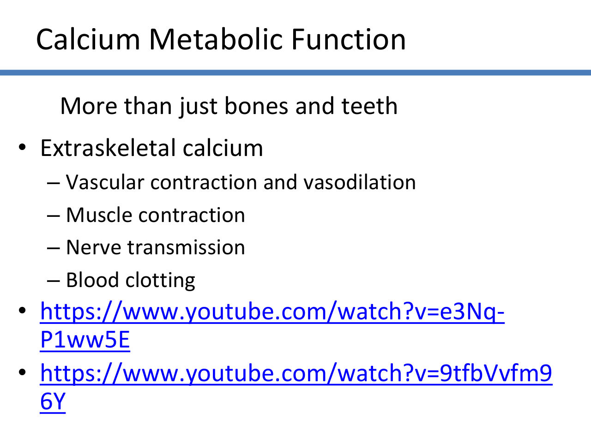

**Extraskeletal calcium** (the 1% outside bone) is needed for:

- **Vascular contraction and vasodilation** (blood vessel tone)
- **Muscle contraction**
- **Nerve transmission**
- **Blood clotting**

 

**Link to Topic 3:** vitamin K makes Gla residues on clotting factors. Gla binds calcium. No calcium, no clotting.

 

### 🧠 Check
Name four jobs of calcium outside the skeleton.

Answer

Vascular contraction and dilation, muscle contraction, nerve transmission, blood clotting.

---

## 7. Bone through life and peak bone mass

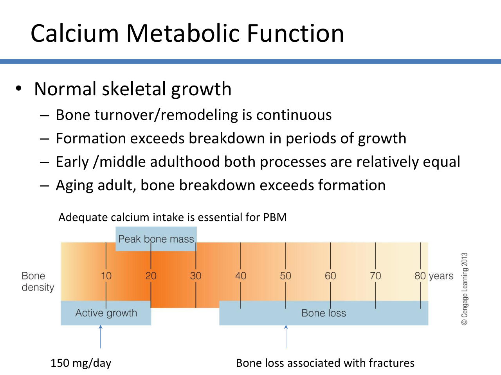

**How to read this graph:** bone density on the y axis, age on the x axis. Density climbs to a peak around 20 to 30, then slowly falls.

Bone is **remodelled continuously**: formation and breakdown at the same time.

| Life stage | Balance |
|---|---|
| Growth | Formation **exceeds** breakdown |
| Early and middle adulthood | Roughly **equal** |
| Older adult | Breakdown **exceeds** formation. About **150 mg/day** lost |

 

**Peak bone mass (PBM)** is the most bone you ever have. It is set in your teens and twenties.

**Adequate calcium intake is essential for PBM.** A high peak means more to lose before fractures start. That is why the teenage RDA is 1200 mg.

**Bone loss is associated with fractures.**

 

### 🧠 Check
Why does calcium intake in your teens matter for fractures at 70?

Answer

Teen intake builds peak bone mass. Everyone loses bone from middle age on. Starting from a higher peak means it takes longer to reach the bone loss level linked with fractures.

---

## 8. Measuring calcium status: DEXA and the WHO definition

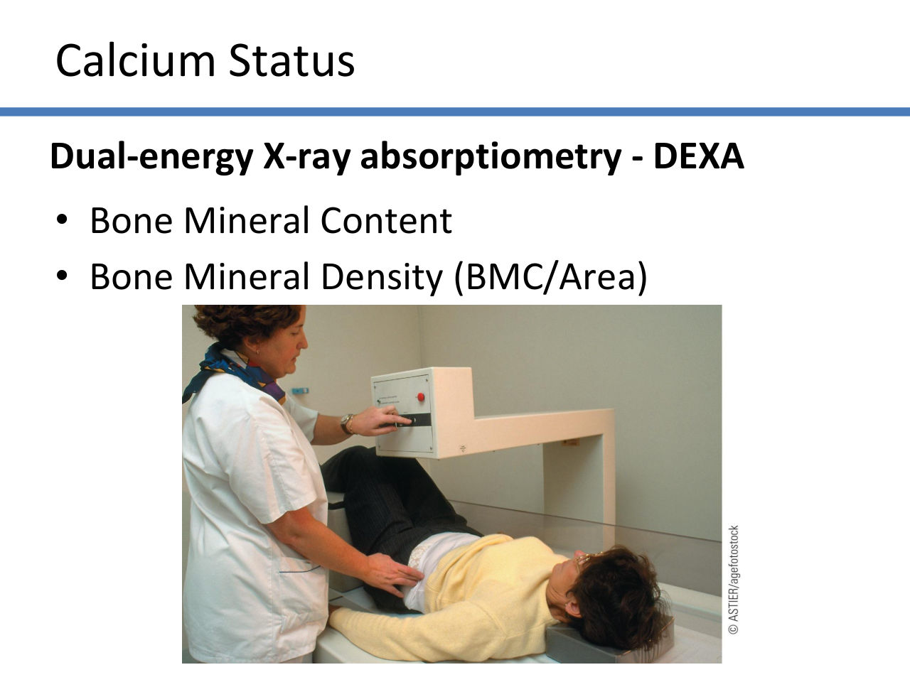

Calcium status is measured as bone, not blood, because blood calcium is held constant whatever the diet.

| Measure | Meaning |
|---|---|
| **Bone mineral content (BMC)** | grams of mineral in the bone |
| **Bone mineral density (BMD)** | BMC ÷ area |
| **DEXA** | dual-energy X-ray absorptiometry, the scan that measures them |

 

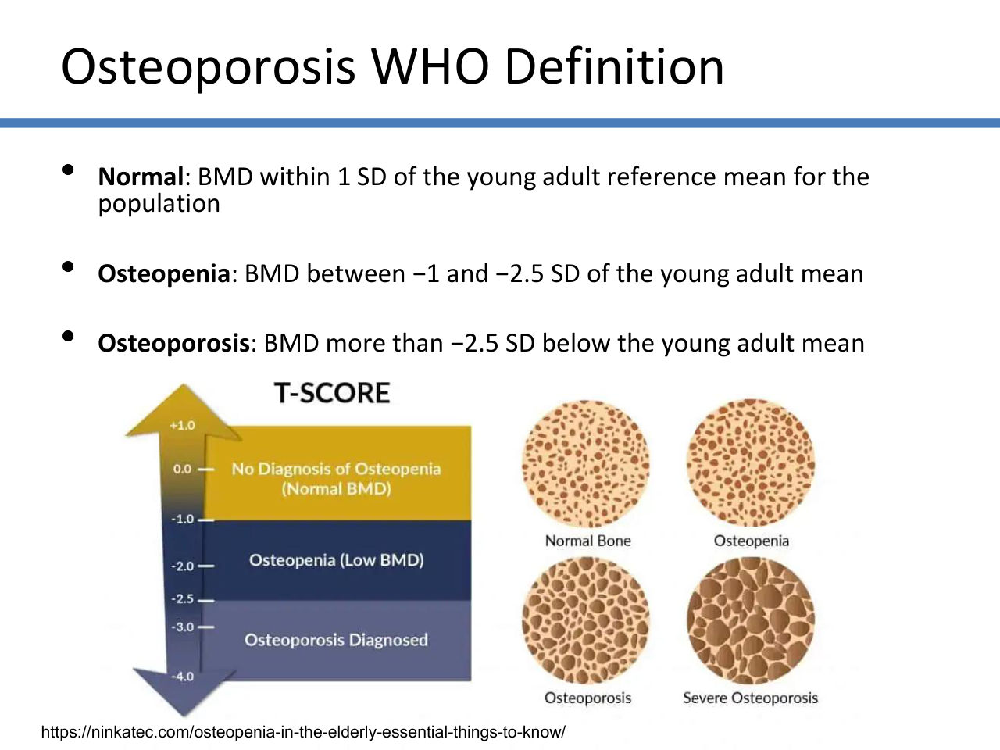

**How to read this slide:** the T-score compares your BMD with the mean of young adults, in standard deviations (SD).

| Category | BMD compared with young adult mean |
|---|---|
| **Normal** | within 1 SD |
| **Osteopenia** | between −1 and −2.5 SD |
| **Osteoporosis** | more than **−2.5 SD** below |

The bone pictures show the holes getting bigger as density falls.

 

### 🧠 Check
What T-score defines osteoporosis?

Answer

Bone mineral density more than 2.5 standard deviations below the young adult mean.

---

## 9. Deficiency and toxicity

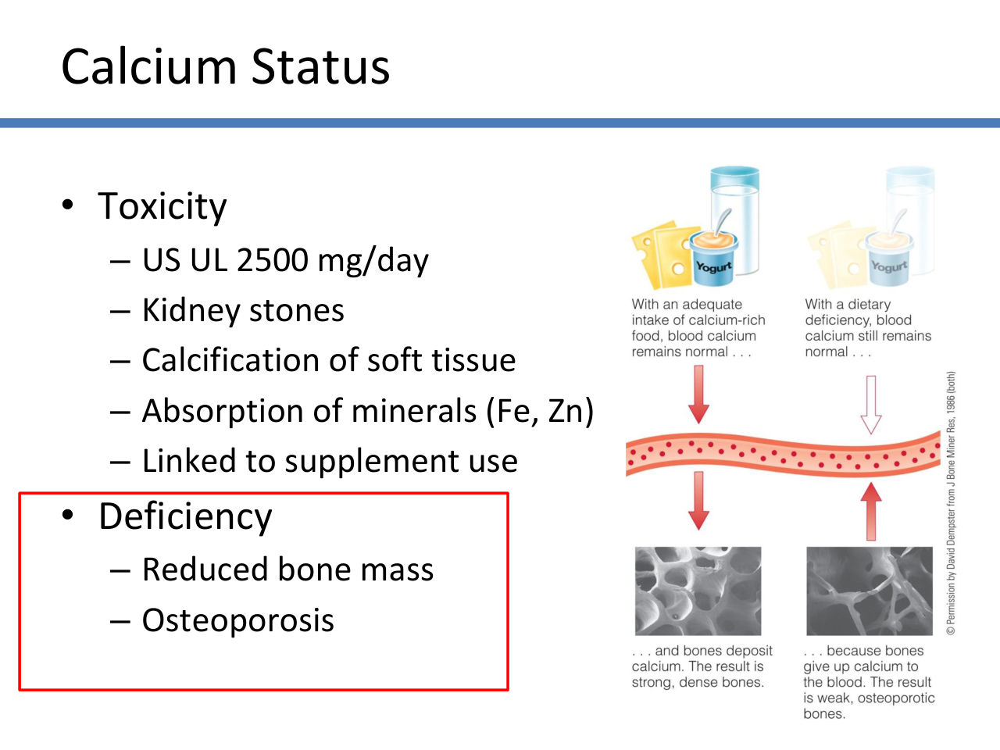

**Deficiency:**

- Reduced bone mass
- **Osteoporosis**

The right-hand picture: with enough calcium, blood calcium stays normal and bone stays dense. With a poor diet, blood calcium **still** stays normal, because bone gives up its calcium, and the bone becomes weak.

 

**Toxicity:**

| Fact | Detail |
|---|---|
| US UL | **2500 mg/day** |
| Problems | **Kidney stones**, calcification of soft tissue |
| Other minerals | Blocks absorption of **iron and zinc** |
| Cause | Linked to **supplement use**, not food |

 

**Link to Topic 15:** calcium is on the "decreased" side of the iron absorption table. High-dose calcium with a meal cuts iron absorption.

 

### 🧠 Check
Give three problems caused by too much calcium.

Answer

Kidney stones, soft tissue calcification, reduced absorption of iron and zinc.

---

## Summary (slide 35)

- Sources: dairy, green leafy vegetables, fortified foods, mineral water.
- Absorption: vitamin D dependent active transport (20–30%), passive paracellular (50–70%). About 30% of intake is absorbed.
- Functions: bone and teeth, muscle contraction, nerve transmission, blood clotting, vascular tone.
- Deficiency: osteopenia, osteoporosis.
- Toxicity: kidney stones, soft tissue calcification, UL 2500 mg.
