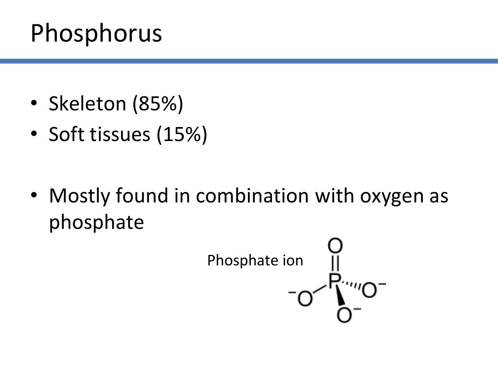
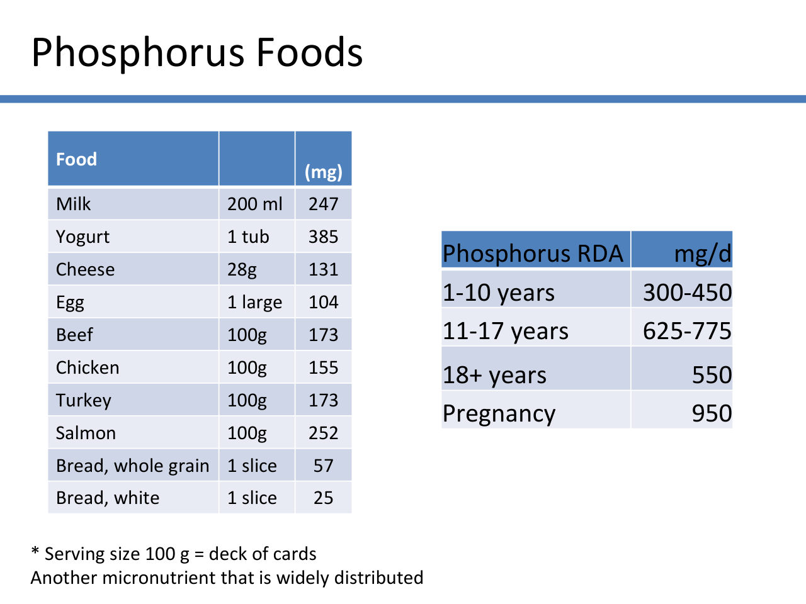
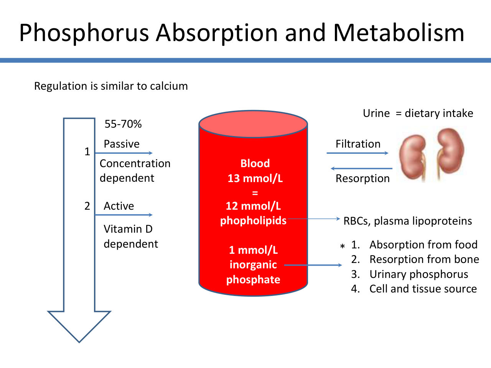
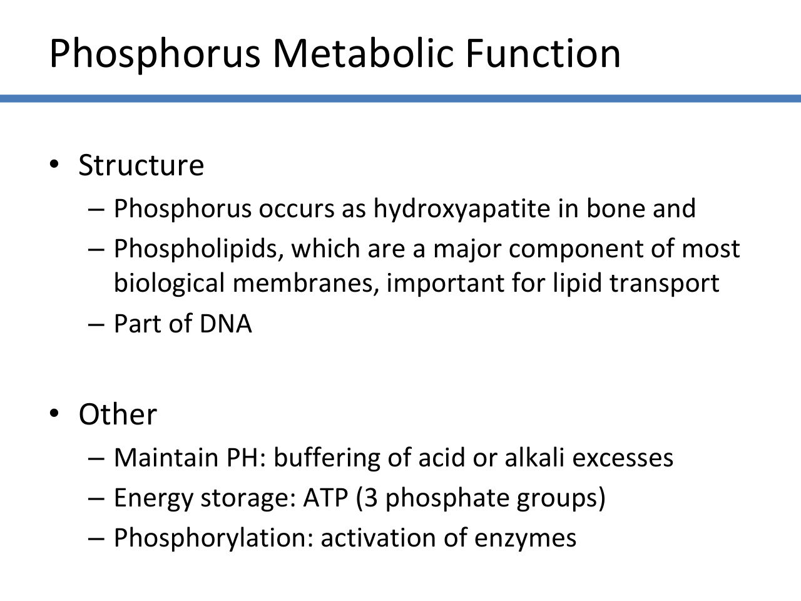
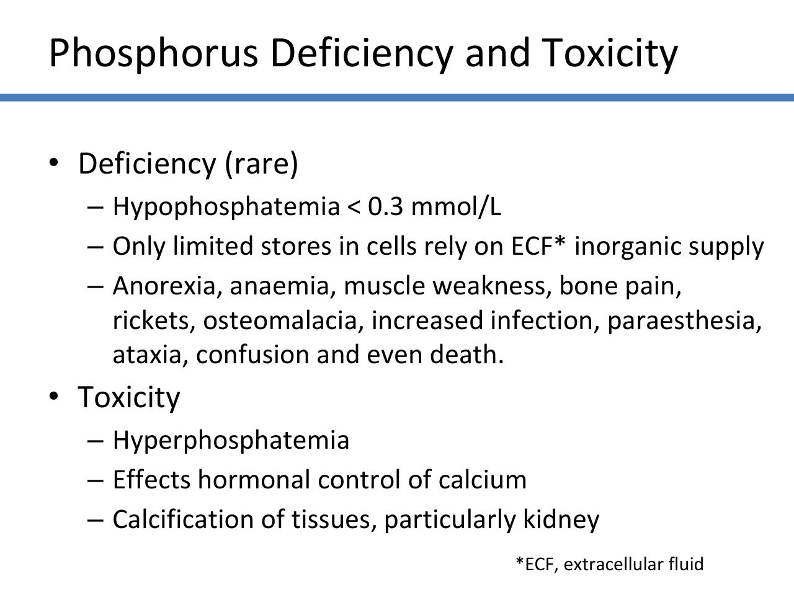
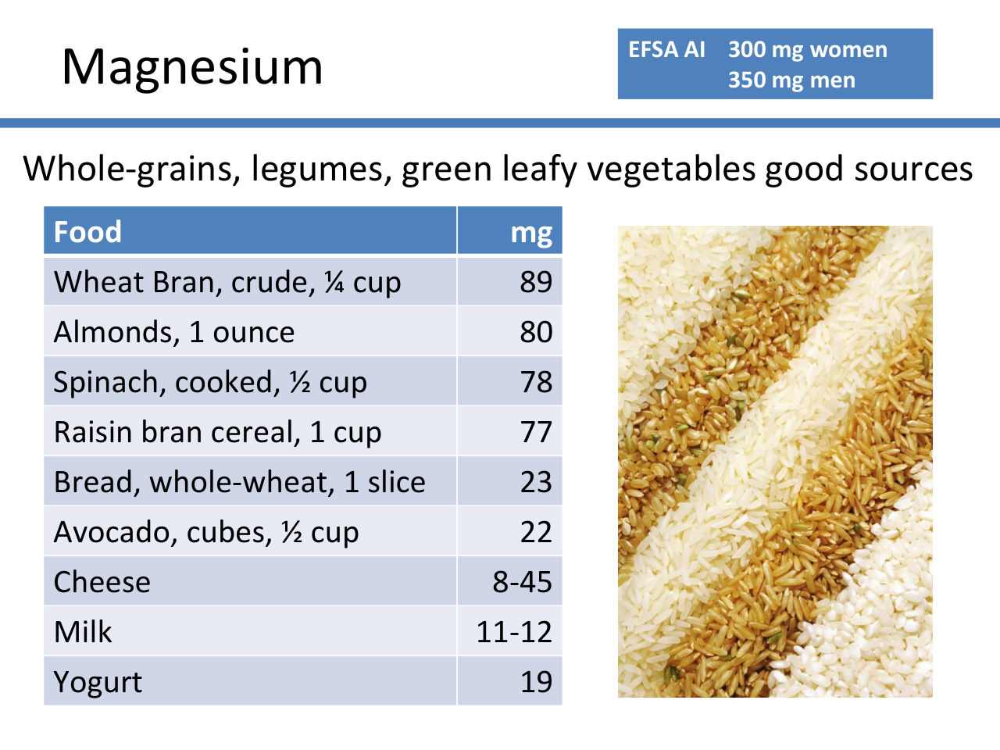
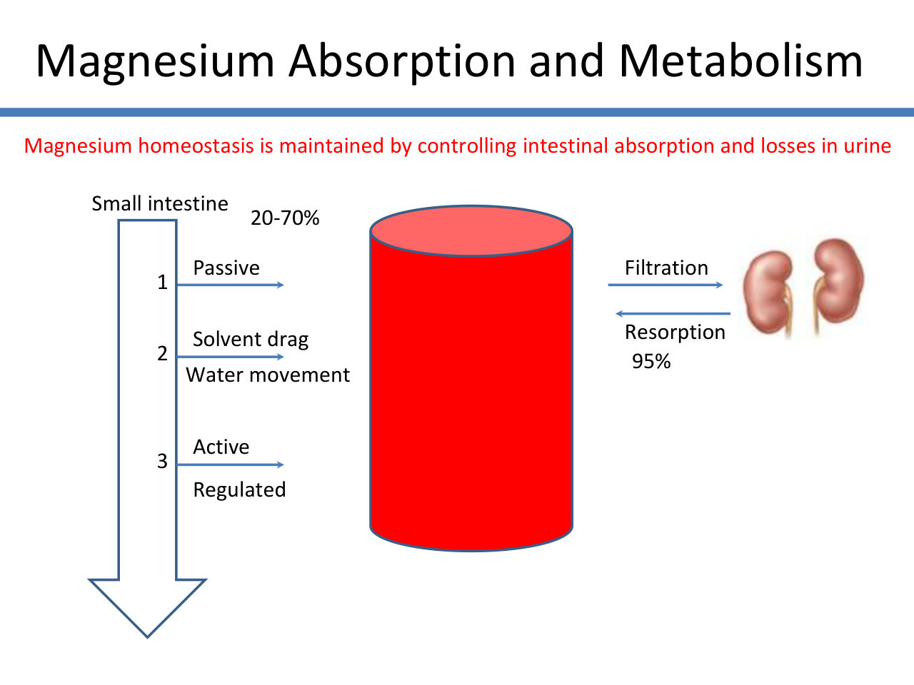
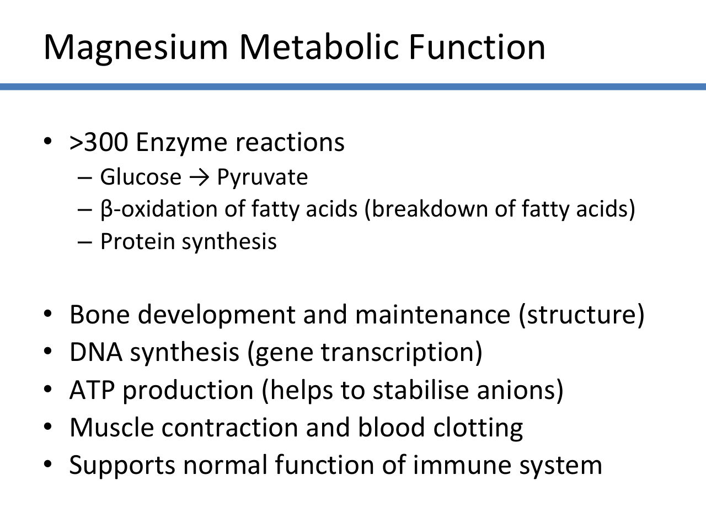
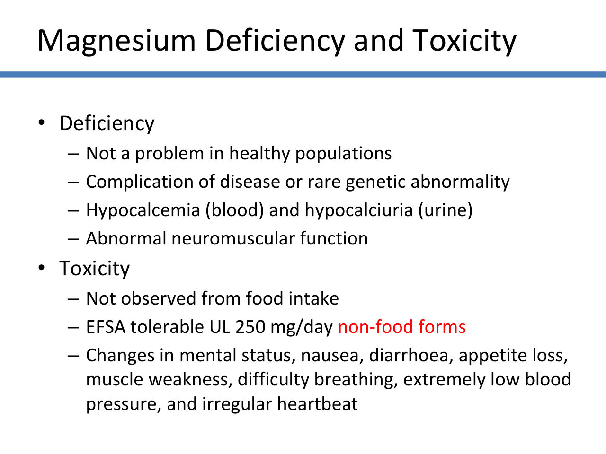

# Topic 14 — Phosphorus and magnesium

Slides: Lecture 17 (Minerals Ca, P, Mg), pages 24 to 35

---

## The big idea

Two more major minerals that live alongside calcium in bone.

**Phosphorus** is in the body as **phosphate**. 85% in the skeleton, 15% in soft tissue. It is in bone (hydroxyapatite), membranes (phospholipids), DNA and **ATP**. Regulation copies calcium.

**Magnesium** is a **cofactor for more than 300 enzymes**, including the ones that make and use ATP. Nuts, seeds, whole grains and green vegetables.

Both deficiencies are **rare** in healthy people. Both toxicities come from non-food sources.

---

**How to use these notes:**
When you see 🧠, stop.
Say the answer out loud or write it down.
Then click to check.

---

## ⭐ Learn by heart from this topic

**The phosphorus card.**

| Ask | Answer |
|---|---|
| Form in the body | Phosphate (P with oxygen) |
| Where | 85% skeleton, 15% soft tissues |
| Best foods | Milk, yoghurt, cheese, meat, fish, eggs, nuts, legumes, processed foods (additives). Widely distributed |
| RDA | Adults **550 mg**; 11–17 years 625–775 mg; pregnancy 950 mg |
| Absorption | **55–70%**. Mostly passive (60–70%), some active vitamin D dependent (30%) |
| Blood | 13 mmol/L: 12 mmol/L phospholipids + 1 mmol/L inorganic phosphate |
| Regulation | Similar to calcium. Urine phosphorus = dietary intake |
| Functions | Hydroxyapatite in bone, phospholipids in membranes, DNA, pH buffer, **ATP**, phosphorylation of enzymes |
| Deficiency | Rare. Hypophosphataemia < 0.3 mmol/L. Anorexia, anaemia, muscle weakness, bone pain, rickets, osteomalacia |
| Toxicity | Hyperphosphataemia. Upsets calcium control, calcifies tissues, especially kidney |

 

**The magnesium card.**

| Ask | Answer |
|---|---|
| Best foods | Wheat bran, almonds, spinach, raisin bran cereal. Whole grains, legumes, nuts, seeds, green leafy vegetables, mineral water |
| EFSA AI | **300 mg women, 350 mg men** |
| Absorption | **20–70%** in the small intestine. Passive (50–70%), active (20–30%), solvent drag (10–20%) |
| Kidney | 95% reabsorbed. Homeostasis = control of gut absorption and urine losses |
| Functions | Cofactor for **> 300 enzymes**: glycolysis, β-oxidation, protein synthesis. Bone structure. DNA synthesis. ATP (stabilises anions). Muscle contraction, clotting, immune |
| Deficiency | Rare in healthy people. From disease or genetic faults. **Hypocalcaemia**, hypocalciuria, abnormal neuromuscular function: cramps, tetany, arrhythmias, low K |
| Toxicity | Not from food. EFSA UL **250 mg/day for non-food forms** (supplements). Nausea, diarrhoea, muscle weakness, low BP, irregular heartbeat |

 

**Memory hook:** **P** is for **ATP** (three **P**hosphates). **Mg** holds the ATP in place: **Mg = 300 enzymes**.

---

## 1. Phosphorus: where it is

| Pool | Share |
|---|---|
| **Skeleton** | **85%** |
| Soft tissues | 15% |

In the body phosphorus is almost always joined to oxygen as **phosphate** (PO₄³⁻). The slide shows the phosphate ion: one P, four O.

 

**Compare with calcium:** calcium is 99% in bone, phosphorus 85%. Both are the minerals of hydroxyapatite, the bone crystal.

 

### 🧠 Check
In what chemical form is phosphorus found in the body? What share is in the skeleton?

Answer

As phosphate, combined with oxygen. 85% in the skeleton.

---

## 2. Phosphorus foods and requirements

**How to read this table:** mg phosphorus per serving. Dairy, meat and fish are high. White bread is low.

| Food | Serving | Phosphorus (mg) |
|---|---|---|
| **Yoghurt** | 1 tub | **385** |
| Salmon | 100 g | 252 |
| Milk | 200 ml | 247 |
| Beef | 100 g | 173 |
| Turkey | 100 g | 173 |
| Chicken | 100 g | 155 |
| Cheese | 28 g | 131 |
| Egg | 1 large | 104 |
| Bread, whole grain | 1 slice | 57 |
| Bread, white | 1 slice | 25 |

"Another micronutrient that is widely distributed." Processed foods add more as phosphate additives.

 

| Group | Phosphorus RDA (mg/day) |
|---|---|
| 1–10 years | 300–450 |
| 11–17 years | 625–775 |
| **18+ years** | **550** |
| Pregnancy | 950 |

 

### 🧠 Check
What is the adult phosphorus RDA? Name the food on the slide with the most phosphorus per serving.

Answer

550 mg per day. Yoghurt, 385 mg per tub.

---

## 3. Phosphorus absorption and regulation

**How to read this slide:** same layout as the calcium slide. Gut on the left, blood in the middle, kidney on the right.

| Fact | Detail |
|---|---|
| Absorbed | **55–70%** of intake, much more than calcium |
| Route 1 | **Passive**, concentration dependent. About 60–70% of absorption |
| Route 2 | **Active**, **vitamin D dependent**. About 30% |
| Blood | **13 mmol/L** total: **12 mmol/L as phospholipids** (in red cells and plasma lipoproteins) and **1 mmol/L inorganic phosphate** |
| Kidney | Filtration then resorption. **Urine phosphorus = dietary intake** |
| Regulation | **Similar to calcium** |

 

**Four sources of blood phosphorus:**

1. Absorption from food
2. Resorption from bone
3. Urinary phosphorus (what the kidney lets go)
4. Cells and tissues

 

### 🧠 Check
What share of dietary phosphorus is absorbed, and what does urine phosphorus equal?

Answer

55–70%. Urine phosphorus equals dietary intake, because the kidney excretes what is absorbed.

---

## 4. Phosphorus functions

**Structure:**

| Where | Form |
|---|---|
| Bone | **Hydroxyapatite** (calcium phosphate crystal) |
| Membranes | **Phospholipids**, also used for lipid transport (lipoproteins) |
| Genes | Part of **DNA** (the phosphate backbone) |

**Other:**

| Job | How |
|---|---|
| **Maintain pH** | phosphate buffers acid and alkali |
| **Energy storage** | **ATP** has 3 phosphate groups |
| **Phosphorylation** | adding a phosphate switches enzymes on or off |

 

**Link to Topic 6:** thiamin's coenzyme is thiamine **di**phosphate. Niacin's is NAD **phosphate**. Many coenzymes carry phosphate.

 

### 🧠 Check
Name three structural roles and three other roles of phosphorus.

Answer

Structural: hydroxyapatite in bone, phospholipids in membranes, DNA.

Other: pH buffering, ATP energy storage, phosphorylation of enzymes.

---

## 5. Phosphorus deficiency and toxicity

**Deficiency is rare.** Phosphorus is in almost everything.

| Fact | Detail |
|---|---|
| Name | **Hypophosphataemia**, below **0.3 mmol/L** |
| Why it bites | Cells hold only limited stores and depend on the inorganic supply in extracellular fluid |
| Symptoms | Anorexia, anaemia, muscle weakness, bone pain, **rickets, osteomalacia**, infections, paraesthesia, ataxia, confusion, death |

 

**Toxicity:**

| Fact | Detail |
|---|---|
| Name | **Hyperphosphataemia** |
| Effect | Upsets the hormonal control of **calcium** |
| Result | **Calcification of tissues, particularly the kidney** |

 

**Link to Topic 4:** rickets and osteomalacia appear here too. Bone needs both calcium and phosphate to mineralise.

 

### 🧠 Check
What blood level defines hypophosphataemia, and which organ is most at risk in toxicity?

Answer

Below 0.3 mmol/L. The kidney calcifies.

---

## 6. Magnesium foods and requirements

**How to read this table:** mg magnesium per serving. Plant foods lead. Dairy is low.

| Food | Mg (mg) |
|---|---|
| **Wheat bran**, ¼ cup | **89** |
| Almonds, 1 oz | 80 |
| Spinach, cooked, ½ cup | 78 |
| Raisin bran cereal, 1 cup | 77 |
| Bread, whole-wheat, 1 slice | 23 |
| Avocado, ½ cup | 22 |
| Yoghurt | 19 |
| Milk | 11–12 |
| Cheese | 8–45 |

**Good sources:** whole grains, legumes, nuts, seeds, green leafy vegetables, mineral water.

Spinach is green because of **chlorophyll**, and chlorophyll has magnesium at its centre. That is why green leaves are a source.

 

**EFSA AI:** **300 mg women, 350 mg men.**

 

**Link to Topic 1:** it is an AI, not a PRI, so an average requirement could not be set.

 

### 🧠 Check
What is the EFSA AI for magnesium for men and for women?

Answer

350 mg for men, 300 mg for women.

---

## 7. Magnesium absorption and regulation

**How to read this slide:** three numbered arrows into the blood from the small intestine, and the kidney on the right.

| Route | Type | Share |
|---|---|---|
| 1 | **Passive** (paracellular) | 50–70% |
| 2 | **Solvent drag** (carried along with water movement) | 10–20% |
| 3 | **Active** (transcellular, regulated, vitamin D dependent) | 20–30% |

Overall **20–70%** of dietary magnesium is absorbed in the small intestine.

 

**Kidney:** filtration then resorption. **95%** is reabsorbed.

**Magnesium homeostasis is maintained by controlling intestinal absorption and losses in urine.** No hormone loop like calcium's.

 

### 🧠 Check
Name the three absorption routes for magnesium. How is magnesium balance controlled?

Answer

Passive, solvent drag, active.

By adjusting intestinal absorption and urinary losses.

---

## 8. Magnesium functions

**Cofactor for more than 300 enzyme reactions**, including:

- Glucose → pyruvate (**glycolysis**)
- **β-oxidation** of fatty acids
- **Protein synthesis**

**Other roles:**

| Role | Detail |
|---|---|
| Bone | development and maintenance, structure |
| DNA | synthesis and gene transcription |
| **ATP** | production. Magnesium stabilises the negative charges (anions) on ATP |
| Muscle | contraction |
| Blood | clotting |
| Immune | supports normal function |

 

**Link to Topics 6 to 8:** the B vitamins supply the coenzymes for energy pathways. Magnesium is the mineral partner that lets ATP be made and used.

 

### 🧠 Check
Roughly how many enzymes need magnesium? Name two pathways.

Answer

More than 300. Glycolysis, β-oxidation of fatty acids, protein synthesis.

---

## 9. Magnesium deficiency and toxicity

**Deficiency:**

| Fact | Detail |
|---|---|
| In healthy people | **Not a problem** |
| Causes | Complication of disease, or rare genetic abnormality |
| Blood and urine | **Hypocalcaemia** (low blood calcium) and hypocalciuria (low urine calcium) |
| Nerves and muscle | Abnormal neuromuscular function: **muscle cramps, tetany, arrhythmias** |
| Summary slide adds | hypokalaemia (low potassium) |

Low magnesium drags calcium and potassium down with it.

 

**Toxicity:**

| Fact | Detail |
|---|---|
| From food | **Not observed** |
| EFSA UL | **250 mg/day for non-food forms** (supplements, medicines) |
| Symptoms | Changes in mental status, nausea, diarrhoea, appetite loss, muscle weakness, difficulty breathing, very low blood pressure, irregular heartbeat |

 

**Odd fact to remember:** the UL (250 mg) is **lower** than the AI (300–350 mg). The UL applies only to supplement forms on top of food.

 

### 🧠 Check
Why is the magnesium UL lower than the AI?

Answer

The UL of 250 mg applies only to non-food forms, such as supplements. Toxicity has never been seen from food.

---

## Summary (slide 35)

**Phosphorus**
- Sources: meat, dairy, fish, eggs, nuts, legumes, processed foods.
- Absorption: mainly passive (60–70%), vitamin D dependent active (30%).
- Functions: hydroxyapatite, ATP, cell signalling, acid-base buffer.
- Deficiency rare: bone pain, weakness, rickets or osteomalacia, impaired growth.

**Magnesium**
- Sources: nuts, seeds, legumes, whole grains, green leafy vegetables, mineral water.
- Absorption: passive (50–70%), active (20–30%, vitamin D dependent), solvent drag (10–20%).
- Functions: cofactor for > 300 enzymes, bone, neuromuscular, energy, DNA and RNA.
- Deficiency: cramps, tetany, arrhythmias, hypocalcaemia, hypokalaemia.
