# Topic 15 — Iron

Slides: Lecture 18 (Minerals Fe, I), pages 5 to 22. Recap in Lecture 21, pages 23 to 27.

---

## The big idea

Iron deficiency is the **most common micronutrient deficiency in the world**.

Iron sits in **haemoglobin** and carries **oxygen**. Two thirds of body iron is in red blood cells.

Food iron comes in two kinds:

- **Haem iron**, only in animal foods, well absorbed (15–30%).
- **Non-haem iron**, in plants and animals, poorly absorbed (1–20%) and easily blocked by tea, phytate and calcium. Helped by **vitamin C** and meat.

The body **cannot excrete iron**. So it stores it (ferritin), reuses it, and **regulates absorption** (hepcidin).

Deficiency goes in three stages: stores empty, transport falls, haemoglobin falls. Women need more (16 mg) than men (11 mg) because of menstrual losses.

---

**How to use these notes:**
When you see 🧠, stop.
Say the answer out loud or write it down.
Then click to check.

---

## ⭐ Learn by heart from this topic

**The iron card.** Cover the right column and say it from memory.

| Ask | Answer |
|---|---|
| Amount in body | 4–5 g in a 70 kg adult |
| Where | 70% functional (60% haemoglobin, 5% myoglobin, 5% enzymes); 20% ferritin; 10% haemosiderin; < 1% transferrin |
| Two food forms | Haem (Fe²⁺ in a haem ring, animal foods only) and non-haem (plant and animal) |
| Absorbed | Haem 15–30%; non-haem 1–20%. Fe²⁺ (ferrous) is absorbed, Fe³⁺ (ferric) is not |
| Helps non-haem absorption | Vitamin C, meat, fish, low iron status, pregnancy |
| Blocks non-haem absorption | Phytate (legumes, whole grains), polyphenols (tea), calcium, low gastric acid, high iron status |
| Tea with a meal | Cuts non-haem absorption by 40–70% |
| Storage protein | Ferritin (and haemosiderin). Transport protein: transferrin. Regulator: hepcidin |
| Best foods | Lean beef, lamb, baked beans, spinach, salmon, wholemeal bread, fortified cereals |
| Irish sources (NANS) | Breads 19–22%, meats 18%, breakfast cereals 15–18% |
| EFSA PRI | **Women 16 mg, men 11 mg** |
| RDA on slide | Men 10, women 14, pregnancy 15, children 8–10, adolescents 13–14 mg |
| Functions | Haemoglobin (O₂ transport), myoglobin (O₂ store in muscle), cytochromes (ATP), enzymes for energy, antioxidants, DNA synthesis |
| Deficiency signs | Fatigue, weakness, poor resistance to cold, pale skin, poorer thinking in children |
| At risk | Infants, adolescents, pregnant women (growth), menstruating women |
| Three stages | 1 ferritin falls (< 12 µg/L); 2 serum iron falls, iron binding capacity rises; 3 haemoglobin falls, protoporphyrin rises |
| WHO anaemia cut-off | Hb < 13 g/dl men, < 12 g/dl women |

 

**Memory hook:** **Fe²⁺ feeds you, Fe³⁺ flees.** Vitamin **C** converts 3 to 2. **Tea** takes it away.

---

## 1. The most common deficiency, and haemoglobin

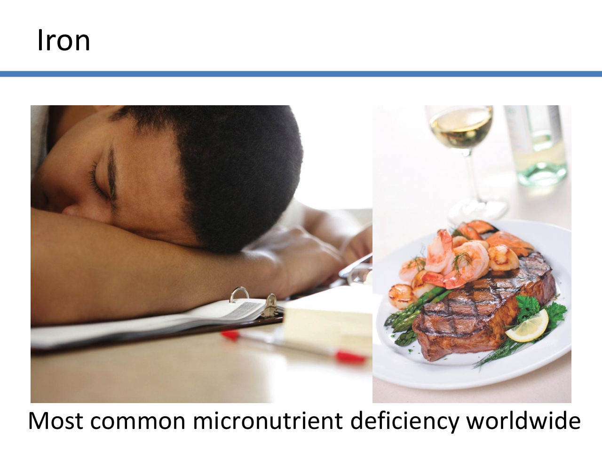

Iron deficiency is the **most common micronutrient deficiency worldwide**.

 

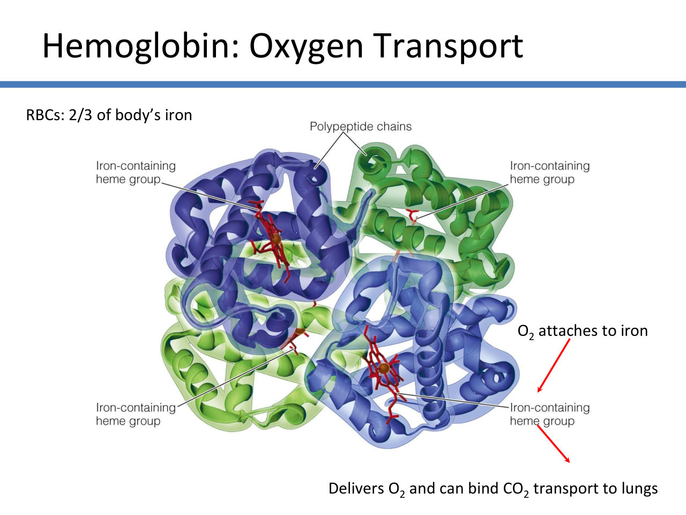

**How to read this slide:** a haemoglobin molecule. Four polypeptide chains (blue and green), each holding one **haem group** (red) with an iron atom in the middle.

- **Oxygen attaches to the iron.**
- Haemoglobin delivers O₂ to tissues and can carry CO₂ back to the lungs.
- **Red blood cells hold two thirds of the body's iron.**

 

### 🧠 Check
Where does oxygen bind in haemoglobin? What share of body iron is in red cells?

Answer

To the iron atom in each haem group. Two thirds.

---

## 2. Iron in foods: haem and non-haem

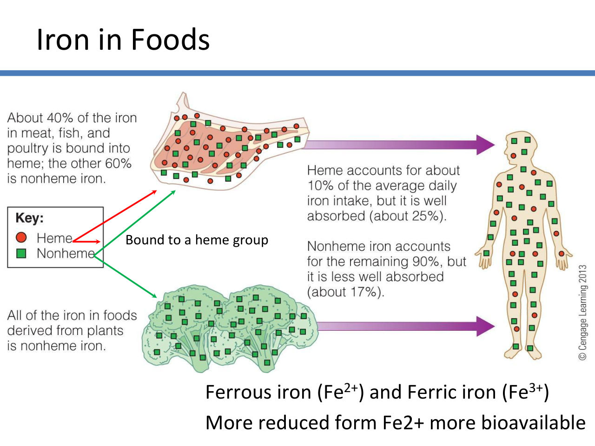

**How to read this slide:** meat on top, plants below. Red dots are haem iron, green squares are non-haem.

| | Haem iron | Non-haem iron |
|---|---|---|
| Structure | Iron held in a **haem ring** | Free iron, Fe²⁺ or Fe³⁺ |
| Where | **Only animal foods**: meat, poultry, fish. About 40% of the iron in meat | Plant foods, and the other 60% of iron in meat |
| Share of intake | About 10% | About 90% |
| Absorbed | **15–30%** (well) | **1–20%** (poorly) |

 

**Ferrous and ferric:**

| Form | Charge | Absorbed? |
|---|---|---|
| **Ferrous** iron | **Fe²⁺** | Yes, the more reduced form is more bioavailable |
| **Ferric** iron | **Fe³⁺** | Must be reduced to Fe²⁺ first |

 

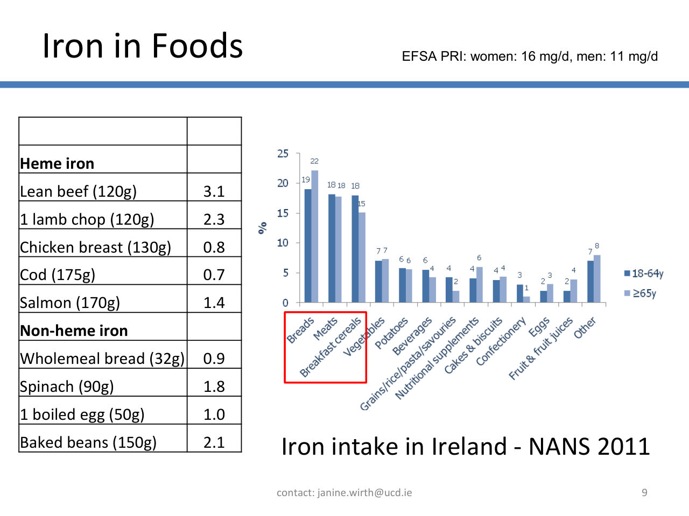

**How to read this slide:** mg iron per portion on the left. Irish intake sources (NANS 2011) on the right.

| Food | Portion | Iron (mg) | Type |
|---|---|---|---|
| **Lean beef** | 120 g | **3.1** | haem |
| Lamb chop | 120 g | 2.3 | haem |
| Salmon | 170 g | 1.4 | haem |
| Chicken breast | 130 g | 0.8 | haem |
| Cod | 175 g | 0.7 | haem |
| **Baked beans** | 150 g | **2.1** | non-haem |
| Spinach | 90 g | 1.8 | non-haem |
| Boiled egg | 50 g | 1.0 | non-haem |
| Wholemeal bread | 32 g | 0.9 | non-haem |

 

**Irish iron sources (NANS):** **breads** 19–22%, **meats** 18%, **breakfast cereals** 15–18%. Those three are boxed on the slide. Bread and cereals count because they are fortified.

 

**EFSA PRI: women 16 mg/day, men 11 mg/day.**

 

### 📐 Equation 1: Portions needed to reach the PRI

$$\text{portions} = \frac{\text{PRI (mg)}}{\text{mg iron per portion}}$$

| Symbol | Meaning | Units |
|---|---|---|
| portions | servings of that food needed in a day | count |
| PRI | 16 mg for women, 11 mg for men | mg/day |
| mg per portion | iron in one serving | mg |

**Why it holds:** each portion gives a fixed amount. Divide the target by the amount per portion and round up.

**Use it when:** the question gives iron per portion and asks how many portions reach the recommendation. The lecturer said this is an example exam question.

**Does not apply:** to the absorbed amount. The PRI is already set to allow for the low absorption of iron. Do not multiply by 15% as well.

 

**Example:** a woman (16 mg) eating only baked beans (2.1 mg per 150 g) would need 16 ÷ 2.1 = 7.6, so **8** portions.

 

### 🧠 Check
Which form of iron is absorbed, ferrous or ferric? What are the EFSA PRIs?

Answer

Ferrous, Fe²⁺.

16 mg for women, 11 mg for men.

---

## 3. Iron in the body

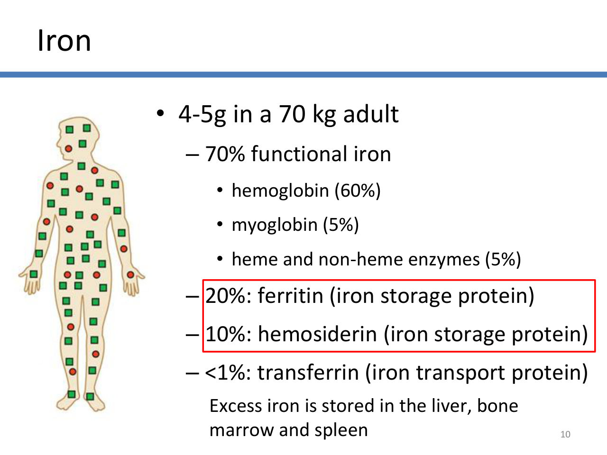

A 70 kg adult holds **4 to 5 g** of iron.

| Pool | Share | Protein |
|---|---|---|
| **Functional** | **70%** | haemoglobin **60%**, myoglobin 5%, haem and non-haem enzymes 5% |
| **Storage** | **20%** | **ferritin** |
| Storage | 10% | **haemosiderin** |
| Transport | **< 1%** | **transferrin** |

Excess iron is stored in the **liver, bone marrow and spleen**.

 

**Three proteins to tell apart:**

- **Ferritin** = store (also a temporary store in the gut wall).
- **Haemosiderin** = long-term store.
- **Transferrin** = carries iron in blood.

 

### 🧠 Check
Name the iron storage protein and the iron transport protein.

Answer

Storage: ferritin (and haemosiderin). Transport: transferrin.

---

## 4. Absorption and hepcidin

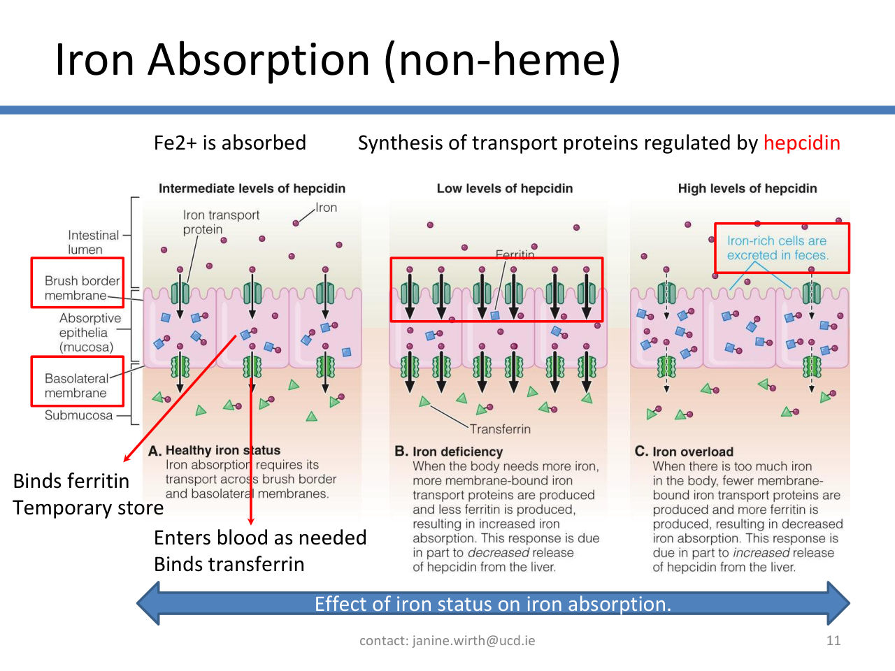

**How to read this slide:** three panels of gut wall. Left: healthy status. Middle: deficiency. Right: overload. Iron crosses the brush border, sits in the cell, and leaves across the basolateral membrane into blood.

| Step | What happens |
|---|---|
| 1 | **Fe²⁺ is absorbed** across the brush border into the gut cell (via **DMT1**) |
| 2 | Inside the cell it **binds ferritin** as a **temporary store** |
| 3 | It **enters blood as needed** and **binds transferrin** |
| 4 | If the body does not need it, the gut cell is shed with its iron into faeces |

 

**Hepcidin** is the liver hormone that **regulates synthesis of the transport proteins**:

| Iron status | Hepcidin | Transport proteins | Result |
|---|---|---|---|
| Deficiency | **low** | more made | **more absorbed** |
| Healthy | medium | normal | balance |
| Overload | **high** | fewer made | **less absorbed**, iron-rich cells shed |

This is the "effect of iron status on iron absorption" arrow across the bottom.

 

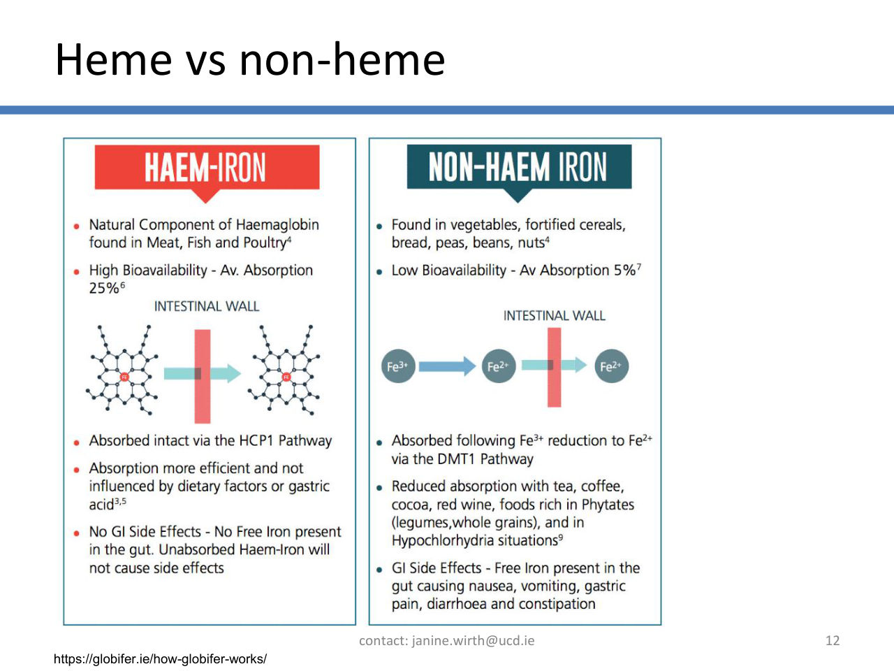

| | Haem iron | Non-haem iron |
|---|---|---|
| Absorbed via | **HCP1** (haem carrier protein), intact | **DMT1**, after Fe³⁺ is reduced to Fe²⁺ |
| Average absorption | about 25% | about 5% |
| Dietary factors | **not** much affected | reduced by tea, coffee, cocoa, red wine, phytate |
| Gut side effects | no free iron, so none | free iron can cause nausea, pain, diarrhoea, constipation |

 

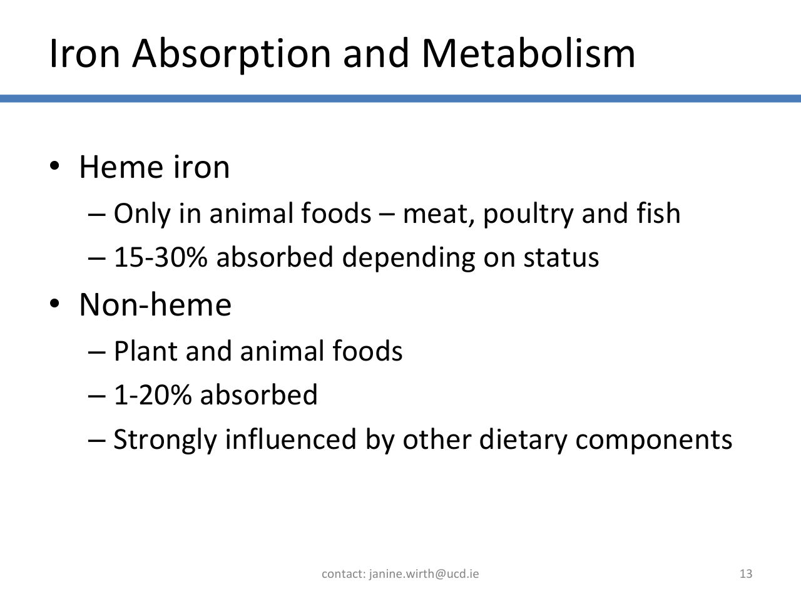

| | Haem | Non-haem |
|---|---|---|
| Foods | Only animal: meat, poultry, fish | Plant and animal |
| Absorbed | **15–30%**, depending on status | **1–20%**, strongly influenced by other dietary components |

 

### 🧠 Check
What does hepcidin do when iron stores are high?

Answer

Hepcidin rises and cuts synthesis of the transport proteins, so less iron is absorbed and the iron-rich gut cells are shed.

---

## 5. What helps and what blocks absorption

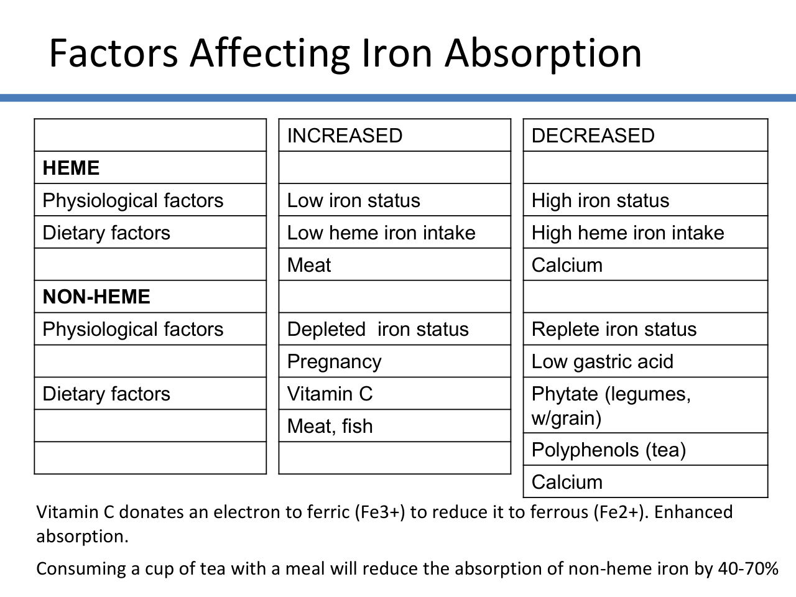

**How to read this table:** rows for haem and non-haem. Columns for increased and decreased.

**Haem iron:**

| Increased | Decreased |
|---|---|
| Low iron status | High iron status |
| Low haem iron intake | High haem iron intake |
| Meat | **Calcium** |

**Non-haem iron:**

| Increased | Decreased |
|---|---|
| Depleted iron status | Replete iron status |
| Pregnancy | Low gastric acid |
| **Vitamin C** | **Phytate** (legumes, whole grains) |
| **Meat, fish** | **Polyphenols (tea)** |
| | **Calcium** |

 

**Two sentences to memorise:**

1. **Vitamin C donates an electron to ferric (Fe³⁺) and reduces it to ferrous (Fe²⁺).** Enhanced absorption.
2. **A cup of tea with a meal reduces non-haem iron absorption by 40–70%.**

 

**Link to Topic 13:** calcium blocks both kinds of iron. That is why calcium supplements should not be taken with an iron-rich meal.

 

### 🧠 Check
Name two things that increase and three that decrease non-haem iron absorption.

Answer

Increase: vitamin C, meat or fish, low iron status, pregnancy.

Decrease: phytate, polyphenols in tea, calcium, low gastric acid, replete iron status.

---

## 6. Iron balance: store, reuse, regulate

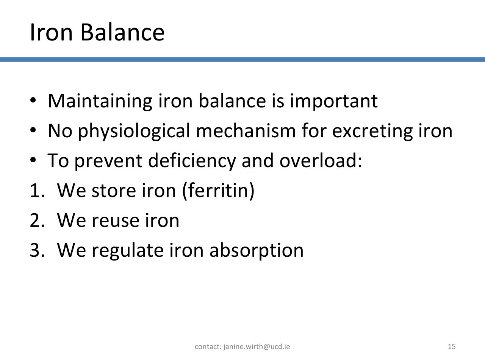

**There is no physiological mechanism for excreting iron.** Small amounts are lost in sweat, skin, urine and bleeding, but there is no tap.

So to prevent both deficiency and overload the body:

1. **Stores** iron (ferritin)
2. **Reuses** iron
3. **Regulates absorption** (hepcidin)

 

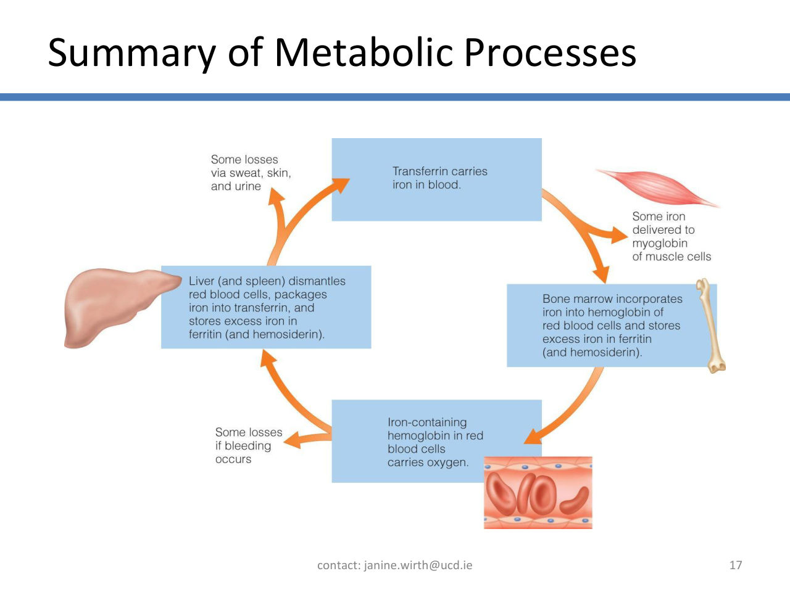

**How to read this slide:** a cycle. Transferrin carries iron in blood → bone marrow puts it into new red cells → red cells carry oxygen → liver and spleen break down old red cells and package the iron back into transferrin, storing extra as ferritin and haemosiderin. Some goes to myoglobin. Losses via sweat, skin, urine, bleeding.

Because the loop is closed, a healthy man needs only about **1 mg a day** to cover losses.

 

### 🧠 Check
Why does iron balance depend on absorption rather than excretion?

Answer

The body has no mechanism for excreting iron. It controls iron by storing it, reusing it and regulating how much is absorbed.

---

## 7. Functions

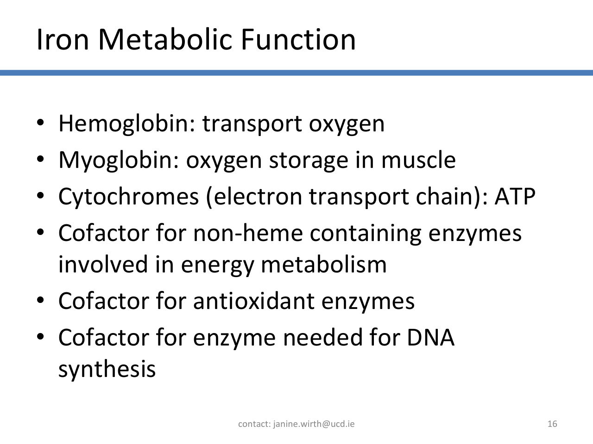

| Function | Protein |
|---|---|
| **Transport oxygen** | **haemoglobin** |
| **Store oxygen in muscle** | **myoglobin** |
| **Make ATP** in the electron transport chain | **cytochromes** |
| Energy metabolism | cofactor for non-haem enzymes |
| Antioxidant defence | cofactor for antioxidant enzymes |
| **DNA synthesis** | cofactor for the enzyme that makes DNA building blocks |

 

**Link to Topics 7 and 11:** cytochromes sit in the same electron transport chain as FAD and NAD. DNA synthesis also needs folate.

 

### 🧠 Check
Name the three iron proteins for oxygen transport, oxygen storage and ATP production.

Answer

Haemoglobin, myoglobin, cytochromes.

---

## 8. Requirements and recommendations

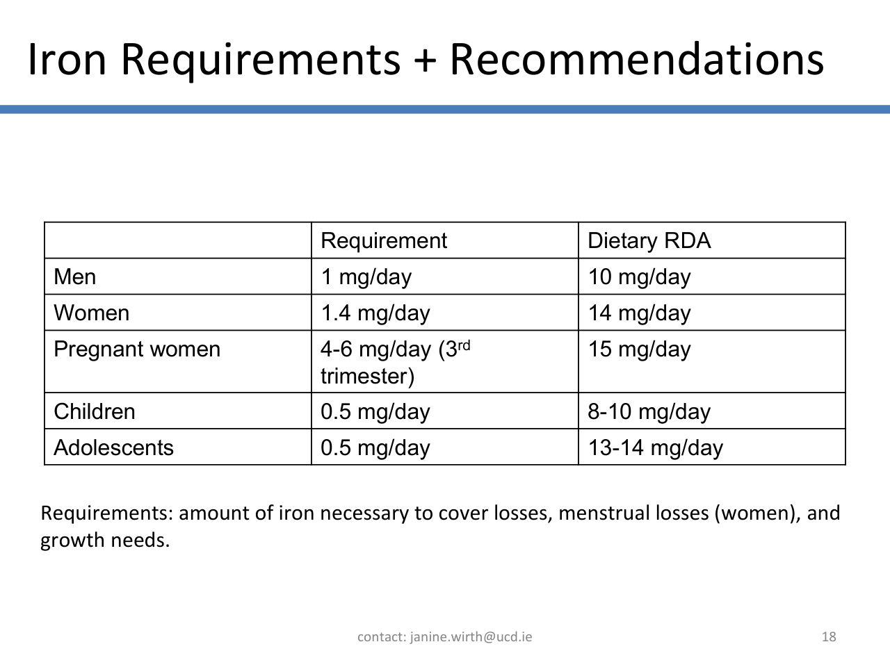

**How to read this table:** the requirement is the iron that must actually be absorbed. The RDA is what to eat, about ten times more, because absorption is low.

| Group | Requirement (absorbed) | Dietary RDA |
|---|---|---|
| Men | 1 mg/day | 10 mg/day |
| **Women** | **1.4 mg/day** | **14 mg/day** |
| Pregnant women | 4–6 mg/day (3rd trimester) | 15 mg/day |
| Children | 0.5 mg/day | 8–10 mg/day |
| Adolescents | 0.5 mg/day | 13–14 mg/day |

**Requirement = amount needed to cover losses, menstrual losses (women), and growth needs.**

EFSA's PRI (slide 9) is a little higher: **16 mg women, 11 mg men.**

 

### 🧠 Check
Why is the RDA about ten times the requirement?

Answer

Only about 10% of dietary iron is absorbed. To absorb 1 mg you must eat about 10 mg.

---

## 9. Deficiency and the three stages

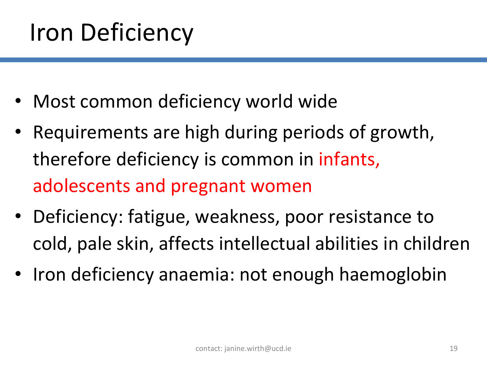

| Fact | Detail |
|---|---|
| Most common deficiency | worldwide |
| At risk | **infants, adolescents, pregnant women**, because requirements are high in growth |
| Signs | fatigue, weakness, **poor resistance to cold**, **pale skin**, affects **intellectual abilities in children** |
| Iron deficiency anaemia | **not enough haemoglobin** |

 

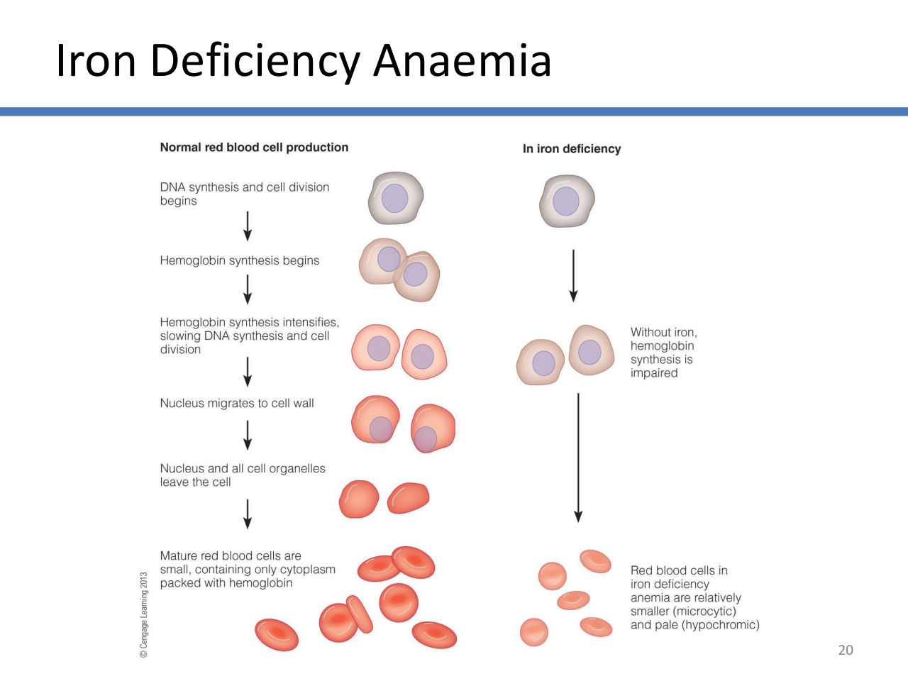

**How to read this slide:** left column, normal red cell production. Right column, iron deficiency. Without iron, haemoglobin synthesis is impaired and the red cells end up **small (microcytic) and pale (hypochromic)**.

 

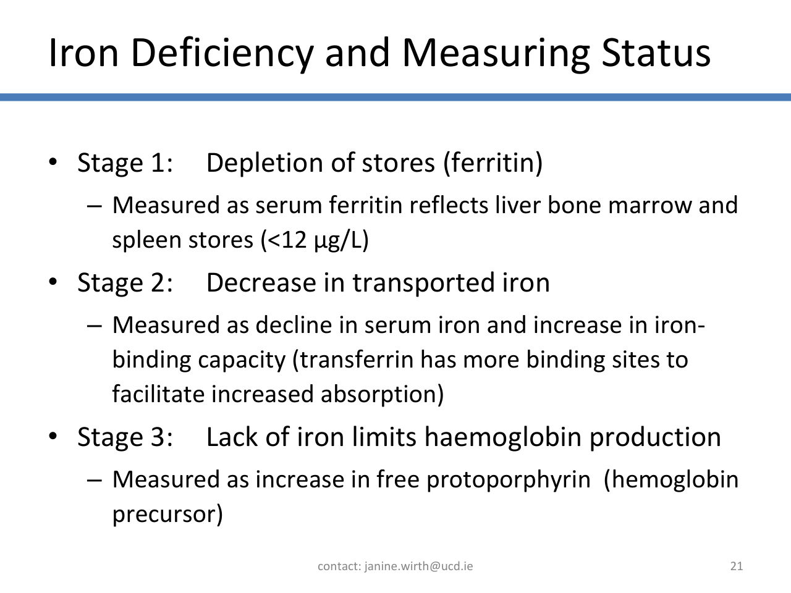

| Stage | What is lost | How it is measured |
|---|---|---|
| **1** | **Stores** (ferritin) | **Serum ferritin < 12 µg/L**. Reflects liver, bone marrow and spleen stores |
| **2** | **Transported iron** | **Serum iron falls**, **iron-binding capacity rises** (transferrin grows more free binding sites to catch more iron) |
| **3** | **Haemoglobin production** | **Free protoporphyrin rises** (the haem precursor builds up with no iron to finish it) |

 

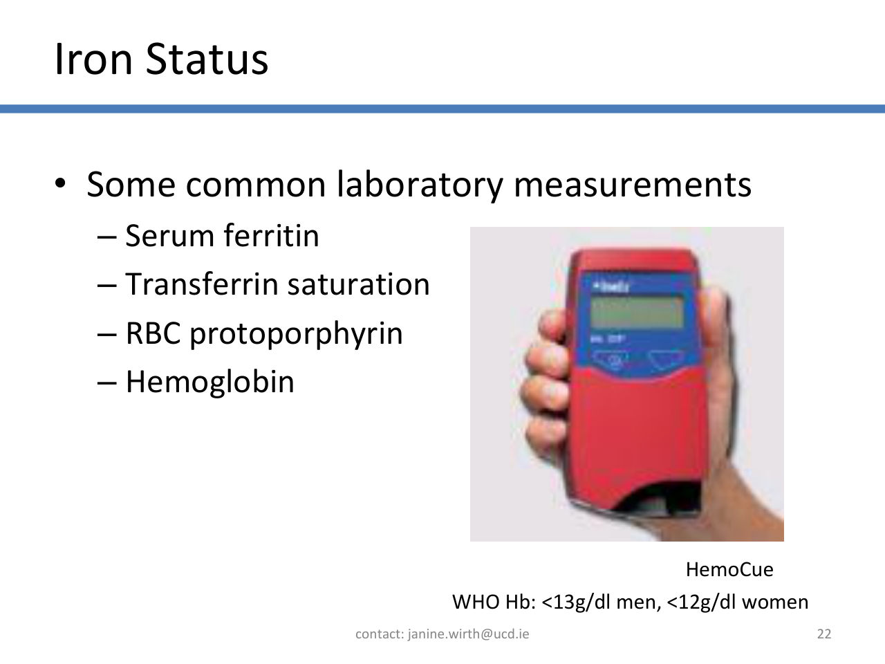

**Lab measurements:** serum ferritin, transferrin saturation, red cell protoporphyrin, haemoglobin.

**WHO anaemia cut-off:** **Hb < 13 g/dl in men, < 12 g/dl in women.**

The HemoCue in the picture is a hand-held haemoglobin meter.

 

### 🧠 Check
What is the first marker to fall in iron deficiency, and at what value?

Answer

Serum ferritin, below 12 µg/L. Stores go first.

---

## Summary (slide 36)

- Sources: red meat, poultry, fish, legumes, tofu, fortified cereals, whole grains, green leafy vegetables.
- Haem iron (animal): 15–35%, absorbed via HCP1.
- Non-haem iron (plant): 2–20%, absorbed as Fe²⁺ via DMT1. Enhanced by vitamin C and acid. Inhibited by phytates, polyphenols, calcium.
- Functions: oxygen transport (haemoglobin, myoglobin), electron transfer (cytochromes), energy, DNA synthesis, immune.
- Deficiency: iron deficiency anaemia, fatigue, pale skin, impaired cognitive development.
