# Topic 16 — Iodine

Slides: Lecture 18 (Minerals Fe, I), pages 23 to 35, repeated in Lecture 19, pages 4 to 12. Recap in Lecture 21, pages 33 to 36.

---

## The big idea

Iodine has one job: it is part of the **thyroid hormones**, **thyroxine (T4)** and **triiodothyronine (T3)**. The numbers are how many iodine atoms each carries.

Thyroid hormones set the **metabolic rate**, body temperature, growth and brain development.

Not enough iodine → the thyroid swells trying to catch more: **goitre**.
A deficient mother → a baby with **cretinism**: permanent mental impairment. Iodine deficiency is the **most common cause of preventable mental impairment in the world**.

The fix is cheap: **iodised salt**. Ireland does not have it, so **milk** is the main Irish source, and status drops in summer when cows are out on grass.

---

**How to use these notes:**
When you see 🧠, stop.
Say the answer out loud or write it down.
Then click to check.

---

## ⭐ Learn by heart from this topic

**The iodine card.** Cover the right column and say it from memory.

| Ask | Answer |
|---|---|
| Best foods | Marine fish, shellfish, seaweed, **milk and dairy**, eggs. Iodised salt where used |
| Why content varies | Depends on soil, water, animal feed and processing |
| EFSA AI | **150 µg/day adults, about 200 µg/day in pregnancy** |
| Absorption | Rapid and efficient, **> 90%**, stomach and small intestine |
| Function | Part of **thyroid hormones T4 and T3** |
| What thyroid hormones do | Alter gene expression in pituitary, liver, heart, kidney, brain. Regulate body temperature, metabolic rate, reproduction, growth and development, enzyme synthesis, oxygen use |
| Control loop | Hypothalamus TRH → pituitary **TSH** → thyroid T3 and T4. T3/T4 feed back to switch TRH and TSH off |
| Goitre | Low T3/T4 → more TSH → thyroid enlarges. Can block the trachea |
| Cretinism | Baby born to a deficient mother: severe mental impairment, poor growth, more deaths. **Cannot be reversed** |
| Hypothyroidism | High TSH, low T4/T3. Low metabolic rate, slow reflexes, slow movement, cold intolerance, fatigue, weight gain |
| Hyperthyroidism | Excess T4/T3. Hyperactivity, weight loss, trouble sleeping |
| Status measure | Urinary iodine |
| UK schoolgirls (Lancet) | 51% mild, 16% moderate, 1% severe deficiency |
| Ireland | 1 in 3 pregnant women moderately deficient; < 5% of salt iodised; 55% of adults below the AI (women 65%) |
| Intervention | **Iodised salt**: simple, effective, cheap. UNICEF: 66% of households have it |

 

**Memory hook:** **I** is for **I**odine, for the thyro**I**d. **Goitre grows**, **cretinism cannot be cured**.

---

## 1. Iodine in food and the AI

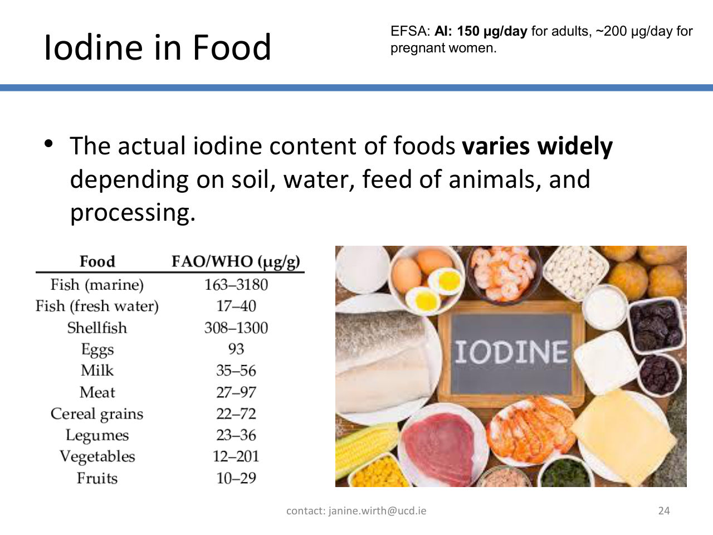

**How to read this table:** µg iodine per gram of food (FAO/WHO). The ranges are huge because iodine depends on where the food came from.

| Food | µg/g |
|---|---|
| **Fish (marine)** | **163–3180** |
| Shellfish | 308–1300 |
| Eggs | 93 |
| Meat | 27–97 |
| Cereal grains | 22–72 |
| **Milk** | **35–56** |
| Legumes | 23–36 |
| Vegetables | 12–201 |
| Fruits | 10–29 |

**The iodine content of foods varies widely depending on soil, water, feed of animals, and processing.**

 

**EFSA AI: 150 µg/day for adults, about 200 µg/day for pregnant women.**

 

**Link to Topic 12:** this is the trace element rule. Content follows the soil.

 

### 🧠 Check
What is the EFSA AI for iodine, and why does the iodine content of food vary so much?

Answer

150 µg/day, about 200 µg/day in pregnancy.

It depends on the soil, the water, what the animals were fed, and processing.

---

## 2. Iodine status in the UK and Ireland

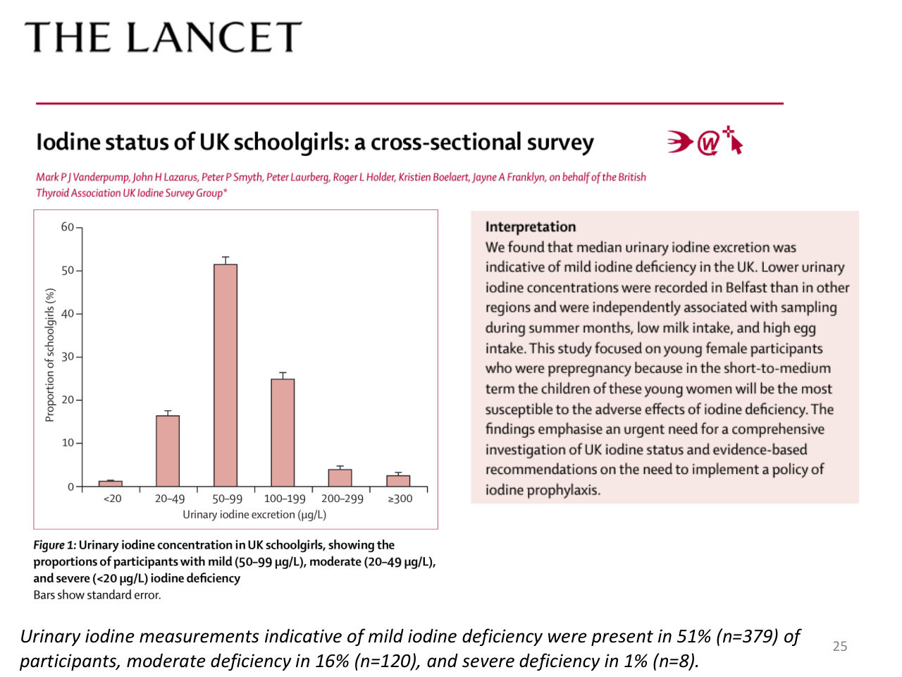

**How to read this slide:** a bar chart of urinary iodine in UK schoolgirls. Most sit in the 50–99 µg/L band, which is mild deficiency. Urinary iodine is the status measure.

| Deficiency | Urinary iodine | Share of UK schoolgirls |
|---|---|---|
| Mild | 50–99 µg/L | **51%** |
| Moderate | 20–49 µg/L | **16%** |
| Severe | < 20 µg/L | 1% |

Lower iodine went with **summer sampling, low milk intake and high egg intake**. Young women matter because their future children are the ones at risk.

 

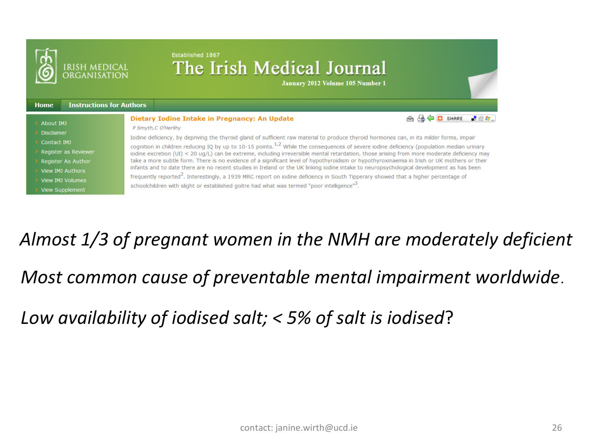

- **Almost 1 in 3 pregnant women** at the National Maternity Hospital were **moderately deficient**.
- Iodine deficiency is the **most common cause of preventable mental impairment worldwide**.
- Iodised salt is barely available in Ireland: **< 5% of salt is iodised**.

 

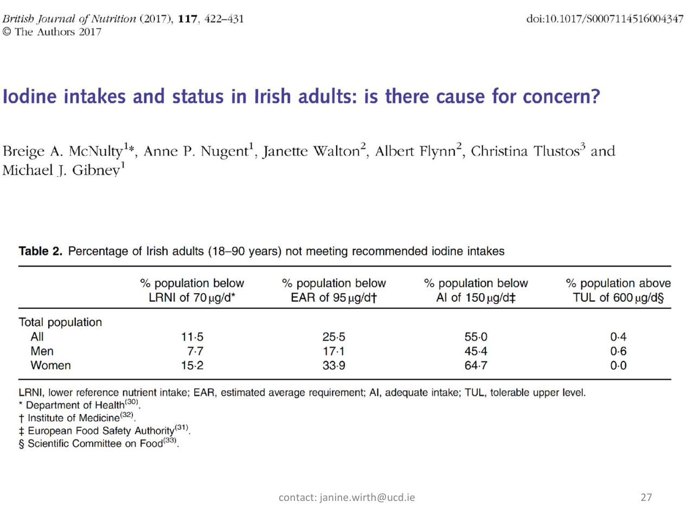

**How to read this table:** percentage of Irish adults below each cut-off.

| | Below LRNI 70 µg | Below EAR 95 µg | Below AI 150 µg | Above UL 600 µg |
|---|---|---|---|---|
| All | 11.5% | 25.5% | **55%** | 0.4% |
| Men | 7.7% | 17.1% | 45.4% | 0.6% |
| **Women** | **15.2%** | **33.9%** | **64.7%** | 0 |

More than half of Irish adults are below the AI. Women are worse than men. Nobody is near the upper limit.

 

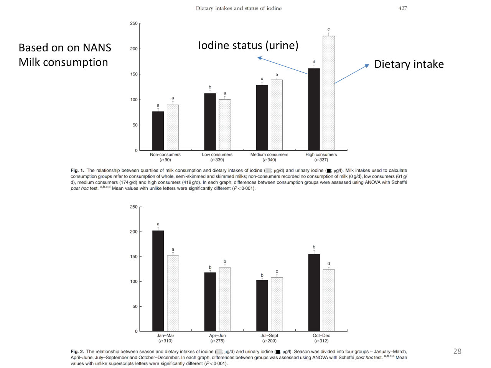

**How to read these graphs:** top graph, milk consumers in four groups from none to high. Both iodine intake (light bars) and urinary iodine (dark bars) climb with milk. Bottom graph, the seasons. **January to March is highest**, **July to September is lowest**.

- **Milk is the main iodine source in Ireland.**
- Status is **seasonal**: higher in winter when cows eat iodine-supplemented feed indoors, lower in summer when they graze.

 

### 🧠 Check
What is the main dietary source of iodine in Ireland, and in which season is iodine status lowest?

Answer

Milk. Lowest in July to September, highest in January to March.

---

## 3. Function: thyroid hormones

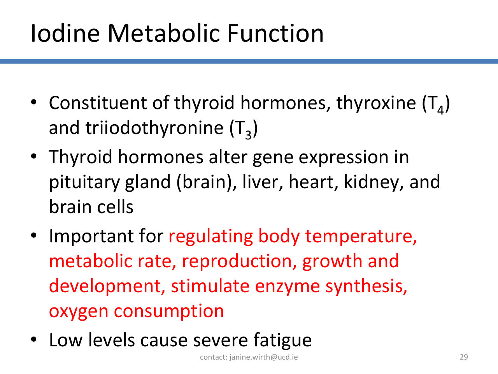

Iodine is a **constituent of the thyroid hormones**:

| Hormone | Name | Iodine atoms |
|---|---|---|
| **T4** | thyroxine | 4 |
| **T3** | triiodothyronine | 3 |

Thyroid hormones **alter gene expression** in the pituitary, liver, heart, kidney and brain.

They regulate:

- **body temperature**
- **metabolic rate**
- reproduction
- **growth and development**
- enzyme synthesis
- oxygen consumption

**Low levels cause severe fatigue.**

 

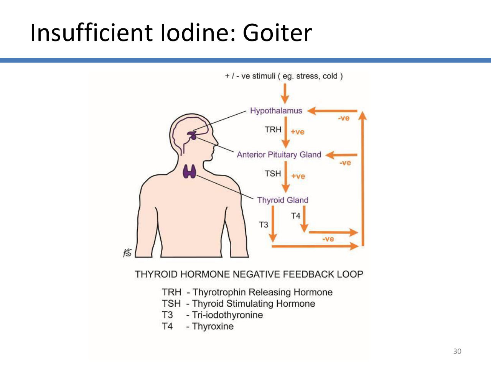

**How to read this slide:** the control chain from brain to thyroid, with the hormones feeding back.

| Step | Gland | Hormone |
|---|---|---|
| 1 | Hypothalamus | **TRH** (thyrotrophin releasing hormone) |
| 2 | Anterior pituitary | **TSH** (thyroid stimulating hormone) |
| 3 | Thyroid gland | **T3 and T4** |
| Feedback | T3 and T4 | switch off TRH and TSH (negative feedback) |

Stress and cold can nudge the hypothalamus.

 

### 🧠 Check
Which gland releases TSH, and what does TSH do?

Answer

The anterior pituitary. TSH tells the thyroid to make T3 and T4.

---

## 4. Severe deficiency: goitre and cretinism

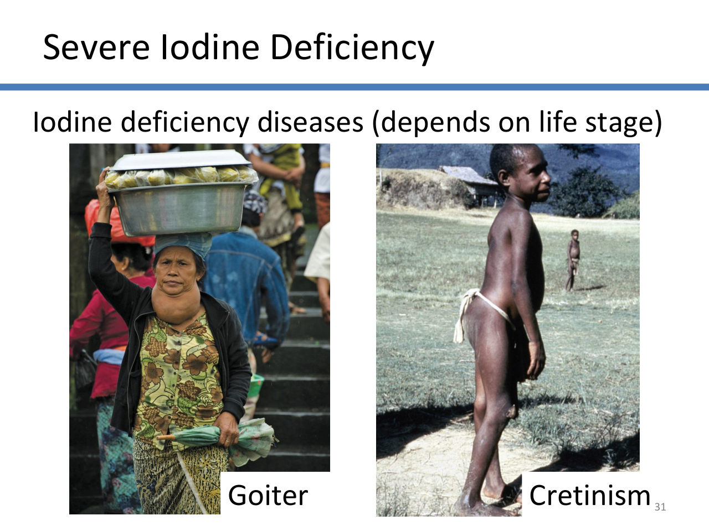

**How to read this slide:** two photos. Left, a woman with a swollen neck: goitre. Right, a child with stunted growth: cretinism. Which disease you get **depends on life stage**.

 

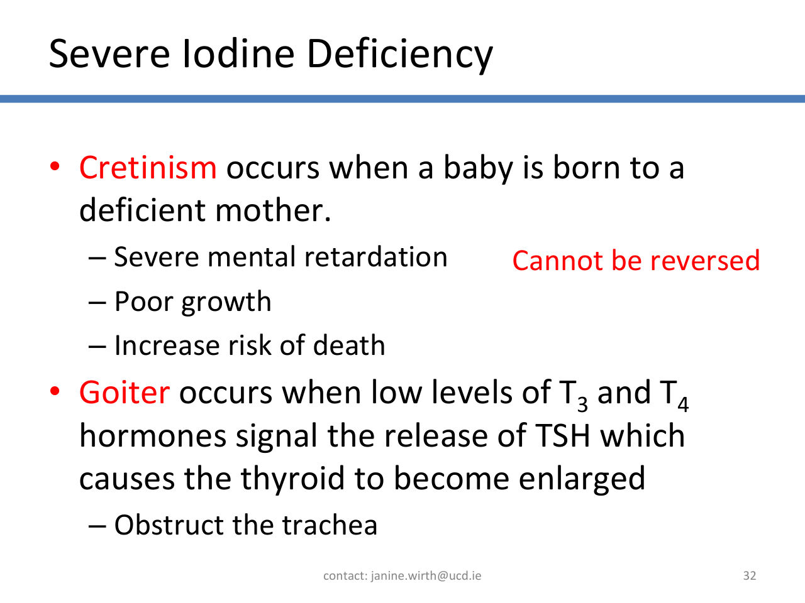

**Cretinism** happens when a **baby is born to a deficient mother**:

- severe mental retardation
- poor growth
- increased risk of death
- **cannot be reversed**

**Goitre** happens because **low T3 and T4 signal the release of TSH**, which makes the thyroid **enlarge**. It can **obstruct the trachea**.

 

**The logic of goitre:** no iodine → no T3/T4 → no negative feedback → TSH keeps rising → the thyroid grows and grows trying to make hormone it cannot make.

 

### 🧠 Check
Why does the thyroid enlarge in iodine deficiency?

Answer

Low T3 and T4 remove the negative feedback, so TSH stays high and keeps stimulating the thyroid to grow.

---

## 5. Intervention: iodised salt

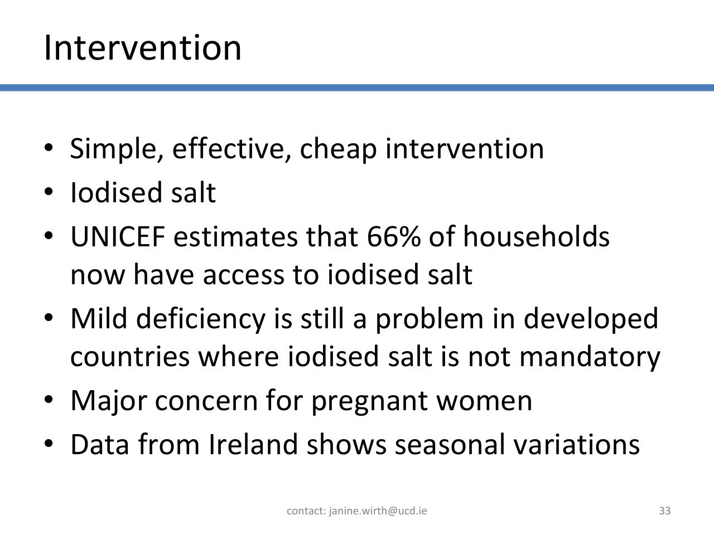

| Fact | Detail |
|---|---|
| The fix | **Iodised salt**: simple, effective, cheap |
| Coverage | UNICEF estimates **66% of households** now have access |
| Remaining problem | **Mild deficiency** in developed countries where iodised salt is **not mandatory** |
| Biggest concern | **Pregnant women** |
| Ireland | **Seasonal** variation in status |

 

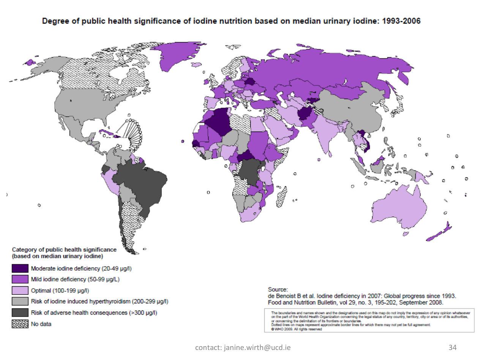

**How to read this map:** purple shades are deficiency, grey is optimal, dark grey is excess. Deficiency is not just a developing-world problem: much of **Europe** is purple.

 

### 🧠 Check
What is the public health intervention for iodine deficiency, and why does mild deficiency persist in rich countries?

Answer

Iodised salt. It persists where iodising salt is not mandatory.

---

## 6. Too little and too much: hypo- and hyperthyroidism

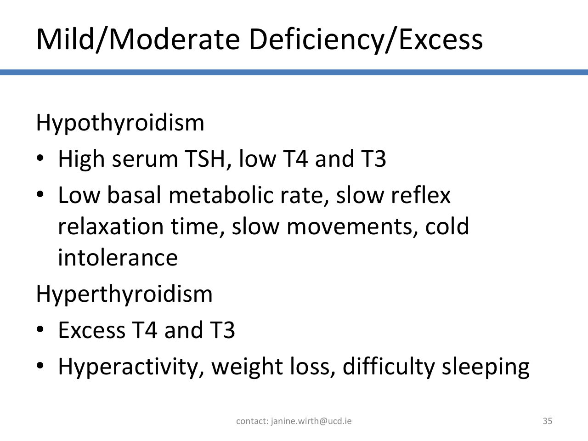

| | Hypothyroidism | Hyperthyroidism |
|---|---|---|
| Blood | **High TSH, low T4 and T3** | **Excess T4 and T3** |
| Metabolism | **Low basal metabolic rate** | High |
| Signs | slow reflex relaxation, slow movements, **cold intolerance**, fatigue, weight gain | **hyperactivity, weight loss, difficulty sleeping** |

Mild or moderate iodine deficiency leads to hypothyroidism. Hyperthyroidism is the mirror image.

 

### 🧠 Check
In hypothyroidism, is TSH high or low? Why?

Answer

High. The thyroid cannot make enough T3 and T4, so there is no feedback to switch TSH off.

---

## 7. Absorption

Summary slide 37 adds one fact the other slides skip:

**Absorption is rapid and efficient, more than 90%, in the stomach and small intestine.**

Compare: iron 1–30%, calcium 30%, zinc 20–40%. Iodine is easy to absorb. The problem is getting it into the food in the first place.

 

### 🧠 Check
How well is iodine absorbed?

Answer

More than 90%, rapidly, in the stomach and small intestine.

---

## Summary (slide 37)

- Sources: seafood, seaweed, dairy, eggs, some grains, iodised salt.
- Absorption: rapid and efficient (> 90%) in the stomach and small intestine.
- Functions: synthesis of thyroid hormones T4 and T3; regulation of metabolism, growth and neurodevelopment.
- Deficiency: goitre, hypothyroidism, fatigue, weight gain, developmental delay, cretinism in infants of deficient mothers.
