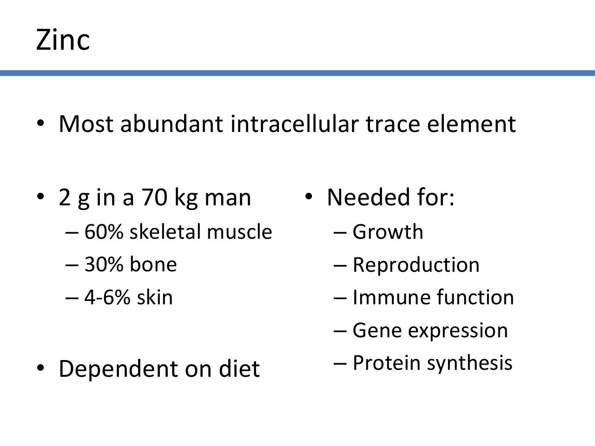
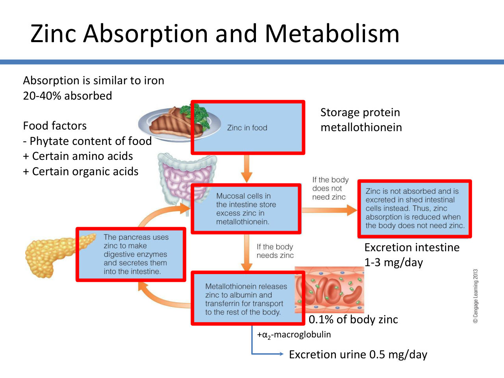
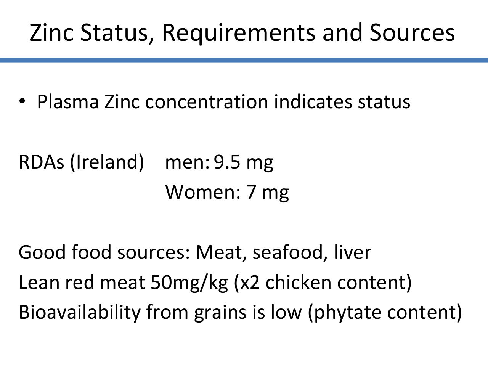
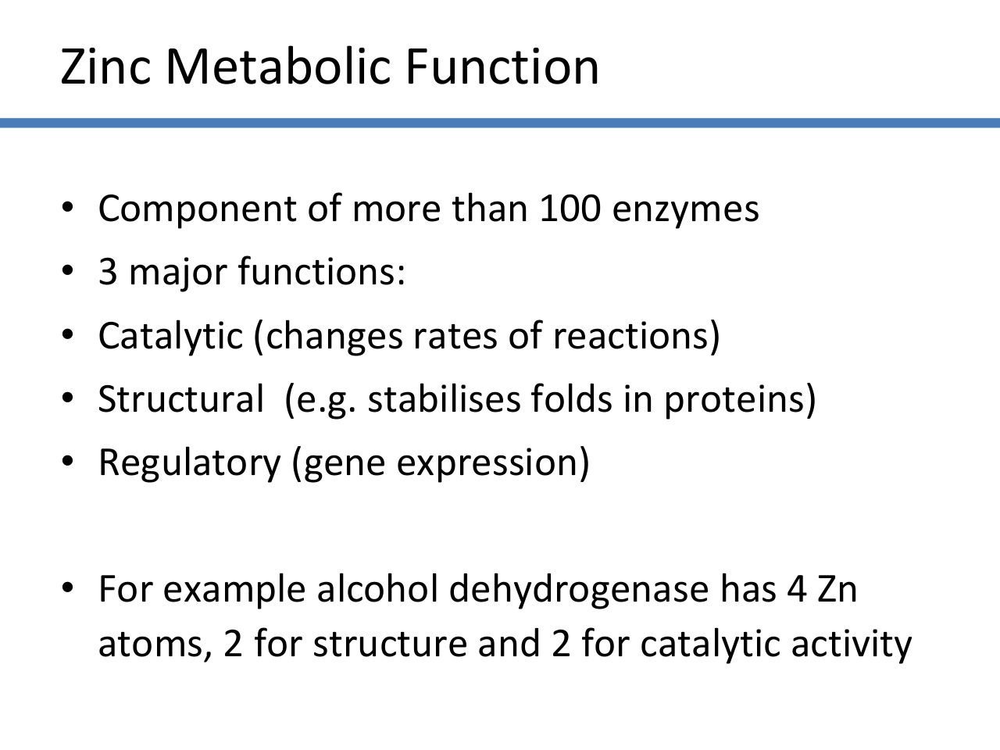
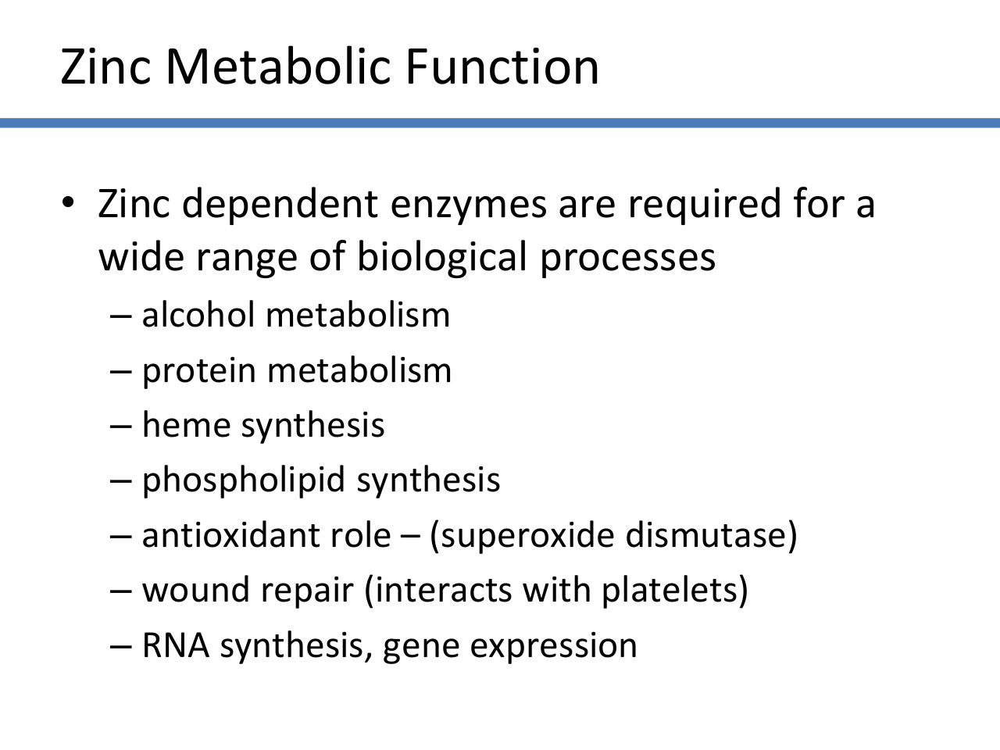
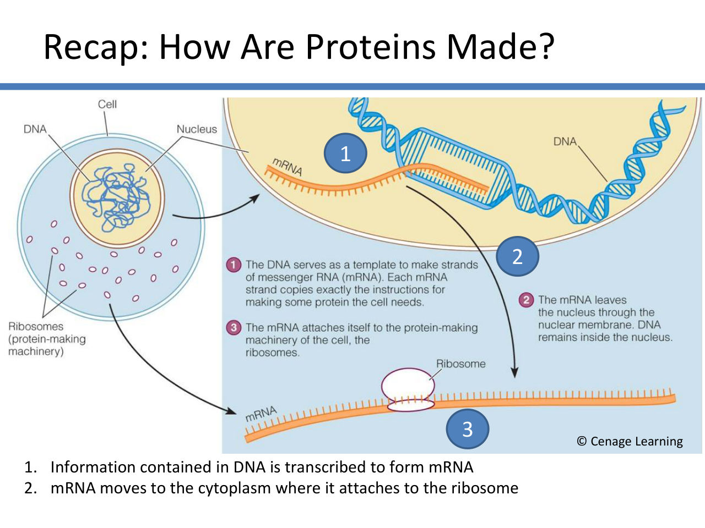
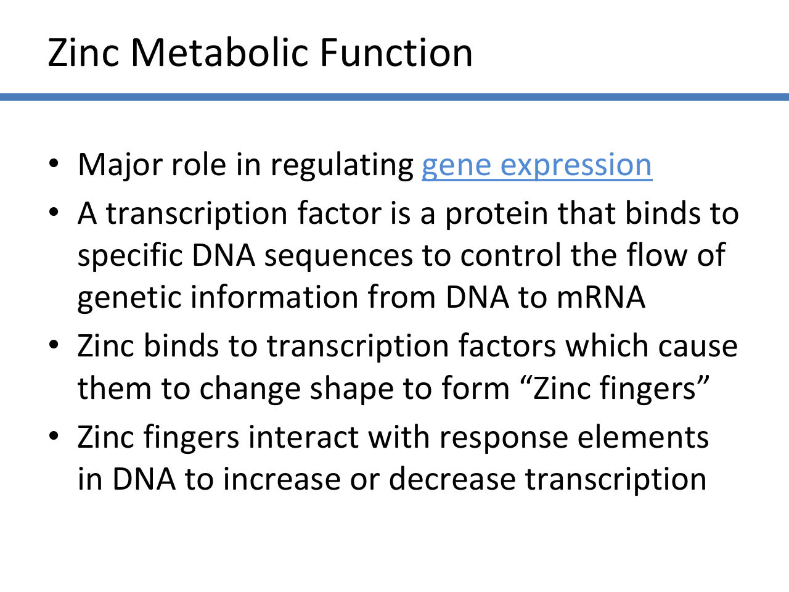
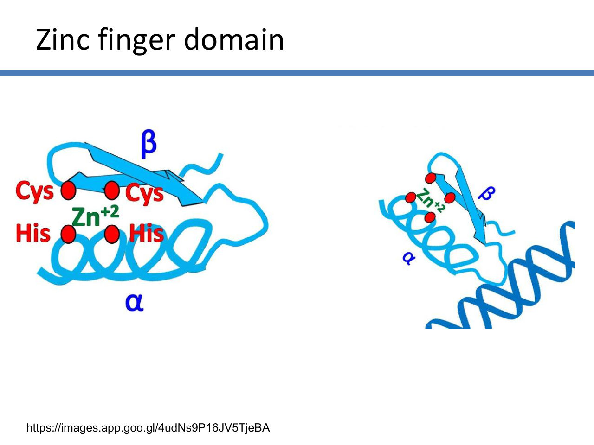
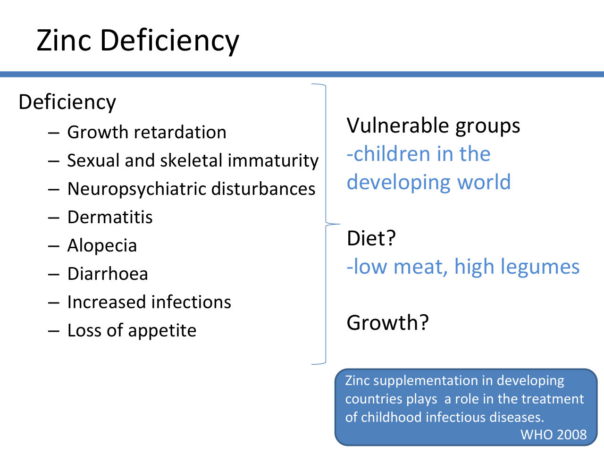
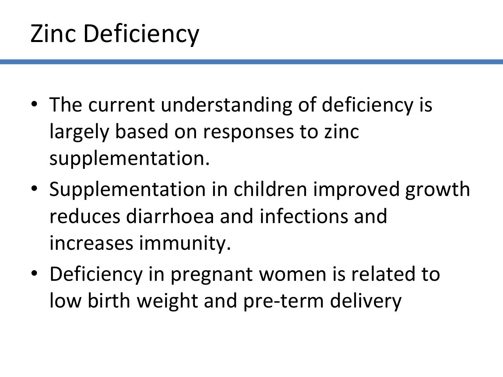

# Topic 17 — Zinc

Slides: Lecture 19 (Minerals I, Zn, Se), pages 13 to 23. Recap in Lecture 21, pages 44 to 47.

---

## The big idea

Zinc is the **most abundant intracellular trace element**. About **2 g** in a man, most of it in **muscle and bone**.

It sits in **more than 100 enzymes** and does three kinds of job: **catalytic, structural, regulatory**.

The regulatory job is the clever one: zinc bends transcription factors into **zinc fingers** that grip DNA and turn genes on or off.

Zinc comes from **meat, seafood and liver**. **Phytate** in grains and legumes blocks it, so children in the developing world on low-meat, high-legume diets get deficient: **poor growth, diarrhoea, infections**. Zinc supplements help them.

---

**How to use these notes:**
When you see 🧠, stop.
Say the answer out loud or write it down.
Then click to check.

---

## ⭐ Learn by heart from this topic

**The zinc card.** Cover the right column and say it from memory.

| Ask | Answer |
|---|---|
| Amount in body | 2 g in a 70 kg man. Most abundant intracellular trace element |
| Where | 60% skeletal muscle, 30% bone, 4–6% skin. Only 0.1% in plasma |
| Best foods | **Meat, seafood, liver**. Lean red meat 50 mg/kg, twice chicken |
| Blocks absorption | **Phytate** (grains, legumes). Bioavailability from grains is low |
| Helps absorption | Certain amino acids and organic acids |
| Absorbed | **20–40%**. Absorption is similar to iron |
| Storage protein | **Metallothionein** in the gut cell |
| Blood transport | Albumin and α2-macroglobulin |
| Excretion | Intestine 1–3 mg/day (shed cells, pancreatic enzymes), urine 0.5 mg/day |
| Irish RDA | **Men 9.5 mg, women 7 mg** |
| Status | Plasma zinc concentration |
| Functions | > 100 enzymes: catalytic, structural, regulatory. Growth, reproduction, immune function, gene expression, protein synthesis |
| Enzyme example | Alcohol dehydrogenase has 4 Zn atoms: 2 structural, 2 catalytic |
| Pathways | Alcohol, protein, haem synthesis, phospholipid synthesis, antioxidant (superoxide dismutase), wound repair, RNA synthesis |
| Zinc fingers | Zinc binds transcription factors, changes their shape, they bind DNA response elements to raise or lower transcription |
| Deficiency | Growth retardation, sexual and skeletal immaturity, neuropsychiatric problems, dermatitis, alopecia, diarrhoea, infections, loss of appetite |
| At risk | Children in the developing world: high need, low meat, high legumes (phytate) |
| Supplements | Improve growth, cut diarrhoea and infections, raise immunity (WHO 2008) |
| In pregnancy | Deficiency linked to low birth weight and pre-term delivery |

 

**Memory hook:** **Zinc = growth, genes, immunity.** **Zinc fingers** grip DNA. **Phytate** steals it.

---

## 1. Zinc in the body

| Fact | Detail |
|---|---|
| Rank | **Most abundant intracellular trace element** |
| Amount | **2 g** in a 70 kg man |
| Skeletal muscle | **60%** |
| Bone | **30%** |
| Skin | 4–6% |
| Depends on | diet. There is no big store to draw on |

**Needed for:** growth, reproduction, immune function, gene expression, protein synthesis.

 

**Compare:** iron 4–5 g, zinc 2 g. Iron is more abundant overall, but most iron is in blood. Zinc is inside cells.

 

### 🧠 Check
Where is most body zinc? How much is there in total?

Answer

60% in skeletal muscle and 30% in bone. About 2 g.

---

## 2. Absorption and metabolism

**How to read this slide:** zinc in food enters the gut cells. The gut cells store it in metallothionein and release it to albumin in the blood. The pancreas uses zinc to make digestive enzymes and secretes it back into the gut. Unneeded zinc leaves in shed gut cells.

| Fact | Detail |
|---|---|
| Absorbed | **20–40%**. "Absorption is similar to iron" |
| Blocks | **Phytate** content of food |
| Helps | **certain amino acids** and **certain organic acids** |
| Storage protein in the gut cell | **Metallothionein** |
| Transport in blood | albumin, plus **α2-macroglobulin** |
| Plasma zinc | only **0.1% of body zinc** |
| Excretion, intestine | **1–3 mg/day**: shed gut cells and pancreatic secretions |
| Excretion, urine | **0.5 mg/day** |

If the body does not need zinc, it stays in the gut cell and is lost when the cell is shed. Same trick as iron.

 

**Link to Topic 15:** iron uses ferritin as the temporary gut store. Zinc uses metallothionein.

 

### 🧠 Check
What share of dietary zinc is absorbed, and what dietary factor reduces it?

Answer

20–40%. Phytate in grains and legumes reduces it.

---

## 3. Status, requirements and sources

| Fact | Detail |
|---|---|
| Status measure | **Plasma zinc concentration** |
| Irish RDA | **Men 9.5 mg, women 7 mg** |
| Good foods | **Meat, seafood, liver** |
| Lean red meat | **50 mg/kg**, twice the content of chicken |
| Grains | **Low bioavailability** because of phytate |

 

### 🧠 Check
What are the Irish zinc RDAs?

Answer

9.5 mg for men, 7 mg for women.

---

## 4. Function: more than 100 enzymes

Zinc is a **component of more than 100 enzymes**, with **three major functions**:

| Function | Meaning |
|---|---|
| **Catalytic** | changes the rate of a reaction |
| **Structural** | stabilises the folds in a protein |
| **Regulatory** | controls gene expression |

**Example:** **alcohol dehydrogenase** has **4 zinc atoms**: **2 structural, 2 catalytic**.

 

Zinc-dependent enzymes are needed for:

- **alcohol metabolism** (alcohol dehydrogenase)
- **protein metabolism**
- **haem synthesis**
- **phospholipid synthesis**
- **antioxidant role**: **superoxide dismutase**
- **wound repair** (interacts with platelets)
- **RNA synthesis, gene expression**

 

**Link to Topic 15:** haem synthesis needs zinc, so zinc deficiency can contribute to anaemia.

 

### 🧠 Check
Name the three kinds of job zinc does in enzymes, and the example enzyme with four zinc atoms.

Answer

Catalytic, structural, regulatory. Alcohol dehydrogenase: two structural zincs and two catalytic.

---

## 5. Zinc fingers and gene expression

**Recap (slide 19):** DNA in the nucleus is **transcribed** into mRNA. mRNA moves to the cytoplasm and attaches to a **ribosome**, which **translates** it into protein.

A gene is "expressed" when it is transcribed. Controlling transcription controls which proteins a cell makes.

 

| Step | What happens |
|---|---|
| 1 | A **transcription factor** is a protein that binds specific DNA sequences to control the flow of information from DNA to mRNA |
| 2 | **Zinc binds** to the transcription factor and makes it **change shape** into a **zinc finger** |
| 3 | The zinc finger **interacts with response elements in DNA** to **increase or decrease transcription** |

 

**How to read this slide:** one zinc ion (red) held by two cysteines and two histidines. That pins an α-helix and a β-sheet into a finger shape. On the right, the finger sits in the groove of the DNA double helix.

 

**Link to Topic 2:** retinoic acid works the same way. It binds RAR and RXR, which sit on the RARE in DNA. Those receptors are zinc finger proteins. Vitamin A and zinc work together on gene expression.

 

### 🧠 Check
What is a zinc finger and what does it do?

Answer

A transcription factor folded around a zinc ion. It binds response elements in DNA to increase or decrease transcription of a gene.

---

## 6. Deficiency

**Signs of deficiency:**

- **Growth retardation**
- **Sexual and skeletal immaturity**
- Neuropsychiatric disturbances
- **Dermatitis**
- **Alopecia** (hair loss)
- **Diarrhoea**
- **Increased infections**
- Loss of appetite

 

**Vulnerable group:** **children in the developing world**.

| Why | Detail |
|---|---|
| Diet | low meat, high legumes, so high phytate |
| Growth | high requirement |

**WHO 2008:** zinc supplementation in developing countries plays a role in the treatment of childhood infectious diseases.

 

- Our understanding of deficiency comes mostly from **responses to zinc supplementation**.
- Supplementing children **improved growth, reduced diarrhoea and infections, and increased immunity**.
- Deficiency in **pregnant women** is linked to **low birth weight and pre-term delivery**.

 

**Link to Topic 10:** dermatitis and alopecia also appear in biotin deficiency. Zinc deficiency adds growth failure, diarrhoea and infections.

 

### 🧠 Check
Why are children in the developing world the group most at risk of zinc deficiency?

Answer

High need for growth, low intake of meat, and high intake of legumes and grains whose phytate blocks zinc absorption.

---

## Summary (slide 30)

- Sources: meat. Phytate lowers availability from grains.
- Functions: growth, reproduction, immune function, gene expression (transcription factors), protein synthesis. Component of > 100 enzymes: catalytic, structural, regulatory.
- Deficiency: common in children of developing countries (high need, low intake, high phytates).
