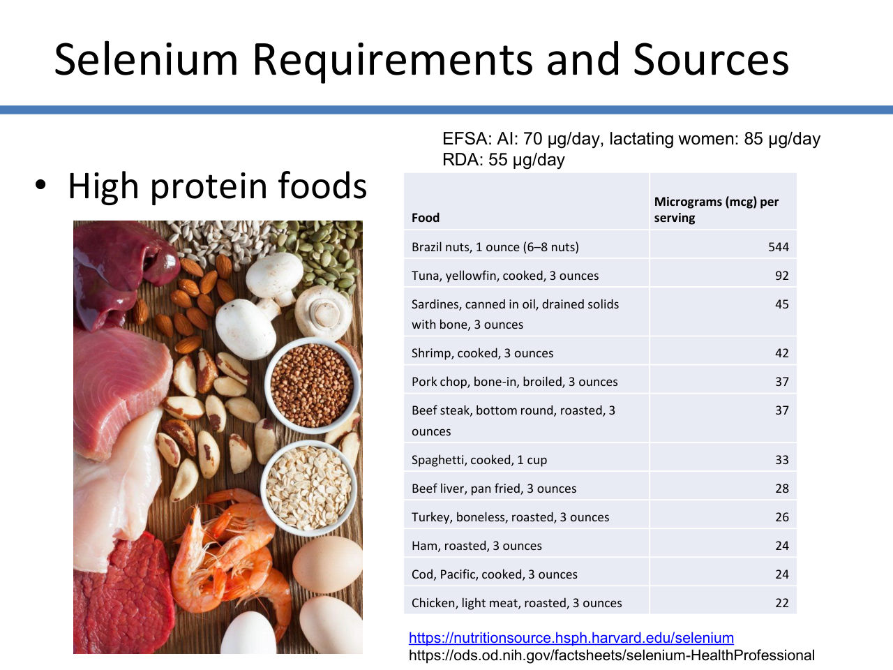
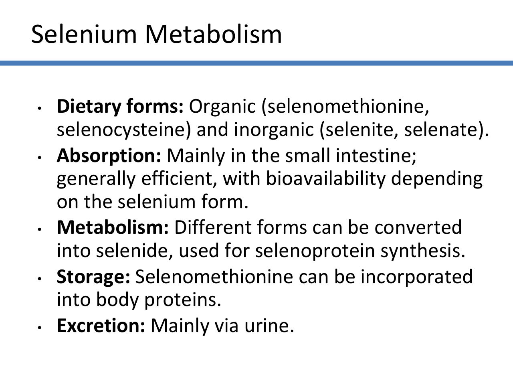
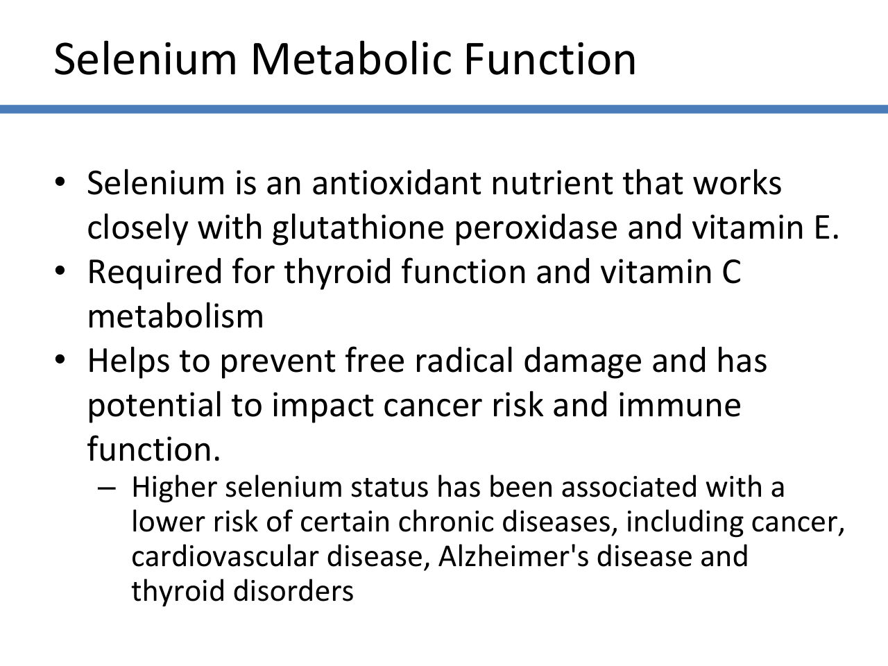
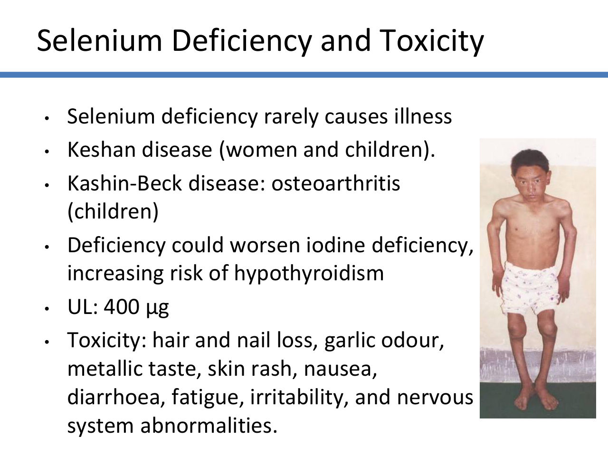

# Topic 18 — Selenium

Slides: Lecture 19 (Minerals I, Zn, Se), pages 24 to 31. Recap in Lecture 21, pages 52 to 54.

---

## The big idea

Selenium is the **antioxidant trace element**. It sits in **glutathione peroxidase** and works alongside **vitamin E**.

It is also needed for **thyroid hormone metabolism**, so selenium deficiency can make iodine deficiency worse.

**Brazil nuts** are the famous source: one ounce gives 544 µg, far above the AI of 70 µg. After that, seafood and meat.

Deficiency rarely causes illness on its own. The two named diseases are from low-selenium soil in China: **Keshan disease** (heart) and **Kashin-Beck disease** (joints).

Toxicity has a tell-tale sign: **garlic breath**, with hair and nail loss.

---

**How to use these notes:**
When you see 🧠, stop.
Say the answer out loud or write it down.
Then click to check.

---

## ⭐ Learn by heart from this topic

**The selenium card.** Cover the right column and say it from memory.

| Ask | Answer |
|---|---|
| Best foods | **Brazil nuts** (544 µg per oz), tuna, sardines, shrimp, pork, beef. High-protein foods: seafood, meat, poultry, eggs, dairy, whole grains |
| EFSA AI | **70 µg/day**, 85 µg lactating |
| RDA | 55 µg/day |
| UL | **400 µg/day** |
| Dietary forms | Organic: selenomethionine, selenocysteine. Inorganic: selenite, selenate |
| Absorption | Small intestine, generally efficient, depends on the form |
| Metabolism | All forms → selenide → selenoproteins |
| Storage | Selenomethionine built into body proteins |
| Excretion | Mainly urine |
| Function | Antioxidant in **glutathione peroxidase**, with **vitamin E**. Thyroid hormone metabolism. Vitamin C metabolism. Immune function |
| Deficiency | Rarely causes illness. **Keshan disease** (cardiomyopathy, women and children). **Kashin-Beck disease** (osteoarthritis in children). Worsens iodine deficiency |
| Toxicity | Hair and nail loss, **garlic odour**, metallic taste, rash, nausea, diarrhoea, fatigue, irritability, nerve problems |

 

**Memory hook:** **Se = glutathione peroxidase + vitamin E.** **Keshan = heart, Kashin-Beck = bones.** Too much Se smells of **garlic**.

---

## 1. Sources and requirements

**How to read this table:** µg selenium per serving. One food is in a different league.

| Food | Serving | Selenium (µg) |
|---|---|---|
| **Brazil nuts** | 1 oz (6–8 nuts) | **544** |
| Tuna, yellowfin | 3 oz | 92 |
| Sardines | 3 oz | 45 |
| Shrimp | 3 oz | 42 |
| Pork chop | 3 oz | 37 |
| Beef steak | 3 oz | 37 |
| Spaghetti | 1 cup | 33 |
| Beef liver | 3 oz | 28 |
| Turkey | 3 oz | 26 |
| Ham | 3 oz | 24 |
| Cod | 3 oz | 24 |
| Chicken | 3 oz | 22 |

**High-protein foods** are the sources: selenium rides along with the amino acids as selenomethionine.

 

| Reference value | Amount |
|---|---|
| **EFSA AI** | **70 µg/day** |
| EFSA AI, lactation | 85 µg/day |
| RDA (US) | 55 µg/day |
| UL | 400 µg/day |

One ounce of Brazil nuts is more than the UL. A couple of nuts a day is plenty.

 

### 🧠 Check
What is the EFSA AI for selenium, and which food gives the most per serving?

Answer

70 µg/day. Brazil nuts, 544 µg per ounce.

---

## 2. Metabolism

| Step | Detail |
|---|---|
| **Dietary forms** | **Organic**: selenomethionine, selenocysteine. **Inorganic**: selenite, selenate |
| **Absorption** | Mainly in the **small intestine**. Generally efficient. Bioavailability depends on the form |
| **Metabolism** | The different forms are converted into **selenide**, which is used to make **selenoproteins** |
| **Storage** | **Selenomethionine** can be built into body proteins in place of methionine |
| **Excretion** | Mainly via **urine** |

 

**Compare with iron:** iron cannot be excreted. Selenium can, in urine. So selenium balance is easier to keep.

 

### 🧠 Check
Name an organic and an inorganic dietary form of selenium. What are all forms converted to?

Answer

Organic: selenomethionine or selenocysteine. Inorganic: selenite or selenate.

All become selenide, which makes selenoproteins.

---

## 3. Function: antioxidant and thyroid

| Job | Detail |
|---|---|
| **Antioxidant** | Works closely with **glutathione peroxidase** and **vitamin E** |
| **Thyroid** | Required for thyroid function (the enzymes that activate thyroid hormone contain selenium) |
| Vitamin C | Required for vitamin C metabolism |
| Free radicals | Helps prevent free radical damage |
| Disease | Higher selenium status is **associated** with lower risk of cancer, cardiovascular disease, Alzheimer's disease and thyroid disorders |

 

**Link to Topic 5:** vitamin E catches free radicals in the membrane. Glutathione peroxidase, with selenium at its active site, destroys the peroxides. They are the two halves of the antioxidant defence.

**Link to Topic 16:** selenium enzymes convert T4 to the more active T3. Low selenium makes iodine deficiency worse.

 

### 🧠 Check
Which enzyme does selenium work in, and which vitamin does it partner?

Answer

Glutathione peroxidase. Vitamin E.

---

## 4. Deficiency and toxicity

**Deficiency rarely causes illness.** The two named diseases come from regions with selenium-poor soil:

| Disease | What it is | Who |
|---|---|---|
| **Keshan disease** | **cardiomyopathy** (heart muscle disease) | women and children |
| **Kashin-Beck disease** | **osteoarthritis** / osteoarthropathy (joints) | children |

Deficiency could **worsen iodine deficiency**, increasing the risk of **hypothyroidism**.

The photo shows a child with Kashin-Beck disease: short stature and enlarged joints.

 

**Toxicity:**

| Fact | Detail |
|---|---|
| UL | **400 µg/day** |
| Signs | **hair and nail loss**, **garlic odour**, metallic taste, skin rash, nausea, diarrhoea, fatigue, irritability, nervous system abnormalities |

 

**Link to Topic 12:** a trace element whose food content and deficiency diseases both follow the soil.

 

### 🧠 Check
Name the two selenium deficiency diseases and what each affects.

Answer

Keshan disease: the heart (cardiomyopathy). Kashin-Beck disease: the joints (osteoarthritis).

---

## Summary (slide 31)

- Sources: high-protein foods. Brazil nuts, seafood, meat, poultry, eggs, dairy, whole grains.
- Absorption: generally well absorbed in the small intestine.
- Functions: antioxidant defence (glutathione peroxidases), thyroid hormone metabolism, immune function.
- Deficiency: Keshan disease (cardiomyopathy), Kashin-Beck disease (osteoarthropathy), impaired immune function, muscle weakness, impaired thyroid function.
