# Topic 19 — Water and electrolytes: sodium, chloride, potassium

Slides: Lecture 20 (Na, Cl, K), pages 5 to 25. Recap in Lecture 21, pages 37 to 43.

---

## The big idea

The body is about half water. Dissolved in that water are charged minerals, the **electrolytes**.

**Potassium** is the main positive ion **inside** cells. **Sodium** is the main positive ion **outside** cells. **Chloride** is the main negative ion outside.

The difference in concentration across the cell membrane is the **membrane potential**. The **Na⁺/K⁺-ATPase pump** keeps it up, burning **20–40% of resting energy** to do so. Every nerve impulse and muscle contraction rides on it.

**Water follows sodium.** So the kidney controls body water by controlling sodium, using **aldosterone** and the **renin-angiotensin-aldosterone system (RAAS)**.

Deficiency is rare and comes from sweating or drinking plain water without salt. Toxicity is rare and can kill.

---

**How to use these notes:**
When you see 🧠, stop.
Say the answer out loud or write it down.
Then click to check.

---

## ⭐ Learn by heart from this topic

**The electrolytes card.** Cover the right column and say it from memory.

| Ask | Answer |
|---|---|
| Body water | 45–70% of body weight, 33–53 L. Adipose 10% water, lean tissue 76% |
| Six electrolytes | Sodium, potassium, calcium, magnesium, chloride, phosphate |
| Inside cells | **Potassium** (150 mM), phosphate |
| Outside cells | **Sodium** (142 mM), **chloride** |
| Membrane potential | The electrochemical gradient from the Na/K concentration differences |
| The pump | **Na⁺/K⁺-ATPase**: 3 Na⁺ out, 2 K⁺ in, costs 1 ATP. 20–40% of resting energy |
| Salt (NaCl) | **40% sodium, 60% chloride** by weight |
| Sodium in the body | 70 g. Blood 140 mmol/L. Most abundant electrolyte in sweat |
| Sodium functions | Fluid balance, nerve conduction, muscle contraction, active transport, 75% of body sodium in bone apatite |
| Chloride function | Making **HCl** in the stomach |
| Absorption | High. One route uses glucose. Some in the colon |
| High blood sodium | ↓ aldosterone → sodium excreted in urine |
| Low blood sodium | ↑ aldosterone → kidney retains sodium |
| RAAS | Renin (kidney) → angiotensinogen (liver) → angiotensin I → ACE (lungs) → angiotensin II → vessel constriction + aldosterone → sodium reabsorption |
| Excretion | Mainly urine, some sweat |
| Potassium | Major intracellular electrolyte. 90% absorbed. Aldosterone ↑ NaCl and ↓ K. We eat about 2 g, 3.5 g is optimal |
| Potassium foods | Legumes, nuts, meat, fish, bananas, spinach, potatoes |
| Deficiency | Rare: extreme sport, heavy sweating, drinking lots of water without electrolytes. Nausea, dizziness, cramps, irritability, confusion, low BP |
| Toxicity | Rare. The 2018 Belgian fish sauce death |

 

**Memory hook:** **K** stays **K**eyed inside, **Na** stays **Na**-outside. **Salt is 40% sodium.** **Water follows salt.**

---

## 1. Body water and the electrolytes

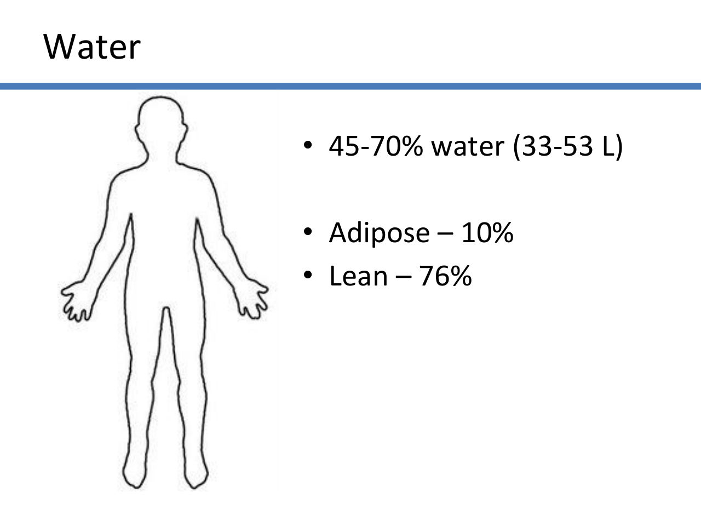

| Fact | Detail |
|---|---|
| Body water | **45–70%** of body weight, **33–53 L** |
| Adipose tissue | only **10%** water |
| Lean tissue | **76%** water |

So a lean, muscular person is a higher percentage water than a person with more body fat.

 

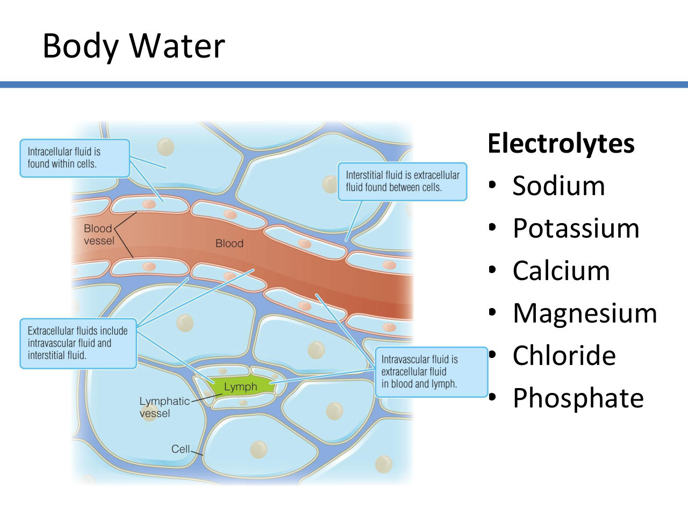

**How to read this slide:** cells (intracellular fluid), the fluid between them (interstitial), and blood (intravascular). Interstitial plus intravascular equals extracellular fluid.

**The electrolytes:** sodium, potassium, calcium, magnesium, chloride, phosphate.

 

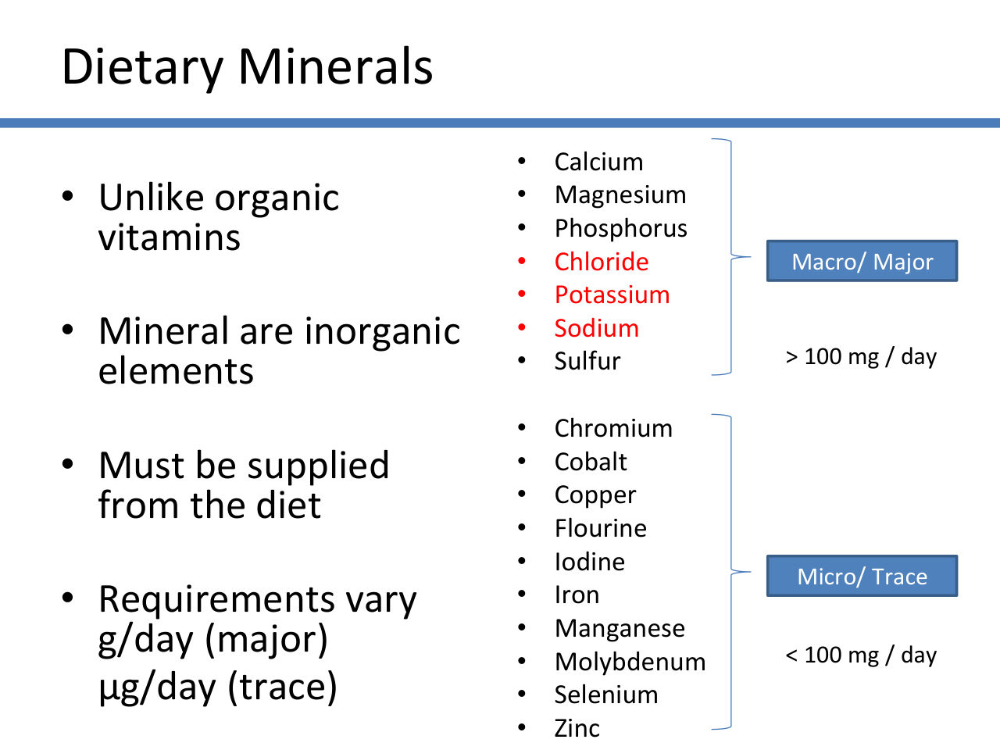

Chloride, potassium and sodium are **major minerals**, more than 100 mg a day. In fact we eat grams of them.

 

### 🧠 Check
Which tissue holds more water per gram, fat or lean tissue? Name the six electrolytes.

Answer

Lean tissue (76% versus 10%).

Sodium, potassium, calcium, magnesium, chloride, phosphate.

---

## 2. Sodium, potassium and the membrane potential

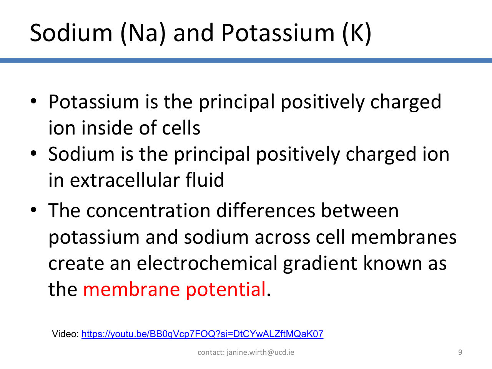

| Ion | Where it is the main positive ion |
|---|---|
| **Potassium (K⁺)** | **inside** cells |
| **Sodium (Na⁺)** | **extracellular** fluid |

The concentration differences across the membrane create an electrochemical gradient called the **membrane potential**.

 

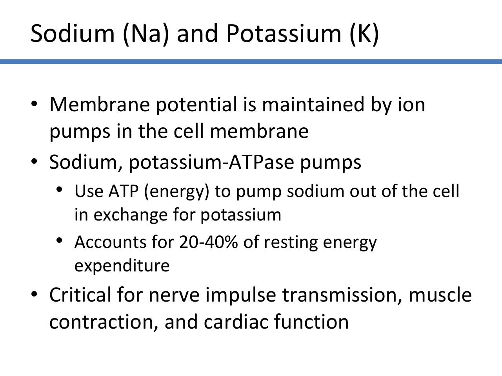

The membrane potential is kept up by **ion pumps**:

| Fact | Detail |
|---|---|
| Pump | **Sodium, potassium-ATPase** |
| Action | Uses **ATP** to pump **sodium out** of the cell in exchange for **potassium in** |
| Cost | **20–40% of resting energy expenditure** |
| Needed for | **nerve impulse transmission, muscle contraction, cardiac function** |

 

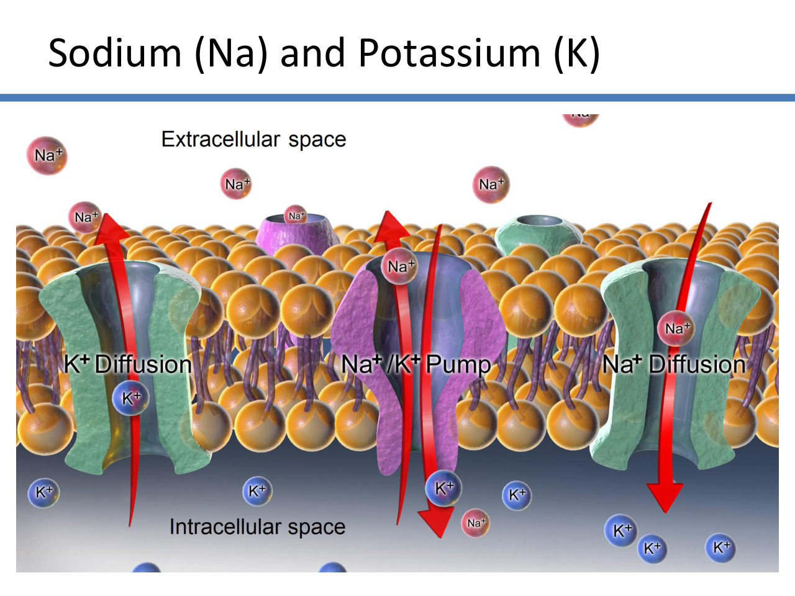

**How to read this slide:** the purple Na⁺/K⁺ pump in the middle pushes ions against their gradients. The green channels either side let K⁺ and Na⁺ diffuse back down their gradients. Pump up, leak down.

 

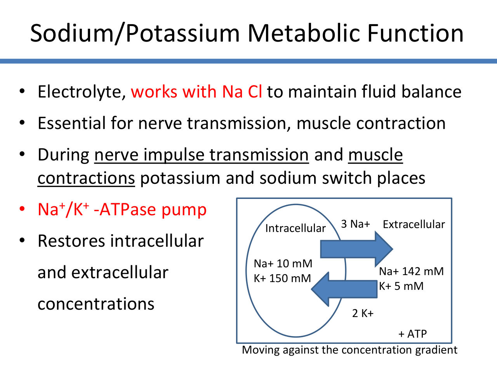

**How to read this slide:** the box. Each cycle moves **3 Na⁺ out** and **2 K⁺ in**, using **1 ATP**, **against the concentration gradient**.

| Ion | Inside the cell | Outside the cell |
|---|---|---|
| **Na⁺** | **10 mM** | **142 mM** |
| **K⁺** | **150 mM** | **5 mM** |

During a nerve impulse or muscle contraction, **sodium and potassium switch places** through the channels. The pump then **restores** the concentrations.

 

**Link to Topic 6:** thiamin is also needed for nerve sodium transport. The pump needs ATP, and ATP needs the B vitamins and magnesium.

 

### 🧠 Check
How many sodium and potassium ions does the pump move per ATP, and in which directions?

Answer

3 Na⁺ out of the cell, 2 K⁺ into the cell, per ATP.

---

## 3. Salt is 40% sodium

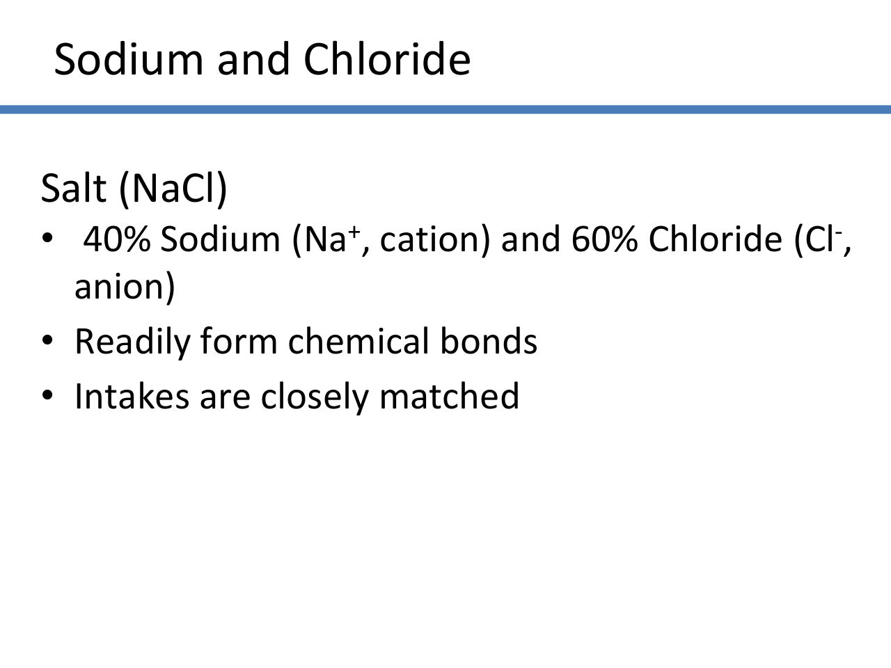

**Salt (NaCl):**

- **40% sodium** (Na⁺, a cation)
- **60% chloride** (Cl⁻, an anion)
- They readily form chemical bonds.
- Intakes of sodium and chloride are **closely matched**, because they come in together.

 

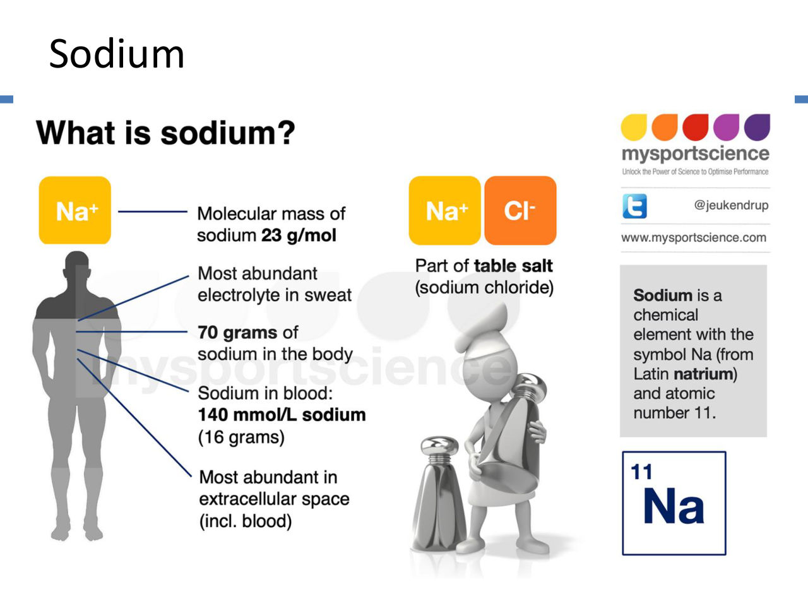

| Fact | Detail |
|---|---|
| Molecular mass | 23 g/mol |
| Most abundant electrolyte in | **sweat** |
| Amount in body | **70 g** |
| Blood | **140 mmol/L** (about 16 g in the blood) |
| Where | most abundant in **extracellular** space, including blood |
| Symbol | Na, from Latin natrium, atomic number 11 |

 

### 📐 Equation 1: Sodium in salt

$$\text{g sodium} = 0.4 \times \text{g salt}$$

| Symbol | Meaning | Units |
|---|---|---|
| g sodium | the sodium a food or diet delivers | g |
| g salt | the sodium chloride it contains | g |
| 0.4 | sodium's share of the weight of NaCl | none |

**Why it holds:** sodium weighs 23 and chloride 35.5. 23 ÷ 58.5 = 0.39, about 40%.

**Use it when:** a question gives salt and asks for sodium, or the other way round (divide by 0.4, or multiply by 2.5).

**Does not apply:** to sodium from other sources such as monosodium glutamate or sodium bicarbonate. Those have sodium but no chloride.

 

**Example:** 6 g of salt a day, the Irish target, is 6 × 0.4 = **2.4 g sodium**.

 

### 🧠 Check
What fraction of salt is sodium by weight? How much sodium is in 10 g of salt?

Answer

40%. 10 × 0.4 = 4 g sodium.

---

## 4. Electrolytes and fluid balance

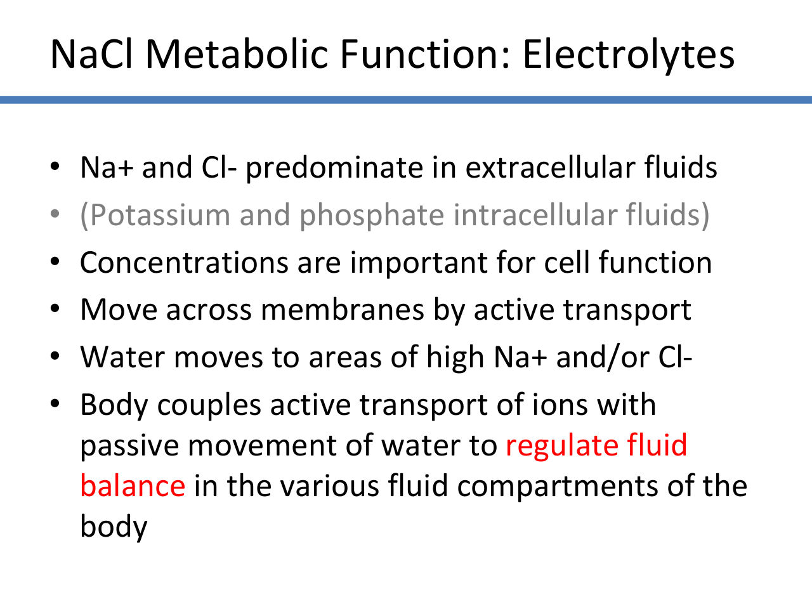

| Fact | Detail |
|---|---|
| Extracellular fluid | **Na⁺ and Cl⁻** predominate |
| Intracellular fluid | potassium and phosphate |
| Movement | ions cross membranes by **active transport** |
| Water | moves to areas of **high Na⁺ and/or Cl⁻** |
| The trick | the body **couples active transport of ions with passive movement of water** to regulate fluid balance between compartments |

 

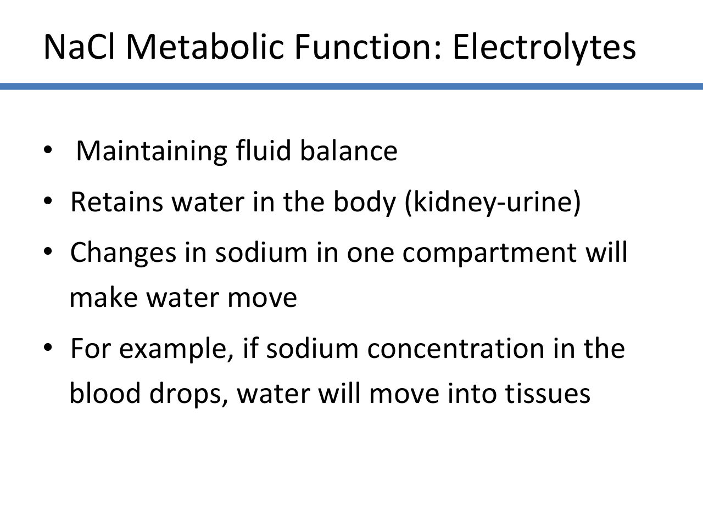

- Sodium **retains water** in the body (via the kidney and urine).
- A **change in sodium in one compartment makes water move**.
- **Example:** if blood sodium drops, water moves out of the blood **into the tissues**.

This is why drinking lots of plain water after heavy sweating is dangerous: blood sodium falls, water floods into cells, including brain cells.

 

### 🧠 Check
If blood sodium falls, which way does water move?

Answer

Out of the blood into the tissues, following the higher sodium concentration.

---

## 5. What sodium and chloride do

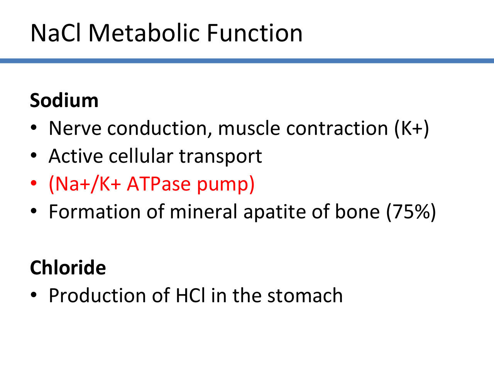

**Sodium:**

| Function | Detail |
|---|---|
| Nerve conduction and muscle contraction | with potassium |
| Active cellular transport | the Na⁺/K⁺ ATPase pump drives other transporters |
| Bone | formation of mineral **apatite**. **75%** of body sodium is in bone |

**Chloride:**

| Function | Detail |
|---|---|
| Stomach | production of **hydrochloric acid (HCl)** |

 

**Link to Topic 15:** low gastric acid reduces iron absorption. Chloride is what the stomach uses to make that acid.

 

### 🧠 Check
What is chloride's special job?

Answer

Making hydrochloric acid in the stomach.

---

## 6. Absorption and regulation by aldosterone

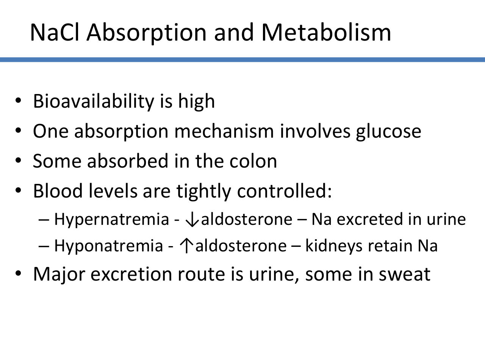

| Fact | Detail |
|---|---|
| Bioavailability | **high** |
| One absorption route | involves **glucose** (sodium and glucose are taken up together) |
| Colon | some absorbed there too |
| Blood levels | **tightly controlled** |
| Excretion | **mainly urine**, some in **sweat** |

**The aldosterone rule:**

| Blood sodium | Aldosterone | Kidney |
|---|---|---|
| **Hypernatraemia** (high) | **↓ aldosterone** | sodium **excreted** in urine |
| **Hyponatraemia** (low) | **↑ aldosterone** | kidney **retains** sodium |

 

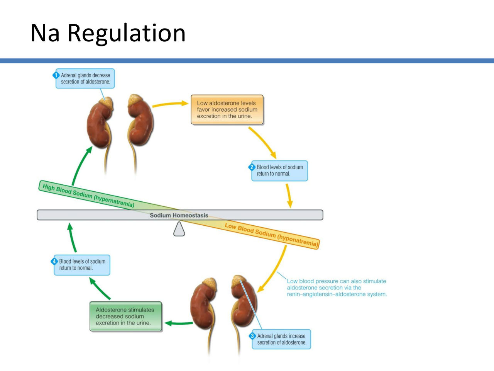

**How to read this slide:** a seesaw. High blood sodium tips it one way: the adrenal glands cut aldosterone, more sodium goes out in urine, blood sodium returns to normal. Low blood sodium tips it the other way: adrenals raise aldosterone, less sodium in urine, blood sodium returns to normal. Low blood **pressure** can also trigger aldosterone through RAAS.

 

**Link to Topic 13:** calcium has its own seesaw with PTH and calcitonin. Sodium has one hormone, aldosterone, going up or down.

 

### 🧠 Check
Blood sodium is high. What happens to aldosterone and to urinary sodium?

Answer

Aldosterone falls. More sodium is excreted in urine.

---

## 7. The renin-angiotensin-aldosterone system (RAAS)

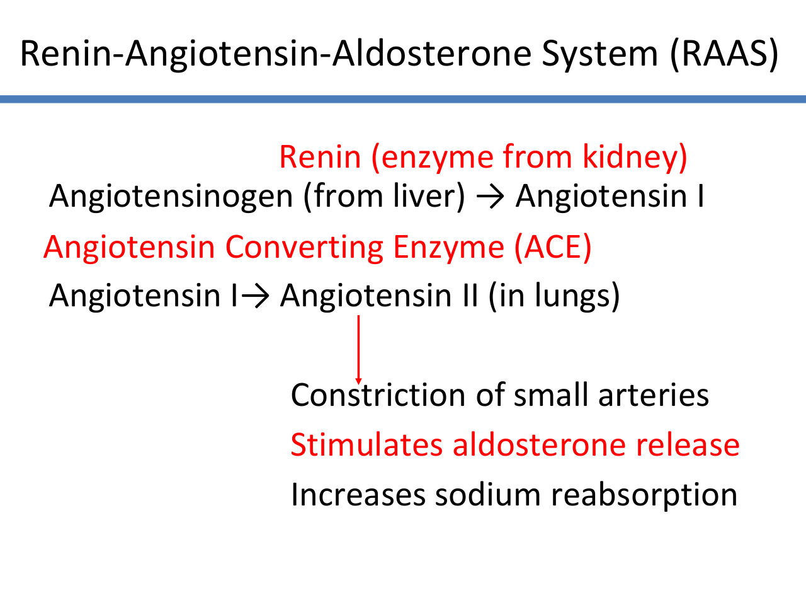

**How to read this slide:** a chain of four steps, two enzymes in red.

| Step | What | Where |
|---|---|---|
| 1 | **Renin** (an enzyme) is released | **kidney** |
| 2 | Renin converts **angiotensinogen** → **angiotensin I** | angiotensinogen comes from the **liver** |
| 3 | **Angiotensin converting enzyme (ACE)** converts angiotensin I → **angiotensin II** | **lungs** |
| 4 | Angiotensin II acts | **constricts small arteries** and **stimulates aldosterone release** |
| 5 | Aldosterone | **increases sodium reabsorption** in the kidney |

Two effects raise blood pressure: narrower vessels and more sodium (and so more water) kept in.

 

**Link to Topic 20:** the ACE gene comes back in salt sensitivity. People with certain ACE variants respond more to salt.

 

### 🧠 Check
Where is renin made, and where is ACE found?

Answer

Renin in the kidney. ACE in the lungs.

---

## 8. Potassium

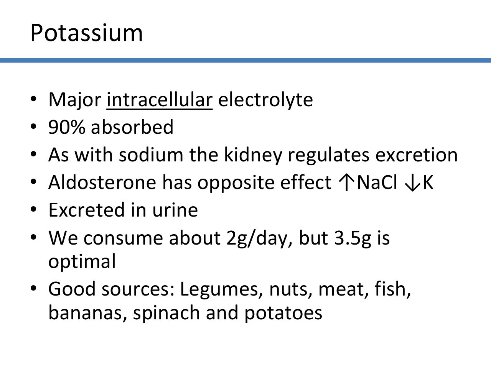

| Fact | Detail |
|---|---|
| Role | **major intracellular electrolyte** |
| Absorbed | **90%** |
| Regulation | the **kidney** regulates excretion, as for sodium |
| Aldosterone | has the **opposite** effect on potassium: **↑ NaCl kept, ↓ K kept** (potassium excreted) |
| Excretion | urine |
| Intake | we eat about **2 g/day**, but **3.5 g** is optimal |
| Good sources | **legumes, nuts, meat, fish, bananas, spinach, potatoes** |

 

**Why 3.5 g matters (Topic 20 preview):** more potassium goes with lower blood pressure. The DASH diet is high in potassium foods.

 

### 🧠 Check
What does aldosterone do to potassium?

Answer

It makes the kidney lose potassium while keeping sodium. Opposite effects.

---

## 9. Deficiency and toxicity

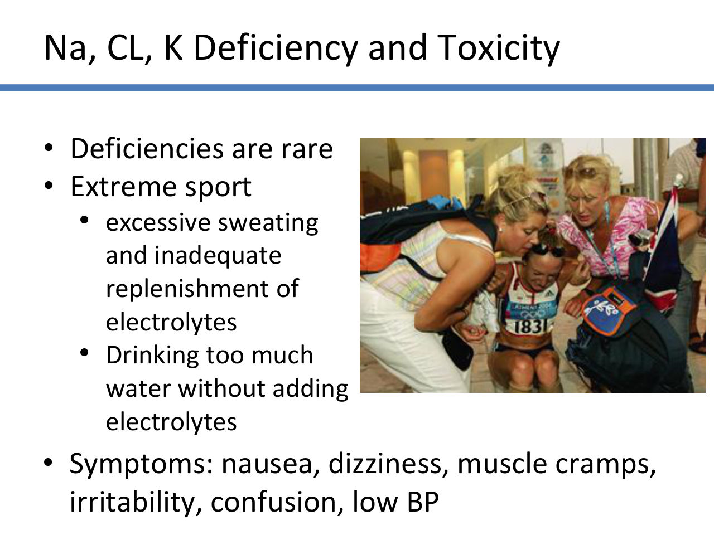

**Deficiencies are rare.** When they happen:

| Cause | Detail |
|---|---|
| **Extreme sport** | excessive sweating without replacing electrolytes |
| **Water intoxication** | drinking too much water without adding electrolytes |

**Symptoms:** nausea, dizziness, muscle cramps, irritability, confusion, **low blood pressure**.

 

**Belgium 2018:** a 20-year-old student died after a fraternity hazing ritual. He was made to drink **fish sauce**, alcohol, and stand in freezing water. He collapsed and died two days later of multiple organ failure. **The death was attributed to the salt content of the fish sauce.**

Salt is toxic in large single doses. The body cannot clear it fast enough.

 

### 🧠 Check
Give two situations that cause electrolyte deficiency.

Answer

Extreme sport with heavy sweating and no electrolyte replacement. Drinking too much water without electrolytes.

---

## Summary (slide 25)

- Sodium, chloride and potassium are electrolytes essential for fluid balance and nerve transmission.
- The renin-angiotensin-aldosterone system regulates sodium levels.
