# Topic 20 — Salt and health

Slides: Lecture 21 (Salt and health, recap), pages 2 to 17. Pages 18 to 55 are the exam recap.

---

## The big idea

Sodium holds water in the blood, so it sets **blood volume**, and blood volume sets **blood pressure**.

**High salt → hypertension → cardiovascular disease.** That is why every public health body runs a salt reduction campaign.

Irish adults eat **about 11 g (men) and 8.5 g (women)** of salt a day against a target of **6 g**. Most of it is hidden in **processed food**: bread, processed meat, meat dishes. Only 15–20% comes from the salt cellar.

Not everyone responds the same way. **Salt sensitivity** depends partly on genes such as **ACE**.

---

**How to use these notes:**
When you see 🧠, stop.
Say the answer out loud or write it down.
Then click to check.

---

## ⭐ Learn by heart from this topic

**The salt card.** Cover the right column and say it from memory.

| Ask | Answer |
|---|---|
| Chain | Sodium → blood volume → blood pressure → hypertension → CVD |
| Irish target, 11+ years | **6 g salt (2.4 g sodium)** a day. RDA 4 g |
| Irish actual | **11 g men, 8.5 g women** |
| Children | 1–3 years: target 2 g, actual 2.8 g (140%). 4–6 years: target 3 g, actual 3.6 g (120%) |
| 1 g salt contains | 0.4 g sodium and 0.6 g chloride |
| Label conversion | **Salt = 2.54 × sodium** |
| Where salt comes from | Manufactured foods **65–70%**; added in cooking and at table 15–20%; natural 15% |
| Top Irish food sources (NANS) | Breads 22–25%, cured and processed meats 18%, meat dishes 7–9%. Together **more than 50%** |
| Bread versus crisps | One slice of bread can have more salt than a bag of crisps |
| FSAI bread reformulation | Salt in bread **down 18–30% in 10 years** (2003–2012). White bread 1.4 → 1.1 g per 100 g |
| DASH diet | Dietary Approaches to Stop Hypertension: fruit, veg, low-fat dairy, less salt |
| Salt sensitivity | Not everyone's BP responds to salt. Genetics and lifestyle |
| ACE gene | GG variant: typical BP on high sodium. **GA or AA: elevated** BP on high sodium, and better response to a low-sodium diet |
| Nutrigenomics report | 7 in 10 people carry the risk variant; advice: limit sodium to 1500 mg/day |
| Worked day | Processed choices 3750–5350 mg sodium (too high). Home-made choices 901–1502 mg (as recommended) |

 

**Memory hook:** **Bread, bacon, ready meals: more than half the salt.** **Salt = 2.5 × sodium.** **6 g target, 11 g reality.**

---

## 1. Salt, blood pressure and heart disease

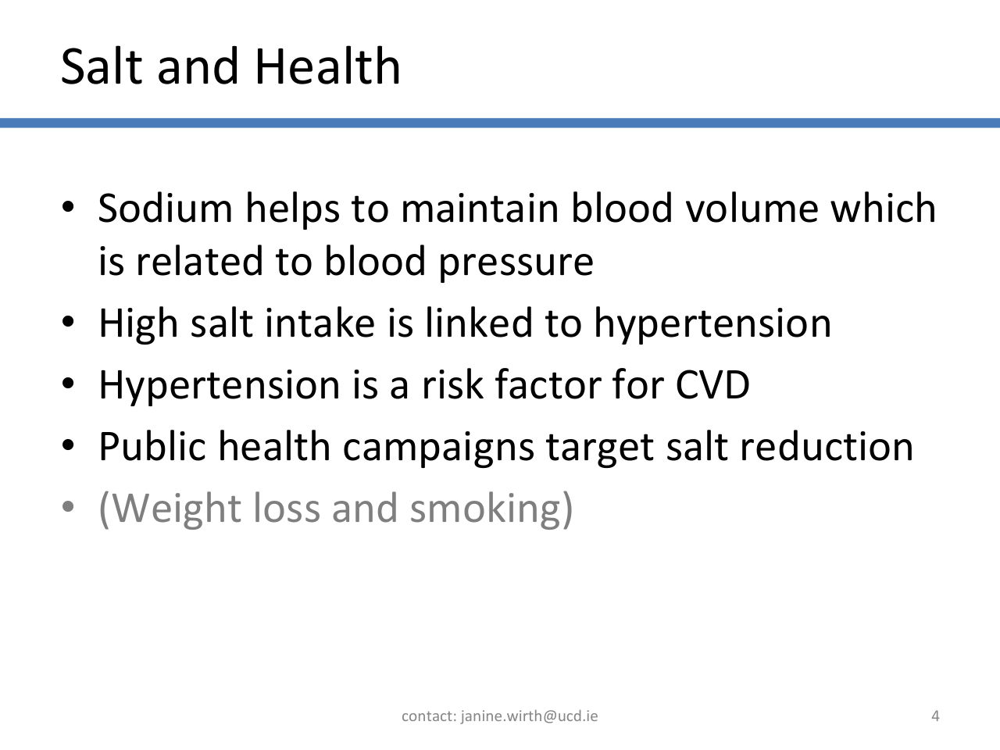

| Step | Link |
|---|---|
| 1 | Sodium helps maintain **blood volume** |
| 2 | Blood volume is related to **blood pressure** |
| 3 | High salt intake is linked to **hypertension** |
| 4 | Hypertension is a risk factor for **CVD** |
| 5 | So public health campaigns target **salt reduction** (alongside weight loss and stopping smoking) |

 

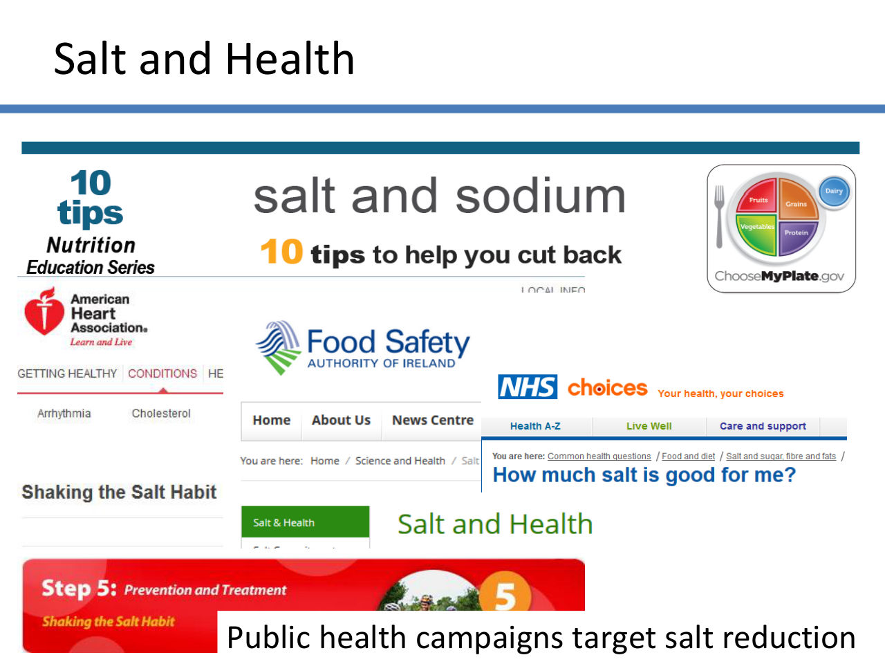

**How to read this slide:** logos from the American Heart Association, the Food Safety Authority of Ireland, the NHS and the US "10 tips" series. Everyone is saying the same thing.

 

**Link to Topic 19:** sodium retains water. More sodium, more water in the blood, more pressure on the vessel walls.

 

### 🧠 Check
Give the chain from salt intake to heart disease.

Answer

Salt → sodium → blood volume → blood pressure → hypertension → cardiovascular disease.

---

## 2. Irish salt intake: targets and reality

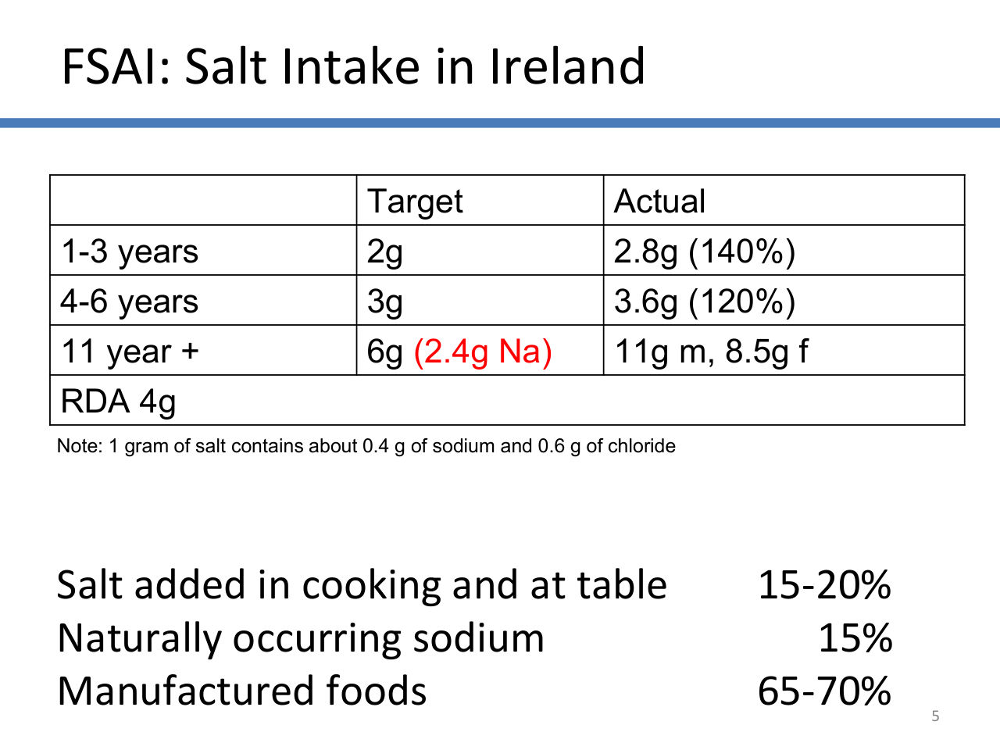

**How to read this table:** target on the left, what people actually eat on the right.

| Age | Target | Actual |
|---|---|---|
| 1–3 years | 2 g | 2.8 g (**140%** of target) |
| 4–6 years | 3 g | 3.6 g (120%) |
| **11 years and over** | **6 g (2.4 g sodium)** | **11 g men, 8.5 g women** |
| RDA | 4 g | |

Adults eat almost **double** the target.

 

**Where the salt comes from:**

| Source | Share |
|---|---|
| **Manufactured foods** | **65–70%** |
| Salt added in cooking and at the table | 15–20% |
| Naturally occurring sodium | 15% |

Throwing away the salt cellar removes only a fifth of intake.

 

**Note on the slide:** **1 g of salt contains about 0.4 g sodium and 0.6 g chloride.**

 

### 📐 Equation 1: Salt from the sodium on a food label

$$\text{g salt} = 2.54 \times \text{g sodium}$$

| Symbol | Meaning | Units |
|---|---|---|
| g salt | the salt equivalent of the sodium in the food | g |
| g sodium | the sodium figure on the label | g |
| 2.54 | 1 ÷ 0.39, the weight of NaCl per unit weight of Na | none |

**Why it holds:** sodium is 23 of the 58.5 in NaCl, so each gram of sodium stands for 2.54 g of salt. It is the reverse of Topic 19 Equation 1.

**Use it when:** a label gives sodium and you want to compare it with the 6 g salt target. Or a question gives salt and asks for sodium (divide by 2.54, or multiply by 0.4).

**Does not apply:** if the label already states salt. Then there is nothing to convert.

 

**Example:** a soup label says 0.8 g sodium per serving. 0.8 × 2.54 = **2.0 g salt**, a third of the day's target in one bowl.

 

### 🧠 Check
What is the Irish salt target for adults, and what do Irish men actually eat?

Answer

6 g a day (2.4 g sodium). Men eat about 11 g, women about 8.5 g.

---

## 3. Where Irish salt comes from (NANS)

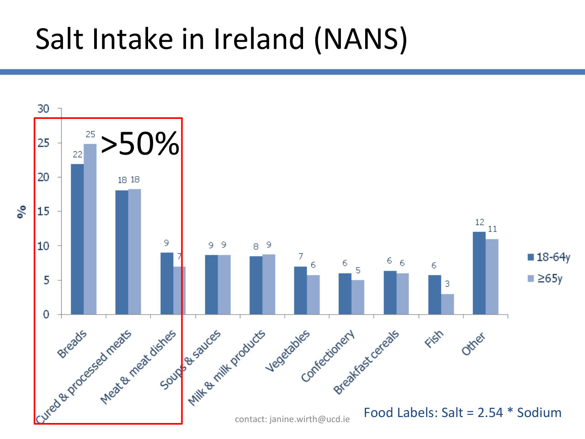

**How to read this graph:** share of salt intake by food group. Dark bars 18–64 years, light bars over 65. The red box marks the top three.

| Food group | Share of salt |
|---|---|
| **Breads** | **22–25%** |
| **Cured and processed meats** | **18%** |
| **Meat and meat dishes** | 7–9% |
| Soups and sauces | 9% |
| Milk and milk products | 8–9% |
| Vegetables | 6–7% |
| Confectionery | 5–6% |
| Breakfast cereals | 6% |
| Fish | 3–6% |

The top three together are **more than 50%**.

**Food labels: salt = 2.54 × sodium.**

 

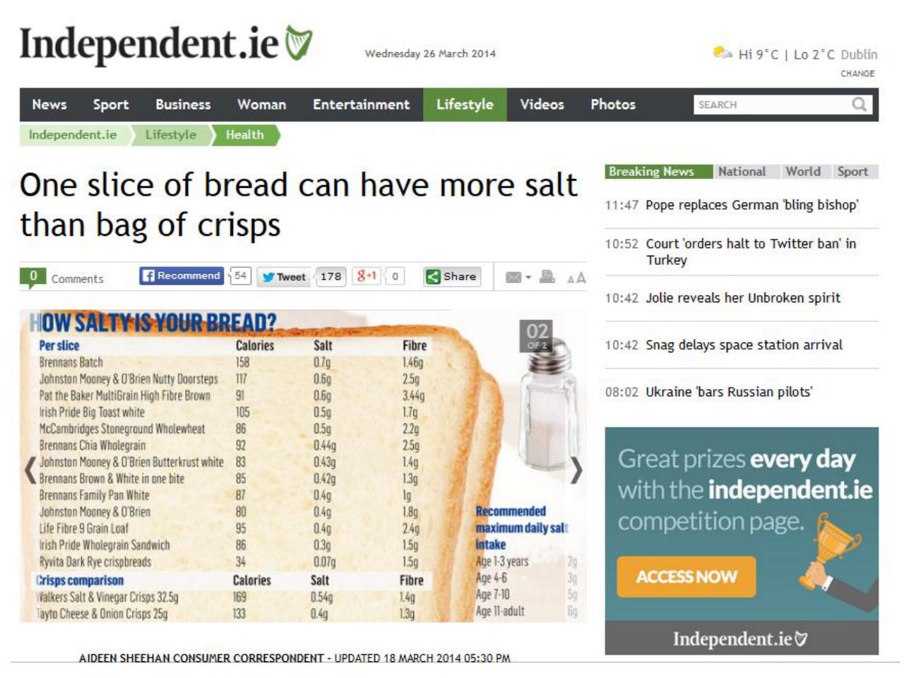

**How to read this slide:** a newspaper piece. **One slice of bread can have more salt than a bag of crisps.** Bread is not salty to taste but we eat a lot of it.

 

**Link to Topic 13 and 15:** bread is also the second source of calcium and the first source of iron in Ireland. Reformulating bread changes a lot of nutrients at once.

 

### 🧠 Check
Which three food groups give Irish adults more than half their salt?

Answer

Breads, cured and processed meats, meat and meat dishes.

---

## 4. Salt reduction in bread

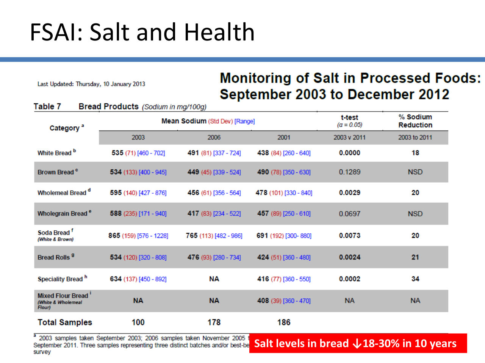

**How to read this slide:** FSAI measured sodium in bread in 2003, 2006 and 2011. Every row fell. White bread sodium 535 → 438 mg per 100 g, an **18%** cut. Bread rolls 534 → 476, 21%.

**Salt levels in bread fell 18–30% in 10 years** (2003–2012).

 

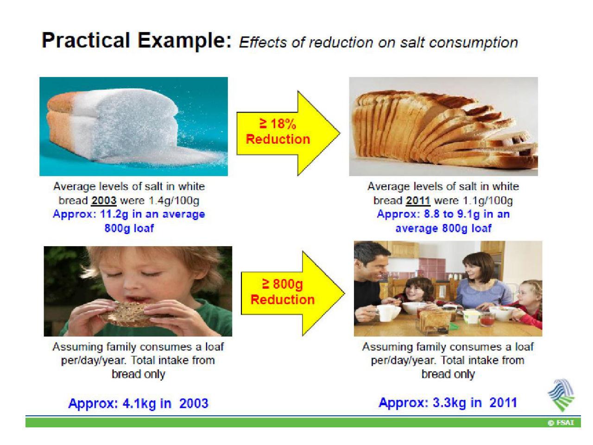

| | 2003 | 2011 | Change |
|---|---|---|---|
| Salt in white bread | 1.4 g per 100 g | 1.1 g per 100 g | **≥ 18%** |
| Salt in an 800 g loaf | 11.2 g | 8.8–9.1 g | |
| Family eating a loaf a day, per year | 4.1 kg salt | 3.3 kg salt | **≥ 800 g less** |

This is the "major drop in population sodium consumption" strategy: change the food, not the person.

 

### 🧠 Check
By how much did salt in Irish bread fall between 2003 and 2012?

Answer

18–30%. White bread went from 1.4 to 1.1 g per 100 g.

---

## 5. DASH diet

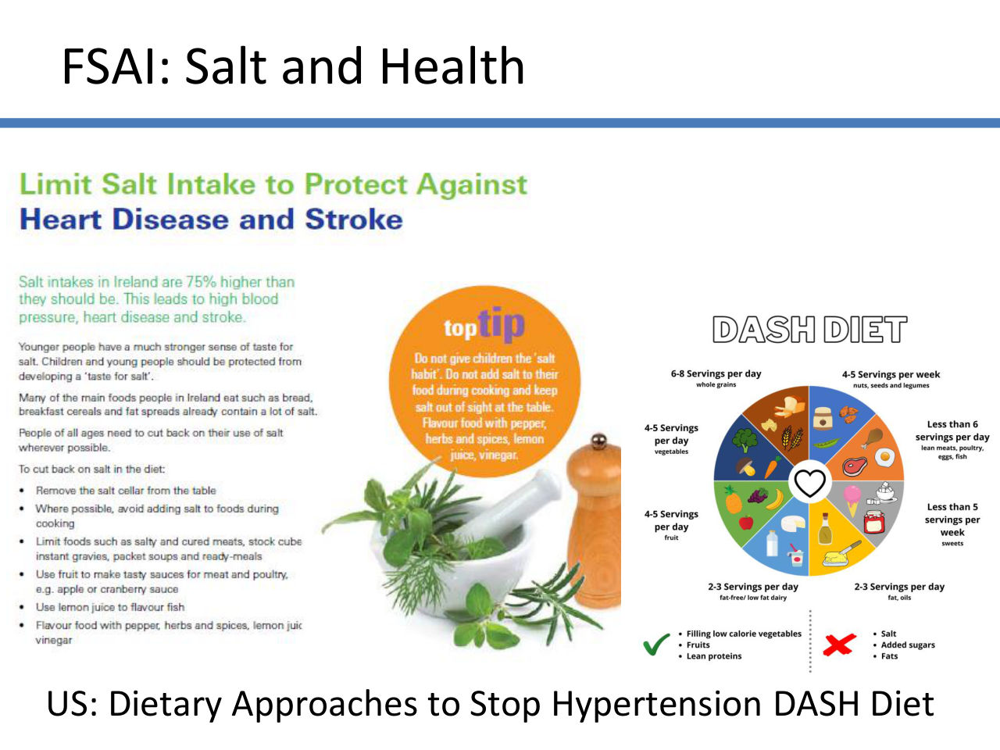

**How to read this slide:** left, the FSAI leaflet "Limit salt intake to protect against heart disease and stroke". Right, the **DASH diet** plate.

**DASH = Dietary Approaches to Stop Hypertension** (US).

| Eat more | Eat less |
|---|---|
| vegetables (4–5 servings a day) | salt |
| fruit (4–5 a day) | added sugars |
| low-fat dairy (2–3 a day) | fats |
| whole grains, nuts, seeds, legumes | red meat (less than 6 servings a week) |

The diet is high in **potassium, calcium and magnesium** and low in sodium. All four of those minerals affect blood pressure.

 

**Link to Topic 19:** 3.5 g of potassium a day is "optimal". DASH is how you get there.

 

### 🧠 Check
What does DASH stand for?

Answer

Dietary Approaches to Stop Hypertension.

---

## 6. Salt sensitivity and the ACE gene

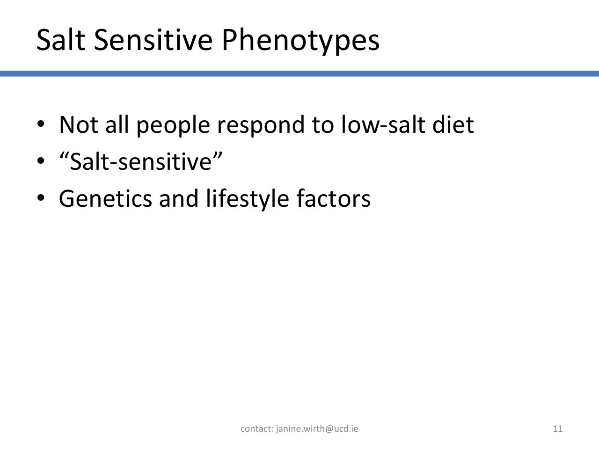

- **Not all people respond to a low-salt diet.**
- Those who do are **"salt-sensitive"**.
- It depends on **genetics and lifestyle factors**.

 

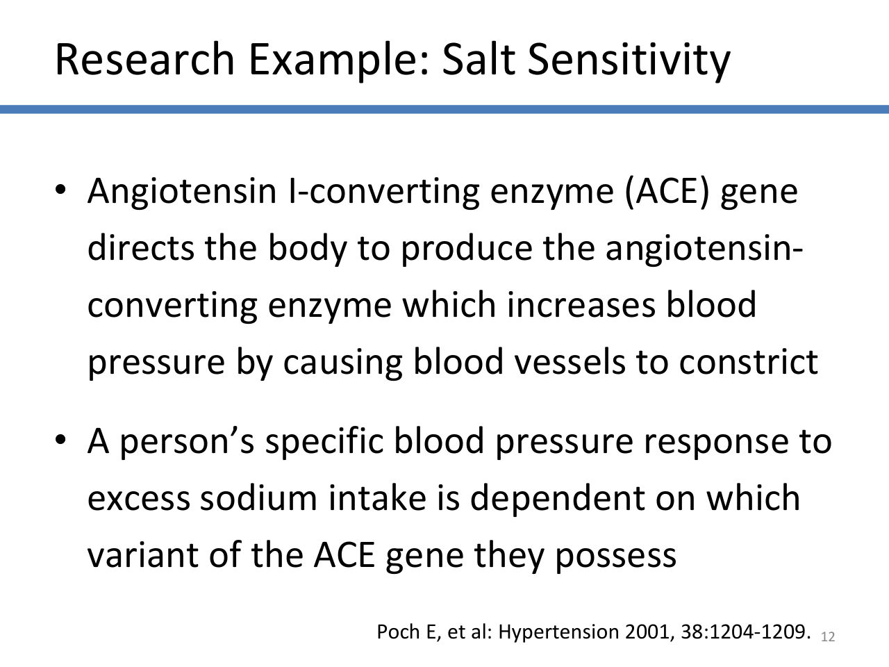

| Fact | Detail |
|---|---|
| The gene | **Angiotensin I-converting enzyme (ACE)** |
| What it makes | the enzyme that raises blood pressure by making blood vessels **constrict** (Topic 19 §7) |
| The finding | a person's blood pressure response to excess sodium **depends on which variant of the ACE gene they have** (Poch et al, Hypertension 2001) |

 

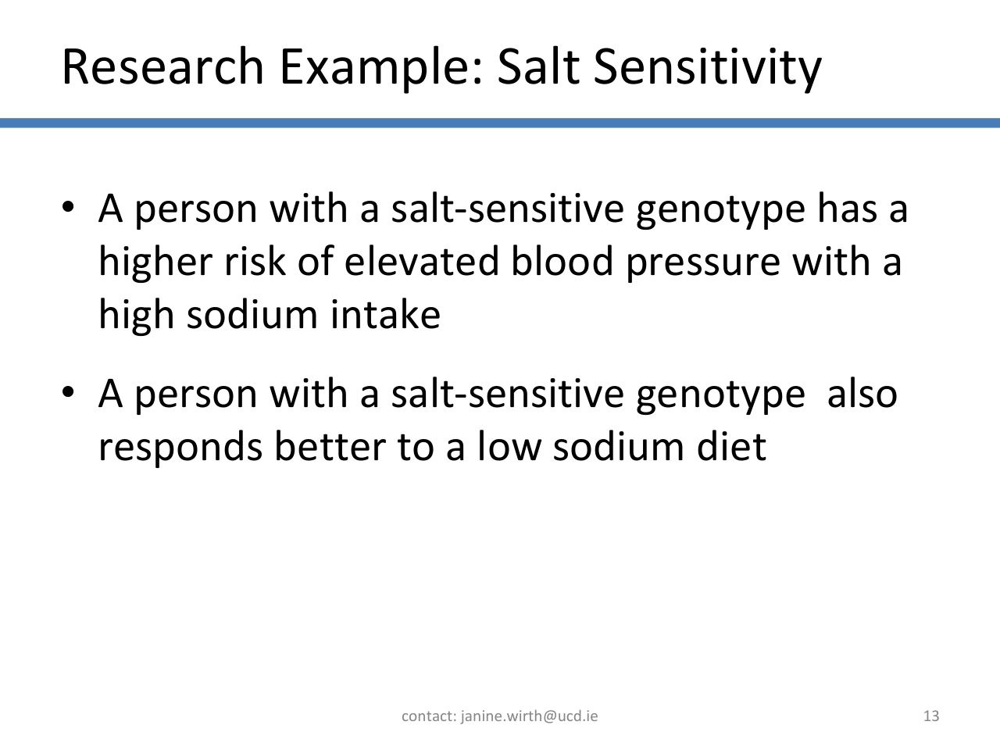

A person with a **salt-sensitive genotype**:

1. has a **higher risk of elevated blood pressure** with a high sodium intake, and
2. **responds better to a low sodium diet**.

 

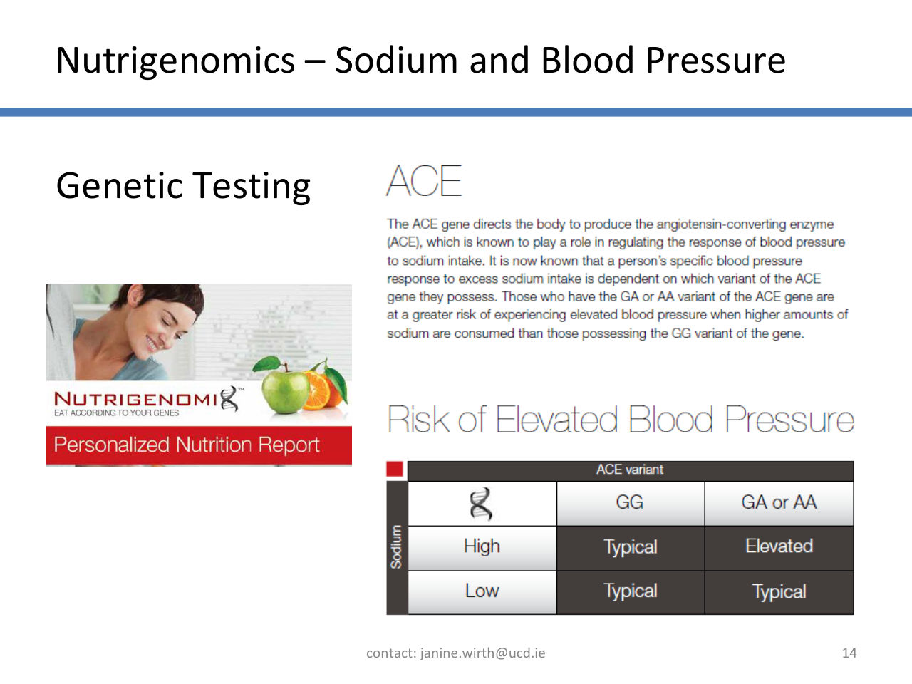

**How to read this slide:** a commercial genetic test report. The grid shows the risk of elevated blood pressure by ACE variant and sodium intake.

| | GG variant | GA or AA variant |
|---|---|---|
| **High sodium** | Typical | **Elevated** |
| Low sodium | Typical | Typical |

 

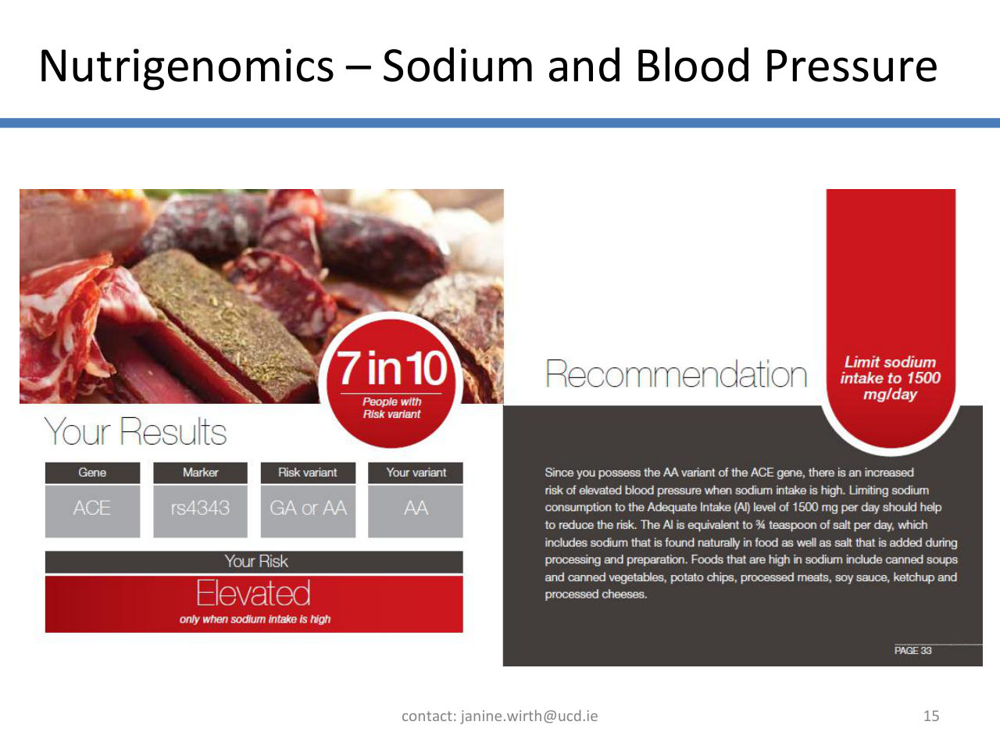

The report says **7 in 10 people** carry the risk variant (GA or AA), and recommends limiting sodium to **1500 mg/day** for them.

 

### 🧠 Check
Which ACE variants raise blood pressure on a high-sodium diet?

Answer

GA or AA. The GG variant has a typical response.

---

## 7. A day of sodium: two menus

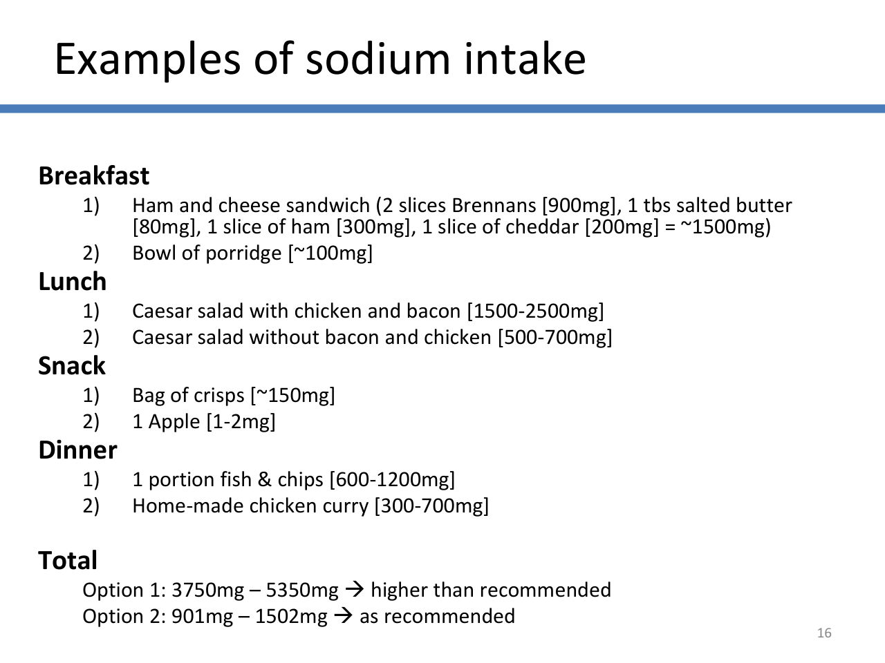

**How to read this slide:** two choices at each meal. Option 1 is processed, option 2 is plainer.

| Meal | Option 1 | mg Na | Option 2 | mg Na |
|---|---|---|---|---|
| Breakfast | Ham and cheese sandwich (2 slices bread 900, butter 80, ham 300, cheddar 200) | ~1500 | Bowl of porridge | ~100 |
| Lunch | Caesar salad with chicken and bacon | 1500–2500 | Caesar salad without bacon and chicken | 500–700 |
| Snack | Bag of crisps | ~150 | 1 apple | 1–2 |
| Dinner | Fish and chips | 600–1200 | Home-made chicken curry | 300–700 |
| **Total** | | **3750–5350 mg** | | **901–1502 mg** |

Option 1 is **higher than recommended** (2400 mg sodium = 6 g salt). Option 2 is **as recommended**.

Notice the sandwich: two slices of bread alone carry 900 mg sodium, more than the crisps and the chips put together.

 

### 🧠 Check
Convert the Option 1 range to salt using the 2.54 rule.

Answer

3750 mg = 3.75 g sodium × 2.54 = about 9.5 g salt. 5350 mg = 5.35 × 2.54 = about 13.6 g salt. Both well above 6 g.

---

## 8. What the lecturer said to learn for the exam (slides 19 and 55)

**Slide 19, the headings to revise for every mineral:**

| Area | What to know |
|---|---|
| Overall | Major minerals versus trace elements, with examples |
| Functions | Muscle contraction, nerve transmission, bone structure, electrolytes, membrane and DNA components, enzyme reactions, immune system, energy metabolism, oxygen transport, thyroid function. Interplay with other nutrients. Main storage site |
| Sources and requirements | Main sources. PRI, AI, requirements, units, equivalents |
| Deficiency and toxicity | Assessment tests. Main symptoms. Who is at higher risk. Upper limits |
| Absorption, metabolism, regulation | Active versus passive transport. Hormones and responding organs (intestine, kidney, bone). Absorption rate and what changes it. Excretion |

 

**Slide 55, the example question templates:**

1. What is the major function of {mineral}?
2. {Food example} is a high source of {mineral}. True or false?
3. Which hormone or transport protein is involved in absorption or homeostasis of {mineral}?
4. A portion of {food} contains {amount}. How many portions does an adult need to reach the RDA?

The 📐 portion equations in Topics 13 and 15 are built for question 4.

---

## Summary (slide 17)

- Most salt comes from processed and prepared foods, not the salt shaker.
- Sodium is an essential electrolyte for nerve conduction, muscle contraction and fluid balance.
- The renin-angiotensin-aldosterone system regulates sodium.
- Excess intake strongly influences blood pressure and cardiovascular risk.
- Salt sensitivity = the degree to which a person's blood pressure responds to sodium. Not everyone reacts equally.
- Salt reduction strategy: a major drop in population sodium consumption by reformulating food.
